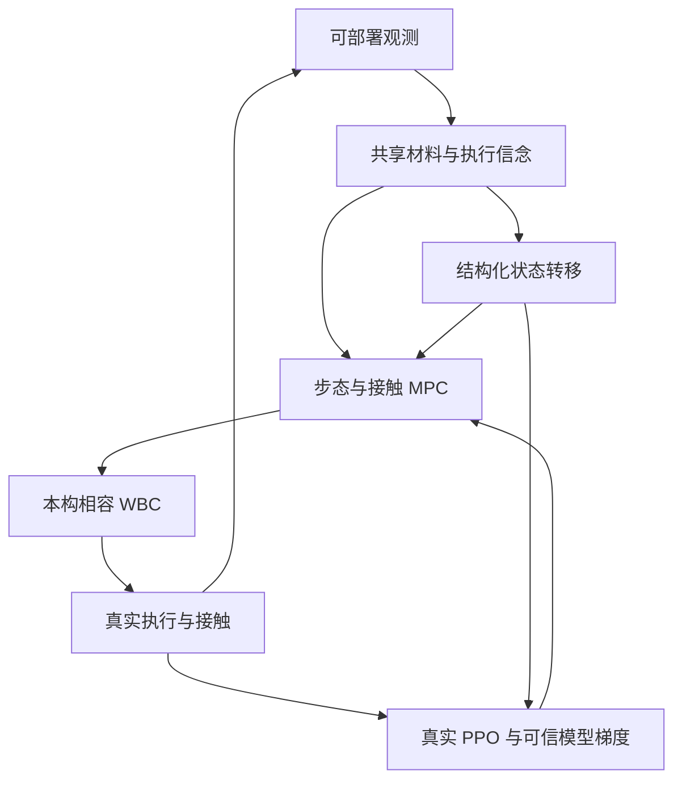

# S1：从当前失败证据到 PANN、步态、MPC、WBC、PPO 内部机制的研究设计

日期：2026-11-26，Asia/Shanghai。研究审计基点：`b58f3330117a25add223ca34e66f40450227b016`。本文是文献与算法设计，不是已实现或已验证的新算法报告。审计过程中 W59 仍在运行，后续提交可能有新结果；本文所有状态数字均属于该固定快照。发布前另回读`e1b78f282c409f5152acd946e810cbf921867edf`的W59索引与每日记录：仍为114次尝试、108次终局、6条运行中，B3/Fixed-action资格不变，未形成推翻本报告判断的新actor更新证据。

## 0. 结论与范围

目前已经有可供研究的稳定仿真基线，但“材料历史能够改善步态与任务收益”的闭环证据仍不足。用户提出的创新标准成立：沿用前人的物理结构、优化器或学习范式，只要提出了针对未解决问题的实质机制、明确适用条件并通过有辨识力的对照，仍然可以形成创新。不能因为某个词在论文里出现过就否定，也不能仅以换网络、加奖励或模块相连来证明贡献。

建议把科学问题明确为：**具有恢复和迟滞的同一物理地块，被不同足依次加载时，如何仅凭可部署观测，联合决定步态、落点、触地速度和承载轨迹，并在有限计算预算下保持可靠执行？**

据此，PANN 要改变势函数辨识与状态估计；MPC 要改变预测状态、优化变量和风险约束；WBC 要改变接触相容关系；PPO 要改变动作分解、价值表征和更新方向；世界模型负责这些模块共同使用的状态转移。方案要求四个模块分别产生可检验的内部改动，但论文贡献宜凝聚为三项：可观测材料记忆、材料历史条件下的步态与接触优化、真实学习与可信模型梯度的联合算法。

本文学习算法中的“真实执行/真实前向”指物理仿真器与完整控制栈产生的实际轨迹，相对于WM想象轨迹；实机证据另行验证。

本次使用三个并行研究支线查阅材料、控制/步态、学习/联合算法。没有启动新仿真或训练，没有运行官方方法的复现实验，没有修改活动 W59 控制代码，没有搬移或删除原始数据。官方 SuperMimic 是唯一 SuperMimic 方法与代码依据；用户个人复现不参与本项目判断。也没有把此次源码与文献阅读说成仓库全部二进制逐字节阅读。

## 1. 现有实现与真正需要改动的部分

| 模块 | 现有实现，已核对源码 | 当前增量的边界 | 候选的内部改造 |
|---|---|---|---|
| PANN | 原论文的平衡/过应力 FICNN 势、PICNN 耗散；训练辅助 LSTM；部署隐式材料求解。已有自由恢复边界 | W59 M3 只拟合释放混合、共同恢复率、重载增益三个标量；没有改神经势或内部变量方程 | 从整足合力条件下重训能量/耗散与恢复谱；共享材料信念；直接约束重载后果和动作响应 |
| 步态 | 稳定 F 接触状态机；三维请求为交接时间、载荷斜坡、力分配偏置 | 落点与步态形态仍受到原结构限制，不能把请求发出等同实际改变 | 混合离散接触序列与连续相位、占空比、落点、触地速度；根据实际承载事件修正 |
| MPC | 质心/接触力 QP，历史模型参与候选评估；W59 偏置修改力参考线性项 | 当前三维 hook 没有把材料状态、变形及落点作为统一预测/优化对象 | 持久材料状态进入时域；联立时序、足印、载荷；风险与可恢复性约束 |
| WBC | 已有真实动力学/输入约束、球足实际接触点处理、材料法向逆解参考；r52/r58 等确有实质工程修改 | 当前材料主要通过位置/加速度任务参考进入；不是材料本构与机器人加速度联立的新优化核 | 加入压陷/压陷加速度，约束本构一致性、接触阶段与动力学，限制冲击及力变化 |
| PPO | 已有原始 raw/logp_raw、封存策略核对、真实时间折扣/GAE、Adam 后 KL 回滚 | PPO-full 为标准 clip 更新；Diff 分支用想象 actor loss，两者尚非一个联合更新 | 混合事件动作、跨足重载价值表征、真实 PPO 主更新与可信局部模型梯度组合 |
| 世界模型 | 黑盒与结构模型；结构模型包含已知动力学与接触/执行残差 | 训练及候选多步展开存在冻结刚体映射近似，预测误差小不代表局部导数对 | 沿构型重算动力学及一致反向，稳定多率积分，共享材料/执行状态，干预响应监督 |

源码证据：[`material.py`](../src/tm02/material.py)、[`s1_material.py`](../src/tm02/s1_material.py)、[`s1_w59_model_recovery.py`](../scripts/s1_w59_model_recovery.py)、[`s1_w59_f_backend.py`](../scripts/s1_w59_f_backend.py)、[`s1_w54_f_r52_backend.py`](../scripts/s1_w54_f_r52_backend.py)、[`s1_w56_f_r58_backend.py`](../scripts/s1_w56_f_r58_backend.py)、[`s1_w59_learning.py`](../scripts/s1_w59_learning.py)、[`s1_w59_learner_update.py`](../scripts/s1_w59_learner_update.py)、[`s1_w59_model.py`](../scripts/s1_w59_model.py)。读取沿继承链进行，不能拿最早 w54 的常刚度注释代表当前 r58 的非线性材料法向逆解。

### 1.1 当前证据支持哪些结论

- W57 的 PR A/B 有各自 E600 通过证据，因此有稳定仿真研究基线。它是接触力 QP MPC＋WBC＋PD 的 F 路线，不是原始全身 iLQG N。不能据此宣布实机部署或一般地面鲁棒性完成。
- W58 的 3413 次非空历史干预没有改变候选胜者；候选只改变很短等待，缺少落点/足印与加载形态选择。这指向“动作与问题尺度是否匹配”，也可能包括材料历史信号弱，不能直接归咎算法名称。
- W59 的 M3 在两组 B 开发统计中，首次重载整足力误差从 0.15196 降至 0.07002 N、从 0.17922 降至 0.10313 N，约下降 53.9% 与 42.5%。这是离线候选证据；`accepted_physical=false`，不能当作步态或任务收益提升。
- 结构 WM 的一个 **10k** 节点在 547 个开发起点上，0.10 s 法向力 MAE 约 20.64 N，0.35 s 已约 14946 N；2 s 有限结果只有 215/547。已有 **50k** 权重不能被这个 10k 结果自动判失败，也不能因训练损失下降就视为修复。
- R3 的 5 子步有 72 个方向，36 个可分辨、28 个正确：36/72=50.0% 是可分辨覆盖率，28/36=77.8% 是可分辨条件下正确率，28/72=38.9% 是全部方向中“可分辨且正确”的比例；三者不能互换。17 子步结果更弱。该快照记录可信路径梯度时域为 0，新 W59 actor 更新仍为 0；32 子步中断已记录为想象状态下质量矩阵 `Singular matrix`，不是完整检验得分。
- 新 W59 B3、Fixed-action A/B E30/E60 资格通过，不能替 P3 或新联合策略背书。步态不能只看机身不倒：W59 重新按实际接触点统计后，G1 滑移结论与旧球心口径不同，两个定义须保留并解释。

证据入口：[`W58审查`](S1_W58_REVIEW_20261126.md)、[`W59索引`](../results/terrain_memory/simulation/tm-s1-go2-local-readiness-r12/w59/index.json)、[`M3`](../results/terrain_memory/simulation/tm-s1-go2-local-readiness-r12/w59/model/recovery.json)、[`R3五子步`](../results/terrain_memory/simulation/tm-s1-go2-local-readiness-r12/w59/learning/development-r3-05-substeps.json)、[`每日记录`](S1_DAILY_WORKLOG.md)。

这些负结果值得利用：它们把研究问题从“再调一点参数”推进到材料可观测性、接触事件、动作权限、局部梯度与长时信用。

## 2. 检索顺序、版本与分区证据

按 Nature 系、Science 系、2025 中科院高分区期刊、相关顶会的优先级检索，并补充截至本日的直接相关预印本。刊名、发表状态和阅读版本分别登记，不能混用预印本与正式版的实验细节。

2025 分区采用大类口径；[丽水学院转述的2025分区规则](https://kyc.lsu.edu.cn/2025/0327/c2834a353049/page.htm)写明大类一区归为 Top，因此“一区 Top / 一区”在该口径下重合。T-RO 的一区 Top 有[吉林大学2025公开说明](https://sai.jlu.edu.cn/info/1026/5155.htm)，CMAME 有[上海师大2025说明](https://jiangong.shnu.edu.cn/99/9e/c26809a825758/page.htm)，RA-L 二区 Top 有[福州大学教师页对2025文章的标注](https://jxxy.fzu.edu.cn/info/1219/7899.htm)。这些是高校公开交叉证据，仍不冒充完整官方原表逐刊核验。其他刊物的 2025 大类/Top 尚待原表复核，不拿 JCR Q1 或影响因子替代，也不为填满每一档列入低相关论文。

核心来源、正文阅读位置与代码范围见[文献证据表](research/20261126-kernel-innovation/source-ledger.md)。这里记录直接改变设计的结论。

| 优先层次与论文 | 实际方法，及它对本项目的约束 |
|---|---|
| [Nature Machine Intelligence 2025，Bio-inspired Gait Strategies](https://www.nature.com/articles/s42256-025-01065-z) | 已有双层 PPO、反馈步态调节、步态记忆与切换，结合能耗、接触和执行器指标。只加相位/占空比不够；我们需要检验同一地块的材料历史如何改变下一足承载决策。 |
| [Nature Communications 2024，DeepTransition](https://www.nature.com/articles/s41467-024-47443-w) | CPG＋RL 以存活/可行性解释步态转换。精读的是作者预印本；实机演示用预知的等价地形距离，不能误写为全自主感知泛化。 |
| [Nature Computational Science 2024，Custom Thermodynamics](https://arxiv.org/html/2308.04119v3) | 学低维闭合态并约束耗散/保守动力学；训练观测远丰富于机器狗整足力。可借鉴状态结构，不能移植为任意软地可辨识或闭环稳定证明。 |
| [Science Robotics 2024，DTC](https://arxiv.org/html/2309.15462v2) | 在线轨迹优化提供参考，RL 学低层跟踪；过频重规划会让规划器迁就弱跟踪。启发联合训练必须检测真实执行误差，并正确安排事件重规划。 |
| [T-RO，Perceptive NMPC](https://arxiv.org/pdf/2208.08373) | 全身/质心动力学、局部落足区域、实时迭代和事件反馈；其步态仍外给。已有提前/延后接触反馈，不能仅靠添加该接口主张新颖性。 |
| [T-RO，STANCE](https://iit-dlslab.github.io/papers/fahmi19tro.pdf) | 已把形变作为 WBC 变量，联立 Kelvin–Voigt 力关系与足端加速度。其无记忆局部线性材料与外部定位条件，是本项目明确的比较对象。 |
| [CMAME 2026，有限应变 PANN](https://arxiv.org/html/2511.02959v1) | 已有多 Maxwell、门控删模态、结构化势及隐式指数积分。它们是可用基础；不可压弹性体结论不等于砂土压密。 |
| [Computational Mechanics 2024，原 PANN](https://arxiv.org/html/2401.14270v1) | 自由能、耗散、隐式演化与辅助 LSTM 已存在。改动应落在可观测辨识、释放/重载训练和控制相关响应。 |
| [JMPS 2026，隐变量可辨识性](https://arxiv.org/html/2605.14179v1) | 可辨识结论有严格凸性、可达性、输入覆盖等假设，仅确定状态等价类；整足合力下不能承诺恢复每格 oracle 状态。 |
| [T-RO 2026，Residual MPC；本轮读作者2025版](https://arxiv.org/html/2510.12717v1) | 标准 PPO 与 MPC 残差已有；接触切换时残差很关键。新方法应解释如何在可行接触空间中学习，而非无约束叠加关节力矩。 |
| [CoRL 2026，官方 SuperMimic](https://arxiv.org/pdf/2610.28480v3) | 冻结 WM 参数、保留输入导数，用短想象更新 actor；critic 来自想象转移。它不是“改了 PPO”，也没有解决本项目材料历史与硬门执行。 |
| [CoRL 2025 DMO](https://arxiv.org/html/2509.00215v2)；[ICLR 2025 PWM](https://arxiv.org/html/2407.02466v3) | DMO 用真实前向、模型反向缓解滚动漂移；PWM 区分预测精度与可优化性。两者都不能保证错误局部导数成为正确方向。 |
| [DynaMimic](https://arxiv.org/html/2611.32944v1)、[Trust What Repeats](https://arxiv.org/html/2611.27648v1)，2026-11 | 前者学习接触作用并反复计算已知动力学；后者用重复性与真实方向检验研究梯度失真。它们是直接近邻，必须纳入对照与边界。 |

### 2.1 四项深读后直接改变方案的细节

**步态不应只有节拍。**BGS 的参考生成本来就随状态变化；WTW 也已有连续步态参数。候选新增是用卸载历史、恢复不确定性和将来足印复用决定接触顺序与承载形状，同时区分触地、反弹、稳定承载。已有接触反馈并不使这一新问题失去研究意义。

**软 WBC 应比较 STANCE，而不只比较刚地 WBC。**STANCE 已有力—变形与加速度相容关系；我们拟研究非线性迟滞状态、相容切线、跨足共享历史和观测不确定性，并避免依赖无漂移外部动捕。若仅把 KV 换成另一个常刚度，贡献有限。

**“物理＋WM”要核查离散化。**DynaMimic 的20 ms预测内含更细的接触作用与两次动力学更新；项目当前冻结映射并不等价。重算本身是修复近似，不自动构成论文创新；材料与执行记忆及真实响应校准才是进一步研究点。

**真实前向也不保证反向正确。**DMO 可以去掉想象状态漂移，但硬门导致零执行影响或模型局部 Jacobian 错误时仍会误导更新。SuperMimic 官方 critic 主要来自想象轨迹；项目应保留真实任务回报的独立价值依据。

## 3. 总体设计：共享物理状态，分别控制学习责任

将状态写成机器人状态 x、世界坐标材料信念 b、控制器执行记忆 c。b 包含慢材料参数、快速恢复状态及必要不确定性；c 包含相位、接触确认、实际载荷、持有命令、上次请求与尚未完成的交接。

“共享”指同一材料历史、接触作用、执行语义和版本在估计、规划、学习中一致；不意味着所有损失同时更新所有参数。训练时允许较重模型；部署时保留小型物理核、低维信念、短时规划与 WBC。

## 4. PANN 内核：学习重载后果，而非只调整预测力增益

### 4.1 需要改变的方程与输入

保留广义标准材料结构，用少量候选恢复分支与慢参数 eta 条件化势：

\[
\Psi_\theta(\epsilon,z;\eta)=\Psi_{eq,\theta}(\epsilon;\eta)+\sum_r\Psi_{r,\theta}(\epsilon-z_r;\eta),\quad
\sigma=\partial_\epsilon\Psi_\theta,\quad
0=\partial_{\dot z}\Phi_\theta+\partial_z\Psi_\theta.
\]

势及条件化路径必须保留所需凸性/耗散约束。热力学约束针对固定参数的物理推进；在线参数辨识、状态校正与模型版本切换分别记账。参数在控制周期内冻结，更新前检查预测能量/接触力跳变，不能把估计修正解释为真实材料耗散。若参数本身是变化的物理状态，能量平衡须包含相应参数变化项。先比较同容量单模态重训与少量体积/偏量或多时间尺度分支，不预设网络越大越好。零牵引自由恢复和隐式 Newton 是已有基础，继续使用，不列作新贡献。

真正变化是：通过现有接触边界和整足聚合，从加载—卸载—等待—异足重载的可观测轨迹直接训练势参数与状态估计。仅有受载曲线拟合时，恢复谱可能对下一次踩踏没有约束；M3 的共同指数补丁应作为强对照，而不是最后的物理解释。

### 4.2 从不可观测点状态改为控制相关信念

观测是整足合力：

\[
F_t=\sum_{j\in\mathcal A_t}A_j\sigma_{n,j}(\epsilon_j,z_j;\eta)+\nu_t.
\]

M1已经实现世界坐标材料账本、跨足访问关联和整足观测修正，且Ground已有懒执行的未来零载传播。新增研究是可辨识方向上的约束更新、慢参数/快状态的不确定性校准，以及直接面向重载和控制响应的训练，不是第一次加入跨足地图或延迟恢复计算。

一个合力不能唯一辨识许多单元状态。用有限历史的受约束估计更新可观测投影，对弱信息方向保留宽区间或少量假设；足印面积、接触点和定位误差也进入不确定性。同一物理地点被另一只足访问时继续该地点历史，不能按腿编号复制四套互不关联的材料真值。

训练损失包含整足力、可观测压陷/运动、释放后重载响应与成对动作差分；校准集和训练集按完整历史/地图分离。隐变量坐标的数值接近 oracle 不是验收条件，未见历史下的力/压陷分布与候选排序更重要。

### 4.3 何时可称为方法贡献

同标签、同预算比较原 PANN、M3、仅加载重训、含释放/重载重训、共享信念。只有当重载预测、真实动作响应与控制收益共同改善，且合力噪声/足印错位下仍成立，才能支持贡献。若只是加数据就解决，应如实归因数据覆盖；若多模态不优于单模态，不把多模态写成必需机制。

## 5. 可微动力学与世界模型：同一接触作用推进身体和材料

物理块使用

\[
M(q)\dot v+h(q,v)=S^T\tau+J(q)^T\lambda+r_\phi.
\]

刚体惯性与运动学使用已知结构；PANN 解释法向材料恢复/承载；学习项解释明确定义的剩余执行、摩擦和接触误差。限制残差容量并诊断残差占比，防止它绕过 PANN 把任何错误吞掉。训练和规划必须使用同一预测接触作用更新身体与材料，不能一个用预测力、另一个偷用未来真实力。

独立比较三项：沿预测构型重算 M/J/h；按驱动保持与接触变化使用稳定多率积分；监督对真实执行请求的响应。重算数值时若切断构型导数，必须标为近似反向并验证，不能把它称完整可微动力学。

WM 验收拆为一步状态/力、自由多步展开、真实轨迹附近导数、候选排序及最终控制收益。按触地/反弹/承载/卸载分层，避免大量平稳样本掩盖切换错误。50k 权重需独立复测；不从10k发散推断所有后继权重失败。

DMO 式真实前向分支可以与自由想象并行比较：前者用于判别是否主要是滚动漂移，不能修复不正确的局部响应。真实前向必须对应当前动作；不能把旧轨迹的 next state 当新 actor 动作的真实后果。

## 6. 步态与 MPC：同时改变接触时间、空间和加载轨迹

### 6.1 步态变量有明确的执行语义

离散变量选择少量可行接触序列/继续承载/交接/恢复模式；连续变量包含周期、相位偏移、占空比、落点偏移、触地法向速度和载荷曲线系数。先从有明确作用的少量变量开始，逐项验证请求可改变实际轨迹。

材料历史影响的应是具体选择：恢复不足的旧足印是否绕开；能否提前轻触探测；在相同任务时间内如何调整承载增长；是否暂时维持另一足支撑。单纯延长等待、放慢速度造成的奖励变化必须由固定命令/相同时间的对照排除。

### 6.2 MPC 的状态、目标、约束全部改变

预测状态纳入局部被访问材料信念与接触阶段；决策变量为足印、阶段时长、接触力和必要的形变摘要。每个候选持有独立材料副本，避免候选评估相互污染。重叠足印使用同一物理地块，不重复计算支撑能力或把同一地面反力分配两次。

候选目标为

\[
\min \mathbb E\!\left[\sum_k\ell_{task}+\lambda_E\ell_{power}+\lambda_s\ell_{slip}+\lambda_i\ell_{impact}\right]
+\lambda_R\operatorname{CVaR}_{\alpha}(\ell_{failure})+V_{term}(x_H,b_H,c_H).
\]

这是拟研究形式，不是已验证的风险保证。共同地块造成的跨足相关误差须共同传播，不能把承载概率直接乘最大力就当作鲁棒支撑约束。材料承载分位数约束、力矩/摩擦/运动学约束、支撑可达性，以及下一足稳定承载前的交接条件共同限制计划。当前力 QP 应作为速度与效果基线。终值需看未恢复材料与后续再访问，避免短时域只将损失推到时域外。

离散接触模式在较慢事件层用小候选集比较，连续量用热启动 SQP/实时迭代或局部凸子问题；不把一个巨大混合整数问题放进每次 WBC。接触反馈已有先例，新增应体现在跨足历史影响的联合空间/时间决策与尾部控制效果。

### 6.3 以决策误差安排计算

若对有限候选集确有统一误差界 `|J_hat(a)-J(a)| <= epsilon`，则预测最优候选的真实代价 regret 至多 `2*epsilon`。这一简单条件关系可用于研究何时加密材料积分、延长模型时域或追加候选值得；它不是新定理，也不意味着 ensemble 方差就是误差界。

实际应在独立历史上校准区间，检查候选代价间隔是否大于不确定性。若排序证据不足，使用已验证的保守可行候选，并记录无法区分；不靠模型自己报置信度宣称安全。在未见材料分布上，原校准覆盖不自动成立。

## 7. WBC 内核：把材料相容性纳入优化

现有 r58 通过材料逆解给法向参考，已经比常刚度补偿更进一步。下一步改变 QP 的变量与约束：加入法向压陷/压陷加速度和受限松弛，与 qddot、接触力共同求解。

以固定接触活动集 A 下的离散材料解为起点：

\[
\lambda_{n,k+1}=\mathcal F_\theta(\delta_{k+1},b_k,\Delta t;\mathcal A).
\]

首版可消去内部状态，对隐式解算器取总导数，获得包含恢复响应的算法切线，再将下一时刻压陷通过离散积分与 qddot 相连。若把内部状态作为独立变量，就必须同时加入线性化材料演化残差；不能既用总导数又把同一内部状态修正叠加一次。速度只有在离散模型将它作为独立输入时才另列，不能把另调阻尼冒充PANN一致切线。

定义压陷为沿法向的相对位移 `delta = n^T(p_ref - p_c)`。当前平面TM02、局部冻结法向时，相容关系为

\[
n^T(J_c\ddot q+\dot J_cv)=n^Ta_{ref}-\ddot\delta.
\]

J_c须对应所定义的实际接触几何点与球足滚动运动。若拓展到变化法向，压陷二阶导还包含 `2*n_dot^T*(v_ref-v_c) + n_ddot^T*(p_ref-p_c)`；平面简式不能当一般曲面恒等式。参考点不等同变形中的表面，必须保持压陷定义一致。

对于非线性与观测误差，用有界、可记录松弛处理本构近似；刚体动力学、力矩/输入范围和单边力约束不能被随意软化。

接触阶段至少区分飞行、首次触地、接触沉降/反弹、稳定承载、卸载。阶段依实际观测与不确定性判断；触地不等同已经可承重。对冲击阶段约束触地速度、载荷上升率和预计能量交换，而非只看机身 roll/pitch。球足滑移继续使用实际接触点，保留旧统计用于解释历史结果。

验证顺序：固定 MPC 比较当前 r58、KV/STANCE 风格、非线性无记忆切线、持久历史切线；再接新 MPC。看承载延迟、反弹次数、真实冲击、滑移、力矩饱和、失败和求解尾延迟。若只改善力跟踪却增加冲击/失败，不能算成功。被动性约束可作进一步方向，但必须包含驱动器/采样/估计延迟及外功条件，不能仅凭材料耗散推出机器人闭环稳定。

## 8. PPO 内核：事件策略与真实更新、可信反向协作

### 8.1 现有正确处理保留

当前原始样本 logprob、真实时间折扣、时间 GAE、KL 回滚已经存在。对这些做数学澄清不是创新。新增工作应与当前正确 PPO-full 比较，不用故意错误基线。

令完整策略输入 `s=(机器人观测历史,任务命令,b,c)`；离散模式 `m` 与连续原始请求 `xi` 来自

\[
\pi_\theta(m,\xi\mid s)=\pi_\theta^d(m\mid s)\pi_\theta^c(\xi\mid m,s).
\]

PPO ratio 在原始采样空间计算；若用变换后动作密度，需相应 Jacobian。可行模式 mask 必须由采样前状态决定，并在新旧策略重算时一致。另记录投影后请求、实际执行动作、硬门原因和生效时间。多个请求可能被同一硬门映到同一执行，不破坏请求空间 score-function，但会减少有效探索，必须量化。

保留Adam后回滚机制，但混合动作必须重算完整分布KL：

\[
D_{KL}(\pi_{old}\Vert\pi_\theta)=D_{KL}(\pi^d_{old}\Vert\pi^d_\theta)+\mathbb E_{m\sim\pi^d_{old}}D_{KL}(\pi^c_{old}(\cdot\mid m)\Vert\pi^c_\theta(\cdot\mid m)).
\]

当前固定标准差Gaussian的均值差公式不能直接覆盖离散模式、条件分布或可学习方差。控制器映射在一批on-policy数据及对应PPO更新中冻结；需要学习的MPC/WBC参数要么作为已采样动作纳入joint logprob，要么独立外层更新并重新采集数据。另行用模型梯度优化控制参数须明确其有偏性质，旧请求ratio并不解释执行映射变化。

### 8.2 价值表征覆盖跨足重载

当前Diff实现先用真实目标训练critic，最后又以imagined target更新同一个critic。拟改为V_real只由真实执行训练，想象价值如需使用另设辅助头；或者维护独立且不被想象目标更新的真实价值校准器。

critic 增加材料信念、执行记忆与同一地块再访问上下文。可加重载预测辅助头，但主 advantage 仍来自真实任务回报。真实时间 GAE 的有效性保留；终止、成功、数据窗口截断和普通 hold 不能混淆。不能直接把动作相关的“生效比例”乘 advantage 然后宣称仍无偏。

### 8.3 联合更新方向是待验证的新机制

\[
g=g_{PPO,real}+\eta\,\mathbb E[\operatorname{stopgrad}(w(s,m,H))\nabla_\theta\hat R_H].
\]

这里g定义为回报上升方向，R_hat为模型累计回报；概念更新为theta向正g移动。若实现采用最小化loss，两项均按相应负号转换，不能与MPC代价J的最小化方向混淆。

离散接触选择由真实 likelihood-ratio 学习；只有经检验的连续分量用路径梯度。`w` 和有效 H 来自独立真实正负干预：同时看可分辨率、符号、幅值、动作排序与接触模式，不只看训练 MSE 或 ensemble 自洽。没有可信梯度时 `w=0`，真实 PPO 仍可推进；不要求先凑满任意32步。

比较真实 PPO、固定模型辅助、条件可信辅助，以及真实前向/模型反向。可以评估梯度冲突抑制，但普通投影或 clipping 不是新贡献；它最多约束当前 surrogate 的一阶冲突，不能保证真实长期收益。联合辅助本身有偏，不能称无偏 PPO 或保证单调改进。

## 9. 联合算法：用一个因果链证明协同

一个完整学习周期：

1. 用已发布版本采集真实轨迹，保存请求、实际执行、机器人状态、整足观测、足印/地图关联和完整版本。
2. 用真实转移及释放/重载/干预样本更新材料势、状态估计和 WM；actor 回报不更新物理模型，避免模型为了得分虚构更有利地面。
3. 用独立整条历史检验预测、排序、局部导数和有效时域；开发样本不回流为同一准入测试。
4. 用真实回报更新 critic；模型辅助价值如需使用，单独记录偏差。
5. 冻结WM、critic及信任权重参数，保留对状态/动作的导数；真实PPO与可信连续模型梯度更新策略，使用完整混合分布KL与执行退化检查。控制参数按第8节的采样动作或独立外层方案处理。
6. 独立闭环评测通过后发布新版本；旧稳定 F/W59 完整身份保留。

核心因果链是：**材料历史改变重载预测 → 预测改变步态/落点/承载 → WBC真实实现 → 后续再加载与任务收益改善 → 未见历史/扰动仍成立 → 目标设备按期算完。**

完整算法不是只对比一个弱基线。至少比较 `M0C0`、`M1C0`、`M0C1`、`M1C1`：M 表示新材料信念，C 表示新步态/接触控制。对同一可加性指标报告交互项，结合失败分布解释；再比较单独训练、冻结模型、交替联合。只有完整系统改善不够，要证明模块之间的信息确实被使用。

## 10. 并行研究与判别实验

可以六条研究工作流并行推进；重训练/物理回合由资源租约调度，不等于同时启动六个大训练。复用已校验历史银行，但新动作维度需新的真实干预，不能由旧三维数据外推成已有覆盖。

| 工作流 | 独立交付 | 第一组决定性对照 |
|---|---|---|
| A 材料势与恢复 | 重训练内核、整足观测损失、未见等待/重载测试 | 原PANN、M3、同容量重训、恢复/重载训练 |
| B 观测信念与世界模型 | 世界坐标信念、重算动力学、多率积分、梯度诊断 | 确定/不确定历史；冻结/重算物理；自由/真实前向 |
| C 步态与 MPC | 接触序列、足印、时序、载荷联合求解 | 固定步态；仅时序；加落点；加触地速度/加载 |
| D 本构 WBC | 新变量/相容约束、接触阶段控制 | 当前r58；KV；非线性无历史；非线性共享历史 |
| E PPO 与联合学习 | 混合动作、重载价值、可信辅助 | 同权限真实PPO；固定辅助；校准辅助；DMO式 |
| F 独立评测与部署 | 视频事件对齐、统计、部署时延与数据检查 | 不参与选择参数；保留测试集与完整失败分母 |

先让 A–D 独立改变机制并产出可归因结果；E 的真实 PPO 可以并行推进，模型辅助由证据决定开启；F 全程工作。先用小型成对设计筛选，再给候选至少三个独立训练种子；A/B 场景不是种子。96 个从少数 full states 派生的分支不是96个独立环境，置信区间按起点/完整历史聚类。

CPU/GPU 配额以现场其他项目占用、内存峰值与总有效吞吐为依据。W59 记录中六物理路相对四路合计吞吐有所增加，但任务组成改变，不能直接外推任意训练六路都快。优先安排两个互不依赖的 GPU 拟合任务与 CPU 物理/控制工作流；第三个 GPU 任务只有在实测显存、利用率和吞吐支持时增加。25核/96GB是资源上限，不是当前空闲保证。

单回合物理失败结束该回合并计入完整分母，属于学习数据；不默认停止整个训练。分支停止条件采用完成登记的实验集合/更新预算、数值或资源异常、预登记的失效率退化规则或用户停止。**后台墙钟截止关闭，聊天结束不杀任务；控制器2ms/20ms实时期限和超时降级必须保留。**训练结束以实测结果与完整分母汇报，无额外用户电脑归档。

## 11. 鲁棒性、步态、泛化、实时性的验收

| 目标 | 最少需要的证据 | 不能替代它的指标 |
|---|---|---|
| 步态质量 | 实测接触序列、相位/占空比、步长步频、接触点滑移、触地速度/冲量、反弹、稳定承载延迟、机械功与任务速度；视频对齐这些事件 | 机身不倒、短视频看起来平稳、只用旧球心滑移 |
| 鲁棒性 | 推扰、载荷/重心变化、混合软硬地、低摩擦、观测噪声/延迟/丢失、模型失配；失败率与尾部、恢复时间 | 仅A/B E600、只报告平均奖励 |
| 泛化 | 按材料参数族、完整加载史、地图和命令留出；足印关联错位与未知恢复时间；多个种子 | 相邻帧随机划分、训练参考库成功、oracle输入 |
| 实机实时 | 目标设备完整 sensor→估计→材料→MPC→WBC→通信链的p50/p95/p99/最坏值、deadline miss、降级后的控制质量 | GPU显存大、服务器训练快、只测网络forward平均时间 |
| 模块贡献 | 同动作权限/相同奖励与预算的结构消融、容量/数据覆盖对照、交互检验 | 新模型多动作/多样本却只与旧固定策略比 |

部署频率初始沿用当前20ms MPC、2ms WBC作为待验证预算，不是已实现硬件性能。可将信念更新与候选步态选择放较慢事件层，WBC只接收缓存的材料状态/切线；训练、回放和模型更新放离线。优先蒸馏 warm-start、候选排序或终值，并保留在线约束复核。若将整个 MPC/WBC 蒸馏掉，需要另立对照证明其泛化和失效行为。

Go2 的实际传感器、扭矩/电流可得性及精度须现场核实。仿真真实 GRF、无漂移世界坐标和内部网格状态不能直接成为实机必需输入。使用足力估计时必须报告误差对材料辨识的影响，不能同时把估计力当无误差标签与独立验证真值。

现有 TM02 黏弹性基准不能代表不可逆砂土/雪压密。先在其真实定义内验证机制；需要扩展时另建塑性/压密材料族与数据、明确外推范围。

## 12. 实施边界与交付

这是后继研究方案，允许新分支在独立代码与输出身份下开发；活动 W59 的固定版本、原任务/接触定义和已有结果不被重写。下一执行代理先读最新 main、活动进程、数据 manifest 与本报告，确定哪些结论已被新证据更新，再展开具备条件的分支。建议新增模块位于独立命名空间，旧 F、PANN、W59 均保留为可重现基线。

配套[Codex启动提示词](S1_KERNEL_INNOVATION_START_PROMPT_20261126.md)给出任务、并行、资格与交付要求。每日进展继续追加到唯一的 [`S1_DAILY_WORKLOG.md`](S1_DAILY_WORKLOG.md)，逐事件记录问题、假设、代码/数据版本、运行分母、结论与下一步。GitHub 保存紧凑源码/方案/结果索引，原始大数据沿已有 Release/存储约定处理，不在用户电脑增加二次归档。

本次新增物理样本=0、PANN训练=0、WM训练=0、actor更新=0。所有候选机制尚待实现与验证；本文不承诺每条都能成为论文贡献，也没有给出未经验证的首创、全局稳定或实机实时结论。
