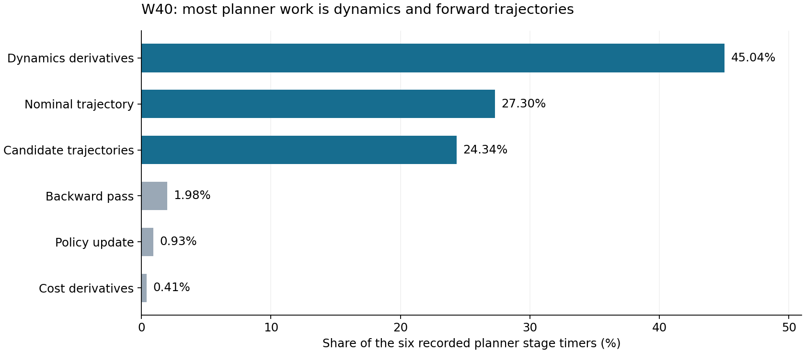

# W41 GPU 支线：扩大有效实验，形成可接入的批量规划部件

> 2026-11-10：本文件保留历史身份，当前执行入口为 [W43计划](S1_W43_STABILITY_PLAN.md) 和 [W43完整启动提示词](S1_W43_START_PROMPT.md)。W42及原GPU已结束；GPU只按新计划从失败阶段续接，不重复已完成目标。

日期：2026-11-07，北京时间。用户本次明确要求扩大 GPU 支线工作量，与两条 CPU 联合主线并行；本文件覆盖此前 W41 草稿中“仅八个 fixture、做一次有限诊断后停止”的范围。W40 的已完成结果仍保留，不重启它的旧 job。这里是已授权的下一轮实现与实验清单，尚无 W41 GPU 运行成绩。

## 1. 当前结论和实验目的

W40 已完成 FP64 批量 predictor、十子步状态和固定目标的差分导数链；8 个真实状态中 3 个通过原标准，5 个未对齐。已发布数据的最大局部 A/B 差为 1421.7147，最大合成 A 差为 1358.3332；它们是混合单位矩阵的分量差，不能解释成米或角度。全部失败例的合成 A 最大误差列都是 base-z。这给出接触/求解分支的调查线索，尚未证明具体原因。

现有 GPU 8-state 单子步 steady p50 为 10.443 s，CPU 8-state 十子步为 0.06389 s。工作量不同，不能据此计算严格加速比，当前也没有可用的加速证据。当前缺完整 task cost/private phase、反馈候选排序和完整 planner。

重新汇总 W40 全部 64 个训练回合、49,044 次规划的六项内部记录，动力学导数占计时小计 45.04%，名义轨迹 27.30%，候选轨迹 24.34%，backward 1.98%，policy update 0.93%，cost derivatives 0.41%。因此先完成批量动力学、导数与轨迹工作；暂时只把 backward/QP 搬到 GPU 不会解决主要吞吐瓶颈。分母是六项计时之和，不是两流共同墙钟；[复算](../results/terrain_memory/simulation/tm-s1-go2-local-readiness-r12/reviews/W40-final-review/planner-stage-summary.json)。

## 2. 一条 GPU 工作流，连续完成五项产出

下表不是五条同时抢显存的进程。默认一个 `s1-w41-gpu` 会话顺序推进，阶段内用 GPU batch 并行；与 CPU A/B 同时工作。完成前序所需实现后自动继续后续工作，不在每个小阶段重新索取授权或等待一次新对话。技术错误保存首次完整上下文后修复，不把旧结果重算一遍当作新进展。

| 工作 | 具体实现与实验 | 必须交付的结论 |
|---|---|---|
| G1 接触与导数定位 | 原 8 fixtures 全部保留；从已保存 W40 A314/B E30 及其他代表性记录中增加约 24–48 个真实状态，覆盖刚地、接触建立/脱离、首次受载、材料边界、大反馈、PD 饱和和躯干风险。逐子步记录 state、contact pair/位置/法线/距离、passive force、solver状态、A/B和有限差分的受扰终点。 | 第一处分歧在哪里；是移植漏项、接触几何算法、求解容差/提前停止，还是有限差分跨分支。每例有具名原因或明确未定位，不只留一个最大误差。 |
| G2 驻留设备与批量容量 | 模型、状态、扰动和十子步循环常驻设备；使用 `vmap` 与 `scan`/设备循环减少每步 host 同步。先测一个节点的 49 个输入，再把实际 176 个节点组织为节点块；每节点 1+36+12=49 个名义/状态/控制输入，共 8624 个逻辑输入，由 microbatch 执行，不要求一次装入显存。对现有 10 个候选按候选维并行，不能打乱轨迹时间递推。 | 编译、首次运行、steady、H2D/D2H、峰值显存/内存分别报告；给单次规划延迟及批量吞吐的不同结论，说明选择的节点块大小。 |
| G3 接入真正规划工作 | 补齐同版本 task residual/cost、phase/context、r27/r28及实际部署版本的策略映射；将 GPU 预测/导数接到 CPU iLQG 外层，backward 暂留 CPU。用保存的候选或新声明的完整 planner fixture 比较候选成本、可行性、排序、winner、首个目标角与整次规划时间。 | 确认节省的是完整规划工作而不是孤立内核。旧记录缺 private state/K/H 时，只能构造新声明 fixture，不能宣称重现旧历史 planner。 |
| G4 独立闭环支线 | 数值/接口问题解决后，在独立目录使用当前 CPU 主线的复制固定策略或明确新控制器版本，真实 TM02 plant 仍按原物理积分。直接做完整联合栈的 E30；同 case 真通过再 E60。先比较相同种子/初态/预算下结果，再决定是否在新 phase 用 GPU 采样。 | 跌倒/非法接触/材料域、合法去返程、终点、规划耗时、样本/h均可比。不得热替换正在续接的 W40 A，也不把 copied evaluation 算第三条 PPO 训练谱系。 |
| G5 一项有依据的替代路线 | 若 G1 证实原生接触差异无法在同模型语义下消除，或 G2/G3 表明固定版本 MJX 架构没有收益，按瓶颈选择一项独立对照：需要整时域/多重射击并行时选 MPX；问题明确在不等式/可微接口时选 TurboMPC；主要是碰撞/前向吞吐时选当前 MJWarp/新 MJX 后端。不能在backward仅约2%的现状下预认定换QP求解器就是主要加速来源，三者不用全装全跑。 | 明确新算法/新预测后端与“等价 CUDA 移植”的差别；记录真实接触、精度、输入和任务限制。至少实现本问题所需接口后再报告能力，作者 demo 只证明安装/作者环境。 |

G1/G2 可以共享真实状态库和对照结果；G3 可在定位 G1 时并行编写，但未经解释的错误结果不进入主线。目标是推进至真正规划和闭环，而不是把“还没逐元素一致”变成永远停止实现的理由。

## 3. 两种数值身份必须分清

**等价迁移。** 原 MuJoCo/MJX 3.2.3、FP64、原四元数切空间、固定 u、十子步、因果 userdata、coldstart、接触和差分定义保持。原位置/速度/导数标准不能为通过而放宽。CPU/GPU 同时使用相同声明版本；r28 predictor 的结果不能直接替 r30 策略背书。

**新预测器或新求解器。** 对已明确解释的接触算法/精度差异，可以在独立版本中继续实验；允许研究新的可微接触或批量架构，不要求它逐 bit 模拟旧后端。但必须在原 CPU/TM02 plant 和原任务判据下验证，并报告模型差异、误差与稳定性，不得把它记成等价后端。固定随机种子并不使不同算法轨迹相同，比较任务结果和资源成本，不强求整条状态逐点相等。

浮点精度、解算器和差分步长不能混成一个变化。若试 FP32，`eps=1e-6` 不自动沿用；先在具名状态分量尺度下检查方向差分随步长变化的稳定区域，并用双精度参考核对预测/候选/任务结果。改变接触几何、删掉躯干碰撞、减时域或减子步的版本，都要独立声明，不能用于“原问题已加速”的结论。

## 4. 资源分配：使用真正空闲量

现场先读实际 GPU 型号/总量/进程用量、现有任务峰值、CPU affinity 和 `MemAvailable`。用户报告已有另一项 GPU 训练、约 60 多 GB 显存占用；这不是本审查的现场测量。96 GB 容量不能全部分给新任务，120 GB RAM 的空闲也不是全可预占。

- CPU 新双主线默认各 12 MPC workers，Torch/BLAS 各 1；GPU host 1–2 线程，编译最多 2 jobs。普通 W40 A resume 保持其冻结 workers。若另一个训练也大量用 CPU，以现有任务和实际吞吐调整新任务，不能三个 12-worker 池硬挤 25 核。
- 若现场总占用约 60–65 GiB，GPU 支线可以从约 16–20 GiB 自身预算、单节点/小块开始，实测峰值后扩大节点块；这是资源安排示例，实际预算由可用量和其他任务峰值决定。另一任务释放显存后扩大本任务 batch，不人为长期只跑 8 个世界。
- 复用项目隔离依赖；关闭 JAX 默认大比例预分配。`PREALLOCATE=false` 不是硬显存上限，仍须根据实际峰值选择块大小。不能用全卡 memory.used 把他人训练的占用计为本任务消耗。
- 当前 W40 旧入口已经关闭预分配却仍记录约 43,841 MiB 的全卡占用；需要区分自身 device buffers、编译与共存任务。不能只凭这个快照宣称其全是缓存、全是本任务或 GPU 已被用满。
- 同一次配置复用编译与持久缓存，代码/静态shape/版本变更才编译新签名；不用重复 JIT 消耗算力。出现容量不足时缩小本任务 microbatch，保留已完成阶段记录，不误停另一项训练。

这里没有另建监控平台或定时强杀器；资源快照和阶段性能直接写入正常实验结果。GPU 利用率、显存占用只是解释量，完成更多正确规划/有效样本才是收益。

## 5. 工作完成、发布和接入

新建 `gpu/w41-gpu` 任务目录、结果目录和新入口；旧 `start_s1_go2_w40_gpu.py`/`s1_go2_w40_gpu.py` 保留历史，不用含 28h timeout 的入口运行新工作。新任务 `deadline_unix_s=null`，按本清单产出、明确技术失败或用户停止结束。30/60/300/600 s 是物理实验长度；单次网络请求超时和有限数值迭代保留。

至少保存逐子步 A/B、P/Q、受扰输入/输出、接触/求解信息、完整候选输入输出和阶段计时。固定状态库注明来源和重建内容，不读取真实隐藏材料状态增加信息优势。新数据和日志先提交紧凑结果，大数组沿用后台交付；不要重新上传已交付 W40 十份 NPZ，不在用户电脑额外归档，也不自动删除服务器研究输出。

GPU 支线不阻塞 CPU 稳定性工作；有明确有效结果就继续 G3/G4 和后续新 phase 接入。若同语义和选定替代路线都没有收益，交付可定位的负结果并结束本清单，不以更多显存占用或新增无关算法掩盖失败。

## 6. 一手参考

- [MuJoCo 3.2.3 MJX](https://mujoco.readthedocs.io/en/3.2.3/mjx.html)：大 batch 的适用性、SAT 与原生 MPR 的差别、接触复杂度；这是定位方向，不是已证明本次差异的根因。
- [当前 MJX](https://mujoco.readthedocs.io/en/latest/mjx.html) 与 [MJWarp](https://mujoco.readthedocs.io/en/latest/mjwarp/index.html)：吞吐/单步延迟、自动微分和精度差异。不要把当前功能套回固定 3.2.3。
- [JAX GPU 内存](https://docs.jax.dev/en/latest/gpu_memory_allocation.html)：多个进程共存、预分配和内存池行为。
- [MPX](https://github.com/iit-DLSLab/mpx)、[TurboMPC](https://github.com/ToyotaResearchInstitute/turbompc)：具名独立路线，作者速度不直接转化成本项目收益。
- [本轮新增论文及版本校正](../results/terrain_memory/simulation/tm-s1-go2-local-readiness-r12/reviews/W40-final-review/literature-update-20261107.md)：可执行动作先验、接触梯度、简化预测结构及材料信息的实际控制权限。

## 7. 2026-11-07 D57 实施入口

新`start_s1_go2_w41_gpu.py`已建立无deadline的独立任务。`s1_go2_w41_gpu.py`使用32个新增真实W40事件、49输入的设备scan，之后按176节点顺序块覆盖8624逻辑输入；旧8例和10个NPZ不重算。完整逐子步状态、局部A/B、接触几何、求解信息与受扰终点写入该任务目录。

原生`S5-r30-gpu-mjx`桥已正常构建，163.27s。独立GPU预测器通过Unix socket返回十子步状态与局部A/B；原生CPU仍拥有完整task cost/private phase、r30 QP/feedback、候选排序和iLQG backward。节点/候选以至多2个请求组运行，独立评价只用2个MPC workers，不形成第三条12-worker PPO。该接口和后续评价是新建完整栈fixture，不冒充缺失private state的历史回放。数值未对齐时明确记为新MJX接触预测器，并保持原CPU/TM02 plant。

G3/G4自动使用B的不可变update37，在原初态分别执行r30原生预测器与独立GPU预测器的E30，同case通过才E60。G5只选择一个已具有前向吞吐/接触理由的MJWarp对照，隔离环境`work/envs/w41-mjwarp`固定mujoco/mujoco-warp4.0.0、warp1.19.0、numpy2.5.4；原主环境未升级。新后端明确FP32身份，保留原solver迭代/容差，记录三个具名差分尺度的敏感性，再在原plant独立E30/E60。没有把FP32结果用作原FP64等价证书。接口源码已准备，阶段执行与结果以任务result.json为准，不将未来阶段标成已完成。

G1–G5结束或首次技术故障后，`finish_s1_go2_w41_gpu.py`发布本轮新原件和实际结果，保留首次输入、原始文件及已上传副本。任务没有后台完成期限；网络故障保留publication_interrupted，不把队列当published。

## 8. 2026-11-08 G2 定向续接

G1 已完成32个新增事件，5例通过完整数值标准，原件已随 `w41-new-evidence-01.zip` 发布。2026-11-07 21:30 的 G2 首节点在编译阶段报错：MJX3.2.3 `collision_driver` 从 NumPy 几何编号生成JAX数组时，在x64环境下产生int64，而 `make_data` 初始contact.geom1/geom2/geom为int32，违反 `lax.scan` 的carry类型要求；尚无完成的G2节点。

修复仅在held FD和held forward的每次物理步返回处，将这三个接触编号转回输入carry的整数dtype。FP64状态、接触值、原solver、1e-6差分、十子步和控制策略不变。沿实际G2首节点完成正常JAX编译和计算，不另做G1重放、smoke或参数扫描。

明确入口为 `python scripts/start_s1_go2_w41_gpu.py --resume-from G2`。原G1记录、首次故障、旧job/clock/log/exit及发布记录保存在同任务resume-history下；当前结果直接复用完整G1，只推进尚未完成的G2节点，之后继续既有G3/G4/G5入口。每个G2节点完成即保存实际数组和计数。仍使用2个host线程、最多2个XLA编译jobs和原缓存，不接触W41 A/B的进程或frozen artifact；后台无墙钟截止。

续接结束后的交付只选择本次新增或变化的输出，并使用包含续接ID的新ZIP资产名。旧G1数组与已发布ZIP复用，不重新打包旧原件或覆盖远端资产；旧ZIP和所有服务器原件保留。超过单资产容量的完整新流只切分传输副本，源文件不改。

现场续接 `g2-20261108T034922Z` 已完成G2节点0的49输入×10子步计算并保存数组，后续节点继续。输出states与A/B保持float64，contact_geom为int32。G1原32条记录及32份GPU数组保持不变；首次故障和旧发布记录留在同任务resume-history。W41 A/B训练进程未重启。
