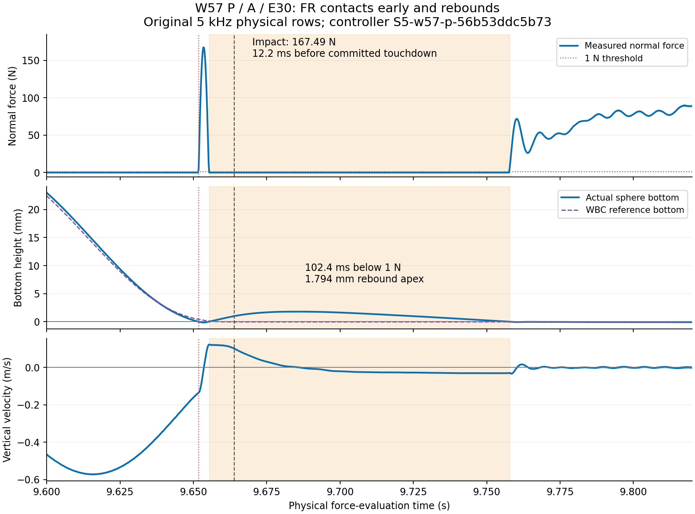
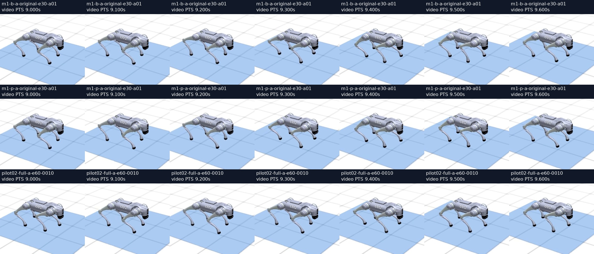

# S1 / W57：实际进度、视频与原数组、机制缺口和下一步判断

日期：2026-11-23（Asia/Shanghai）。固定审查快照：[`fd4ede8d46572d638b736d4538f4d9946326265d`](https://github.com/kaiwen123-yang/MCP-RL/commit/fd4ede8d46572d638b736d4538f4d9946326265d)，执行索引时刻 **19:20:56 +08:00**。代码/机制深读始于`e2d38923`；两者之间的变化为发布恢复、动态索引/日志及blind第29次更新，原材料/规划/视频结论未变。

[下一步完整计划](S1_W58_RESEARCH_PLAN.md) · [Codex启动提示词](S1_W58_START_PROMPT.md) · [一手文献审查](S1_W57_LITERATURE_UPDATE_20261123.md) · [独立控制/学习审查](../results/terrain_memory/simulation/tm-s1-go2-local-readiness-r12/reviews/W57-review/control-and-learning.md) · [视频与原始数组复算](../results/terrain_memory/simulation/tm-s1-go2-local-readiness-r12/reviews/W57-review/evidence/video-and-raw-review.md) · [只读汇总JSON](../results/terrain_memory/simulation/tm-s1-go2-local-readiness-r12/reviews/W57-review/snapshot-audit.json)

## 发布前的动态复核

推送前又读取main的cf2c7521、**2026-11-23 19:36:06 +08**快照：物理attempt增至130（126 passed、2机制未达标、2 running），完成物理子步38,350,000；full仍8192/32，blind7424/29＋82 partial＝7506，合计15616已更新、15698已观察distinct。原冻结资格和“W57仍在执行”的判断不变。下文机制、原数组和主表固定在19:20:56，以免后台继续更新使证据身份漂移；最新续接以现场/运行索引为准。[发布前复核JSON](../results/terrain_memory/simulation/tm-s1-go2-local-readiness-r12/reviews/W57-review/publication-refresh.json)

## 1. 当前结论

**稳定名义行走基线已经成立，可以推进实验；W57也已经取得实质工程和训练进展。但当前推送快照仍在执行，不能称整轮结束，更不能称材料记忆的独立或联合科研收益已经成立。**

上轮最重要的工程缺口——材料预测没有真正进入MPC候选选择、新timing策略没有实际学习——这轮已经推进了。新的瓶颈更具体：早触地后的冲击反弹仍在；M1在核心释放→重载家族退化；P1的可见改善混有接触时长修正，而受控私有历史效应极小；R确实有动作权限却尚无明确任务回报改善；机制任务的反向足印不满足所声明的重访。

这说明下一步应完成当前同预算冻结评价，再把**接触质量、材料状态预测、历史决策价值**三线同时向前推，随后有条件地做真正联合训练。继续原样增加timing样本，不能自动修复这些问题。

## 2. 实际完成了什么，尚未完成什么

| 层次 | 固定快照中的证据 | 可以得出的结论 | 尚不能得出的结论 |
|---|---|---|---|
| 原稳定基线 | r55、r60的A/B各自原E600完成10往返并保持至600s | 两名义case可持续合法行走 | 跨材料、扰动、速度及实机鲁棒性 |
| M1 | 保留短预测改善，原M1+B A/B E30 | 在线测力状态校正已实装 | 所有事件族更准、闭环统一变好 |
| P1 | 1504次replan，628有后续物理的材料记录，真实WBC输入作用 | 候选内材料消费已接通 | 已证收益来自游离地块历史 |
| R full | 8192 distinct、32 PPO更新 | 新83D timing head真实学习 | 最终冻结策略改善或E60资格 |
| R blind | 7424 committed、29更新、6 partial，继续运行 | 同预算对照在推进 | 已完成与full的公平最终比较 |
| PR | 队列已定义，等待最终R节点与collector自然收尾 | 冻结组合协议与静态接口兼容 | 联合on-policy训练成功 |
| 新原资格 | M1+B A/B E30；M1+P A E30 | 新身份短阶段通过 | E30已完整回家或新身份E600成立 |

执行索引共128个真实物理attempt：124标记passed、2个mechanism_criteria_unmet、2个running。124包含121个训练episode及3个冻结原E30，不能全部当冻结控制器资格。累计已完成物理子步37,750,000，进程CPU 183,727.384s约51.04核时；仍运行的部分进度不以完成量填充。

两head合计 **15616条进入已完成优化、6条部分缓冲，共15622条已观察distinct转移**，不是一个训练了15622条的策略。旧W44速度actor新更新0。正式四组机制结果表在本快照尚为空，冻结评价dispatcher仍等待自然最终节点。没有把等待或未运行阶段记为失败。

出处：[执行索引](../results/terrain_memory/simulation/tm-s1-go2-local-readiness-r12/w57/index.json)、[冻结队列](../results/terrain_memory/simulation/tm-s1-go2-local-readiness-r12/w57/dispatch/frozen-evaluations.json)、[逐update独立聚合](../results/terrain_memory/simulation/tm-s1-go2-local-readiness-r12/reviews/W57-review/snapshot-audit.json)。最新运行值应读现场及最新main，本表只描述固定快照。

## 3. 稳定baseline与步态：已经能走，但接触质量有明确可改之处

### 3.1 四条完整E600支持稳定名义基线

| 身份/case | 第10往返完成/s | 终点保持/s | 最大绝对roll/pitch/° |
|---|---:|---:|---:|
| r55 A | 467.094 | 132.906 | 1.663 |
| r55 B | 470.302 | 129.698 | 1.589 |
| r60 A | 466.054 | 133.946 | 1.579 |
| r60 B | 469.820 | 130.180 | 1.558 |

这是带明确路线、材料贯穿和原约束的长时证据，已经超过“视频看起来没摔”。但A/B是两个名义case，并非足够的随机种子与泛化矩阵。真实F为接触力QP MPC＋WBC，不能用历史N线全身iLQG解释目前成功。

上轮全局统计约0.54s周期、3cm足端摆幅、主要对角支撑；本轮按地面区间拆开后发现r60材料直行周期约0.628–0.632s（约1.58Hz）、CV5.8–6.4%，刚性直行0.526–0.528s（约1.90Hz）、CV2.5–3.1%。材料段更慢、时序更不规则，不能用全程1.85Hz平均值遮盖。也不能在材料、转弯、等待混合的情况下要求完美对称。

历史依据见[W56审查](../results/terrain_memory/simulation/tm-s1-go2-local-readiness-r12/reviews/W56-review/README.md)；本轮分段统计和全物理事件依据见[W57步态普查](../results/terrain_memory/simulation/tm-s1-go2-local-readiness-r12/w57/p/full-force-off-summary.json)。

### 3.2 “落脚后又离地”的根因已比上轮清楚

执行端对四E600共12,000,000个0.2ms子步做了全量普查。沿既定“小幅离力≥40ms、Fz≤1N、排除大幅正常摆动”的定义，有1047个事件。全部沿已承诺摆动apex追溯为**末摆动提前接触后反弹**，这类事件中的已确认承载丢失为0。1021次此前为单脉冲，26次为同一次碰撞的阈值反复穿越，不应被最近一帧状态误分成其他失载。

首次碰撞通常比承诺触地早4.4–13.2ms，中位8.8ms；控制还在swing，期望支撑力接近0，真实足端下落后向上反弹。小反弹最高约2.511mm、最长144.8ms。刚地也存在，r55已有，不能归因于r60新材料接口；此统计不排除短于40ms的其他chatter。

### 3.3 这次还独立复算了新P的原数组，而非只引用旧baseline

新`S5-w57-p-56b53ddc5b73`、A/E30的原ZIP已按发布SHA256核对；完整读取150000×85物理行和15001条轨迹，物理数值全有限，5kHz时钟误差约4.66e−16s。最小机身高0.283007m，最大绝对roll/pitch约1.37046°，非足接触/力0，实际力矩峰约原限值54.26%。它是稳定的原E30，但30s时返程未完成，不能称完整往返。

P的材料直行周期FL/RR约0.626s、FR/RL0.631s，CV5.21–5.80%；刚地约0.526s、CV1.77–2.17%。同定义仍找到20次早触反弹：FL6、FR11、RR3。典型FR在9.6518s提前12.2ms撞地，峰167.49N，vz由−0.1356变为+0.1216m/s；9.6554–9.7578s低于1N共102.4ms，反弹高1.794mm。

对齐500Hz WBC后可见：9.652/9.654s仍swing、触地确认只到1/2；9.656s力归零，计数清零；9.666s转search；9.758s再接触才给约33.94N支持目标，9.764s确认touch，9.770s才确认bearing。首个约3.6ms碰撞没有形成已确认支撑。

这一因果链直接决定后续G应处理末摆动与首次测触接管、参考连续性及承载建立，不能照“已承载突然掉支撑”去调大反馈。观察到碰后反弹也不代表已经找到一个能消除首撞冲量的控制修改，仍需新身份原任务验证。

### 3.4 视频看到了什么，没看到什么

查看7个新发布视频的84个均匀时码帧，另加B/P/R材料周期21帧和P碰撞附近16帧，另查看1张全幅，共122张提取帧（含重复时刻）。范围包括M1+B/P原E30、M0短重访A/B、R full A ep1/ep10及B ep9。机身基本平稳、对角足交替，短任务约80s回家后保持；R训练片段末段站立为终点保持，不能当作停止行走故障。

视频分辨率及约30fps不能可靠辨认1–2mm、几毫秒的首次接触机制。密集日志才支持上面的结论。这里的R是训练过程ep10，未看到最终8192策略或blind最终冻结评价的视频；不得用它宣称最终学习改善。时码、源资产、SHA和可复算脚本均在[evidence目录](../results/terrain_memory/simulation/tm-s1-go2-local-readiness-r12/reviews/W57-review/evidence/)。

## 4. M1：短预测确实更准，但没有解决最重要的重载家族

| 预测口径，held A | M0 | M1 | 解释 |
|---|---:|---:|---|
| 非释放整足20.2ms未来力MAE/N，270行 | 0.177002 | 0.129411 | 下降26.9% |
| 跨足家族20.2ms未来力MAE/N，30行 | 0.258160 | 0.170745 | 也有改善 |
| **源释放→实际跨足重载单格力MAE/N，30行** | **0.102292** | **0.160545** | **增加约57%** |
| 同一释放→重载预载深度MAE/μm | 0.416778 | 0.637018 | 更差 |

B的释放→重载力MAE也由0.075598升至0.121810N。这不是“所有跨足指标都恶化”，而是两种时间口径的结论不同；必须明确20.2ms短预测与约1.2–1.5s释放后再加载。

M1对每足可辨识的共同creep/free-duration做低维校正，没有直接在线读取plant真q，这是正确边界。单足合力对应8–18维隐藏状态时，局部秩通常仅1，无法宣称所有地块内态都已恢复。开发B、保留A都来自原r60 E60；两条名义episode还不是材料泛化。

同输入WBC法向参考差在held-A中位约8.51e−13m，虽然超出局部重建误差，但没有物理意义上的强作用证据。真实M1+B E30相对r60滑移A约增1.99%、B约减0.26%，没有一致闭环优势。下一M2的主要任务应是释放状态、free recovery传播及重载预测，而不是把短时均值再优化一点就宣布记忆估计完成。

出处：[M1选择及范围](../results/terrain_memory/simulation/tm-s1-go2-local-readiness-r12/w57/m/selection.json)、[逐事件两种时距](../results/terrain_memory/simulation/tm-s1-go2-local-readiness-r12/w57/m/error-by-event.json)、[误差带](../results/terrain_memory/simulation/tm-s1-go2-local-readiness-r12/w57/m/error-band-calibration.json)。

## 5. P1：真实在线规划进步，收益归因仍未过关

P1/M1 A E30有1504次replan，629条材料候选，其中628有后续物理，611选材料修正、17选nominal。最后30.000s的记录没有后继，单列。首个在线选择5.120s，WBC映射确实改变，随后真实轨迹分叉。这已解决上轮“只有离线材料调用”的接通缺口。

与同M1的B在A/E30配对：

| 原任务量 | P相对B | 判断 |
|---|---:|---|
| 原归一化滑移积分 | −8.925% | 有利 |
| 压陷积分 | −4.185% | 有利 |
| 峰值主应变 | +2.788% | 不利 |
| XY路程 | −1.887% | 同30s走得略少 |
| 任务进度 | −1.616% | 略慢 |
| 正机械功 | −0.849% | 不能脱离路程解释 |
| 按运动路程归一化正机械CoT | +1.059% | 未改善能效 |

这是单个确定性配对，不能推统计显著性或统一性能优势。两组E30都过原阶段但未完整回家。

更有决定性的归因审计是628条记录全覆盖的protected-private比较：295次历史干预为空、333次非空，**候选排序翻转0次**；332次有WBC覆盖，326次差异高于重建误差，首映射命令差中位4.12e−9rad、最大4.09e−7rad。它只重置游离且被查询的私有格点，保护当前完整足印、owner、WBC和actor；结论是这一受控历史增量没有显示强决策作用，不是所有材料反馈都无用。

11个保存状态的分解提示接触可用时长修正更重要。例如8.760s，availability-only首映射差约1.49346e−3rad，full约1.49311e−3rad，私有历史差约3.51e−9rad。**“P整体改善主要混有接触时间离散修正”是有证据支持的解释，尚须geometry-only闭环对照，不能直接宣布全段8.9%滑移都由它造成。**

当前MPC不是简单“看不远”：新P有40个真实同格源释放→重载配对，中位1.2338s；其中14对在首次验证query后0.35s内发生。已有19保存状态的2s事件层探索、34匹配家族，确实改变部分等待选择，但full/private仍无赢家差。下一P2应改进材料响应与动作/支撑的作用位置，并把等待/进度代价一起比较，不能只延长horizon或加大材料权重。

出处：[P/B配对](../results/terrain_memory/simulation/tm-s1-go2-local-readiness-r12/w57/p/physical/w57-m1-p-a-original-e30-a01-paired-B.json)、[全保护历史审计](../results/terrain_memory/simulation/tm-s1-go2-local-readiness-r12/w57/p/physical/w57-m1-p-a-original-e30-a01-all-protected.json)、[候选因素分解](../results/terrain_memory/simulation/tm-s1-go2-local-readiness-r12/w57/p/physical/w57-m1-p-a-original-e30-a01-factorized-planning.json)、[事件层结果](../results/terrain_memory/simulation/tm-s1-go2-local-readiness-r12/w57/p/saved-planning-summary.json)。

## 6. R：真正训练了、有权限，但尚无“学得更好”的证据

83D独立head/critic/optimizer、同policy-version双collector各128条、按真实dt的GAE、真实后继bootstrap及行为log-density均有真实实现与回执。full/blind从共同初始化分别训练，原W44冻结；未发现需打断本轮的实质信用分配/schema错误。

full8192条中2247条（27.43%）相对同实测门序列的零请求重建改变了实际交接时刻；blind已更新7424条中1712条（23.06%）改变交接，另1条只改变ramp。这是动作权限证据，不是27.43%的性能提升，也不是一个真实独立零动作世界的收益反事实。其余受支撑/时间门约束或相同交接，不能把非零request一概视为有效探索。

full最终节点63个自然结束训练episode的reward/s均值约0.239357，最大最小差只占均值0.1577%；末前后半A、B分别约−3.87e−5/s、−1.54e−5/s。2048/4096/8192趋势并不单调，**没有明确学习改善或收敛证据**。满足既有“趋势或非零不确定性”续训条款，不代表该条款本身证明科学收益。

32次full优化合计5.258s，blind29次合计3.334s，远小于闭环采集时间。显存不是这个64×64网络的瓶颈。当前正确下一步是让blind达到匹配预算并自然结束、固定最终checkpoint，完成原任务和机制对照；不立刻把8192追加到更大数。

PR的P快照和R训练快照在timing spec、timing/learning、backend/runtime及PPO源文件上兼容，但R是在P0上训练，冻结放到P1会改变请求分布和门。若组合不佳，应区分分布变化、单模块和历史价值，之后再以新runner做真正联合训练。仅复制现5701固定seed的目录不会得到独立学习seed。

出处：[full8192节点](../results/terrain_memory/simulation/tm-s1-go2-local-readiness-r12/w57/r/pilot02/full/node-08192.json)、[full更新](../results/terrain_memory/simulation/tm-s1-go2-local-readiness-r12/w57/r/pilot02/full/)、[blind更新](../results/terrain_memory/simulation/tm-s1-go2-local-readiness-r12/w57/r/pilot02/blind/)、[独立控制审查](../results/terrain_memory/simulation/tm-s1-go2-local-readiness-r12/reviews/W57-review/control-and-learning.md)。

## 7. 机制任务：需要修正实验几何，不能靠延长时间补救

M0/B短任务A、B均跑满100s，完成12次身体穿越，分别79.094s、79.994s回家；严格同格跨足周期只有6/12、7/12。A六个正向全部合格、六个反向全部不合格；反向同侧前后足加载x格互斥，足印边缘中位差25.58mm。B只有一次反向合格。

因此它们是“身体任务走完、机制条件未满足”，不是跌倒，也不是后台超时。视频末段静站是完成后的保持。延长100s不会让此前反向足印重叠；把身体穿越数换成跨足重访数会破坏问题定义。

W58需要明确新版本路线/相位，用baseline足印先确定实际source→release→target事件；short与恢复条件共用路线、权限及计分。全部预声明目标都要报告，无交叠不能事后剔除。已有6s自由恢复近充分而非严格零历史，短重访约1.2–1.3s仍有残余，这一时间差有材料机制价值，前提是目标足真正踩到相关格点。

出处：[A几何](../results/terrain_memory/simulation/tm-s1-go2-local-readiness-r12/w57/m/revisit-geometry-w57-mech-b-a-short-a01.json)、[B几何](../results/terrain_memory/simulation/tm-s1-go2-local-readiness-r12/w57/m/revisit-geometry-w57-mech-b-b-short-a01.json)、[机制配置](../experiments/terrain_memory/s1-w57-mechanism.json)、[新任务设计规则](S1_W58_RESEARCH_PLAN.md#4-新机制任务先把真实足印事件设计对)。

## 8. 对长期目标的影响及下一步规模

目前的位置可以清楚分为四层：

1. **名义任务可行性：已建立。** r55/r60长程资格是研究起点；无需再回到“先找一套能走的控制器”。
2. **模型/控制/学习链路：大部分已接通。** M1、P1、新timing学习都有真实记录，P1不是离线展示。
3. **可恢复世界地块历史的因果收益：尚未建立。** 误差、动作、任务收益三层均有具体缺口；需要同权限历史对照与有真实足印的任务。
4. **多seed、泛化、轻量化/实时与Go2/NX：后续阶段。** 当前两case仿真和小网络GPU占用不足以覆盖它们。

下一计划以G接触质量、M2释放重载、P2历史动作价值三线并行，一次推进到明确的成组结果：完成W57既有队列；新16条开发机制矩阵；独立冻结验证；有机制信号后启动3学习seed×full/private-blind、每head累计最多8192，条件上限49152 distinct。开发16不能再当保留集；三seed学习后的保留机制最少32条真实episode，另有各身份原资格。

这使“多做点”对应多个可归因问题和完整后继，而非增加同版本重复试验。若历史效应在合法场景中仍低于模型/积分误差，应给出负结论或可利用效应上限；不能为了一个正结果改软材料、删约束或放大记忆。

## 9. 算力：可以更并行，但依据真实热点

最新资源trace覆盖114633.1s，其中双物理同时推进103362.8s，约**90.17%**；已是真双任务持续工作。W57进程GPU峰2130MiB，全机31165MiB包含其他项目。F/B平均约1核，P单例约1.23核，R含同步等待平均约0.84核；亲和4核不等于用了4核。

当前W57双槽与冻结身份保留。W58等全部旧后继自然结束后采用统一调度，默认3物理槽，实测条件允许再扩4–6。P/PR内部4个native材料worker计入配额；双collector必须原子取得两槽，3槽只能1个训练campaign＋1个独立评价，6槽才能容纳3个campaign。

暂按实际可用资源的18核物理、4核材料/候选/整合、3核系统余量上限规划；已有其他项目占用先扣除。每次扩容看总distinct/h与physical_s/wall_s、单流P95、RSS/GPU/I/O是否实际改善。GPU用于真实成批材料/候选工作，不为占满96GB运行无关大张量。24路原数据迁移属于另一任务，不等于24路物理；本次不执行迁移和删除。

## 10. 文献带来的具体修正

本轮审查八项主要一手来源，重点为2025–2026；其中六项有可读方法全文，两项最新软地面工作只取得官方摘要/出版元数据，边界已标明。结论不是“选一篇最新论文替换稳定F”。

- 2026 **Residual MPC** 与 **AugMPC** 支持保留有效MPC先验、明确RL接触动作权限与同预算比较；PR冻结组合和联合训练必须分开。AugMPC未施加关节力矩限制，不能照搬这条边界。
- 2026 **Terrain-Adaptive…SINDy** 明确SINDy离线冻结，在线适应主要在接触/阻抗/导纳；这提示本项目必须把反馈改善与未来材料历史决策分开命名。
- 2025 **Learning to adapt…gait strategies** 与IFM支持分段周期、接触、机械功/CoT和运动质量评价；不能只报站稳或reward，也不应强迫材料段与刚地完全同周期。
- **Load-bearing Assessment** 把未来实际支撑载荷与承载判断绑定，启发P2预测“候选动作将怎样加载地块”，而不只输出一个与动作弱相关的恢复值。
- 2026 **Terramechanics-Aware…** 和 **MILD** 表明接触历史估计材料、可变形地面建模与步态适应已有近邻。仅凭摘要不能排除它们的长期地图/恢复机制；本项目的新意需要由持久世界格点、恢复状态、跨足动作后果和对照实证来建立。

逐篇标题、DOI、一手URL、已读范围和方法边界见[文献文件](S1_W57_LITERATURE_UPDATE_20261123.md)。这是一轮定向近邻研究，不声称穷尽全部最新论文或完成新颖性证明。

## 11. 阅读、复算与交付边界

本次取得完整Git checkout并清点10,273条tracked路径、1,351,578,876字节；完整解码W57下291份JSON，共4,573,980字节。核心源码、项目记忆、AGENTS、历史阶段审查、全部61份已完成update、材料/规划/队列和视频由三线交叉阅读；新P原数组完整独立复算，旧四E600采用已发布全量普查及其事件定义/源码核对。没有把文件清点、JSON解码或checkout宣称为逐字理解了全部1.35GB，也没有逐帧看完全部历史视频。

Release状态在审查期间由79项、17,660,813,035B更新到81项、17,874,794,470B：旧数字中full-B ep10的一个已验证ZIP尚未组成完整bundle，之后第二ZIP及视频补齐，81项均有完整verified回执。发布EOF恢复与checkpoint穿插发布有对应代码提交；此差异不是物理重跑或数据校验失败。

本次工作只有读取、独立复算、文献、计划与GitHub交付，**新增机器人物理、训练、AutoDL后台均0**；未访问D57实时进程，未修改运行中的实验，也没有用户电脑二次归档或原数据删除。每天详细记录继续写入单独的[S1_DAILY_WORKLOG.md](S1_DAILY_WORKLOG.md)。所有下一步后台无固定墙钟deadline，对话结束不kill；原模拟任务终止和硬界保留。
