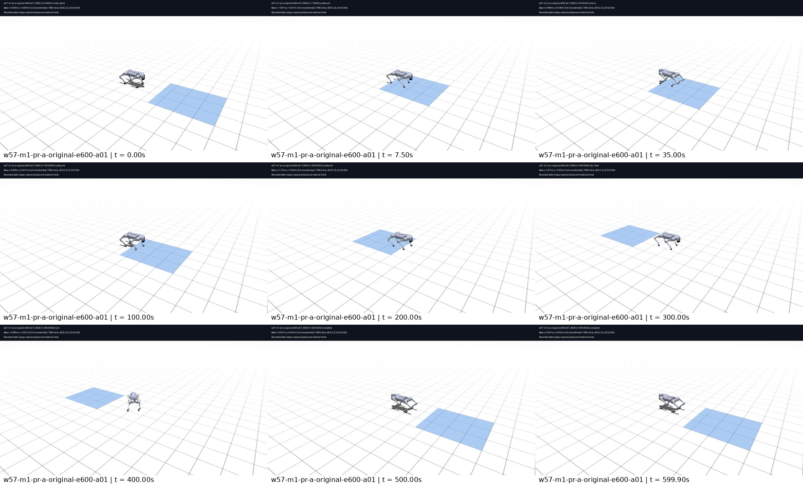
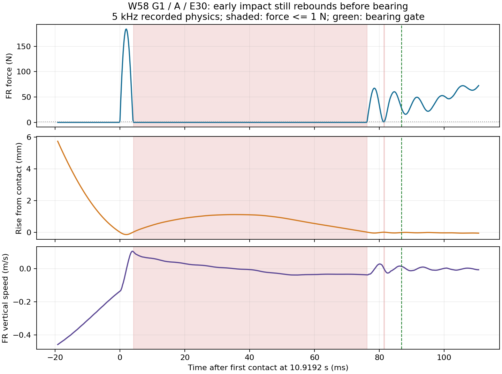

# S1 当前进展：W57 最终结果、W58 完整审查与下一研究方向

日期：2026-11-26，Asia/Shanghai。固定 Git 快照：`ef500f31c7a96d94f83c9afb5c7a880864b447dc`。W57 索引截至 11-25 10:21:58；W58 科学状态截至 11-26 12:35:49，发布观察截至12:49:35。这里是仓库证据审查，不是实时连接 D57 的进程检查。本次没有启动新的机器人仿真或训练。

**结论：稳定长程基线已经成立，并且新 W57 PR 也有自己的原 E600；但材料历史引起的决策收益、三个模块的联合增益仍未成立。W58 已经结束，选择 G0/M1，没有启动新联合学习。下一步可以推进实验，但应转向持久材料记忆与动作条件执行世界模型，不能继续把同一套微弱等待候选多跑几个 seed。**

[W59 完整方案](S1_W59_RESEARCH_PLAN.md) · [官方 SuperMimic 与近期论文](S1_W59_OFFICIAL_METHODS_20261126.md) · [启动提示词](S1_W59_START_PROMPT.md) · [本次证据与复算入口](../results/terrain_memory/simulation/tm-s1-go2-local-readiness-r12/reviews/W58-review/README.md)。

## 1. 阅读与独立复核的范围

审查沿项目目标、历史失败、控制实现、材料模型、训练身份、完整实验分母和原始视频相互核对。读取 W57/W58 最新索引、训练/冻结队列、选择与终局、32条 W58 正式机制账本、相关执行代码和合同；回顾10月20日终止目标/宏步采样/KL问题，避免重新引入旧错误。

独立下载并验证8个真实MP4与G1/A/E30完整原始ZIP。视频检查72个全程取样面板、18个接触近邻面板（含重复时点），另检查一个单帧；未声称逐帧看完全部视频。G1原始数据独立读取150,000×85的5kHz记录与15,001控制行。两个机制实例用HTTP Range读取原始事件成员，验证CRC和成员SHA，未声称重新验证整个多GB ZIP。

这是针对最新问题和历史约束的完整证据链审查；没有宣称逐字理解所有历史文件、读取所有Release原始字节。具体文件、摘要、时码和验证范围见[source-manifest.json](../results/terrain_memory/simulation/tm-s1-go2-local-readiness-r12/reviews/W58-review/evidence/source-manifest.json)。

仓库旧 `current.json` 的 W58 片段仍写 `isolated_development_W57_active`，AGENTS旧入口也保留11月23日状态；它们不能覆盖日期更新、内容完整的 [W58 index](../results/terrain_memory/simulation/tm-s1-go2-local-readiness-r12/w58/index.json)。本次新入口明确区分这两类记录。

## 2. 基线到了什么程度

稳定内核是接触力QP MPC＋全身WBC＋原PD60/5。原N全身iLQG不是当前通过E600的F。材料世界格点、原本构预测和旧W44 speed actor早已存在；不能把第一次加入“记忆”“PPO”认作本轮创新。

W57 full/blind各完成8192条去重事件转移、32次更新；A/B各贡献4096。它们属于一个学习seed下的两个环境case，不是两个学习seed。旧W44 speed actor保持冻结。PR为在P0下训练的R与P1冻结组合，尚非P1+R联合on-policy训练。[W57索引](../results/terrain_memory/simulation/tm-s1-go2-local-readiness-r12/w57/index.json) · [训练实录](../results/terrain_memory/simulation/tm-s1-go2-local-readiness-r12/w57/r/pilot02/training-actuals.json)。

| 新 PR 原 E600 | A | B |
|---|---:|---:|
| 完整物理观察 | 600 s | 600 s |
| 物理记录行数 | 3,000,000 | 3,000,000 |
| 十往返后到家稳定 | 466.128 s | 469.982 s |
| 随后保持到600s | 133.872 s | 130.018 s |
| 最低机身高度 | 0.283007 m | 0.283007 m |
| 最大绝对roll/pitch | 1.593882° | 1.658460° |
| 非足接触力峰值 | 0 | 0 |

来源：[PR A](../results/terrain_memory/simulation/tm-s1-go2-local-readiness-r12/w57/mechanics/w57-m1-pr-a-original-e600-a01.json)、[PR B](../results/terrain_memory/simulation/tm-s1-go2-local-readiness-r12/w57/mechanics/w57-m1-pr-b-original-e600-a01.json)。这支持两个固定名义case、原限制下稳定完成长程任务；尚不支持多地形/实机鲁棒、最优步态或材料记忆收益。

## 3. 模块接通了，但增益没有稳定叠加

所有B/P/R/PR/blind各自通过A/B原E30与E60。相对同case B，原E60描述性差异如下，负数表示该代价下降：

| 臂 | A slip integral | A moving CoT | B slip integral | B moving CoT |
|---|---:|---:|---:|---:|
| P | −3.153% | −0.129% | −2.574% | −0.422% |
| R | −5.284% | −0.473% | −2.640% | −0.630% |
| PR | +4.577% | −0.310% | −1.867% | −0.896% |
| blind | −2.576% | −0.354% | −0.896% | −0.458% |

路径长度差约0.25%以内，不能把变化全部解释为少走了路；但只有两个固定case及一个学习seed，不作统计显著性主张。机制任务中的PR相对B，四组slip分别为+0.630%、+2.475%、+5.661%、+2.957%，均更差；CoT三组略好、一组略差。主16机制与blind4均完整观察后停稳，却都未满足原12个严格目标。[配对机制](../results/terrain_memory/simulation/tm-s1-go2-local-readiness-r12/w57/paired-mechanisms.json) · [独立重算](../results/terrain_memory/simulation/tm-s1-go2-local-readiness-r12/reviews/W58-review/evidence/audit-summary.json)。

因此P、R各有小幅改进现象，但“组合后更好”“材料信息使RL更强”都还缺少一致证据。

## 4. W58 的完整工作量与真实选择

W58 `finished`，56个attempt已结束，running为空。分解为21次原资格通过、32次完整机制观察（4通过、28严格条件未齐）、3次技术中断。53次自然终局共8,226模拟秒、41,130,000物理子步；3次中断的部分物理另计。中断涉及读取半写入live JSON导致dispatcher/worker退出，原件保留并以a02完整重采，不能称控制器跌倒。

最终selected gait=G0、material=M1，joint eligible=false、joint distinct为空。W58没有新联合PPO或BPTT训练结果。[index](../results/terrain_memory/simulation/tm-s1-go2-local-readiness-r12/w58/index.json) · [outcome](../results/terrain_memory/simulation/tm-s1-go2-local-readiness-r12/w58/outcome.json) · [开发准入](../results/terrain_memory/simulation/tm-s1-go2-local-readiness-r12/w58/development-decision.json)。

### G1：减轻早触反弹，未改善总体代价

G1自己的A/B E30/E60全过，承载前平均离力时间/已提交swing下降63.7%–66.7%，但原slip/距离四组恶化9.9%–18.9%，CoT三组略差。这个off-time均值包括无反弹落脚，不意味着每次反弹时长都下降三分之二。

材料直行段周期更均匀、频率提高，A/E30材料段前20ms冲击峰值中位数却从51.412升到66.575N。不同步数/落脚位置下的分布比较不是相同事件反事实。[G1选择](../results/terrain_memory/simulation/tm-s1-go2-local-readiness-r12/w58/g/selection.json)。

独立原始复算仍发现FR代表事件：10.9192s触地，较预定早12.8ms；前20ms峰值183.97N；10.9234–10.9954s连续72ms无>1N载荷，最大回弹1.113mm；11.006s才确认bearing。其时全局机身仍稳定，说明稳定与接触质量是两个尺度的问题。

视频中的机身直立、交替步进与日志相符，但30fps不足以定量判断这些毫秒冲击。步态仍有可改空间，不能只优化off-time、忽略冲击/滑移/功。[日志与视频详审](../results/terrain_memory/simulation/tm-s1-go2-local-readiness-r12/reviews/W58-review/evidence-gait.md)。

### M2：末端误差改善，恢复物理仍未校准

M2不是新本构神经网络；它在承载单元保留M1，在满足已释放条件的单元发布M0路径。独立B/A回合的跨足release→reload力MAE约下降32.5%/31.6%，但非release的20.2ms整足力MAE从0.122771→0.134948N、0.117722→0.127346N，均未通过原采用门，因此M2新机器人回合为0。

更深的诊断：即使用真实release初态开始，learned free propagation仍产生A/B平均+0.128366/+0.113645N重载力误差；M0初态误差在35/35、31/31事件中反向抵消了一部分。故最终MAE好不等于恢复律更真实。下一模型必须分别处理release初态、free law、reload解，而非继续在两条偏差路径间切换。[材料诊断](../results/terrain_memory/simulation/tm-s1-go2-local-readiness-r12/w58/m2/development-free-propagation.json) · [控制与模型详审](../results/terrain_memory/simulation/tm-s1-go2-local-readiness-r12/reviews/W58-review/control-and-learning.md)。

### P2：历史效应小、动作候选窄、执行误差更大

P2候选只有0/2/6ms等待，使用相同落点与预定触地时间、同一预设加载场景。它尚未为不同候选联合改变载荷、落脚或接触序列。八条正式P2-full机制回合合计3,817请求、3,592材料请求、3,413非空private reset，赢家翻转与observed gate switches均为0。八个full/private配对的任务与运动指标完全相同。

保存状态校准中support-ready预测误差median40ms、P95 104ms；同批full/private差最大仅0.139ms。正式机制中历史ready差最大约0.192–0.744ms，仍无赢家改变。这里要比较的是实际执行误差、可辨识效应和动作分辨率，继续把0.2ms积分划得更细无法消除几十毫秒的事件预测失配。[P2实现](../scripts/s1_w58_p2.py) · [合同](../experiments/terrain_memory/s1-w58-p2.json) · [support校准](../results/terrain_memory/simulation/tm-s1-go2-local-readiness-r12/w58/p2/saved-support-calibration.json)。

## 5. 机制失败不是没等够：全部目标分母

32个正式机制episode×12目标，共384个预声明机会：

| 集合 | 实现目标 | 无匹配事件pair | 有pair但足印交面积为0 | 总数 |
|---|---:|---:|---:|---:|
| development short | 78 | 14 | 4 | 96 |
| development recovered | 48 | 28 | 20 | 96 |
| validation short | 88 | 8 | 0 | 96 |
| validation recovered | 44 | 32 | 20 | 96 |
| 合计 | 258 | 82 | 44 | 384 |

所有body traversal完成；192个recovered目标的连续clear均达到6.000–6.002s。只有validation B-short的四个臂均达到12/12。384不是独立统计样本，多臂轨迹相同。[完整目标账本复算](../results/terrain_memory/simulation/tm-s1-go2-local-readiness-r12/reviews/W58-review/evidence/w58-missing-targets.json)。

原始事件代表核对：B2/A/dev-short的F02区域内FR源载荷为0，而RR有33个事件；区域外仍存在8条合法跨足链。F07区域内两足都有载荷，却分别落在不相交格点，区域外有11条链。recovered若干目标虽有>6s释放间隔，实际足印共同面积仍为0。已定位的具体问题是自由步态落脚与狭窄ROI错位；不能把82个无pair全部断言同因，也不能事后扩大ROI把旧失败改成功。

下一轮保留原路线的全分母任务评估，并单列固定目标足印/时序的材料机制任务。几何、加载和等待先冻结，再比较算法；mechanism子任务不能替代原E30/E600资格。

## 6. 官方 SuperMimic 为什么可借鉴，为什么不能直接搬

官方方法把真实模拟器数据用于训练可微世界模型，再通过模型内短想象改善策略。这适合当前“真实控制采集昂贵、GPU闲置”的结构。我们的模型还必须包含材料格点恢复、MPC/WBC记忆和硬门的动作兑现；否则它会产生真实控制器不会执行的理想轨迹。

近期DynaMimic已直接覆盖“解析刚体动力学＋学习接触力/残差”，Trust What Repeats已直接覆盖SuperMimic梯度可信性。项目自己的候选贡献应是**持久地块历史如何经受限动作影响另一只脚，以及同一世界模型如何使规划与学习获得真实收益**。官方权重、人形mocap数据和训练效率倍数不迁入本项目结论。完整近邻与代码映射见[官方方法报告](S1_W59_OFFICIAL_METHODS_20261126.md)。

## 7. 并发已经扩大，下一步要改变计算结构

W58已实际运行六条独立物理流。在可比scratch窗口，3/4/6流总速度为0.064371/0.097128/0.143470模拟秒/墙钟秒；六流较四流约+47.7%，当时实际约6个CPU核、约4.24GB GPU。此前混合存储四流扩容未通过，后期六流一次每流比约0.891，说明I/O与任务阶段会影响收益。[scratch并发证据](../results/terrain_memory/simulation/tm-s1-go2-local-readiness-r12/w58/dispatch/evaluation-scratch-capacity.json)。

下一轮六个工作流并行覆盖材料模型、执行模型、规划/学习、真实干预、步态几何、整合交付；物理槽统一调度，GPU承担批量模型拟合和短想象。六槽可同时容纳六个单评估或三个双collector campaign，不是六个双collector。资源方案使用真实吞吐与其他项目余量，不以显存填满作为成果。

所有后台无固定墙钟截止、无对话结束kill；保留原模拟时长和物理终止。GitHub核验后不在用户电脑额外归档。日常细节只追加唯一[S1_DAILY_WORKLOG.md](S1_DAILY_WORKLOG.md)。

**本次交付为审查、离线证据复算、文献与W59计划；W59实际代码、机器人物理、模型训练和PPO/BPTT更新均未启动。**
