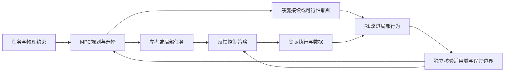

# MPC–RL 的进入路线与跨控制方法创新评估

日期：2026-10-13。本轮依据既有100篇阅读材料，另做扰动观测／自适应、鲁棒管、无源性、收缩、可达性、技能组合、双重控制与事件触发的专题查新。新增来源按摘要或方法段落核查，未全部逐篇全文精读，不计入主库100篇完成数，不改MR编号。以下排序是研究判断，不是文献排名、实验结论或首创认证。

## 结论与适用前提

在“先方法与理论、后通用仿真、最后平台”的约定下，较容易进入的是**状态依赖的参考／任务参数学习＋已有约束MPC**。它让学习对象、模型和求解器较容易分开检查。这里的容易是实现和定位问题较容易，不等于较容易写出有新意的论文。

这条入门路线通常是“高层RL选参考、低层MPC执行”；下面的长期候选通常是“高层MPC规划、低层RL改进反馈行为”。两者不是直接升级关系。可以共用模型、约束、任务和评测，但需要分别建立基线，不能把入门架构的经验直接当成另一架构的有效性证据。

如果希望发展有独立辨识度的方法家族，优先研究**低层反馈策略的学习如何改变高层预测规划的可行任务范围**。可借用管状MPC、参考治理器、可达集和闭环响应参数化的思想；根据系统选择其中一种验证工具。这个母题有长期空间，但“RL学技能、MPC组合技能”与“用误差合同连接两层”均已有直接前人。新贡献必须落在一个尚未被同条件解决的学习—可行性关系，而不是把两套现有代码拼起来。

另保留一条不同的长期候选：**在补偿使眼前误差很小时，如何主动辨清未来任务真正需要知道的系统差异**。它借鉴双重控制和自适应控制，物理问题清楚，但信息状态、探索与安全的耦合更难，不列最轻入口。

当前不锁定最终方向，不把“独立流派”当成可预先保证的成果，也不把有相关前人等同于没有创新价值。

## 1. 哪种融合较容易切入

| 路线 | 实现与诊断门槛 | 做出实质突破的主要困难 | 当前建议 |
|---|---|---|---|
| RL学参考／高层任务参数，MPC输出控制 | 较低到中等；可固定模型和求解器，不必穿过MPC求导 | 已有大量工作；要说明状态依赖、长期决策或可行性接口为何需要学习 | 优先作为进入骨架 |
| RL调固定Q/R等少量权重 | 较低 | 可能用贝叶斯优化、CMA-ES或直接数值整定更合适，RL不一定必要 | 适合学习流程，单独贡献通常不足 |
| MPC基础动作＋RL残差 | 较低到中等，反馈改善容易观察 | 加和后约束与稳定性质未必保留；DOB／自适应补偿是强替代 | 第二进入选择，必须有明确未建模机制 |
| 策略初值、候选分布、学习优化更新 | 中等 | 需要了解数值优化及完整在线开销；效果可能只是更多资源或更好调参 | 适合对优化感兴趣的研究者 |
| 终端价值辅助MPC | 中等到偏高 | 价值定义、数据支持、数值形状与有限求解相互作用，强前人较多 | 保留，不继续锁为唯一主线 |
| 安全过滤／证书学习 | 原型中等；可信保证较高 | 模型误差、验证域、可行后备及分布变化 | 若问题本身是安全可行性，可以优先 |
| 联合学视觉模型、actor、critic和规划 | 较高 | 多处同时变化，训练与调试成本高，因果归因困难 | 暂不作为第一步 |
| MPC教师蒸馏 | 原型较低到中等 | 教师数据成本、学生信息限制与保证传递 | 可作基线与训练工具，不必单列新范式 |

高层RL也可能训练昂贵，因为每次交互都要求解MPC；上述门槛判断不意味着“网络小＝总体省算力”。如果名义模型质量很差且没有可行基线，上述优先级需要重新评估。

## 2. “独立融合流派”应该怎样理解

不必发明第十种连线拓扑。一个方法即使属于分层或参数化架构，也可以凭新的学习对象、接口语义或性能规律形成可复用方法家族。

可以区分三种成果：

1. **有效集成**：若干已有模块配合，在特定任务上工作得更好。需要诚实归因和公平比较，本身也可能有应用价值。
2. **独立方法框架**：明确一种反复出现的问题，规定学习与规划交换什么、怎样共同更新，给出条件性分析与跨系统证据，其他人能替换底层算法并复用原则。
3. **形成流派**：后续研究沿着该原则发展，社区采用其语言、基线与问题。我们能够努力完成第二项，第三项取决于时间和外部采用，不能预先给成功概率。

一个值得追求的框架至少应具备：同一科学问题；明确的新机制；足够低的验证成本；可复用接口；与既有强方法在相同条件下可辨别的优势。复杂度、模块数量和新缩写都不是这些要素的替代。

## 3. 从其他控制方法可以借什么

| 方法 | 值得借鉴的思想 | 可以形成的MPC–RL研究问题 | 已有基础与限制 |
|---|---|---|---|
| DOB／ADRC／L1自适应／滑模 | 快速补偿、参考模型、抗扰误差界及补偿输入占用 | 补偿后的不同对象能否共享长期任务知识；何时补偿掩盖将来重要的参数差异 | L1-MBRL、UC-MPC及RL调观测器已有；噪声、带宽、matched/unmatched不确定性和饱和不能忽略 |
| Tube MPC／参考治理器 | 预测真实轨迹可能偏离多少；只接受可实现的命令 | 学习策略改进如何改变可接受参考集合及任务可行域 | 学tube、分层contracts和在线模式选择已有；经验误差变小不等于硬包络成立 |
| 无源性／耗散性／能量整形 | 从能量交换限制反馈行为 | 连续交互任务中，学习行为如何分配能量预算并完成长期任务 | 能量罐RL、能量罐MPC、Q-learning storage已有；无源不等于避障、限峰值力或任务完成 |
| 收缩／增量稳定 | 控制轨迹之间的偏差传播 | 给学习行为提供可供规划使用的误差传播关系 | CCM-MPC与CCM-RL已有；度量验证、控制饱和和技能切换难；不能把预测误差小当收缩证书 |
| Youla／SLS闭环参数化 | 在具有稳定结构的反馈或闭环响应空间里学习 | RL能否优化一种可由MPC直接规划与约束的反馈响应 | 稳定策略RL、Youla-REN、SLS-MPC已存在；线性结构不自动推广到任意非线性，稳定不等于状态约束可行 |
| 双重控制／最优试验设计 | 动作既改变物理状态，也改变未来知道多少 | 只辨识将改变任务动作或可行性的未知因素，学习长期信息价值 | RL＋dual MPC早已有；理想双重控制原理已覆盖，机会主要在可计算近似与有限预算 |
| 事件触发／多率／实时调度 | 按需要分配测量、辨识与求解资源 | 当前预算该用于再算、更新模型还是主动获取信息 | RL学触发、时域和元参数已存在；计算期间系统仍在运动，必须计真实耗时与后备行为 |
| 迭代学习控制／Learning MPC | 从重复任务中保存成功经验并改善下一次执行 | 经验在任务变化后哪些仍能可靠复用 | ILC、RL关系和LMPC均有基础；重复性强时传统方法可能已足够 |

这些是备选借鉴来源，不是要把八种控制理论装进同一个方案。

## 4. 发散候选与当前取舍

从能力需求、假设冲突、跨控制方法迁移和简单基线四个视角组织了以下候选。没有用主观加权分数假装算出成功率。

| 候选 | 学习对象／机制 | 当前取舍 |
|---|---|---|
| C1 状态依赖参考与任务参数 | 用长期任务回报选择MPC能实现的命令 | 最轻进入骨架，需寻找具体新问题 |
| C2 固定代价权重自动整定 | 学Q/R等低维参数 | 教学／基线用途，不单独押注创新 |
| C3 结构化抗扰残差 | 在有界补偿结构里学难建模修正 | 可用，先挑战DOB／L1替代 |
| C4 规划接续瓶颈驱动的低层学习 | 为全局可行任务范围改进局部闭环行为 | 优先长线候选；下节细化 |
| C5 策略更新后的能力合同接纳 | 更新策略时维持旧计划的可执行后继 | C4后续问题；不能一开始全做 |
| C6 可迁移名义闭环价值 | 经补偿建立共同决策接口并学可复用价值 | 次优候选；饱和会破坏表面等效性 |
| C7 任务相关主动辨识 | 学哪些安全试探值得付出长期代价 | 有物理意义，理论与查新更难 |
| C8 稳定反馈策略参数化 | 在Youla／SLS／收缩结构内学习 | 理论储备方向，直接前人很多 |
| C9 能量预算下的可组合行为 | 学行为代价及能量需求，MPC预见性安排 | 若转向接触交互任务则优先级上升 |
| C10 选择再算／更新／试探 | 学计算操作和物理信息获取的控制价值 | 有前景但不宜同时调十种资源 |
| C11 有限更新下的终端局部信息 | 使少数求解步骤真正改善执行动作 | 保留原备选，未因本次发散而否定 |
| C12 从成功重复任务中复用可行知识 | 学习哪些轨迹／终端集可跨任务迁移 | 邻近LMPC／ILC，须证明RL必要性 |

## 5. 优先长线候选：学习如何改变规划的可靠能力范围

### 通俗目标

一个控制策略不能只告诉规划器“我会绕弯”。规划器需要知道：从什么位置和速度出发可以用；过程中可能偏离多少；结束时到达什么状态范围；下一段行为能否接上。

这些描述可以称为能力说明，严格形式在已有文献中常称contract或funnel。它们不是我们发明的概念。值得进一步研究的是：**学习怎样改变这些能力，并让这种变化可靠地进入在线规划。**

图中核验不是必然能完成的通用神经证书。第一阶段应选择已知低维模型、明确有界扰动与可验证策略族；新策略固定并核验后再部署。有限样本统计保证必须按原有分布和置信条件报告，不能改写成全域硬保证。

### 一个可以辨别的机制

假设两种控制行为都能从区域A到区域B。第一种到B时速度较高，接不进下一段狭窄通道；第二种略慢，但它的终点位置—速度范围适合后续动作。仅看“A到B成功率”可能无法区别这两种能力。

一个待研究机制是：高层规划明确暴露哪项接续条件失败，低层RL针对这一瓶颈改进完整反馈行为，再由独立的能力核验决定是否接纳。想建立的关系是：某种局部策略改进在什么条件下能保持原来可做的任务，同时新增一部分可做的任务。

若保留全部旧策略，再无限加入新策略，可选集合不缩小只是集合包含关系，不能当作核心理论贡献。应限制策略库规模、规划计算和能力核验预算，研究如何识别真正阻碍任务的局部行为、怎样学习并接纳有效替代，以及这种变化为什么改善组合后的任务能力。已有技能纠错、可组合RL和自动课程方法也必须纳入针对这一机制的继续查新。

不能只在奖励里加一个终端速度惩罚就称为贡献。最先要比较的简单方案，是固定反馈的终端速度整形、延长执行时间、优化参考，以及同预算tube MPC。若这些方法已经达到同样效果，就没有理由强行引入RL。

### 为什么RL与MPC分别可能有价值

- RL从累计任务回报优化复杂反馈行为，可能改变可达出口、误差传播和时间／能耗折中；它不负责凭自身置信度宣布一个未经验证的边界。
- MPC针对新目标与约束在线安排这些行为，使训练出的局部能力被不同任务复用。
- 传统反馈控制能够承担前者，纯分层RL也能承担后者，所以两者均是必要对照；目标是同信息、同数据、同时间预算下更好的效果，不宣称任何一方在原理上做不到。

### 对直接前人的具体边界

SPlaTES已学可预测、可纠错技能并用MPC规划；Kögel等已按模式误差合同规划且分析切换；可组合RL已有入口／出口及概率保证；Deep Learning Tubes早已有学习误差管。因而“先训练技能、再拟合误差界、最后塞进现成MPC”主要仍是组合。

要超过这种组合，至少应发现并解决一个实际存在的问题：局部学习目标与全局接续可行性不一致；策略更新使旧合同失效；或能力改进在认证成本内不能被规划及时采用。本次优先考虑第一个，后两项留作后续。即使如此，它仍与接口细化、安全策略改进及可组合RL相邻，尚未完成新颖性确认。

### 第一项可形成论文的问题

**在相同扰动、信息和计算条件下，规划瓶颈驱动的反馈策略学习，能否比单独追求跟踪／局部回报的学习，更有效地扩大可靠可完成的任务范围？**

初步检验可以从受限推力质点／非线性小车开始，使用宽通道—急转—窄通道或不同终点速度要求，不先决定机器人。固定模型与扰动界，用两个控制行为就足够揭示接续问题。先只离线学习、冻结后部署，不把在线持续更新放进第一版。

对照应含：充分整定的名义／tube MPC；高层RL＋低层MPC；普通残差RL；固定技能的预测规划；相同策略族但只事后拟合能力边界；终端速度整形／延长技能时间的简单方案。根据最终主张选择其中直接相关的组，不把不同接口全部堆成榜单。

报告在预先规定测试域内的任务成功、可行初态覆盖、接续失败、全过程约束、任务成本，以及训练／核验数据与完整在线时间。有限采样覆盖只能叫测试覆盖；有形式保证时另列其认证域。改善不能只来自更多训练数据、放松约束或更长执行时间。

## 6. 第二条长期候选：当前控制得好，是否意味着已足够了解系统

以质量—阻力—外载系统 m·dv/dt=u−cv−d 为例。匀速时，加速度为零，只能从输入看到cv+d的组合；即使补偿器把跟踪误差压得很小，质量仍可能不清楚。未来短距离刹停时，不同质量解释会给出不同的可行性判断。

候选问题是：根据有限的任务预览，是否只需要一次安全的小加减速，去区分那些会改变后续任务决策的模型？RL学习这种信息的长期价值，MPC约束试探和后续动作。补偿并没有抹去所有信息，应完整记录实际总输入；若被动辨识已足够，就不应制造试探需求。

这不是新的dual-control概念。2016已有Dual MPC with RL，2020已有任务导向和结构不确定性的dual MPC，2022已有hyperstate RL。值得研究的只能是受限激励、有限预览、模型突变和固定计算条件下的实用近似与对应误差。强基线必须包括无RL的任务导向试验设计、主动模型判别、RLS／变点检测和小规模情景树dual MPC。

这条路线的科学问题很清楚，但更难切入：同时存在信息状态、策略信用分配、模型辨识和约束条件。若先做C4已有合适平台和经验，再考虑C7较稳妥；不要求两者合成一篇论文。

## 7. 何时有资格称独立框架

阶段A：复现一条可靠分层／参数化MPC闭环，并明确经典控制强基线。它是进入与学习成果，不假装创新。

阶段B：在至少两个通用系统中找到可重复的重要机制，并提出一个仅改变关键接口的办法；与同资源强基线比较。机制解释与方法改善同时成立，才支持一篇方法论文。

阶段C：把同一原则推广到策略更新、扰动变化、不同任务组合或更大系统，证明哪些性质传递、哪些条件失败，并提供别人能用的接口与实现。此时才具有方法家族的基础。

只有阶段B／C的证据成立，才值得讨论新的命名。当前可以主动追求开创性，但无需承诺这个具体候选必然成为流派。

## 8. 最值得先对照的外部文献

| 阅读对象 | 用途 | 本轮读取边界 |
|---|---|---|
| [SPlaTES，RLJ/RLC 2025](https://rlj.cs.umass.edu/2025/papers/Paper136.html) | 已有可预测技能、纠错与MPC规划，尤其§4.1–4.3 | 正式摘要与方法重点段，非本轮全篇精读 |
| [Kögel等，Safe hierarchical MPC](https://onlinelibrary.wiley.com/doi/full/10.1002/rnc.6808) | 已有能力合同、误差收紧及模式切换；§3明确离线合同 | 官方正文及§2–3重点；未独立核验全证明。2025卷期、2023-06-20在线首发 |
| [Neary等，ICRA 2024](https://arxiv.org/abs/2312.01249) | 可组合RL的入口／出口及验证，防止重做已有接口 | 摘要与§III重点，首稿2023 |
| [Composing RL Policies，AAMAS 2025](https://www.ifaamas.org/Proceedings/aamas2025/pdfs/p574.pdf) | 学得抽象与策略的PAC组合保证 | 正式全文重点§4和假设，未逐条独立证明 |
| [Deep Learning Tubes，RSS 2020](https://arxiv.org/abs/2002.01587) | 说明学习误差管本身已有 | 摘要；不把条件性概率保证当全域硬界 |
| [Robust adaptive MPC using CCM](https://arxiv.org/abs/2209.11713) | 误差传播与自适应tube强基线 | 摘要与§3重点；2023正式、2022首稿 |
| [Stabilizing RL control，Automatica 2024](https://arxiv.org/abs/2310.14098) | Youla稳定策略参数化 | 摘要和作者记录，不认证所有非线性扩展 |
| [System Level Synthesis](https://arxiv.org/abs/1904.01634) | 理解从控制器到闭环响应的设计视角 | 摘要／导论；作为概念基础，不占用主库新增经典名额 |
| [L1-MBRL，ICLR 2024](https://proceedings.iclr.cc/paper_files/paper/2024/hash/2d66a70c770de7835678f1c1e65fe5e1-Abstract-Conference.html) | 学习与快速自适应的直接先例 | 摘要及方法／假设／实验定点核读 |
| [UC-MPC，ACC 2024](https://arxiv.org/abs/2309.13743) | 补偿误差和实际总输入约束进入规划 | 摘要、版本史及模型／边界接口重点；首稿2023 |
| [Learning passive policies with virtual energy tanks](https://ietresearch.onlinelibrary.wiley.com/doi/10.1049/cth2.12558) | 若转向接触交互，区分能量可行与任务安全 | 摘要与能量罐／RL结构重点；2024卷期、2023首公开 |
| [Dual MPC with RL，2016](https://doi.org/10.1016/j.ifacol.2016.07.276) | 主动辨识＋RL＋MPC直接先例 | 摘要／引言及方法片段，不占主库经典名额 |

原始专题审计留在忽略目录；本页只整合研究判断与公开来源。当前没有新实验、没有通过率数字，没有把搜索未命中当无人研究的证明。
