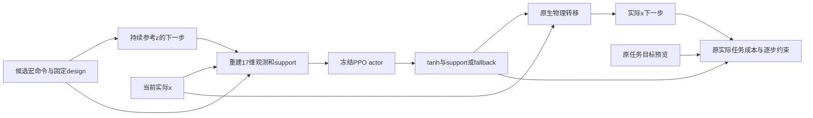

# 预测实际执行闭环的MPC：接口实现、原任务需求与不训练核验

日期：2026-10-17。按用户指定的`e23a28a`三份文档和后续`8488a1c`交接继续。本阶段实现并核验原生PPO的实际闭环预测，没有训练、改变checkpoint、采购、操作机器人或开启自动检测。

首篇已确认科学问题保持：**在长程、多阶段机器人任务中，扰动和执行误差会改变后续动作的可完成性。如何根据后续任务需要学习可实现的反馈响应，并让MPC利用这种能力调整计划，在相同模型信息、输入权限和计算预算下，改善完整任务的成功率、完成时间与资源代价？**狗和臂目标暂保留、主平台未定，实机场景仍是设计稿。

**本次结论：旧接口的actor无关预测已经修复，原任务对实际神经执行的需求可计算且非零；相同冻结actor下重规划确有任务成本变化，但存在约束代价。所得梯度被同信息标准模型化策略梯度/离散伴随完全解释，尚无共同学习增量。**应保留新接口作为分析基准，停止将这项梯度或规划改善称为新的RL能力学习成果。

## 1. 实现了什么

新文件不覆盖旧原型：

- [closed_loop_prediction.py](../src/response_ppo/closed_loop_prediction.py)：纯functional的一步、任意低层命令timeline和宏命令候选预测。
- [execution_aware_env.py](../src/response_ppo/execution_aware_env.py)：独立`ExecutionAwareServo`，调用原SPlaTES CEM bridge，预测当前actor执行的实际状态。
- [identity及实际重规划评估](../scripts/validate_closed_loop_interface.py)。
- [同候选池与任务导数核算](../scripts/audit_closed_loop_mpc_demand.py)。

旧`env.py`、训练器、原planner bridge及检查点没有修改。分析对象仍是原三状态、17维观测、单动作系统；增广状态包含x和z共六个量，但**它不是六状态双执行器探针**。

| 接口量 | 具体含义与延续规则 |
|---|---|
| 实际x | 位置、速度、执行器输出；从当前实测/仿真状态开始，跨宏段持续 |
| 参考z | 参考位置、速度、执行器状态/输出；净加速度还需减去非线性及阻力项；按原response推进，绝不重置为x |
| 命令 | 宏周期10拍；采样坐标第二分量转换为执行eta，原域不变 |
| raw_design | 检查点已有四参数响应design，整轮固定；不是新训练的模型参数 |
| θ与执行映射 | 原17→64 Tanh→64 Tanh→1均值网络，原support/tanh/fallback；每步重建观测 |
| 时间与目标 | 当前tick及原任务已提供的目标预览；不向actor新增任务参考输入 |
| P/B/E/cfg | 原固定物理/支持条件；P沿用保存的数值，不用更高精度重算一个不同指标 |
| 扰动 | 主预测为名义w=0；support内部仍保留W=.04。真实隐藏相位不进入规划 |

控制执行和预测中的动作链相同：

MPC读`[x,z,raw_design]`，只用当前状态初始化；候选中逐步调用当前actor产生动作。低层实际执行仍由actor完成，没有替它另求一个最优反馈控制器。当前精确展开是可核验的分析基准，不是已证明适合最终机器人在线运行的架构。以后可由校准紧凑`Gφ/Sφ`替代，但其对象与actor版本必须一致。

## 2. 原任务如何进入需求

对固定候选宏命令C，按80个低层步预测

\[
u_j=a_\theta(x_j,z_j,c_j;d),\quad
x_{j+1}=f_0(x_j)+Bu_j+Ew_j,\quad
z_{j+1}=R(z_j,c_j;d),
\]

其中d是固定raw_design。主目标为

\[
J(\theta,C)=\frac1{80}\sum_{j=0}^{79}
\left[(p_{j+1}-r_j)^2+0.005u_j^2+0.01v_{j+1}^2\right].
\]

时间索引、目标权重与原实际task相同，没有增加Γ、终端价值或人为恢复奖励。原PPO `total`中的一步条件违反和empty惩罚另列，不能把此task-only导数称为完整旧PPO reward梯度。

主规划仍使用原reference域可行门槛，以隔离预测对象变化。actual域、input、tube、support违反逐前缀公开；次级共同actual/input/tube筛选对两种成本完全相同，另列结果。**新预测能看见违反，不代表主选择器已把它作为硬约束。**后面的penalty负结果正说明这一差别重要。

预测w=0表示名义对象；原物理执行仍使用原隐藏扰动过程。没有把W改0、泄露未来phase，或将逐拍W换成另一个能量球。历史已发生扰动只用于identity核验，不能称为planner预览。

## 3. 接口接通：数值证据

[协议](../notes/closed-loop-interface-2026-10-17/protocol.md)在运行前冻结，全部12个正式检查点都执行，没有挑选性能较好的组。

- 12组×256步×16环境的一步预测，与原记录的状态、观测、动作、task/total和原metric精确一致，最大差0。
- 12组最初80步，在相同历史命令与明确标注的历史扰动下连续预测，状态和metric最大差0。
- 原checkpoint及六个旧生产源文件的执行前后hash不变。

这证实执行映射及状态接续实现正确；不等于未知对象模型精确或随机策略期望预测正确。本轮使用与原确定性评估相同的Gaussian中心执行语义。[完整identity结果](../notes/closed-loop-interface-2026-10-17/validation-results.md)

## 4. 原任务的非零需求与同信息导数

共同池查询固定为tick0/60/120/180、全部16环境和全部12检查点，共768查询。原CEM的warm-start从tick0每10拍重建，首命令与原记录精确一致。两种成本共用原34候选池，不重新抽取有利候选。

- 113/768查询改变了最优的不同命令序列：support为6/384，penalty为107/384。
- 全部查询有原reference域可行候选；次级共同actual/input/tube筛选下140/768没有可行候选，均在penalty组。
- 新actual argmin在同池actual预测成本下不高于reference选支，是选择定义的必然，只算排序/模型失配证据。

梯度查询事先固定为每组tick60/env0，使用同池actual赢家C。12/12实际任务梯度非零，范数为`1.66e−4–9.10e−3`。独立离散伴随与完整展开BPTT的最大相对差为`1.47e−15`；使用旧原生方法独立shooting这12条固定计划，成本差不超过`8.67e−18`。24项预声明方向差分保持分支，最大相对误差`2.77e−6`。

这里的需求来自原目标误差、实际输入及未来执行状态。以累计成本的costate记号，有

\[
\beta_j=\lambda^x_{j+1}
+[2(p_{j+1}-r_j),\ 0.02v_{j+1},\ 0]^T,
\quad\xi_j=B^T\beta_j+0.01u_j,
\]

\[
\nabla_\theta J=\frac1{80}\sum_j
\left(D_\theta a_\theta\big|_{x_j,z_j,c_j}\right)^T\xi_j.
\]

完整状态costate包括support观测及znext的依赖，见[推导](../notes/closed-loop-interface-2026-10-17/theory.md)。它就是同信息的标准模型化策略梯度，不因写成控制伴随而多出一个新优化方向。选中的梯度轨迹未使用fallback，不能把这些数值核验扩大为已覆盖所有fallback边界。

还有一条直接限制主张的结论：在**同一个完整当前名义计划**上，如果所有实际动作值一阶保持，则该名义task的一阶导数也为0：

\[
P_{\ker J_{\rm value,current\ plan}}\nabla_\theta J=0.
\]

所以本次非零需求不能冒称纯反馈斜率信用；旧128锚点保持也不能替代当前计划或全任务保持。负梯度侧有限探针的名义cost下降只用于导数核验，未更新或部署任何策略。[逐组需求证据](../notes/closed-loop-interface-2026-10-17/pool-and-gradient-results.md)

## 5. 当前策略不变时，实际重规划产生了什么

随后运行全部12组原first-short条件：同actor、design、seed、初态、目标与实际扰动，16环境×256步，仅更换规划预测接口。它是新反事实执行仿真，不是旧记录重放。

| 分组 | task成本变化（组内均值之比） | 约束观察 | 可支持的结论 |
|---|---:|---|---|
| 6个support检查点 | −0.8612% | actual/reference域、tube及empty违反均0 | 正确预测当前执行响应能在这些固定任务上改善规划 |
| 6个penalty检查点 | −2.7945% | 平均tube违反率从36.8245%升到38.7899%；4组原total成本变坏 | 任务成本改善不能覆盖实现条件代价 |
| 全部12组简单汇总 | task从0.01614209109降至0.01584444715，约−1.8439% | 不把分组负结果平均掉 | 仅为冻结actor的预测/规划效果，非学习收益 |

tube违反率是低层时刻×环境样本的比例，不是完整任务失败率。四个tube恶化case为：seed17/joint_penalty `24.292%→27.026%`，seed29/joint_penalty `55.493%→55.615%`，seed43/joint_penalty `22.974%→30.151%`，seed43/fixed_penalty `33.081%→44.385%`。原total成本变坏的case则为seed17的两个penalty组及seed43的两个penalty组，二者不能混成同一指标。

这没有验证首篇机器人任务的成功率、完成时间或跨形态学习；只是沿用已有原生任务的成本与约束检查。双平台范围不变，不因本次servo结果锁定实机场景。

## 6. 强方法比较及计算边界

本轮完成同目标direct BPTT与独立policy-constrained shooting/costate的核验；允许完全一致。随后按[补充冻结协议](../notes/closed-loop-interface-2026-10-17/independent-shooting-protocol.md)，用旧`ResponseServo`基础方法独立重新积分全部48个池、26,112条候选，没有调用新预测模块。768/768查询的不同命令赢家一致，actual成本最大差`1.11e−16`，主要及次级约束掩码全同，次级无可行仍为140。它与新池评分具有相同候选、actor调用和物理预测步数；具体几何运算与墙钟另列，不能称同墙钟预算。[独立shooting结果](../notes/closed-loop-interface-2026-10-17/independent-shooting-results.md)

这是实际完成的独立有限池shooting比较，不只对同一成本数组再次argmin；它也不是一个独立连续TO求解器或全局最优证明。

没有执行独立连续TO求解器、鲁棒全扰动集合优化、训练后学习曲线或严格同墙钟学习预算竞争。因此不能声称新的联合方法胜过它们。名义w=0问题也不能改称robust worst-case问题。

同候选数不等于同总计算：原reference预测每步不跑actor，新预测每个候选微步都重建support并运行网络。新12组实际评估墙钟合计约126.34秒；这是本次CPU运行记录，不是独占实时率或Orin部署benchmark，不与上一阶段17.58秒简单作严格测速结论。

本轮主要已发生计算：identity 64,512模型微步；共同池reference重建9,922,560微步、actual评分2,088,960微步；12组需求/伴随/差分/固定计划shooting共6,720模型步，另960个reference状态Jacobian；新实际执行49,152仿真转移，其MPC预测13,578,240微步。额外独立同池shooting已完成，另计2,088,960预测微步及相同actor调用，墙钟约8.17秒。训练、权重更新、梯度优化器步和checkpoint写入均0。

## 7. 三层验收与继续／停止决定

| 层次 | 当前状态 | 决定 |
|---|---|---|
| 接口接通 | 完整执行链及历史连续预测精确吻合，actual planner已运行 | **通过**，保留为可核验分析基准 |
| 原任务产生需求并被规划使用 | 12组需求非零、同池排序部分改变、冻结策略实际成本改变；penalty有约束恶化 | **有条件支持继续**，必须保留任务—实现条件取舍，不能仅追task成本 |
| 共同学习相对同信息强方法有增量 | 梯度被标准BPTT/伴随解释，actor未学习 | **未建立**，停止将该梯度或规划改善包装成新RL能力/算法优势 |

继续研究应围绕真实执行响应的表示、模型误差、任务相关可实现变化和总预算，而不是重复证明局部导数非零。只有物理模型/规划改善时就据实收窄；对penalty违反恶化不能继续使用“名义reference gate已足够”的安全/性能主张。后续若采用共同actual/tube硬筛选，需双方一致并正面处理无可行候选，不能放宽基线或另挑任务。

当前仍不进入训练或硬件阶段。完成材料供手动复审；自动检测保持关闭，Go2/Piper与采购状态没有改变。原训练batch仍未恢复，本轮没有伪造优势或旧概率。
