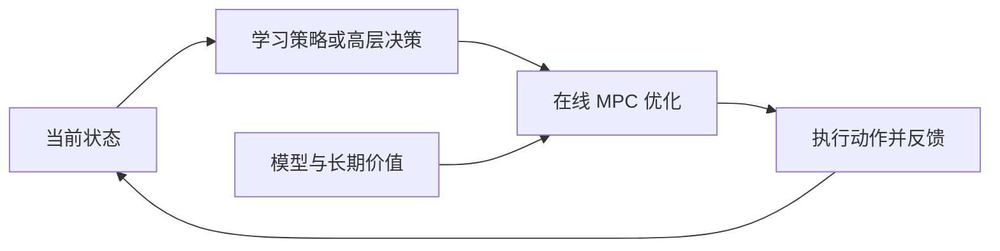

# MPC 与 RL 的融合方法地图

本页是面向阅读的接口整理。八个文献目录是本仓库的组织方式，不是某一篇综述的原始分类。主库按 2024—2026 年近期研究组织；经典只在需要解释方法来源时回查。具体顺序见 [近期阅读路线](reading-plan.md)。

## 先看三个不同维度

1. **MPC 在学习系统中承担什么角色？** 训练专家、策略的一部分、价值评价器，或部署时的附加规划器。
2. **学习量进入哪里？** 模型、代价、终端价值、初值、迭代更新、外层参考或训练数据。
3. **训练与部署怎样计算？** 训练是否反复求解、是否对求解器求导、部署是否保留 MPC、是否在线更新参数。

同一种“RL 调 MPC 权重”方法，可能通过可微优化训练，也可能把 MPC 放进环境中，用无求解器梯度的 RL 训练。接口相同不代表训练机制相同。

## 统一的阅读参照

以下采用最小化代价的记号：

$$
U_t^* = \arg\min_{u_{0:H-1}}\left[\sum_{k=0}^{H-1}\gamma^k\ell_\theta(x_k,u_k)+\gamma^H V_\phi(x_H)\right],
\quad x_{k+1}=f_\psi(x_k,u_k),\quad g_\eta(x_k,u_k)\leq0.
$$

执行时通常取第一步动作，并在获得新状态后重新求解。这个式子只是阅读参照，不表示每篇论文都学习全部参数，也不表示每个采样规划器都显式实施硬约束。

| 学习对象 | 直观作用 | 阅读时要查的问题 |
|---|---|---|
| 模型 $f_\psi$ | 预测候选动作会怎样改变状态 | 学习目标与真正影响决策的误差是否一致？ |
| 代价 $\ell_\theta$ / 参考 | 决定当前优化更重视什么 | RL 优化的是实际闭环回报，还是固定轨迹误差？ |
| 价值 $V_\phi$ | 评价有限时域之外的后果 | 评价的是哪个策略，在哪些状态可信？ |
| Actor 生成的初值 | 给优化器一个合理起点 | 能否在实际迭代预算内形成更好的第一步动作？ |
| 候选分布或优化更新 | 将搜索集中到有价值的轨迹 | 少采样是否真的减少延迟，收益能否跨任务保持？ |
| 高层意图 | 减少局部控制器面对的长期组合决策 | 意图能否由底层实现，失败后如何重新决定？ |
| 教师数据 | 把规划经验用于策略训练 | 是否计入教师生成成本，策略是否受其覆盖限制？ |

## 三种典型计算链

这张图适合 Actor 辅助规划、价值辅助规划和部分分层结构。模型补偿路线可以让网络直接影响预测模型；训练侧教师路线则把 MPC 放在数据生成环节，部署不一定运行在线优化。

| 路线 | 训练期间 | 部署期间 | 代表文献 |
|---|---|---|---|
| Actor / Critic 帮助 MPC | 学习策略与价值 | 策略初值、终端价值与在线优化 | MR029 AC4MPC |
| MPC 是结构化策略 | 通过回报更新 MPC 参数 | 由参数化优化问题产生动作 | MR008 Data-Driven Economic NMPC；MR086 AC-MPC |
| 学习模型中的在线规划 | 联合学习模型、奖励、策略与价值，并规划收集数据 | 短时域规划与终端价值 | MR026 TD-MPC2；MR119 TD-M(PC)²；MR122 BMPC |
| MPC 教师帮助学习 | 优化数据或轨迹改进参与策略更新 | 取决于方法：可只用策略，也可继续在线规划 | MR122 BMPC；MR095 MPC-Net、MR088 Guided Policy Search 为经典回查 |

近期方法还在追问这些接口是否匹配：BMPC 用规划器产生的行为训练策略，再让策略帮助规划；TD-M(PC)² 针对规划策略与价值函数所评估策略之间的失配；DEQ-MPC（MR163）把网络推断与优化必要条件写成联合不动点问题。这些例子用于定位阅读问题，不能据此认定方法已经在所有任务上解决了价值偏差、收敛或安全问题。[BMPC 正式记录](https://proceedings.iclr.cc/paper_files/paper/2025/hash/8636419dea1aa9fbd25fc4248e702da4-Abstract-Conference.html)、[TD-M(PC)² 正式记录](https://proceedings.mlr.press/v331/lin26a.html)、[DEQ-MPC 正式记录](https://proceedings.mlr.press/v305/gurumurthy25a.html)。

## 容易混淆的边界

- RL 不等于部署时持续更新网络；冻结策略仍能根据观测闭环控制。
- 学习动力学加 MPC 不一定含 RL；模型监督学习、模仿学习和 RL 应分别标明。
- MPPI / CEM 属于在线优化方法，使用它们本身不等于使用 RL。
- 有约束项、低代价或仿真成功，并不自动构成真实系统的安全保证。
- 理想精确优化下的结论、有限次迭代算法和实际实现应分别阅读。
- 样本效率、训练时间、优化器耗时与完整闭环延迟不能相互替代。

来源：[MR004 正式综述](https://doi.org/10.1016/j.arcontrol.2026.101045)、[MR008](https://doi.org/10.1109/TAC.2019.2913768)、[MR029](https://doi.org/10.1109/TCST.2025.3620521)、[TD-MPC](https://proceedings.mlr.press/v162/hansen22a.html)。
