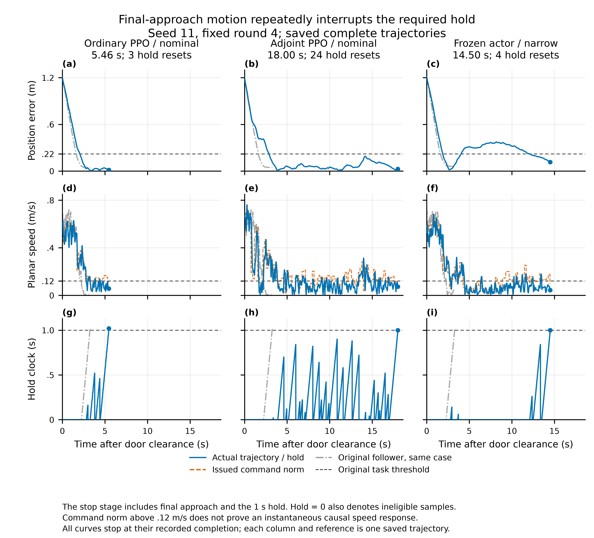

# Go2既有负结果的归因：公共停稳规划与策略更新受限

日期：2026-10-20。状态：**离线诊断完成；没有训练、模型拟合、新物理轨迹、参数或场景修改。PR未合并。**

**这批负结果首先暴露了公共体系的问题，不能直接解释为“伴随机制导致停不稳、因而原理无效”。** 过门后的主要拖延来自终点附近的继续运动、速度越界和保持计时重置；在已检查的终点状态，模型—规划重放显示公共代理目标会拒绝自己预测能更早完成的候选；这尚未给全部组间时间差分配因果份额。KL早停则是两组共同的实际策略更新尺度超过既定联合分布阈值，首轮有相同数据的直接对照，CV不是这一现象的必要原因。

与此同时，原固定小试的事实不变：伴随组没有显示稳定整程收益，末轮均值比普通组慢6.27%。本诊断没有把它改写为正结果。它收窄的是因果解释：**当前实现的有限预算结果为负，但实验中的有效actor学习很少，且公共规划存在终止目标失配，因此不足以单独否定伴随信用机制。**

## 1. 任务究竟慢在哪里

对全部27条末轮、27条共同起点评价、seed11的9条第3轮轨迹，以及3条原跟随器参照做了相同任务分解。三组相同起点重复轨迹不算独立实验。停止仍沿用原判据：位置误差≤0.22米、平面速度≤0.12米/秒、朝向误差≤0.20弧度，连续保持1秒；没有改变判据来解释结果。

三个末轮均值的过门至完成时间：冻结5.122秒、普通4.524秒、伴随5.478秒；原跟随器3.287秒。普通与伴随从过门到首次进入位置容差区的均值分别1.840与1.873秒，差异很小；较大的差异发生在进入目标区后实现连续保持。

| seed11实例 | 过门/s | 首次进入位置容差/s | 最后连续保持起点/s | 完成/s | 保持重置 |
|---|---:|---:|---:|---:|---:|
| 普通，第4轮nominal | 8.30 | 10.36 | 12.74 | 13.76 | 3次，均为速度 |
| 伴随，第4轮nominal | 8.44 | 11.32 | 25.44 | 26.44 | 24次，23次速度、1次朝向 |
| 冻结，第4轮narrow | 8.52 | 10.42 | 22.02 | 23.02 | 4次速度，另离开过位置区 |

伴随nominal进入位置区后一直没有离开，第一次同时满足三项条件是在11.78秒，但连续保持反复被短时越界打断。位置与朝向已经合格而速度不合格的时间共4.18秒，其中3.90秒对应的平移命令模长本身超过0.12米/秒。进入位置区后的平均实际速度仅0.099米/秒，但平均命令模长为0.145米/秒；平均速度低不能代表能连续保持。

普通与伴随上述实例的过门后速度命令跟踪RMSE分别0.1112与0.1139米/秒，差异很小。它不支持把12.68秒完成时间差主要解释为候选低层完全失去跟踪能力。命令、动力学滞后与步态波动共同产生实际越界，不能将同期命令超过阈值直接当作全部越界的独立因果证明。

冻结narrow的actor从未学习，却也从第3轮11.74秒变为第4轮23.02秒；它在12.58秒退出位置区，20.62秒才重入。这直接排除了“必须有CV或actor更新才会出现这种拖延”的解释。

公共时间尺度还有一个独立问题：只把同一条已执行50Hz轨迹按原0.2秒宏边界下采样，伴随nominal出现8个“两端都满足停稳、内部20ms样本却速度越界”的窗口。只检查宏边界会在16.80秒宣告保持满1秒，真实任务直到26.44秒才完成；普通同例为1个漏峰窗口，宏判13.40秒、真实13.76秒。冻结narrow没有这种漏峰窗口，其主要拖延是离开位置区。即使g准确预测每个200ms端点，也不能仅据这些端点证明20ms检查下的连续保持。这是原轨迹的采样语义比较，不是新物理结果；没有在真实完成后的未保存部分补点。[宏步遗漏保持重置](../notes/go2-adjoint-diagnosis-2026-10-20/terminal/macro_hold_aliasing.csv)。

逐例时序、所有保持重置原因和全部末轮比较见[终端行为证据](../notes/go2-adjoint-diagnosis-2026-10-20/terminal/summary.json)。真实Task的保存计时是主要依据，不把50Hz浮点重算的阈值误差当成任务失败。

## 2. 为什么规划还在要求终点附近运动

原日志没有完整保存CEM候选池。诊断先用原检查点、原随机流、实际保存的full48状态与任务记忆重放437个宏决策，原首命令最大差为4.36e-7。然后在25个实际终点附近状态固定原768候选池，只替换已有g/V组件重评分，不改变候选预算、不新搜一个更好的答案。

结果很有区分力：

- 去掉V或换上一轮V，25/25个点的赢家都不变。原赢家和几何跟随候选均已被模型预测为完成，所以终端V已被完成标志置零。
- 只换上一轮g，三个第4轮实例的15/15个定点选择改变。冻结actor的实例同样如此，说明公共响应模型更新足以改变末段命令偏好。
- 9/25个点中，当前g预测几何跟随候选更早完成，原目标却选了预测更晚完成的候选。

以伴随nominal实际14.8秒的状态为例，当前位置误差仅0.0766米、实际速度0.0433米/秒，已经开始保持：

| 同一当前g、同一候选池 | 原规划选择 | 几何跟随候选 |
|---|---:|---:|
| 首次预测完成还需 | 2.0秒 | 1.0秒 |
| 原代价，越低越好 | 5.3909 | 10.0128 |
| 固定时间项 | 4.0 | 4.0 |
| 终端参考余程惩罚 | 0.0 | 5.8115 |
| 终端V贡献 | 0.0 | 0.0 |
| 4秒末端预测y，目标为3.6米 | 3.7174米 | 3.5822米 |

跟随候选被预测为1秒后已满足真实任务条件，却因4秒后仍位于精确路线终点前约1.8厘米，继续受`20 × remaining_reference_time`惩罚。原赢家预测越过路线终点，余程惩罚为零。**公共评分在追求精确路线终点，真实任务则允许位置容差并要求连续保持，两者并不一致。**

代码中的具体原因是：固定20步各加0.2秒，所以时间项恒为4秒；预测complete后任务记忆吸收，但状态继续展开，几何、命令和终端项继续计费，只清零V。因此更早完成没有减少固定时间项，也没有取消完成之后的虚拟代价。在上述例子里，更早完成的跟随候选还承担了3.061的完成后运行代价及5.820的终端代价。

g的变化会通过这项终端评分改变排序。上述同一跟随候选换旧g后预测末端位于3.751米，余程项消失，选择回到跟随候选。对已执行0.2秒后继的核对显示，三个第4轮实例近终点区的平均位置误差只有约1厘米，速度向量误差约0.085–0.091米/秒；并不是所有短时误差都显著恶化。真正敏感的是这些误差经过4秒展开和终端评分后如何改变决策。

这建立了**当前g与公共目标共同造成不合适候选偏好的计算链**，没有证明换旧g实际执行就会快多少。旧g在学习组还对应旧actor；没有新增物理续跑，所以不分配“拖延的百分之几属于哪个模块”。[重放、同池替换与原代价分解](../notes/go2-adjoint-diagnosis-2026-10-20/planner/README.md)。

## 3. KL为什么几乎只允许一次更新

将每轮前后actor加载到原B状态上，直接计算12维Gaussian的解析KL：

| 判别量 | 结果 |
|---|---|
| 全B状态平均解析KL超过原0.02阈值 | 24/24轮 |
| 解析KL范围 | 0.020472–0.117143 |
| actor实际更新次数 | 22轮各1次；2轮各2次 |
| KL由方差变化造成的最大比例 | 约0.0000403% |
| 主要变化 | 动作分布均值 |

这不是只被某个噪声大的minibatch误停。三seed第1轮，普通/伴随的B数据逐tensor相同、旧actor相同，其KL分别为：

| seed | 普通 | 伴随 |
|---|---:|---:|
| 11 | 0.0708533 | 0.0708532 |
| 23 | 0.1171320 | 0.1171427 |
| 37 | 0.0552967 | 0.0552965 |

两组首步更新后均值RMS差，只占各自旧到新变化的0.035%–0.072%。CV对首步实际变化很小，不能把首步即停归为CV特有问题。后续数据、策略及优化器历史已经分化，不再把全部后续差异直接归于CV。

公共动作标准差约0.10026。方差近似不变时，12维联合KL达到0.02只需要每关节均值RMS变化约0.00579；实际首轮为0.00963–0.01401。学习率3e-5和梯度范数裁剪并不直接约束动作分布KL，多个网络参数同时变化足以产生这个差异。

原更新流程又是在**更新前**检查：第一批仍是旧策略，KL为0，允许一步；下一批发现越界才锁住actor，余下epoch都只更新V，不撤销已经越界的策略。因此本轮主要跑完了采样、模型/价值拟合与评价，actor只接受了少量更新，不能称充分验证了学习效率上限。

记录中的`approx_kl`来自最后一个minibatch，不是触发批。seed23普通第4轮末尾记录0.017448，触发位置重算为0.023854，解析值0.020021。旧概率和最后记录复算相符，没有发现把裁剪动作当Gaussian样本或错载旧策略的证据。两个接受两步的轮次没有中间checkpoint，只能核对最终停止位置，不能重建中间策略轨迹。

所以已确认的是**实际公共更新尺度与当前联合KL控制方式不匹配**。本轮没有尝试其他学习率、标准差、阈值或奖励尺度，不把某一项调参当作已验证修复。[KL完整解释及逐轮证据](../notes/go2-adjoint-diagnosis-2026-10-20/kl/README.md)。

## 4. V和伴随方向还留下什么问题

V在部分确定性部署后缀上明显失准。伴随seed11 nominal第4轮首次进入0.35米区域时，保存V预测余程回报约−1.882，实际成功后缀回报为−15.54，对应15.54秒；第3轮同区域定义下两者为−2.384与−2.04。V的目标包含失败惩罚，只有这些实际成功后缀的回报才直接等于负时间。该差异揭示当前价值没有可靠预见长时间的终点调整。

但不能将V列为上述25个定点规划拖延的直接原因：那些赢家的终端V已被置零，去掉或换V不改变选择。V在其他状态、此前规划以及学习信用中的作用没有因此排除。

当前伴随局部展开的时间代价为常数，完成判断采用布尔门槛，固定分支上不提供穿越完成事件时刻的直接导数；动作信用主要依赖终端V梯度经f和旧反馈反传。V能否描述连续保持的后果，因而是此候选需要解决的实质条件。V在真实后缀上失准并不自动证明其每个局部梯度都错，本轮没有用局部梯度检查替代任务收益。

V训练的是随机B回报，评价采用确定性均值；B记录还来自当轮更新前V，评价来自更新后V。因此这项分析是部署后缀校准诊断，不是证明训练return算错，也不是纯粹的同critic分布实验。[保存V与真实后缀](../notes/go2-adjoint-diagnosis-2026-10-20/value/summary.json)。

## 5. 负结果应如何解释，接下来处理什么

| 问题 | 现有证据支持的归属 | 尚不能声称 |
|---|---|---|
| 终点内反复运动、保持被打断 | 已检查状态的公共g—规划候选排序失配有重放及冻结actor对照；实际速度越界可见 | 所有最终时间差都由g造成，或某个替换已经改善实跑 |
| 预测停稳与真实连续保持不一致 | 200ms端点检查会漏掉20ms速度峰，实际轨迹下采样已确认 | 每种拖延都由时间尺度造成，或宏端点准确即可保证停稳 |
| 一次更新后KL早停 | 公共12维分布变化与既定更新/停止方式；首轮同B排除CV为必要原因 | 某个新超参值必能解决，或增加更新必有收益 |
| V没有预见长停稳后缀 | 公共价值校准问题，并影响CV信用来源的可信度 | 被掩码为0的25个决策由V直接造成 |
| 伴随组末轮均值更慢 | 当前完整实现和预算下的有效负结果 | 伴随原理已被独立否定，或诊断反过来证明候选有效 |

当前应继续保留负结果和强简单参照，保留统一训练代码，但暂缓为CV追加训练。先处理两个公共设计前提：**规划代价、预测终止与实际连续保持必须指向同一任务；策略更新必须有清楚可执行的KL约束，并如实记录触发检查和实际学习量。** 这些是当前代码里能明确定位的问题，不需要改场景制造新难度。

模型与价值的质量也应按终点决策和连续保持来评价，不能仅凭全状态回归损失判断是否够用。公共问题澄清后，才有条件用新的预先固定协议判断伴随信用是否比普通方法更有效；本轮没有实施这些生产改动，也没有给出它们已经有效的结论。

上述公共问题并未证明伴随机制完全无责：后续策略、访问状态与模型训练数据会分化，CV可能通过这些路径改变最终轨迹。本轮排除了若干错误的必要原因解释，并确定了公共链条中的实际失配，没有在无物理对照的条件下分离所有交互效应。

所有离线分析在本地已下载数据上进行，服务器没有新作业、训练或自动检测。生产`src/go2_learning`、`src/go2_frozen`和配置保持原样；新增内容只有诊断脚本、来源哈希、结果及接续文档。[本轮证据索引](../notes/go2-adjoint-diagnosis-2026-10-20/INDEX.md)。
