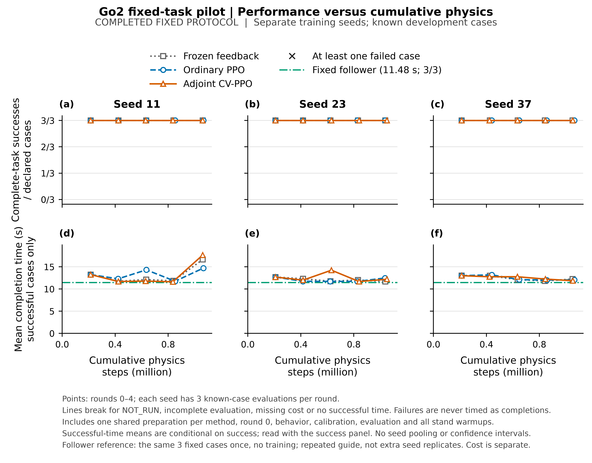
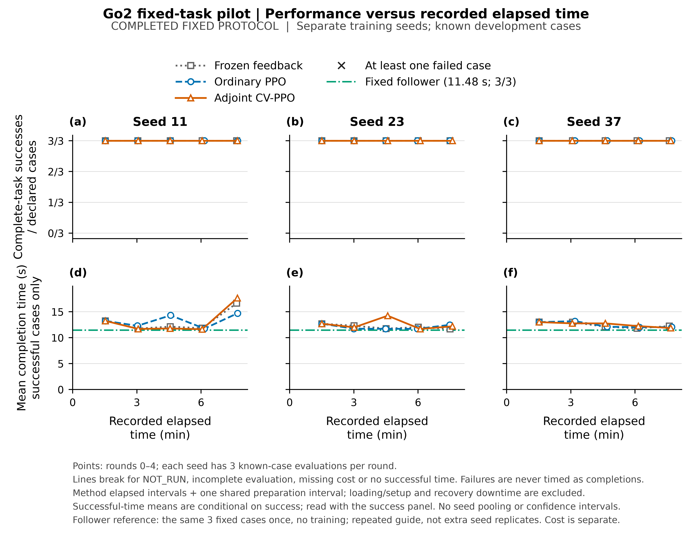

# Go2固定三组小试：当前伴随机制没有稳定的整程收益

更新：2026-10-20。状态：**COMPLETED，修复后比较有效；当前候选增益不获本轮支持。**

后续仅用原轨迹与检查点的[离线归因](go2-adjoint-diagnosis-2026-10-20.md)已完成：公共终点评分、保持检查时间尺度和策略更新约束存在可定位的问题。下述任务结果与成本不变；归因不把负结果撤销，也不将它外推为伴随原理独立失效。

按固定3个种子、3组、每组4轮协议完成。末轮冻结组、普通任务条件PPO＋辨识、伴随组均为9/9完整成功；平均任务时间分别为13.529、13.084、13.904秒。伴随组相对普通组慢6.27%，机械功代理高2.03%、力矩平方积分高5.22%，路径RMS高7.58%。两个种子略快、一个种子明显变慢，不能声称稳定收益。全部学习曲线也没有呈现持续的数据或计算效率优势。

同服务器、同运行环境的原参考跟随器，无训练三条件3/3成功，平均11.480秒。三组学习体系都没有超过这个性能参照。它不是三组机制实验中的同结构消融，但说明当前复杂体系尚未提供任务上的实用增量。

**本轮决定：保留统一可训练Go2体系、普通PPO基线与全部结果；停止当前固定伴随候选的追加训练和正增益主张。** 这不否定MPC规划＋RL执行的方向，也不证明该类控制变量在所有任务或充分收敛后无效。没有按结果改场景、奖励、参数或挑选最好检查点，没有合并PR。

## 完整任务表现

三条件为既有nominal、narrow、wide；每个训练种子在同三个开发条件评价。下表使用预定第四轮，9次为3个训练重复×3个已知条件，不能当作9个独立泛化任务。

| 方法 | 完整成功 | 完成时间均值/s | 三个seed均值的样本SD/s | 机械功代理均值/J | 力矩平方积分均值 | 路径RMS均值/m |
|---|---:|---:|---:|---:|---:|---:|
| 冻结反馈＋共同规划/辨识 | 9/9 | 13.529 | 2.720 | 821.45 | 4755.31 | 0.08047 |
| 普通任务条件PPO＋辨识 | 9/9 | 13.084 | 1.425 | 835.72 | 4685.27 | 0.05823 |
| 伴随辅助PPO＋辨识 | 9/9 | 13.904 | 3.245 | 852.66 | 4929.85 | 0.06264 |

冻结组仅冻结actor，f/g/V仍按共同协议拟合，所以它的表现也可能随轮次变化。机械功为仿真积分代理，不能解释为电池能耗。完整回报是实际任务时间的负值，加原失败惩罚；本次末轮无失败。主判断仍是成功和任务时间，资源列不替换主指标。

| 训练seed | 冻结/s | 普通/s | 伴随/s | 伴随−普通/s |
|---|---:|---:|---:|---:|
| 11 | 16.653 | 14.713 | 17.647 | +2.933 |
| 23 | 11.687 | 12.473 | 12.200 | −0.273 |
| 37 | 12.247 | 12.067 | 11.867 | −0.200 |

三个seed差值的均值为+0.820秒。只有三个训练重复，不据此做强显著性或普遍优劣断言。[逐条件末轮记录](../notes/go2-adjoint-rerun-2026-10-20/analysis/final_evaluation.csv)和[配对差值](../notes/go2-adjoint-rerun-2026-10-20/analysis/paired_final_adjoint_vs_ordinary.csv)全部保留。

九个逐条件配对中候选五个更快、四个更慢，但seed11 nominal从普通的13.76秒增至26.44秒，幅度不能隐藏。保存的阶段事件显示，两者过门约8.30/8.44秒，主要时间差在过门后的终点接近与停稳阶段；冻结seed11 narrow也从8.52秒过门延长至23.02秒才完成。因此不能将所有退化归给actor或伴随方向，公共事实模型、价值与上层规划更新也可能影响任务表现。这是[已保存轨迹的定位](../notes/go2-adjoint-rerun-2026-10-20/terminal-phase-observations.json)，没有新增消融来确定因果份额。stop阶段包含终点接近及最终1秒保持，不全是制动或原地静止。

## 学习效率与实际更新

每个seed每组随机采集21000个策略步，另有相同公共准备；确定性校准和评价按实际完整轨迹计费。全协议随机策略步204750，不能因B批相等就宣称总交互完全相同。

两图包括公共准备、初始评价、全部行为采样、确定性校准、更新、模型拟合、后续评价及每episode站立准备。每列是一个训练seed，不把三个条件当独立seed。绿色点划参照线为同服务器原跟随器11.480秒，仅作性能参照；它的独立成本没有加到三组横轴。

seed11伴随组第1—3轮为11.687、11.780、11.627秒，第4轮变为17.647秒；普通组也有往复，冻结组在末轮同样变慢。因此不能挑选较好的第3轮作为最终结果，也不能仅凭这种波动把原因归给伴随方向。seed23和37的局部优势并未形成跨种子持续优势。

公共KL阈值0.02在两学习组全部24次轮级更新中均触发停止：普通组实际actor minibatch更新为6/4/4，共14次；伴随组为4/4/4，共12次。V仍完成全部规定更新。**四轮不等于actor完成四轮全量epoch，更不等于收敛。** 此结果回答的是这份固定小预算协议有没有观察到收益，未回答充分训练的最终能力。没有为弥补负结果而改学习率、KL阈值或追加更新。[真实更新记录](../notes/go2-adjoint-rerun-2026-10-20/analysis/actor_update_history.csv)保留停止标志和次数。

全部135条确定性评价均成功；117条确定性校准也均成功。包含随机采集后共保存614个episode条目：499条完整成功、0条完整失败、115条预算截断。截断条目的成功与完成时间为空，保留实际时间、回报、资源，未当作失败或完整成功。学习期数据与反复评价的开发条件不作为额外独立测试样本。[全部episode](../notes/go2-adjoint-rerun-2026-10-20/analysis/all_collection_episodes.csv)。

## 总计算代价

以下“单独采用该方法”口径给每个方法分配三个seed各自一次公共准备，包含初始及逐轮评价。各行公共准备重复分配，所以**不能将三行相加当本项目总成本**。墙钟用实际分支生命周期加公共准备区间，物理步包含全部站立；系统加载/初始化落盘的少量开销在整个进程总时长中。

| 方法，合计3个seed | 全部物理步 | 独立使用成本/s | 分支自身成本/s | 实际actor更新 |
|---|---:|---:|---:|---:|
| 冻结反馈 | 3,149,640 | 1366.020 | 1151.684 | 0 |
| 普通PPO＋辨识 | 3,166,640 | 1374.037 | 1159.701 | 14 |
| 伴随辅助PPO | 3,163,360 | 1378.415 | 1164.079 | 12 |

伴随组总物理步比普通组少0.104%，独立使用墙钟高0.319%；这点交互差异没有换来更好的末轮任务结果。12次伴随计算合计7.784秒，占干净批次活跃时间约0.211%。因此本次主要问题是没有稳定的任务收益，不能把负结果简单归咎于伴随反传特别昂贵。

普通组按原公平协议仍拟合了actor更新不使用的动作模型f。三个seed分支拟合共1.539秒，加公共准备共1.925秒；扣除后普通组的乐观成本估计为1372.112秒。这是“其他工作不变”的账面扣除，未实际重跑，也不代表已让普通组利用省下算力。这项修正不会改变当前结论。

干净批次共有准备只计一次后，共362346个策略步、8474920个物理步，其中站立1228000步；actor更新26次、V更新3276次、f/g各4992次。采集耗时3662.153秒，其中CEM规划2619.258秒，后者是前者子项，不能重复相加。PPO/V为6.186秒、事实模型拟合9.619秒、伴随为7.784秒。进程活跃墙钟3690.286秒，CPU用户＋系统3690.647秒，峰值RSS约845.74MiB；不把这些日志解释为5Hz实机实时证明。

返工成本同样保留：

| 执行部分 | 活跃墙钟/s | 已记录物理步 |
|---|---:|---:|
| 旧失效批次，两段 | 2301.821 | ≥5,195,980，另有未保存的中断采集 |
| 修复后完整固定批次 | 3690.286 | 8,474,920 |
| 同环境原参考跟随器三条 | 6.117，含进程启动 | 40,440 |

r2有限作业的3696.993秒已经包含干净批次、跟随器与启动开销；与旧批次合计5998.814秒，约99.98分钟。按三行分项相加为5998.225秒，二者相差0.589秒作业启动开销，不是额外训练。旧两段间停机恢复1803.185秒单列，不算活跃计算。总物理投入只能给已保存下界13,711,340步；旧中断未知步数没有补零。这些是实验执行成本，不含安装环境、传输、分析、读图和人工排查时间。

## 比较有效性、原参照与保留证据

旧批次Adam状态跨组共享，是本实现的初始化错误；网络权重相同不足以证明起点公平。另一次BrokenPipe是输出管道问题，不能混为机器人失败。用户明确授权修复后完整重跑一次，旧结果只保留为缺陷和资源事实，不进入本轮排名。[旧批次与异常](go2-adjoint-server-results-2026-10-20.md)。

修复源码固定为`c72ce059eeecff376bea0649523f40b78c682a87`。原配置SHA-256仍为`724e5385cb92c2bdfbc0a9b783ed5340f0634b66e65254223907135ab375ce20`；每次加载完整状态深拷贝，全新目录和全新公共采集，不复用旧学习检查点。九个实际分支的网络和完整Adam指纹均与对应公共checkpoint相同，最后启动的seed37伴随组也通过。actor优化器为空、V step=84、f/g step=128。[独立初始化证据](../notes/go2-adjoint-rerun-2026-10-20/initialization-audit.json)。

原参考跟随器本次nominal/narrow/wide时间为11.48/11.46/11.50秒，均成功；原历史Windows结果11.30/11.44/11.48秒继续保留历史身份。原mission MPC历史11.48/11.50/11.42秒亦不混入本次测量。完整参照资源及哈希见[参照记录](../notes/go2-adjoint-rerun-2026-10-20/follower-reference-summary.json)。

隔离环境为Python3.12.15、Torch2.14.1+cpu、NumPy2.5.4、MuJoCo3.16.0、SciPy1.18.1、PyYAML6.0.3。CPU亲和6/7、单线程、nice10、GPU不可见。结束前后原项目环境版本一致；本次有限作业与训练进程均已退出，没有自动检测或重试任务，没有操作其他项目进程。

所有原始数据、检查点、日志、失败、源版本与环境快照在服务器原目录和本地忽略目录保留；公开仓库只含原创代码、结果表、图和去除私人信息的证据。干净归档329288174字节，SHA-256为`a95aa005f102aafb4ab5efdf5de83aa64dde5b1ff8dfdfc83d2bb1e7b5e7ca99`。复算入口、逐阶段账单、全部曲线和结果清单见[证据索引](../notes/go2-adjoint-rerun-2026-10-20/INDEX.md)。

## 对后续方向的判断

后续任务信息、真实跨阶段回报、共同MPC和事实再辨识已经进入两种学习方法。第三组额外改变的是用模型续接方向构造的有限样本信用估计，不是普通PPO缺少任务信息或动作权限。本次两学习组都没有比原跟随器更快，伴随组也没有稳定超过普通组，因而不能把“已能反传到actor”当作控制理论帮助RL学出新能力。

现在的主要缺口是：如何让学习与模型/规划更新可靠改善完整任务，并超过足够强的简单方案。固定actor的规划组也会明显波动，提示公共预测/规划更新需要结合已保存轨迹解释；这只是候选原因，尚未作因果分离。保留这个明确问题和当前负结果，后续只有改变机制的理由与可判别预期明确后才制定新的固定实验。本轮到此结束，不追加训练、不按结果改变任务，也不引入新模块掩盖已有结果。
