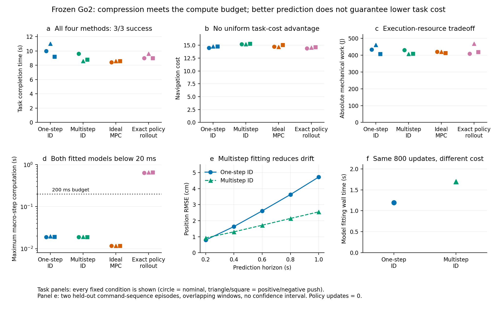

# 冻结Go2：紧凑事实响应与200ms任务比较

日期2026-10-19。本轮用户授权**响应模型拟合**，不授权策略训练；场景、任务、动作权限和完整成功判据继承上一轮，禁止实机、自动检测及影响其他任务。

## 已完成结果

**紧凑事实模型已实际拟合并接入原Go2完整任务。四组各3/3成功，两个拟合模型的全部286个宏步均低于200ms，最大19.61ms。** 这说明当前冻结反馈的预测计算可以压缩；普通辨识同样达标，没有证明必须共同学习反馈。

| 同一冻结Go2上的MPC预测 | 成功 | 平均任务秒 | 平均导航cost | 平均∫τ²dt | 平均绝对机械功J | 三工况最大宏步计算ms |
|---|---:|---:|---:|---:|---:|---:|
| 普通单步事实辨识 | 3/3 | 10.067 | 14.67843 | 4204.53 | 434.13 | 19.61 |
| 多步紧凑事实模型 | 3/3 | 9.000 | 15.24356 | 3777.21 | 415.64 | 19.17 |
| 理想速度模型 | 3/3 | 8.533 | 14.82930 | 3769.28 | 418.08 | 11.71 |
| 准确策略闭环展开 | 3/3 | 9.200 | 14.54291 | 4109.16 | 431.92 | 659.29 |

导航cost、完成时间、机械资源是不同维度，不能把某个小均值改善统称“任务全面变好”。绝对机械功不是电池能耗；时间/资源是task-only，启动与采样另外计账。三种已知工况是开发比较，不是总体成功概率。

相对准确闭环展开，普通辨识导航cost仅增加0.93%，但完成时间增加9.42%；多步模型导航cost增加4.82%，任务时间下降2.17%、绝对机械功下降3.77%。两种模型的平均case墙钟分别约0.912/0.814秒，而准确展开约28.052秒；平均case p95周期约18.62/18.79ms，相比准确展开640.78ms下降约97%。完整链包含MPC搜索、预测与实际仿真推进，不是只测一次网络forward。同步仿真依然不是硬实时或NX/实机验证。

理想模型仍是强简单对照：它已经3/3成功且计算更低。普通辨识较理想模型导航cost下降1.02%，但任务时间增加17.97%、机械功增加3.84%；多步模型较理想模型cost增加2.79%、时间增加5.47%、机械功仅下降0.58%。没有“必须上学习模型才能完成这条任务”的证据。

## 预测更准为何没有直接得到更低任务代价

留出的两条命令序列上，1秒自回归位置RMSE由普通单步辨识的4.7247cm降到多步模型的2.5514cm，下降46.0%；0.2秒位置误差则从约0.7939cm变为0.9250cm。多步监督缓解长展开漂移，同时牺牲了一部分单步位置精度，并非所有指标都提高。

进入MPC后，多步模型三个工况的导航cost均高于普通辨识，均值高3.85%；同时平均完成时间更短、机械功和力矩平方积分更低。这说明事实误差最小化与当前有限候选、短时域规划的导航目标不是同一个优化问题。验证数据是带命令激励的固定反馈分布，MPC会主动选择不同命令，模型排序误差与被访问状态也会改变。当前数据支持这些机制边界，尚未通过因果消融量化每项份额。

不能为降低预测器自评任务cost而重新打开旧的乐观通道。任何后续决策相关模型目标都需以实际任务后果评价；本轮保留负结果，没有重选epoch、调场景或回调参数。

## 模型压缩已解决与共同学习尚需证明的内容

已解决的是当前冻结Go2策略在该任务上的**在线响应计算开销**：从逐候选调用完整物理与策略，变为26534参数、32维递推记忆、每份约113KiB的事实模型，同时保持完整任务成功。普通单步辨识＋latent一致性已经做到，不能把这项收益归给尚未发生的反馈共同学习。

压缩没有增加执行器余量、恢复能力或接触技能，也没有预测完整足端扫掠/碰撞/倾角。原有物理能力由冻结RL提供；有限任务本身没有出现需要新反馈才能解决的成功率缺口。准确模型的计算开销也可能由实现/搜索优化降低，不能把当前串行实现视为不可突破的物理下界。

当前g学的是固定策略θ₀下的命令响应Rθ₀，而不是任意策略参数到响应的可微因果映射。改变θ后，它不会自动给出可信的新响应或∂R/∂θ。共同学习仍需解决真实反馈更新与响应再辨识/动作条件模型的一致性，并把实际完整任务信用送到策略；不能通过自由改变g，把尚未实现的目标当成新能力。

共同学习如果继续，需要在这个已建立的低成本强基线上证明：**改变真实反馈后，能获得更好的完整任务—资源—可预测性取舍，而且普通辨识、充分命令规划或相同信息的直接PO/TO不能解释全部收益。** 可以比较两者都成功时的时间/资源取舍，无需证明固定策略全局无解。本轮没有这项证据，暂不启动策略训练，也不把当前普通系统辨识包装为新共同学习算法。

结果与检查点：[证据索引](../notes/go2-compact-2026-10-19/INDEX.md)、[逐工况报告](../notes/go2-compact-2026-10-19/report.md)、[模型文件与使用](../artifacts/go2-compact-2026-10-19/README.md)。

## 要回答的问题

压缩当前冻结反馈的真实响应，能否保持连续任务表现并让规划/执行宏步计算低于200ms？普通辨识是否已足够；多步事实监督有什么额外作用；还剩什么问题需要改变反馈本身？不把监督建模改名为共同学习。

## 运行前固定协议

[任务配置](../configs/go2_frozen_tasks.json)逐字保留。另设[模型协议](../configs/go2_compact_fit.json)：

- 同场景、同路线、同起点、同冻结HIM策略。仅在合法命令域内用固定AR噪声激励名义路点命令，8条×30秒，另有每条2秒稳定；无外部推扰。6条拟合(seed101–106)、2条验证(seed201/202)。跌倒则结束该episode，保留失败样本，不重置补足或换seed。
- 不用此前完整任务评价轨迹拟合，不按相邻帧随机划分；旧推扰任务存在重复无扰前缀，不能拿它们作为强独立泛化证明。
- 两模型同318维起始输入：六帧历史270、当前gyro/gravity/q/dq/previous-action 42、机体线速度/世界z角速度/roll-pitch/高度6。历史来自上次策略推理，当前传感补充不能省略或偷换为下一帧。
- 同encoder64→latent32、GRUCell32与6维响应头；输出为当前机体坐标的平移增量、yaw增量、末端body vx/vy和世界z角速度。以理想命令响应为共同初始残差基准。
- `id_one_step`采用普通逐步事实辨识，每步从实际可用观测encode；`compact_multistep`从窗口初点encode，后续只用预测状态/latent和记录命令展开5步。两组均只使用真实响应标签，不最小化预测器自评任务cost。
- 两组都加入同系数latent一致性项，对比预测hidden与停止梯度的下一实际观测encoder，避免故意让普通辨识的隐状态无法连续使用。所有起点含不足5步的末尾，用mask保留尾部/失败样本。
- 同初始化seed311、batch seed419、800次Adam更新、batch64、lr.001，取固定最终checkpoint，不按验证或任务结果选轮次/改参数。归一化只用拟合轨迹；分别记录模型步/拟合时间，不把相同更新次数称同计算量。
- 最终四组为普通辨识MPC、多步事实MPC、理想模型MPC、准确策略闭环MPC；都用上一轮同CEM 12候选×2轮、1秒时域和三个已知完整任务工况。前3组采用相同名义几何代理，准确闭环仍有完整物理/接触特权，另行说明。
- 主要看完整成功、任务时间/导航代价/实际机械资源和端到端p50/p95/max/超200ms比例。模型误差只解释结果；平均推理快不等于全部宏步合格。

紧凑模型不预测未来全关节/碰撞/高度/倾角，不能继承当前这些字段作为未来事实。最后的任务评价仍由实际Go2整机状态与全部碰撞几何决定。三工况是已知同场景开发基准，不称新场景泛化或实机部署。

## 执行与成本账

固定采集已完成：8条各150宏步，共1200响应转移（900拟合/300验证），没有跌倒、障碍碰撞或非足触地。包含启动共51,200物理步、12,800次冻结策略调用，运行6.430秒；策略文件SHA前后一致。所有新数据及失败保留规则已锁定，不使用旧评价数据。

两模型分别按固定800次更新完成，共1600次**模型**更新，策略更新0。普通/多步实际拟合分别1.194/1.694秒；含验证和保存的拟合阶段3.406秒。验证集没有参与梯度或挑选checkpoint，采用固定最终参数。两辨识组共享Euler命令残差初值，与原理想模型MPC的midpoint近似不完全相同。

12个评价任务一次完成，无重试或场景/参数修改；评价墙钟93.835秒，采集＋拟合＋评价的记录墙钟合计103.672秒（不含进程启动、传输与离线分析）。真实执行总78,080物理步/19,520次策略调用，含采集与所有启动；准确预测分支另有662,400物理步/165,600次策略调用，两个紧凑模型共34,320次响应递推、286次当前观测编码。拟合/验证的模型前反向sample计数另存，不能用“只花20ms”掩盖离线成本。

使用原专属CPU运行时，单线程、affinity6/7、nice10、不用GPU、不安装新包。三个阶段均正常退出；原有18个编辑/Codex进程全部仍在，运行后GPU计算进程为空。旧理想/准确模型的六案例任务时间、成本、资源、终点及物理计数与上一轮逐项一致；耗时按本轮实际测量重新记录。
