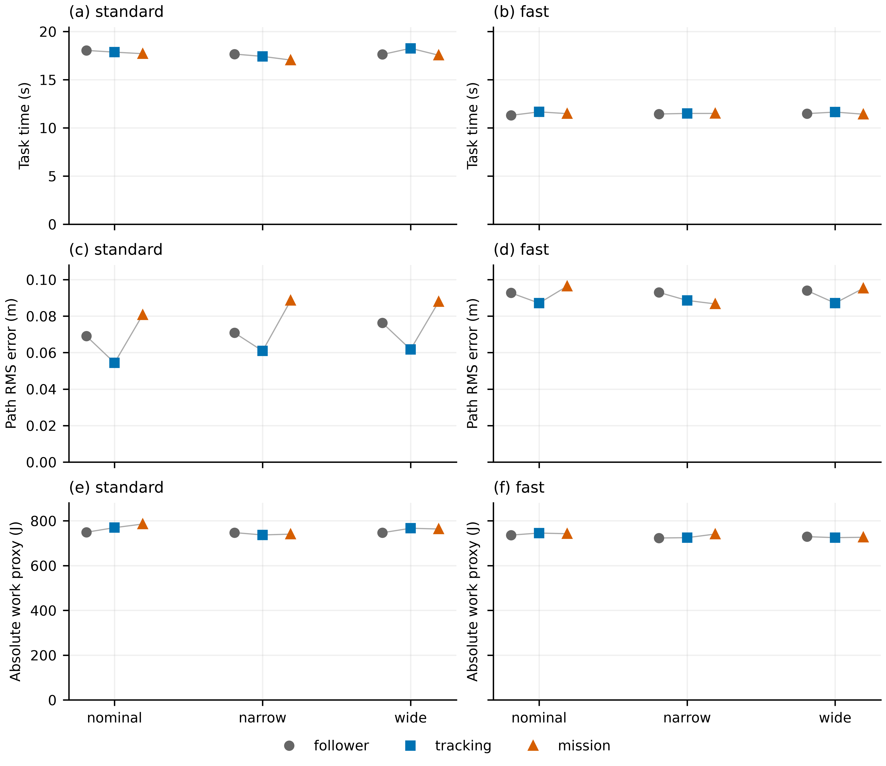
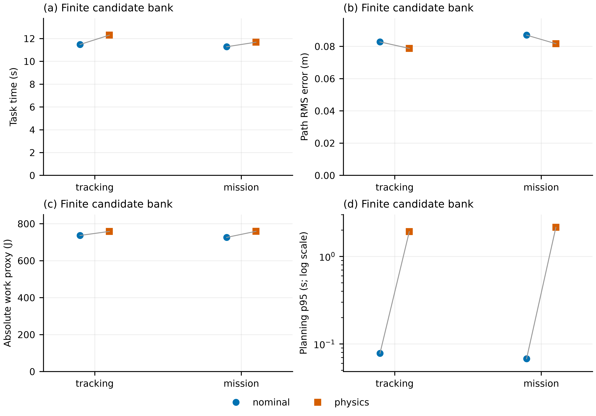
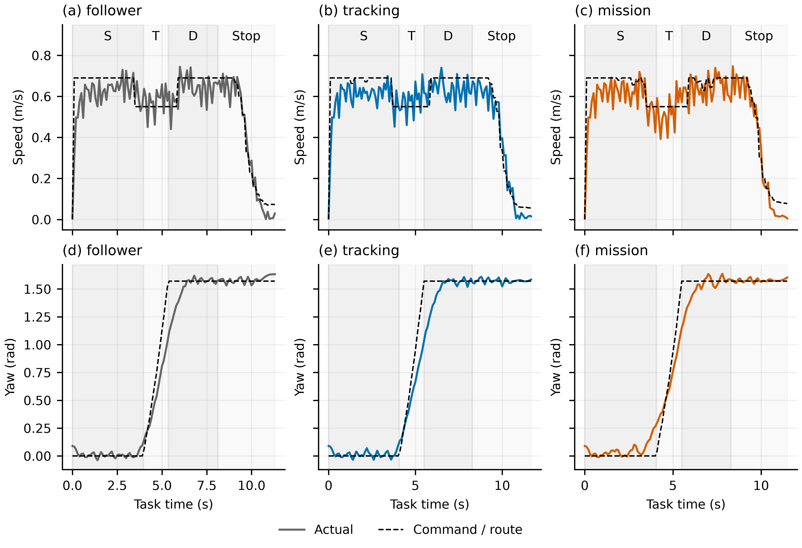

# Go2 公平对照：原来的速度差主要来自什么

日期：2026-10-19。实验分支 `codex/go2-frozen-long-task`，PR #1 保持 Draft、未合并。运行前协议和控制源码在提交 `6481466` 固定并推送，然后执行全部 22 条规定轨迹；没有按结果调参、训练、辨识模型、添加 PINN 或修改场景。

## 结论与证据强度

**原来参考跟随器明显更快，首先是速度条件与目标表达没有对齐；现有证据不支持把约 4.7 秒差距主要归于模型误差。** 名义场景旧 MPC 为 15.94 s、旧跟随器 11.24 s。统一快速档后，同一个未经辨识的一阶模型下，跟踪 MPC 为 11.66 s、任务进度 MPC 为 11.48 s、匹配跟随器为 11.30 s。无需改变低层策略或拟合模型，原来的大差距已经基本消失。

进一步在固定六候选构造下，用完整 Go2 物理分叉替代名义模型排序，跟踪目标完整用时从 11.48 增至 12.30 s，任务进度目标从 11.28 增至 11.68 s。物理预测改变了局部判断、稍微降低路径误差，却没有取得整体提速。**不能据此宣布模型误差无害，也不能再用旧时间差直接论证 PINN 的必要性。** 此干预还改变了可行性判定，不是动力学时间常数的单因素试验。

22 条轨迹全部满足原来的完整任务判据，无实际障碍接触、无跌倒。每格只有一条确定性轨迹，三个既有条件也不是随机重复；这里报告配对事实与条件内干预，不做统计显著性或普遍优越性声明。

## 对齐了什么

路线仍为直行—左转—过门—停止，使用原 nominal/narrow/wide 三个条件；窄门/宽门名称沿用原条件，不是这次新改场景。每个条件的任务定义、初态、2 s 预备站立、场景实体、机器人、公开权重、观测和时钟均与旧基线一致。场景文件 SHA-256 及初始状态已逐组核验。

共同完成判据仍是按顺序经过阶段出口，最终位置误差不超过 0.22 m、平面速度不超过 0.12 m/s、朝向误差不超过 0.20 rad，并连续保持至少 1 s；全程无障碍接触、无跌倒，35 s 超时。该停止定义不要求全身所有关节静止。

共同外部任务目标为先成功完成，再比较完整时间；路径误差、力矩平方、机械功代理和计算代价同时报告。机械功代理是力矩与关节速度乘积绝对值的积分，不是电池电能。两种 MPC 内部成本并不相同，也不能直接比较其数值大小。

| 项目 | 统一条件 |
|---|---|
| standard 命令上限 | 直道 0.45、转弯 0.32 m/s |
| fast 命令上限 | 直道 0.69、转弯 0.55 m/s |
| 命令权限 | 原机体坐标命令 box 不变；同一平移命令模长 governor |
| 制动与终点纠偏 | 同一制动曲线、同一末段纠偏额度与越过终点后的返回规则 |
| 高层/底层频率 | 高层每 0.2 s，策略 50 Hz，PD 200 Hz，物理 1000 Hz |
| 两种主 MPC 预算 | 相同 4 s 预测域，CEM 每次 256 候选 × 3 轮 × 20 步 |

这里统一的是**命令速度权限**，不是强行让各控制器的实际机体速度相等。governor 在名义候选传播、物理分叉和实际下发中都应用。fast 保留接近旧跟随器的有效速度，避免只靠降低跟随器速度来缩小差距。旧跟随器前视纠偏带来的切向速度增益已去除，横向纠偏、朝向反馈和终点反馈保留。

三种控制器为：`follower` 匹配几何跟随器；`tracking` 保留旧参考跟踪损失，是目标表达消融；`mission` 去除固定进度的超前惩罚及期望速度误差，使用剩余参考行驶时间终端项推动任务进度。mission 保留横向、朝向、命令、命令变化与障碍项，末段加位置/速度项。固定预测长度中的常数时间项不影响排序，因此它是**任务进度代理，不是精确最短时间 MPC**。共同任务目标和评价已对齐，跟踪目标组专门保留，用于解释原设置。

## 主对照：速度影响远大于本次目标表达调整

以下均为完整完成时间，单位 s；每格成功。

| 原条件 | standard 跟随器 | standard 跟踪 MPC | standard 任务 MPC | fast 跟随器 | fast 跟踪 MPC | fast 任务 MPC |
|---|---:|---:|---:|---:|---:|---:|
| nominal | 18.04 | 17.86 | 17.70 | 11.30 | 11.66 | 11.48 |
| narrow | 17.66 | 17.42 | 17.04 | 11.44 | 11.50 | 11.50 |
| wide | 17.62 | 18.26 | 17.54 | 11.48 | 11.64 | 11.42 |

同一控制器由 standard 换到 fast，完整时间减少 5.54–6.74 s。保持速度条件不变，从 tracking 换到 mission，standard 减少 0.16/0.38/0.72 s，fast 减少 0.18/0/0.22 s。目标表达有影响，但在本次配置中，速度条件解释的变化更大。

任务 MPC 并未稳定胜过匹配跟随器：standard 三个条件稍快，fast 的 nominal/narrow 稍慢、wide 稍快。跟踪 MPC 的路径 RMS 在六个条件中均低于跟随器；mission 的时间收益也没有统一伴随更小路径误差或更低机械功。以 fast nominal 为例，跟随器/跟踪 MPC/任务 MPC 的路径 RMS 分别为 0.0927/0.0871/0.0964 m，机械功代理为 736.2/745.4/742.3 J。

旧版到新版同时改变了命令 governor、跟随器切向前视增益等控制条件，不能把时间差缩小严格分解成“多少百分比来自速度、多少来自目标”。能较干净解释的是本轮同速度的目标对照，以及同控制器的速度档对照。

## 模型干预：局部选择更符合物理，不等于整体更快

原 nominal 场景、fast 速度，目标 tracking/mission × 排序预测 nominal/physics，共四条完整任务。给定当前状态，每组使用相同规则构造六条候选：匹配跟随序列、名义 tracking CEM 提案、名义 mission CEM 提案、保持命令，以及 mission 偏航命令 ±0.12 的两个提案。候选提案随机数按决策编号固定，无暖启动；不同闭环轨迹后续访问的状态不同，不能称所有时刻候选数值完全相同。

physics 从完整 MuJoCo 和策略历史快照执行每条 4 s 候选，按相同目标公式评分，并恢复真实状态。名义与物理传播都按各自状态使用同一 governor，所以 applied 命令不保证逐值相同。名义可行性来自平面轮廓，物理可行性来自完整机器人接触/跌倒；可行候选优先。

| 目标 | 名义排序用时/s | 物理排序用时/s | 时间变化/s | 名义/物理路径 RMS/m | 名义/物理机械功代理/J |
|---|---:|---:|---:|---:|---:|
| tracking | 11.48 | 12.30 | +0.82 | 0.0828 / 0.0787 | 736.3 / 758.1 |
| mission | 11.28 | 11.68 | +0.40 | 0.0870 / 0.0816 | 725.7 / 758.6 |

在这个候选构造下，目标改为 mission，名义排序减少 0.20 s，物理排序减少 0.62 s；两因素的条件交互为 −0.42 s。这里比较的是完整时间，不是两种内部成本之差，也不是统计 ANOVA。

物理组各自访问的 62/59 个状态中，按实际所用目标，名义与物理最终选择分别有 28/33 次不同；两个组均有 43 次决策的可行集合不同。tracking/mission 的名义赢家在物理分叉中不可行的总次数分别为 8/10，其中有可行替代可供物理选择的是 6/7 次；另 2/3 次六个候选都在完整四秒分叉中不可行。这些是**未来四秒不重新规划的候选结果**，不是实际轨迹事故：真实控制每 0.2 s 重规划，四条完整任务仍全部成功。

这说明模型与几何可行性确实存在误判，但当前诊断不能将它们拆成纯动力学误差，也没有证明这些四秒误判主导了实际完成时间。有限候选、任务进度代理、阶段末状态和每 0.2 s 的重规划共同决定最终结果。物理排序不是全局最优的物理 MPC，更不是 PINN 的替代效果试验。

## 长程任务中保留下来的具体线索

fast nominal 的阶段耗时如下，单位 s。停止段包括门后行驶、制动、到点和原定 1 s 保持，不能把整段都叫纯制动时间。

| 控制器 | 直行 | 转弯 | 过门 | 停止段 | 总计 |
|---|---:|---:|---:|---:|---:|
| 跟随器 | 3.96 | 1.40 | 2.76 | 3.18 | 11.30 |
| 跟踪 MPC | 4.06 | 1.44 | 2.78 | 3.38 | 11.66 |
| 任务 MPC | 4.06 | 1.44 | 2.78 | 3.20 | 11.48 |

两种 MPC 都在 8.28 s 完成过门阶段，但跟踪/任务 MPC 的交接平面速度约 0.658/0.554 m/s，横向位置偏差约 −0.048/−0.019 m，偏航角速度约 −0.379/0.073 rad/s。任务 MPC 的末段少用 0.18 s。这是“同一阶段完成时刻，但交接状态不同、后续时间不同”的实测线索；由于后续控制也不同，不能把 0.18 s 全部因果归给某一个交接变量。

转弯阶段出口也并非一到位置门限就完全对齐：跟踪/任务 MPC 出口 yaw 为 1.038/1.152 rad，仍在后续过门段趋近目标 π/2。阶段时间、姿态、速度和横摆响应因此都需要一起保留。与此同时，参考跟随器仍能完成且总体更快，当前任务尚未证明存在必须靠新低层反馈才能突破的能力缺口。

## 计算与核验

| 工作 | 实际物理步，含准备 | 实际策略推理，含准备 | 额外分叉物理步 | 额外分叉策略推理 |
|---|---:|---:|---:|---:|
| 18 条主对照 | 298,560 | 14,028 | 0 | 0 |
| 4 条模型诊断 | 54,740 | 2,537 | 2,904,000 | 145,200 |
| 一次状态恢复核验 | 2,000 | 50 | 800 | 40 |
| 合计 | 355,300 | 16,615 | 2,904,800 | 145,240 |

模型诊断共 726 条四秒分叉。CEM 候选评分模型步数合计 20,812,800，额外候选库传播 28,320 步、其他控制器传播 58,920 步，日志的一步预测另计。计数字段含义见分析 README，不把评分计数称全部模型调用。所有策略/模型优化器更新为 0。

主对照跟随器规划 p95 约 0.20–0.27 ms，MPC 约 26.7–38.2 ms；有限候选名义组约 67.7–78.1 ms，物理组约 1.92–2.15 s。仿真在规划期间暂停，物理组每次都超过 0.2 s 高层周期；其特权状态与额外计算只用于诊断，不是等算力或实时可部署性能结果。

22 份运行记录的源文件身份相同，仍匹配协议提交中的控制源码；策略文件及内存参数哈希前后一致。原场景/任务、共同速度上限、实际与分叉计数均通过核验。所有物理分叉评分重算差为 0，选中分叉首 0.2 s 边界与下一真实决策状态差为 0。原四个核心源码和旧六条结果相对 `4662938` 无变化。[交叉复核](../notes/go2-fair-2026-10-19/independent-review.md)说明作者身份与核验边界。

公开证据包含全部 22 份结果、10 Hz 实际轨迹、决策、阶段出口、预测误差和物理候选每 0.2 s 的边界状态/命令/分数/可行性。实际完整 50 Hz 轨迹与预备站立记录保留在本地忽略目录 `work/go2-fair-runs/`。没有为每条物理分叉保存完整 50 Hz 关节轨迹或二进制快照；本轮没有新录制视频，旧视频原样保留。

## 这轮之后的研究判断

第一篇的主线仍应是连续多阶段任务中，前段动作留下什么交接状态、后段是否能高效利用，以及规划与实际反馈怎样共同改善完整任务表现。本次首先消除了一个不公平比较造成的大幅速度差，又留下了小幅阶段交接差异和候选可行性误判的证据。它们可以供下一轮讨论选择问题，但不是已经成立的新方法贡献。

目前不加入 PINN，不启动共同学习，也不按结果继续搜索参数。若后续考虑物理约束模型，需先明确它要改善的是哪类候选可行性/状态预测，并验证这种改善能转成完整任务的时间、安全或计算收益；若考虑策略学习，需比较固定策略下更好的目标/规划与实际改变反馈能力各自带来的增量。不能以本次“模型不完全准确”代替这些证据。

全部证据入口：[索引](../notes/go2-fair-2026-10-19/INDEX.md)、[分析与表格](../notes/go2-fair-2026-10-19/analysis/README.md)、[运行前协议](../notes/go2-fair-2026-10-19/PROTOCOL.md)、[复现命令](../src/go2_frozen/README.md)。本轮规定任务到此完成；不自动续训、改场景、加 PINN 或合并 PR。
