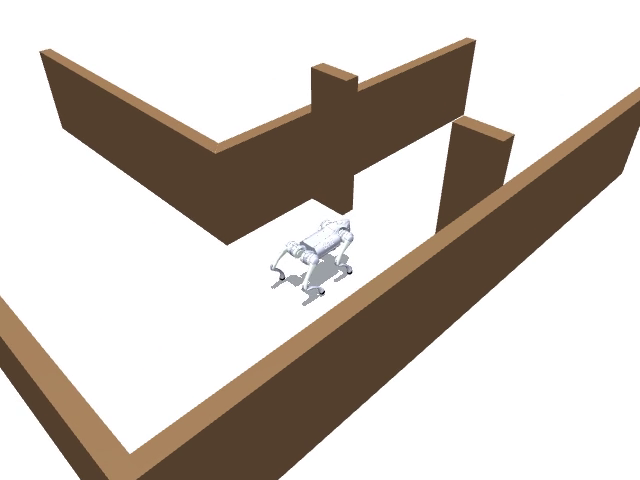
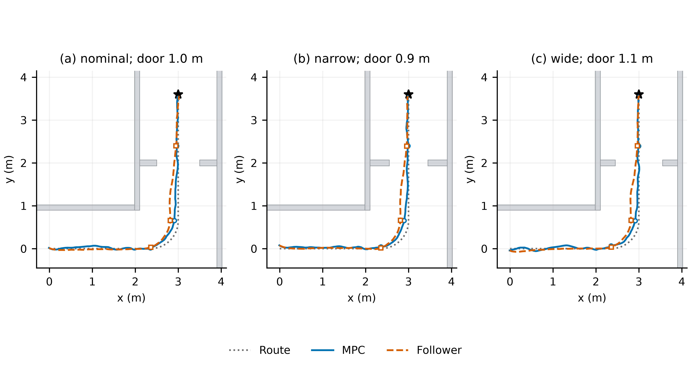
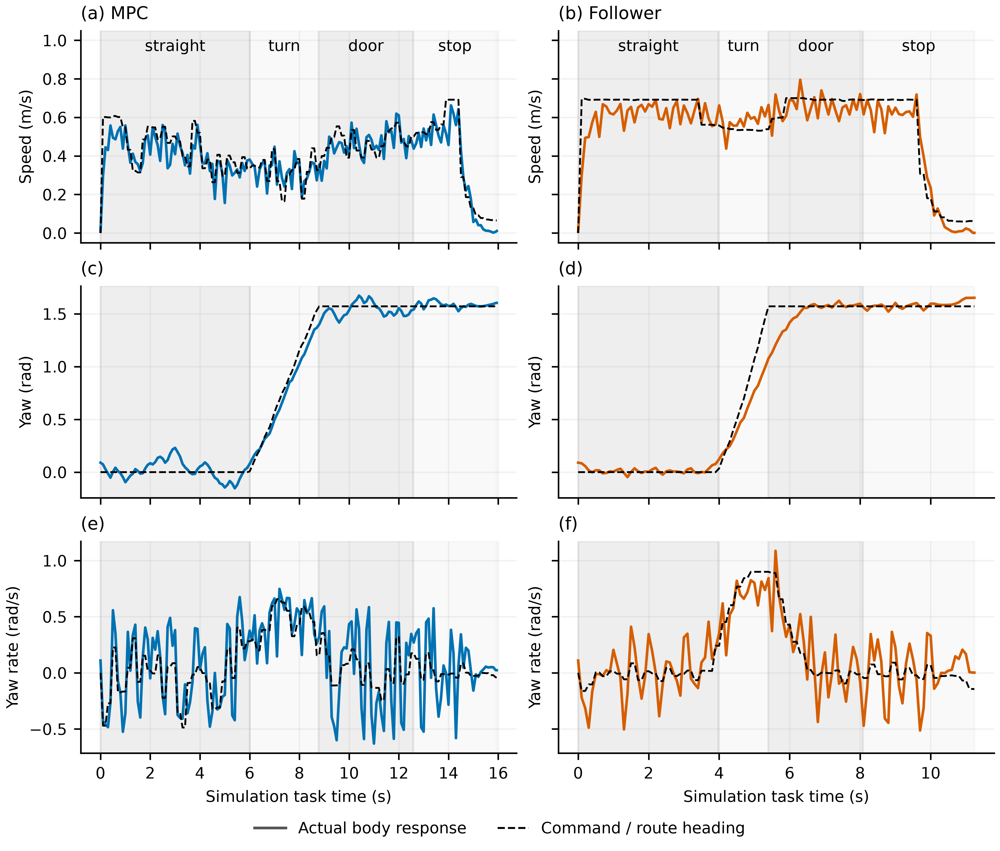
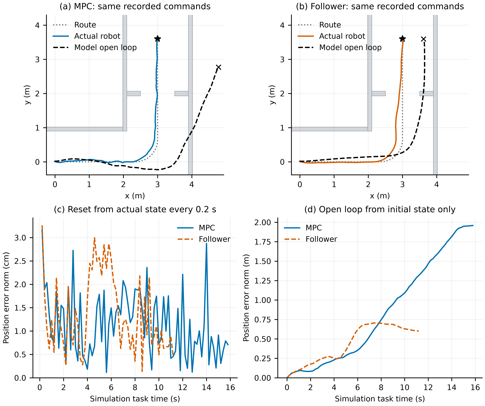

# Go2 冻结公开策略：完整任务与普通 MPC 基线

日期：2026-10-19（Asia/Shanghai）。本报告属于独立 `codex/go2-frozen-long-task` 实验分支；未合并到主线。主线二维负结果与方法重审继续保留。

**本次已实际运行完整 Go2 接触动力学仿真。普通 MPC 与参考跟随器在三种预声明条件下均依次完成“直行—转弯—过门—停止”，满足预声明平面停止条件，无障碍接触或跌倒。所有策略与模型训练更新均为 0，没有连接实机。**

**结果同时表明：本任务尚未暴露必须更新低层策略的能力缺口。参考跟随器比当前参数化 MPC 更快，机械功代理也更低；不能把本次成功包装为 MPC、PINN 或共同学习的优势。**

[nominal MPC 完整视频](../notes/go2-frozen-2026-10-19/media/mpc_nominal.mp4) · [nominal 参考跟随器完整视频](../notes/go2-frozen-2026-10-19/media/follower_nominal.mp4)。视频为实际评价的仿真时间回放，未加速冒充实机或墙钟实时运行。

## 1. 实际运行的系统

- 被控对象：Go2 浮动基座、12 个关节、足地接触、原始惯性与电机限幅的 MuJoCo 模型。平面预测只用于 MPC，不替代实际机器人执行。
- 冻结策略：社区公开 `fan-ziqi/rl_sar@376d42c9b128f963ab08579762d5a216a976ce39` 的 `go2/robot_lab/policy.pt`。不是 Unitree 官方策略，也不是用户当前实机部署包。
- 名义机器人来源：`fan-ziqi/rl_sar_zoo@7dd30bdc7806898950b354260655d5a7f0ce844e` 的 `go2_description/mjcf/go2.xml`。采用该部署项目配套模型来源，重新建立版本固定的仿真配置，不声称精确复现策略原训练环境。
- 观测：机体角速度、投影重力、三维速度命令、关节相对角度、关节速度、上次动作，共 45 维；按原配置缩放和关节顺序执行。
- 执行：冻结策略输出关节位置目标，原配置 PD 作用于机器人；MJCF 的 motor ctrlrange 实际限幅。未将 YAML 中另一条辅助 torque clip 误称为执行限额。
- 时钟：物理积分 1 ms、PD 5 ms、策略 20 ms；高层控制每 200 ms 更新一次。
- 预备站立：1 s 固定 PD，随后 1 s 零命令策略；预备过程单列保存，进入任务时仅改变计时基准，不重置物理状态或动作历史。碰撞/跌倒历史不清空。
- 高层使用仿真真实位姿和速度；低层保持公开观测定义。没有感知定位算法、域随机化、外加扰动或机器人硬件接口。

实际环境：Python 3.12、MuJoCo 3.16.0、PyTorch 2.14.1+cpu。运行环境是实验工作区内独立 venv，未修改主工作区环境。[全部来源与哈希](../notes/go2-frozen-2026-10-19/assets.json)、[实际包版本](../notes/go2-frozen-2026-10-19/environment.txt)。

## 2. 任务与普通 MPC 的身份

起点向 +x 直行；在 `(2.35, 0)` 后沿半径 0.65 m 的左转参考进入 +y 方向；从 `(3, 0.65)` 继续经过 `y=2 m` 的门，到 `(3, 3.6)` 停止。参考长度约 6.321 m，阶段间没有重置。

三种条件在机器人任务评价之前声明：nominal 门宽 1.0 m、起点 y=0；narrow 门宽 0.9 m、起点 y=0.06；wide 门宽 1.1 m、起点 y=-0.06。其余场景、策略及控制参数相同。实体走廊与门面板进入 MuJoCo 碰撞计算。没有按运行结果缩窄门或提高速度。

普通 MPC 是命令空间 CEM：每次 3 轮 × 256 候选，每条 20 步，4 s 预测；采用固定一阶平面速度/偏航响应，时间常数分别 0.25/0.20 s。代价包含路线位置、朝向、速度、命令及变化和平面身体轮廓碰撞；有暖启动和参考跟随候选。模型参数是固定工程初值，未辨识或训练。

诊断对照为无在线优化的几何参考跟随器。两者拥有相同地图、路线、命令上下限与冻结策略，但反馈律和对参考速度的实现不同；不是严格匹配目标函数的算法优劣实验。MPC 更贴近给定参考速度，跟随器的前视纠偏也增加前向速度。因此时间差不能外推为“MPC 普遍更差”。

这是完整任务上的普通滚动参考 MPC，**没有学习终端价值或显式优化全部剩余阶段，不称长程最优规划器或充分整定强最优基线**。已知路线/几何、准备好的速度参考，以及频繁反馈共同帮助完成任务。

完整成功要求顺序通过三个空间门限，最终位置误差 ≤0.22 m、平面速度 ≤0.12 m/s、朝向误差 ≤0.20 rad，连续保持 1 s；任何历史障碍接触或跌倒均禁止成功。超时为 35 s。没有关节速度、垂直速度或角速度停止门限，所以“停止”严格指上述平面条件，不代表全身完全静止。[预声明协议](../notes/go2-frozen-2026-10-19/PROTOCOL.md)。

## 3. 三条件六条完整任务结果

每格一条确定性轨迹，不是多训练 seed 或总体统计成功率。成功轨迹全部保留，开发试跑与适配过程另列，没有选择较好 checkpoint 或失败重试。

| 条件 | 控制器 | 完整成功 | 任务时间 / s | 机械功绝对值积分代理 / J | 路径平方偏差积分 / m²s | 求解 p95 / ms |
|---|---|---:|---:|---:|---:|---:|
| nominal | MPC | 是 | 15.94 | 833.36 | 0.04779 | 18.24 |
| narrow | MPC | 是 | 15.90 | 799.30 | 0.04266 | 18.45 |
| wide | MPC | 是 | 16.48 | 807.17 | 0.04156 | 18.42 |
| nominal | 参考跟随器 | 是 | 11.24 | 726.13 | 0.09344 | 0.177 |
| narrow | 参考跟随器 | 是 | 11.20 | 750.58 | 0.09186 | 0.137 |
| wide | 参考跟随器 | 是 | 11.50 | 757.70 | 0.09049 | 0.154 |

全部六条：无障碍接触、无跌倒、权重文件哈希与内存 tensor 哈希不变。机械功代理为 50 Hz 样本上的 `∫Σ|τ_i qdot_i|dt` 近似，不是电池电能；输入平方积分也单独保存。MPC 贴近路线的程度更高，但花费更多时间与该机械功代理，不能只选一个指标宣称优胜。

仿真在 MPC 求解时暂停推进；p95 均低于 200 ms 控制周期只说明本机求解开销，**不是带通信、状态估计与并行时钟的实机实时性验证**，更不是 NX 测量。

## 4. 跨阶段响应和预测误差

nominal MPC 的实际阶段出口如下；更完整的关节、足接触、命令与动作随阶段记录。

| 已完成阶段 | 时间 / s | 世界速度 vx, vy / m/s | yaw / rad | yaw rate / rad/s |
|---|---:|---|---:|---:|
| 直行 | 6.00 | 0.344, 0.165 | 0.078 | 0.376 |
| 转弯 | 8.78 | 0.090, 0.355 | 1.393 | 0.348 |
| 过门 | 12.58 | -0.022, 0.405 | 1.538 | 0.050 |
| 满足最终平面停止条件 | 15.94 | 最终平面速度约 0.0106 | 最终朝向误差约 0.033 | 见逐时日志 |

这些记录直接显示前段留下的速度和转动仍会进入后段，但本控制器通过正常反馈已经完成接续。它们不是“必须重新训练策略”的证据。

每 0.2 s 从实际状态初始化，名义模型下一控制周期的位置向量 RMSE 约为 **1.22–1.33 cm（三条 MPC）**。从任务初态开始，沿**同一条实际已经执行的命令序列**完全开环回放，三条 MPC 的位置向量 RMSE 约 **0.69–1.56 m**，nominal 为 **1.07 m**。

后者不是“规划器所选 4 s 候选序列的实际误差”：真实后续命令会重规划，本次没有分叉执行每条候选。它只说明固定工程响应模型沿实际命令长时间累积有偏差，而高频状态反馈仍能使机器人完成任务。模型偏差存在，不等于它已导致任务失败。

准备阶段另观察到零 yaw 命令下的残余偏航；没有改策略或加偏置掩盖。最终任务的最后 1 s 仍存在小幅 yaw、身体与关节运动。交叉复核确认预声明停止条件成立，但不支持“完全静止/全身站稳”。[口径与源码交叉复核](../notes/go2-frozen-2026-10-19/independent-review.md)。

## 5. 这次结果对 PINN 与第一篇意味着什么

**已经完成：**从二维惯性对象进入了完整机器人闭环；公开冻结策略、普通 MPC、实体障碍、连续四阶段任务与记录分析均实际运行。

**没有得到：**共同学习收益、PINN 收益、低层策略能力不足、跨条件统计鲁棒性、真实机器人效果或长程最优决策证据。

当前应保留三个具体判断：

1. 本组平地、已知地图、门宽 0.9–1.1 m 的任务，简单冻结反馈系统已能完成。不能为了给新方法制造空间，事后调窄门或削弱基线。
2. 未辨识的一阶命令响应存在长时累积偏差。若后续研究模型，应先与普通系统辨识、偏置补偿和灰箱模型比较，再判断物理约束是否有额外价值；不能由预测误差直接推出 PINN 必要。
3. 任务响应共同学习必须在同样的剩余任务信息、控制权限和预算下证明实际增量。当前基线还没有做完整后段价值优化，因此未来这一功能的收益也不能混记为 PINN 或 actor 学习收益。

后续最有信息量的问题是：在明确的在线计算与任务取舍下，哪些预测误差确实改变计划优劣？普通辨识能否解决？若仍有缺口，再判断是否需要物理约束的策略闭环模型，以及是否需要改变反馈本身。本轮不自动启动这些后续工作。

## 6. 执行账本、源码与复现

六条规定评价共 94,260 个物理子步（含各 2 s 准备）、4,413 次策略推理。另有一次无障碍适配流程 10,000 子步/450 推理，以及一次 nominal MPC 开发试跑 17,940 子步/847 推理。**本轮总计 122,200 物理子步、5,710 次策略推理；策略更新 0、模型训练更新 0、硬件操作 0。**

MPC 记录的 `planner_model_steps` 是候选评分模型步，另有每次 20 步反馈初始化和 20 步最终预测；全部操作已包含在求解 wall time 中。计数不等同 FLOPs。[执行账本](../notes/go2-frozen-2026-10-19/execution-ledger.json)。

所有六条规定评价使用相同源码快照；开发试跑后仅修正参考跟随器的元数据标签，没有修改任务或控制参数。源码哈希及每条结果随仓库保留。外部策略二进制、第三方模型副本、独立运行环境、50 Hz 原始数据和其他视频放在忽略目录；公开仓库包含来源、原创适配代码、完整结果摘要、10 Hz 轨迹、命令序列、阶段记录、图表及两条 nominal 展示视频。决策 JSON 仅压缩数值数组的排版，记录与数值完全保留。

- [代码与复现入口](../src/go2_frozen/README.md)
- [证据索引](../notes/go2-frozen-2026-10-19/INDEX.md)
- [可复现分析脚本](../scripts/analyze_go2_frozen.py)
- [逐条件结果与图表](../notes/go2-frozen-2026-10-19/analysis/README.md)

本报告仅在实验分支提交并通过 PR 供审阅；不合并或修改主线科学结论。
