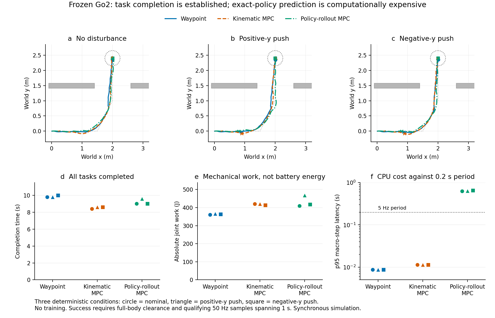

# Go2冻结整机基线、连续任务与结构修正

日期：2026-10-19。用户已授权服务器仿真与方法实现，禁止训练、实机和自动检测。采用独立目录/venv、CPU affinity 6/7、单Torch线程、nice 10、禁用CUDA；不修改既有环境，不终止或调整其他进程。

## 完整任务结果与当前判断

**服务器冻结Go2整机基线、连续任务与结构修正的数据链已跑通，最终9/9达到本轮完整任务判据。没有训练、参数拟合、实机或自动检测。** 最终证据采用6条原轨迹＋3条修复停稳计时后的轨迹；全部旧轨迹保留。三工况的简单平均如下（不是独立随机种子统计）：

| 高层控制（同一冻结RL） | 完整成功 | 任务时间s | 导航任务cost | ∫τ²dt | ∫\|τqdot\|dt J | 宏步p95计算s |
|---|---:|---:|---:|---:|---:|---:|
| 路点命令 | 3/3 | 9.867 | 16.65659 | 4188.67 | 363.44 | 0.00872 |
| 理想速度模型MPC | 3/3 | 8.533 | 14.82930 | 3769.28 | 418.08 | 0.01139 |
| 实际策略闭环预测MPC | 3/3 | 9.200 | 14.54291 | 4109.16 | 431.92 | 0.63981 |

表中p95为每个case的p95再对三工况平均，资源与时间为task-only，启动稳定另计。完整成功同时要求按顺序推进、穿过开口、整机越门、无碰撞/跌倒，以及终点合格50Hz样本首末跨度至少1秒。不是只有base到达或短暂进入目标半径。

准确闭环预测相对理想模型MPC的导航cost均值下降**1.93%**，但任务耗时增加**7.81%**、绝对机械功增加**3.31%**、力矩平方积分增加**9.02%**，单case墙钟约**59.43倍**。其138/138宏步均超过0.2秒周期。故没有成功率增量，也没有整体时间/资源/计算优势；不能把小幅代理cost改善称为全面任务收益。

无扰时策略闭环预测的一宏段误差为0，是同一名义模拟器与完整策略历史复制的结果。两个推扰case只在施力宏段出现预测差，之后又为0。没有偷看未来外力，也不是学到模型或证明真实机器人泛化。

本轮明确了两个研究事实：现有冻结策略＋简单高层控制已经能完成这条开发任务；当前逐候选串行展开真实策略和名义物理虽可信，却计算昂贵。后者可能包含实现/搜索效率问题，不能据此断言共同学习必不可少。后续应在同一Go2体系比较紧凑事实模型、普通辨识＋充分规划、同信息策略优化以及共同设计；本轮不启动这些训练，也不按结果加难度。

详见[逐工况报告](../notes/go2-frozen-2026-10-19/report.md)、[完整证据索引](../notes/go2-frozen-2026-10-19/INDEX.md)。



## 运行过程与修复留痕

**冻结Go2已经在服务器真实物理仿真中运行。** MuJoCo 3.3.7、Torch 2.7.0+cu128（CPU推理），完整HIM estimator+actor，5ms物理/PD、20ms策略。2秒零命令稳定，随后连续3秒前进、2秒运动转向、2秒零命令停止，无状态或历史重置。该9秒片段无非足端触地或障碍接触，最低基座高度0.25577m、最大倾角0.07529rad，最后水平速度约0.00150m/s。参数文件SHA前后一致。这是实际闭环运动，不是固定输入推理；也不是原论文性能复现。

三个学习目标机制测试在服务器通过，无optimizer step。策略闭环MPC首次构造预测副本时发现MuJoCo 3.3.7不暴露Python级`mj_copyData`；改为该版本支持的`copy.copy(MjData)`完整复制，继续执行未运行的三个工况。已经完成的结果保留，不改任务或参数。

九条结果随后经独立轨迹复核，发现初版hold首个合格样本就加20ms：其中6条合格样本首末跨度已≥1秒，`waypoint/push_negative_y`、`kinematic_mpc/push_positive_y`、`policy_rollout_mpc/nominal`只有0.98秒。已改为实际时间戳差，仅补跑这三个受影响工况；三条均只延长0.2秒，旧长度的完整trace字典逐项一致，修复后合格跨度均1.18秒。旧记录完整保留，其余六条无需重跑。成功严格指50Hz合格样本覆盖至少1秒，不声称采样间连续时间证明。另一个最终stdout数组序列化错误发生在三个policy-rollout结果与COMPLETED文件均写入之后，已修打印，不因此重跑。三个停稳补跑进程均正常exit0。

所有12次任务尝试含被替代记录，实际任务物理步21,960，预测物理步873,600；加上每次2秒启动、clone异常前额外2秒启动以及9秒初始运动核验，实际执行总物理步28,960。原始首进程异常前CPU总时长没有完整落盘，明确未知，不补造精确总墙钟。专属进程已退出，既有18个编辑/Codex进程仍在，基础环境未安装MuJoCo、Torch/Numpy版本未改变，GPU计算进程为空。

## 冻结对象与可复现入口

- 策略：`fan-ziqi/rl_sar@376d42c9b128f963ab08579762d5a216a976ce39` 的 `policy/go2/himloco/himloco.pt`、同目录配置和上层`base.yaml`。权重SHA256 `d9945f85a39944aaf241a67f7d2b25a15326a0222d0e503aeb05a7f188430509`。社区Go2适配，非HIM作者原生Go2检查点，非用户实机版本。
- 名义仿真模型：`unitreerobotics/unitree_rl_mjlab@1425b15f73bd4095f0df53709d7c389c3eb9e790` 的 `src/assets/robots/unitree_go2/xmls/scene_go2.xml` 及同级`assets/`。不是准确实机模型，也不宣称它与权重原训练配置完全相同。
- 原始权重/模型与轨迹放忽略目录。公开仓库保存原创代码、配置、来源/hash和结果摘要。
- [运行入口](../scripts/run_go2_frozen.py)、[固定协议](../configs/go2_frozen_tasks.json)、[执行适配](../src/go2_frozen/simulation.py)、[冻结策略](../src/go2_frozen/policy.py)。`--asset-root`内包含`go2/scene_go2.xml`、`go2/assets/`、`himloco/himloco.pt`、`himloco/config.yaml`、`base.yaml`。

```bash
python scripts/run_go2_frozen.py --asset-root /path/to/assets --mode tasks --output /path/to/new-output
```

依赖MuJoCo 3.3.7、已存在的Torch/Numpy/PyYAML。运行器设置进程局部CPU限制，默认不创建后台任务或监视器。先在专属venv安装缺失MuJoCo，避免修改共享环境。官方Python绑定包含MuJoCo运行库：[官方文档](https://mujoco.readthedocs.io/en/stable/python.html)。

## 一条连续任务、三个事前固定工况

路点`(1.5,0,0) → (2,1,π/2) → (2,2.4,π/2)`，门位于`y=1.5`，净开口`x∈[1.4,2.6]`，墙厚0.16m、高0.8m。初始稳定2秒后保留全部状态/六帧历史；任务限时30秒，中间不重置、不设小阶段截止时间。门碰撞包含全部启用的机器人身体、腿和足端几何。

工况是无扰、世界+y推扰、世界−y推扰。后两种在首次观测到base `x≥0.8m`的宏步开始施加0.2秒力，冲量/机器人总质量=0.25m/s；这是压力协议，不是保证实际速度跃变。记录触发位置/速度/阶段；预测不给未来外力。三工况是开发测试，不是统计泛化结论，也不因结果改变场景。

成功要求按顺序推进、实际穿过门洞、整机碰撞包络越过门远侧，终点位置误差≤0.25m、yaw误差≤15°、平面速度≤0.15m/s、yaw rate≤0.25rad/s连续1秒，且整段无跌倒、障碍碰撞、非足端触地。失败保留，跌倒时结束该失败轨迹；不从统计删去。

命令三维body速度，范围`vx[-.4,.6]`、`vy[-.3,.3]`m/s、`wz[-.8,.8]`rad/s。这是本轮开发域，不冒充原训练域/厂家保证。允许前进、倒退、侧移、原地转向、等待；MPC既有12个候选内显式放入零命令、转向和侧移候选。

## 三种控制及解释边界

1. `waypoint`：透明路点反馈命令＋同一冻结RL，提供可运行起点。
2. `kinematic_mpc`：理想body twist模型的命令CEM-MPC＋同一冻结RL。
3. `policy_rollout_mpc`：复制实际MuJoCo状态、solver warmstart、策略六帧历史、previous action、PD保持目标/相位，使用同一冻结RL生成动作并通过名义物理推进，再由CEM选命令。

两MPC共用1秒时域、0.2秒宏步、12候选×2轮、3个elite与命令权限，保留固定随机种子。目标为当前剩余路程及方向误差；短时域终端明确是剩余任务启发式，不冒称30秒真实终点。力矩资源单列，避免只有精确rollout组享有资源预测评分。kinematic几何是随朝向变化的名义矩形代理；实际rollout和最终评价使用完整几何，必须披露这一差别。

`policy_rollout_mpc`是具有精确名义物理和完整仿真状态的模型基准，计算代价较大；不能称已学出紧凑响应模型，不能据此宣称新反馈学习收益。同步仿真允许等待求解器，必须报告相对200ms周期的p50/p95/最大延迟与超期比例，不能由任务成功直接称可实时部署。

## 结构修正已落实的代码

[realized_learning.py](../src/go2_frozen/realized_learning.py)将事实预测、真实后果及策略信用分开：

- 事实模型只拟合相同策略/命令/历史条件下的实际响应，任务cost不进入其拟合目标，真实标签停止梯度。
- MPC使用当前策略诱导的物理响应，固定策略时不能靠自由改写预测器虚构更好的未来。此轮用模拟器承担该响应约束；以后压缩模型必须学习描述执行事实。
- 策略目标来自实际完整任务后果，可附加实际响应相对固定参考的可预测性代价；真实终端后果传回早期实际动作。PPO/score-function损失经实际采样动作概率作用于策略。
- 这与相同目标、数据和信息下的标准PO等价，是结构纠错，不宣称新优化原理。确定性导出策略没有行为概率密度，本轮不伪造PPO数据、不进行策略或模型拟合。

本轮真实Go2轨迹直接进入事实损失与完整任务return计算，学习路径只进行固定张量机制测试。尚未实现/验证训练器、反馈学习增益、有限数据紧凑预测收益或相对同信息PO/TO的独立增量。

## 报告口径

完整成功、失败类型、门通过、位置/姿态/速度和停稳时间优先；报告实际∫τ²dt与∫|τ·qdot|dt，后者是绝对机械功代理，不称电池能耗。执行步、预测分支步、策略推理、实际墙钟分别计数。没有训练、实机、自动检测。下一判断由完整任务结果决定，不以资产核验或测试数量替代。
