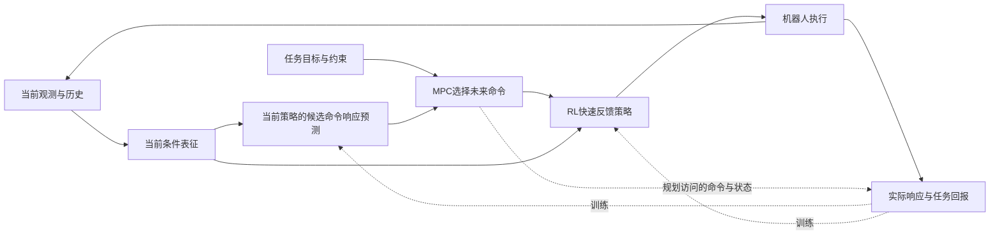

# 面向真实执行响应的 RL–MPC 协同学习：完整研究草案

日期：2026-10-14。用户已认可将“RL与MPC整体共同学习”和“规划利用学得执行能力”合成一项研究，并提供HIM作为线索。本稿据指定论文和直接近邻形成完整算法与验证方案；它是可审查的研究设计，不是已经实现的方法、已确认的三项创新或新实验结果。

**本日四篇全文复核后的更新：** 通用交替训练回路不足以独自构成创新，保留为朴素共同训练基线。最新研究对象、具体耦合信号、理论和训练／推理成本分析见[耦合研究v2](response-coupling-study-v2-2026-10-14.md)，本文保留为历史设计。

## 1. 一个研究问题，两个相互支持的结果

**科学问题：当机器人反馈策略在训练中不断改进、当前环境条件又不能被完全观测时，怎样让MPC预测当前策略对候选命令的真实响应，并让完整任务的成败反过来推动策略和响应模型共同改进？**

共同学习是方法，执行能力可被规划准确使用是产生收益的机制。希望取得的结果分别是：

- 策略经过完整任务训练，获得更有用的执行和恢复能力。
- MPC能够预测并利用这些能力，使任务表现提升，并在实际计算预算内运行。

第一项改变机器人能做什么，第二项使规划能正确利用这种变化。一篇论文可以围绕两者关系展开；不需要将它们作为两个互不相关的模块。

工作题名为“面向真实执行响应的RL–MPC协同学习”。暂不命名新流派。

## 2. HIM与我们的思路相似到什么程度

HIM从历史观测得到速度估计和隐式响应，以辅助RL反馈；它受经典内模控制启发。但它没有提供候选未来命令条件下的整段响应，也不包含部署时的MPC规划。精读版本、页码与边界见[HIM阅读](../notes/him-joint-2026-10-14/HIM-reading.md)。

HIM帮助回答“当前机器人处在什么响应条件中”。本研究还需要回答“如果接下来执行不同计划，各自会发生什么”。前者可作为后者的输入，但两者并不等价。

## 3. 最近的直接前人改变了研究定位

| 工作 | 已有内容 | 本研究不能重复声称的贡献 |
|---|---|---|
| HIM，ICLR2024，首稿2023 | 历史响应表征、显式速度、交替HIO/PPO | 历史编码、隐式响应、交替训练 |
| PIP-Loco，ICRA2025，首稿2024；主库MR028 | 继承HIM并学习动作条件模型、策略和价值，用于部署规划；原文承认规划偏离专家时模型可靠性下降 | 内部模型进入MPC、学习策略与规划组合 |
| ReCo，2026-10-01预印本 | 响应塑形训练；对冻结策略离线辨识；MPC使用闭环响应协调运动 | 让策略更可预测、用策略响应规划 |
| SPlaTES，RLC/RLJ2025 | 可预测技能与模型共同学习；明确讨论策略变化使旧数据过时 | 技能—模型共同训练、认识policy drift |
| Dynamic Tube MPC，2024首稿 | 计划条件下预测固定反馈的执行误差管；作者讨论训练与部署分布失配 | 历史＋候选计划预测误差范围 |
| PCM，ICML2024 | 使用策略表示条件化动力学，并用于MPC | 给模型加入策略编码 |
| Koopman低层RL响应MPC | 固定RL策略的闭环辨识与上层规划 | 固定策略后拟合响应再规划 |
| Online GP-MPC command supervision，2026 | 冻结RL、在线学习命令响应残差；仿真验证 | 在线学习闭环残差／命令监管 |

正文中PIP-Loco不是“上层命令MPC＋固定低层PPO”：其部署规划的首关节动作直接进入执行链。ReCo也不是只做系统辨识：它主动训练响应重复性。准确比较这些不同结构是本研究的前提。

来源、正式年与首稿、逐篇读取范围见[直接近邻表](../notes/him-joint-2026-10-14/nearest-work.md)。新增预印本不混入100篇主库正式发表口径。

本专题另有[结构化补充书目](../literature/supplements/him-joint-2026-10-14.json)，保留外部编号与主库引用，后续可按原文读取深度继续更新。

## 4. 真正要检验的统一机制

已有方法可以把不同条件的响应塑造成统一规律，以便预测。我们提出一个需要验证的假设：**部分差异应该由反馈消除，部分与可用能力相关的差异应该被模型保留，让规划有条件地利用。用完整任务表现决定这种分工，可能比预定一种统一响应更有效。**

例如轻、重负载在同一输入上限下可实现的加速度不同。统一响应可能适合重复性，却未充分利用轻负载时的能力；条件响应也可能因难以辨别负载而预测错误。研究必须同时处理任务收益与预测可信度，不能只让模型误差变小。

这一物理直觉与模型参考控制、自适应控制和增益调度有关系；它不是被宣称为新发现的常识。拟研究的实质是：有限观测、有限计算、反馈策略变化时，怎样做出有效分工，并证明／验证收益。

## 5. 完整运行结构

### 5.1 变量与模块

- `h_t`：近期观测、实际执行动作、命令历史，包含必要的命令计时与控制器内部信息。
- `z_t = E(h_t)`：当前条件表征，可借鉴HIM；不是预设为充分状态或稳定证书。
- `πθ(o_t,z_t,c_t)`：快速反馈策略，接收上层命令并输出实际执行接口支持的动作。
- `Gφ(h_t,C; πθ)`：对候选命令序列C预测当前策略的多步任务响应、段内约束相关量和误差描述。分号后的πθ标明模型适用的策略版本，不意味着输入策略编号即可泛化。
- MPC：针对任务代价与约束优化C，执行第一段命令后重新规划。

预测对象是“机器人＋执行器＋当前反馈控制器”的闭环。若存在动作饱和、PD伺服或安全过滤，其效果都应包含在数据与评价中。

MPC周期与反馈周期分别设计，具体频率依据实际接口和测量确定。局部推理快并不自动保证完整控制周期达标。

### 5.2 响应学习的明确输出

给定相同历史，模型需要比较尚未执行的不同命令。它应预测与任务有关的状态轨迹，以及中间时刻可能发生的约束事件；只预测段末位置是不够的。

模型可以采用宏观闭环状态递推或固定时域整段预测。理论阶段要明确选择及其状态／一致性假设。方法草案优先保留可分析的闭环递推；若历史混叠显著，需要集合或分布预测，不能用一个确定性latent掩盖不可观测性。

训练同时考虑多步响应误差和任务相关的候选评价。平均MSE只是辅助指标；候选排序、过于乐观的成本预测、约束风险低估更直接影响规划。具体学习准则属于需设计和比较的核心，不提前声称加入权重就是创新。

## 6. 可执行的共同训练流程

**初始化：** 复用HIM或合适强基线建立可用的命令反馈策略。首版将预训练的HIM编码器固定，集中更新反馈策略和响应模型；因此更新模型不会暗中改变策略输入。若以后更新共享编码器，它必须与actor作为完整策略版本共同处理并重新采集响应。

随后反复执行以下一轮：

1. **固定当前反馈策略，采集响应。** 在任务中运行MPC，记录它实际访问的命令；在仿真中从相关状态复制分支，执行多个候选命令，取得可比较的真实响应。分支数据计入训练预算。
2. **训练当前策略的响应模型。** 使用当前策略数据和多步目标，验证不同条件及命令下的预测。旧策略数据只有在其适用性明确时才复用。
3. **固定响应模型与MPC，在完整任务中更新反馈策略。** RL使用实际执行获得的任务回报，局部跟踪／能耗等作为适当辅助项。critic评价的是实际MPC＋反馈策略闭环，不能误用单独网络执行的价值。
4. **重新辨识更新后的策略。** 策略改进会改变真实响应，原模型不能默认仍正确。新数据、模型及误差范围都对应新策略。
5. **成对比较后进入下一轮。** 评价旧组合与新组合的任务能力、预测有效性及全部成本。接纳条件需要由理论和独立验证共同支持，不能仅凭训练损失下降。

固定MPC函数时，机器人状态变化仍会改变下一次规划命令，这些后果可进入model-free策略梯度的回报。无需假装可以对真实机器人求导。反之，旧响应模型已折入旧策略，不能把它对新策略参数的梯度视为已知。

这一训练流程是离线交替共同改进，不是所有模块同时做一次反向传播。部署先冻结成对的策略与响应模型，只更新历史状态和计划；在线更新网络权重是额外研究内容。

## 7. 一篇论文的三项拟贡献

| 拟贡献 | 完整方法中的作用 | 与已有工作的区分必须落在哪里 |
|---|---|---|
| **任务相关的条件响应学习** | 当前条件、当前策略、候选命令共同确定预测，用于实际任务与约束判断 | 超过固定低阶辨识、HIM表征直接接预测、普通动态管；优势需体现于计划选择，而非仅MSE |
| **任务驱动的策略—响应—规划共同改进** | 实际规划任务改变反馈能力，新能力再改变规划可用信息 | 超过固定策略加模型、预定响应塑形、朴素交替共训；不能把SPlaTES已有内容重新署为创新 |
| **策略与预测共同变化的有效性分析** | 说明何时新响应可被规划使用，误差怎样影响任务表现和可行性 | 得到可计算、与本方法有关的条件；通用误差递推与已有tube归纳只是基础 |

当前三项是需要取得的技术成果，创新强度未最终确认。若最终只有“HIM＋MPC＋联合奖励”，本方案的贡献目标未实现。

## 8. 理论先行：先建立什么

理论对象需包含真实状态及必要控制器记忆；部署输入仍限于可获得的历史。先明确可预测条件，分析历史混叠、策略改变与多步误差，随后连接预测误差、计划选择和滚动控制。

若同一候选集合上预测成本误差不超过η、优化误差不超过ε，则计划损失可用2η＋ε界定。这是通用基础。真正需要研究的是如何获得与当前策略、规划查询分布和更新过程匹配的η，并使其能指导设计。

若要进一步声明约束保证，则必须具备有效误差集合、收紧、终端或后备条件；网络方差和有限测试零违规不能替代这些条件。策略变化后原来的集合和证书也要重新检查。

首篇不以深度RL全局收敛为前提。可争取的是明确系统类内的条件性计划性能或闭环可靠性结果，再用非线性和接触实验检验实际范围。完整候选命题与限制见[理论草案](../notes/him-joint-2026-10-14/theory-evaluation.md)。

## 9. 证明两个结果确实相互促进的实验

先做四组配平对照：

| 组别 | 规划使用真实闭环响应 | 策略接受完整规划任务反馈 |
|---|---|---|
| A | 否，名义预测 | 否，常规跟踪训练 |
| B | 是，固定策略后辨识 | 否 |
| C | 否，名义预测 | 是 |
| D，完整方法 | 是，与当前策略成对更新 | 是 |

D不仅要比A好，还应解释相对B和C的额外收益。另用“新策略＋旧模型／新模型”“单纯重复性塑形／任务驱动学习”“随机命令／MPC命令训练”“同初态执行多个候选命令”进行机制干预。

强直接基线包括HIM、PIP-Loco、ReCo式响应塑形、固定策略＋条件响应MPC、SPlaTES适用版本、Dynamic Tube MPC，以及充分整定的经典反馈／自适应控制＋MPC。按相同动作层级和任务接口选择可比实现，避免把关节动作MPC、命令MPC与安全过滤的不同任务直接列成不公平榜单。

任务应要求速度／准确性和恢复能力同时发挥作用，例如参数或载荷变化、限幅条件下的连续转向与轨迹任务；报告任务进度与完成率，避免通过停住或放慢来“获得更准确预测”。真实数据、仿真分支、训练计算和完整在线延迟分别计量。

实时性首先以同截止时间下的任务收益或同性能下更低总时间评价，不仅报告求解器时间。理论、机制仿真、接触/跨仿真器、实机按顺序推进。

## 10. 实机与实施范围

用户已确认Go2 EDU、Piper H、铜锤M1。当前HIM/PIP/ReCo文献链使Go2 EDU成为最直接的首台验证候选；这不代替其低层接口、状态估计和计算条件的实际核查。Piper H可用于检验同一原理在另一类执行系统上的适用性，是否投入由仿真与论文主张决定。不会从“拥有两台设备”推定已经组成移动操作平台。

本研究可先用公开HIM类反馈与现有MPC实现搭建完整基线，再逐项引入响应及共同训练。可实现的工程骨架与新颖性判断分开：已有骨架支持开展研究，新增机制及论文强度必须由理论和对照结果确立。

## 11. 文献量怎样补才有效

主库100篇适合建立领域地图；这项统一方案还需要一条更密集的直接近邻链。本轮已经补齐HIM→PIP-Loco，固定策略响应→Koopman/GP-MPC/Dynamic Tube，反馈可预测性→ReCo/SPlaTES，策略条件建模→PCM等关键关系。

优先精读顺序：HIM、PIP-Loco、ReCo、SPlaTES、Dynamic Tube MPC，再围绕策略更新有效性回查控制理论。BMPC、TD-M(PC)²、DMPO、DEQ-MPC作为共同学习与实际执行评价的另一条已读基础链。

本轮HIM为17页正式版全文与5页原图；其余新增来源的读取范围分别见[HIM阅读](../notes/him-joint-2026-10-14/HIM-reading.md)、[近邻表](../notes/him-joint-2026-10-14/nearest-work.md)、[完整方法设计](../notes/him-joint-2026-10-14/method-design.md)、[理论与实验](../notes/him-joint-2026-10-14/theory-evaluation.md)。方法段核查、摘要筛选与全文精读分别记录，未把所有新增来源计为全读。

## 12. 当前判断与下一项研究成果

这次已经形成统一科学问题、完整运行和训练流程、三项贡献目标、直接前人定位、理论路线及因果实验方案，可以围绕它继续推进。两类结果在逻辑上能够合成一篇完整论文。

最关键的下一项成果，是把“任务驱动的条件响应与共同更新”相对ReCo／SPlaTES／PIP-Loco的新增机制落实为明确算法与理论命题；如果优势最终仅来自更大网络或更多训练，就应修改该机制。当前没有新证明、训练结果、仿真或实机结果。
