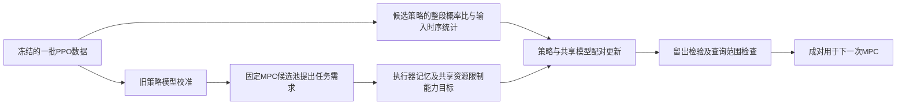

# 执行器记忆与共享输入资源约束下的响应—策略联合更新

日期：2026-10-16（Asia/Shanghai）。按用户指定提交`ffcdcf2`中的[交接要求](research-handoff-control-rl-coupling-2026-10-16.md)组织。本轮交付算法定义、直接支撑机制的条件推导及既有数据上的代数见证；**不训练，不生成新物理轨迹，不进行增益扫描，不更换对象。**开始时远端最新为`7fa5e66`，其有限诊断只作现有数据来源。

## 1. 一条完整机制，以及本轮交付到哪里

**MPC需要的不是一个独立变快的响应参数，而是“任务运动、当段输入占用、下一段开始时执行器还保留什么作用”的可同时实现组合。**学习策略负责在状态和扰动变化下实现这个组合；共享响应模型必须用同一组输入时序统计解释所承诺的执行器末态。

本轮选定一条具体控制关系：执行器的有限时间卷积及共用输入资源。它给出某一截止时刻的能力上界，也给不同时刻输入不同的末态作用权重。这个关系进入模型的输出结构、规划需求和同批策略统计的配对，而不是只在动作末端附加安全修正。

算法保留MPC规划、RL执行。RL的实际学习对象是观测/历史到两个物理动作的反馈函数，不是本轮仿真中的一个阻尼增益；控制结构不预先给出这两个动作的完整任务解。

**本轮完成：**明确优化问题、数据字段、规划需求构造、候选统计、逐块更新、PPO位置、发布规则、计算账本和近邻对照；完成两条有限变化/误差命题及完整证明；用已存五步轨迹验证同一需求在有无控制关系时的决定不同。

**本轮未完成：**实际PPO更新、学出新能力、自动MPC需求的实证验证、同预算性能或论文新颖性认证。旧PPO批次没有持久化，现有见证不能冒充其重算。当前是可审查的研究候选，不是已经胜过SPlaTES/ReCo的方法。



## 2. 对象、已知和必须学的量

本次数学对象沿用已存双执行器系统，不再换系统。首版明确采用全观测六状态ξ=z=[p,q,v,r,a1,a2]和**无循环actor**，另输入当前命令c、段内相位及可用任务参考。宏命令c保持K个低层拍，低层周期Δ。两个执行器时间常数暂取相同τ。该限制使第3节关系精确；不同时间常数需要用完整对角线性执行器算子重推，不能沿用标量α。历史/循环策略属于后续扩展，需额外定义可预测的记忆接口，本版不假定一个未定义的history状态已能由MPC递推。

| 对象 | 本候选的具体定义 |
|---|---|
| 已知结构 | 实际输入上限U；执行器一阶保持关系；共模/差模分配。物体/接触/环境的完整动态不要求已知。 |
| 实际策略πθ | 潜动作a_raw,t由高斯actor采样，u_i=U tanh(a_raw,i)。首版输入为上述六状态、当前c、相位及任务参考；网络输出两个实际执行方向。执行映射固定，不由φ或θ额外改变。actor与critic参数分离。 |
| 实际共/差模 | f=(u1+u2)/2，g=(u1−u2)/2，均为执行后的量。它们不是仿真经典控制律的参数。 |
| 共享响应Gφ | 条件于ξ,c的K拍任务响应、实际输入统计与执行器末态。模型既供MPC预测，也定义策略拟实现的能力要求。 |
| 未知/可学 | 任务和扰动下应怎样协调f与g，怎样利用观测历史、何时保留前进资源、何时建立接续所需差模作用。 |
| 观测边界 | 本轮数据有完整执行器状态；真实机器人若只可估计，应将估计误差写入条件，不能向策略或MPC提供不可用真值。未来扰动不作部署输入。 |

固定tanh映射使物理输入有界，但它只执行硬件权限，不给出有效步态/运动/恢复反馈。随机策略默认也按随机分布部署；若最终改为均值动作，需另做对应行为校准，不能继承本稿的随机策略矩结论。

## 3. 共享响应的最小表示：不是独立添加一个资源头

令ζ_j=[p_j,q_j,v_j,r_j]表示任务运动状态。Gφ一次宏步输出

\[
q_\phi(\xi,c)=
\{\widehat\zeta_{1:K},\widehat\mu_{f,0:K-1},
\widehat\mu_{g,0:K-1},\widehat m_{f,0:K-1},\widehat m_{g,0:K-1}\}.
\tag{A1}
\]

其中μ是条件均值，m分别表示E|f|、E|g|，不是均值的绝对值。a1/a2的条件均值由已知执行器递推层生成，不允许另一个独立末态头随意改变。下一宏节点明确为z_next=[ζ_K,a1_K,a2_K]，与下次G所需六状态接口相同。任务响应ζ由低维条件模型拟合，K个时刻可作为同一网络的一组输出，不在每个MPC候选内执行大actor或接触仿真。均值串接一般不等于真实随机闭环的多步均值，这部分属于名义规划近似，不能由执行器均值递推精确就宣称全部模型精确。

令α=exp(−Δ/τ)、β_j=(1−α)α^(K−1−j)。差模末态和时序加权共模占用为

\[
\widehat a_{-,K}=\alpha^K\widehat a_{-,0}+d_\phi,
\quad d_\phi=\sum_j\beta_j\widehat\mu_{g,j},
\quad b_\phi=\sum_j\beta_j\widehat m_{f,j}.
\tag{A2}
\]

候选模型需满足

\[
\widehat m_{f,j}\ge|\widehat\mu_{f,j}|,
\quad\widehat m_{g,j}\ge|\widehat\mu_{g,j}|,
\quad\widehat m_{f,j}+\widehat m_{g,j}\le U.
\tag{A3}
\]

由此有

\[
\boxed{|d_\phi|+b_\phi\le U(1-\alpha^K).}\tag{A4}
\]

(A2)用固定层实现；为避免每个MPC候选/低层拍求一个QP，本版将(A3)写成明确的廉价参数化。每拍由网络给出五个非负且和为1的系数p0,pf+,pf−,pg+,pg−，并令

\[
\widehat\mu_f=U(p_{f+}-p_{f-}),\quad
\widehat m_f=U(p_{f+}+p_{f-}),\quad
\widehat\mu_g=U(p_{g+}-p_{g-}),\quad
\widehat m_g=U(p_{g+}+p_{g-}).\tag{A4b}
\]

则(A3)直接成立。反之，满足(A3)的任意四元组可取pf±=(mf±μf)/(2U)、pg±=(mg±μg)/(2U)、p0=1−(mf+mg)/U表示。因此这没有额外缩小所声明的一阶/绝对矩多面体。实现可用五维softmax；其有限logit仅表示内点，边界以极限/声明容差处理。**这是输入统计的参数化，不是让actor只选择五个动作，也没有恢复全部联合分布或r与g的相关性。**

actor仍按连续动作策略执行。仅有(A3)/(A4)是期望量的物理必要边界，不是当前神经反馈可实现的充分条件；实际策略证据来自第6节。变量d是执行器末态作用，不等于“恢复越大越好”；MPC任务和下一段初态决定其所需符号与大小。

为什么保留它：相同段末位置/速度可能对应不同a_-；相同动作总量可能对应不同d。若丢掉这些量，模型能对当段任务和下一段能力分别给出看似合理、共同却不可实现的承诺。若原方法已完整建模这些关系，则本表示的优势需另证，不能宣称其必然缺失。

恢复功的卷积关系另见[理论§3](../notes/joint-update-2026-10-16/theory.md)。**本版不把恢复功作为额外独立约束加入主更新**：它涉及r与g的轨迹相关性，不能用几个均值头的乘积代替。先将有限执行记忆与资源关系做实，不拼接所有控制理论。

## 4. 一批PPO数据必须保存什么

一轮k固定当前(θk,φk)和本轮命令生成机制μk；数据Dk在这一版本下产生。在宏段内固定c。完整任务奖励按原任务定义，包括跨段回报，GAE不在普通宏段边界清零。真实终止才终止bootstrap；时间截断按原PPO语义处理。

每个低层记录至少包含：观测和必要历史/隐状态重算入口、潜动作a_raw、实际u、旧logπ、reward、terminated/truncated、Vold、Vnext、段编号/相位、段初ξ及c、ζ和执行器状态。额外派生f/g及|f|/|g|不增加物理交互。

按**独立环境轨迹**划分拟合集Dfit和留出集Dval，避免把同一连续轨迹的相邻拍拆成“独立验证”。在当前阶段只定义这种数据契约；不存在这些字段时不补造噪声或log probability。

先用固定θk校准φ，得到φcal。这是辨识修正，并不代表能力增长。之后候选新策略模型只用该候选的加权统计拟合；不能同一个头一边无权重追旧策略、一边宣称代表新策略。

**条件估计。** 不把全批均值等于某个MPC查询的条件响应。在Dfit的段初空间建立有限个锚点ξℓ，使用预先声明状态/命令尺度的固定非负核κℓ(ξ_i,c_i)。核及尺度在本轮固定，不让θ通过修改核制造收益；但R仍可能重分配组内不同初态的有限样本权重，这项偏差未被消除。它得到局部加权响应，不是精确逐点条件分布。基础有效段数不足时，该区域不提出能力增量，只允许原策略的模型校准。每个条件只有一条样本时SNIS权恒为1、策略梯度为0，不能假装有学习信息。

由固定核支持规则声明查询域Ωk。候选MPC分支的**所有H个查询**须留在Ωk，域外分支标记unsupported，不让域外G变化产生学习收益；候选池全部unsupported时本轮不发布新对。不能仅根状态有数据就使用任意未来模型查询。若实际运行进入域外，本稿不承诺新能力可用；实验回退必须同时恢复上一完整(策略,模型)对，并作为新的控制模式另记数据，不能只换回旧模型却继续执行新策略。本版不把这种混合/切换模式纳入(A7)的固定候选策略保证。理论中的逐条件矩误差需额外覆盖/平滑性条件，局部平均残差不替代它。

## 5. MPC怎样提出需求：可计算而不伪造CEM导数

在φcal上，对Dfit中选定的M个锚点运行原MPC。保存其实际生成的有限候选命令池Pℓ、参考预览和终端代价。这个操作是模型计算，新增调用须记账；本轮没有实际执行它。

更新期间固定候选池、锚点、参考和终端代价。Pℓ中只有名义H步查询均受Ωk支持且满足原任务声明约束的分支参与求最小值；没有支持分支时拒绝该候选φ。域边界不满足下面的光滑条件。对于响应模型φ，定义

\[
\mathcal J_k(\phi)=\frac1M\sum_\ell\min_{C\in P_\ell}
\left[\sum_{n=0}^{H-1}\widehat\ell(q_\phi(z_n,c_n),c_n)
+V_{f,k}(z_H)\right],\quad z_{n+1}=G_\phi^{end}(z_n,c_n).
\tag{A5}
\]

z的接续包含执行器末态，不能在下一段清零。**本版(A5)固定采用名义代价**：对预测均值运动及由μf/μg还原的名义输入应用已声明任务代价，不称真实期望成本。若未来研究期望风险，须补联合分布/相应代价统计；尤其平方均值不能代替输入平方的期望。Vf是本轮冻结的已声明任务终端代价，未提供时取0；不能凭低层critic名称自动当宏观价值。

当有限池的赢家唯一且分支可微时，对赢家的模型rollout求导，得到任务需求方向−∂J/∂q。它包含改变当段运动和改变末态执行器作用对后续段的价值。共享资源的机会成本由(A3)/(A4)对需求可行集合的联动产生，不能暗示CEM已返回某个不存在的资源乘子。平局用确定选支并记录；活跃可行集合变化处用单侧方向/显式小优化，不套光滑定理。

这不是CEM迭代的KKT梯度，也不是连续命令空间全局最优值导数。有限池可保留全部候选重新评分，内层优化时不对候选生成随机过程反传。它使“需求从哪来”确定下来，而不会把预测敏感度称为真实任务改进保证。

一种可独立检查的需求层为

\[
q_\ell^{dem}=\arg\min_{q\in\mathcal C_{phys}}
\langle\nabla_q J_{\ell,k},q-q_{\ell,k}\rangle
+\tfrac{1}{2\eta_q}\|q-q_{\ell,k}\|_{W_k}^2,
\tag{A6}
\]

其中Cphys含(A2)–(A4)，Wk采用固定物理单位尺度，ηq是声明的步长，不根据评价结果挑选。它给出可实现性**外界内的任务需求**，不直接把投影构造的开环动作发给机器人。后面的策略实现层仍可拒绝这一需求。直接在(A5)中受约束更新φ亦可，(A6)用于解释/求局部子步；两者不应在同一轮被当成两个独立任务奖励重复计入。

## 6. 同一批数据怎样描述候选策略的能力变化

对完整段i，潜动作概率给出

\[
R_i(\theta)=\exp\!\left\{\sum_{j=0}^{K-1}
[\log\pi_\theta(a^{raw}_{ij}\mid h_{ij},c_i)-\log\pi_k(a^{raw}_{ij}\mid h_{ij},c_i)]\right\}.
\tag{A7}
\]

候选隐藏状态必须按候选θ重新从保存历史计算。固定执行映射允许潜动作换测度；若把support区间本身也随θ/φ改变，则旧环境核不再相同，(A7)不能直接用。这是与旧解析support接口的重要实现区别。

令bi为(A1)各量的实际轨迹特征，包含**实际绝对输入**而非原高斯均值。每个锚点使用

\[
w_{\ell i}(\theta)=\frac{\kappa_{\ell i}R_i(\theta)}{\sum_s\kappa_{\ell s}R_s(\theta)},
\quad \widehat b_\ell(\theta)=\sum_iw_{\ell i}(\theta)b_i.
\tag{A8}
\]

不把单步PPO的clip ratio用于(A7)/(A8)。logsumexp用于数值稳定，不能偷偷截断R后继续声称原目标。SNIS有有限样本偏差；权重/ESS用于拒绝不受数据支持的候选，不是置信证书。

由于ξ_i不同，模型—策略配对采用局部残差矩

\[
C_\ell(\theta,\phi)=\sum_iw_{\ell i}(\theta)
[q_\phi(\xi_i,c_i)-b_i],\tag{A9}
\]

同时保留局部加权预测损失Lpred=Σℓ,i wℓi‖qφ(ξ_i,c_i)−bi‖²_W，以防仅靠正负误差抵消。该目标对应候选策略加权数据，φcal只作为起点/诊断基线，不再无权重强迫它拟合旧策略。

(A8)/(A9)是在旧段初/命令分布下描述候选反馈。它没有估计“新MPC改变命令后”的完整闭环回报；模型用于新查询时必须单独处理覆盖范围。算法把两者分开，不将一次PPO动作ratio偷换为新整个控制器的性能保证。

## 7. 具体联合目标与逐块更新

用奖励最大化记号定义标准PPO任务项

\[
L_{clip}(\theta)=\tfrac1N\sum_t\min\{\rho_t(\theta)\widehat A_t,
\operatorname{clip}(\rho_t,1-\epsilon,1+\epsilon)\widehat A_t\}.
\tag{A10}
\]

其中ρ_t为单拍概率比，与物理角速度r区分。旧log概率、GAE优势、价值目标和任务奖励固定；本候选不重新写一套“恢复奖励”替换原任务。具体拟求问题为

\[
\min_{\theta,\phi}
-L_{clip}(\theta)+\eta_J\mathcal J_k(\phi)+\eta_P L_{pred}(\theta,\phi)
\quad\text{s.t.}\quad
\|C_\ell(\theta,\phi)\|_{W_k}\le\varepsilon_\ell,
\ q_\phi\in\mathcal C_{phys},
\ \widehat{KL}(\pi_k,\pi_\theta)\le\delta_k.
\tag{A11}
\]

ηJ/ηP、容差、核尺度与KL限制是显式算法配置，初次未来试验需与普通共同训练预先冻结；本轮没有通过训练选择它们。零容差版适于说明梯度，数据有噪声时不强迫精确平均匹配。KL是经验诊断，不能仅由PPO clip推出。

这里Lpred对θ的权重导数**保留**，意味着策略也付出“使响应易于被当前模型描述”的代价；这是共同设计目标的一部分，不能在实现中偷偷stopgrad再声称优化同一(A11)。它与SPlaTES的可预测性思想有重叠，新增研究对象是具体执行记忆—资源关系及前瞻配对，而非可预测性本身。

采用增广拉格朗日只是一种标准求解方式。令软容差通过辅助残差sℓ∈{‖sℓ‖W≤εℓ}表示，Dℓ=Cℓ−sℓ，

\[
\mathcal L=-L_{clip}+\eta_J\mathcal J_k+\eta_P L_{pred}
+\sum_\ell\left[\lambda_\ell^TD_\ell+\tfrac\rho2\|D_\ell\|^2\right].\tag{A12}
\]

一次内层更新明确为：

1. **φ步：**θ和w固定，优化ηJ Jk+ηP Lpred+对偶/一致项；每步保持(A2)/(A3)。不通过真实环境求导。
2. **θ步：**φ、λ、s固定。每次反向前按当前θ重算R、C、D；仅在该次微分中stopgrad(λ+ρD)，不能跨epoch一直用旧D。沿−Lclip、Lpred和候选配对统计的完整导数更新actor；不对记录的bi、ξ_i求导，不反传进入φ步历史。
3. **s与λ步：**sℓ=argmin_{‖s‖W≤εℓ}‖s−(Cℓ+λℓ/ρ)‖₂²，λℓ←λℓ+ρ(Cℓ−sℓ)。这是欧氏距离到W椭球的投影，一般不能直接径向缩放。它是普通增广拉格朗日，不宣称新优化器。
4. **critic步：**按原PPO保存的GAE/return目标拟合参数独立的原任务critic；不把对偶信号写进旧优势。若将来共享backbone，critic更新也可能改θ，必须重新核对全部候选统计，本版不使用共享backbone。

内层次数有限，停止条件是预声明配对残差、经验KL及候选统计支持；未满足则不发布新能力。可用成熟Adam，但必须在同一actor反向过程中加入上述项，不能先跑未修改PPO、再声称它自动完成了(A11)。已有Tianshou底座尚未改动；本轮没有调用`PPOPolicy.learn`。

### 控制关系如何具体改变actor信号

固定φ时记e_i=qφ(ξ_i,c_i)−bi，S_i=Σ_j∇θlogπθ(a_raw,ij|h_ij,c_i)。对任意固定核组，SNIS的精确经验导数是

\[
\nabla_\theta C_\ell
=\sum_iw_{\ell i}(e_i-C_\ell)S_i^T.\tag{A13}
\]

令ℓ_i=‖e_i‖²_W，Lpred的actor导数还包括

\[
\nabla_\theta L_{pred}
=\sum_{\ell,i}w_{\ell i}\left(\ell_i-\sum_s w_{\ell s}\ell_s\right)S_i.
\tag{A13b}
\]

因此每段actor除了原PPO优势，还收到由(ηP、模型误差、λ+ρD)决定的**整段响应实现信用**。这些系数随任务要求与实际实现残差改变，不是人工固定一个惩罚权重就宣称完成。

定义νd=∂J/∂d为规划对执行器末态的敏感度。由d=Σβμg，**模型需求梯度**对μg,j包含νdβ_j；共享容量也通过β_j联系|f_j|的占用。这个时序要求先改变φ步的需求，再通过(A9)/(A13)影响actor。A11没有独立的“末态乘子νd”，有限神经参数化/有限内层下也不保证actor对偶系数恰好等于νdβ_j；实际actor信号以上两条导数为准。相同幅度的段末和段初输入在截止时刻上不等价，原来仅匹配终点或平均资源的表示会丢失这一语义。

**不是第j拍只乘一个νdβ_jg_j。**当前反馈动作还改变未来状态和后续输入，实际使用完整段score及(A13)，或另行证明合法的因果return-to-go。不得丢掉反馈对后续动作的影响。控制结构提供时序和资源的信用依据，RL仍负责从交互中学习历史→动作的非线性反馈函数。

## 8. 一轮可逐行执行的伪代码

```text
输入：冻结的θk、φk、任务奖励；一批带完整概率/历史字段的Dk；
      宏周期K、已知执行器系数、模型/更新预算、核尺度、容差与KL阈值
输出：候选(θ+,φ+)及release状态；不是自动保证真实任务提升

1 按独立环境轨迹拆Dfit/Dval；计算旧GAE和return并冻结。
2 从实际u派生f,g,|f|,|g|，形成完整段bi；记录初末执行器状态。
3 固定θk校准φcal；标记这是认知修正，不是能力增长。
4 建立固定核锚点；支持不足的查询区域禁止本轮能力增量。
5 用φcal与任务预览形成有限MPC候选池P；固定池及终端代价。
6 θ←θk，φ←φcal，λ←0，s←容差球内初值。
7 对预声明有限内层轮数：
    a 用完整候选history重新算logπθ，形成未clip整段R及局部SNIS w。
    b 若支持/权重诊断越界，缩短该参数步；不得截断R后隐瞒偏差。
    c 固定θ，做φ步：任务需求(A5)+同θ加权预测+配对；满足控制层。
    d 固定φ，做θ步：标准PPO项+预测/配对的完整SNIS导数。
    e 投影s、更新λ；在旧return上做原任务critic步。
    f 检查全Dfit的配对、KL、模型结构；未达标继续或保留旧对。
8 冻结候选，仅在Dval重算统计/误差/任务surrogate，不再用它更新权重。
9 若通过下面声明的经验发布条件，输出候选对与适用查询域；否则保留旧对。
10 下一次MPC从真实状态重规划，使用成对新模型；跨段不清零执行器记忆。
```

经验发布条件明确采用：用**同一候选θ权重和同一核**比较候选φ与φcal的留出预测误差，不劣于声明容差；配对残差不超过ε；未clip权重诊断满足预设下限；经验KL不超限；(A2)/(A3)满足；旧命令分布下的留出任务surrogate不下降；未来候选查询受Ωk支持。检查失败只拒绝候选，不用增加训练预算或修改评价任务救结果。

这些是可执行的**经验规则**，不是(14)意义下的置信证书。若需要条件保证，必须另外给出第9节误差界前提；不能用留出MSE或ESS直接填εg。新MPC命令分布变化及多次选择使用同一Dval会破坏朴素统计解释，后续数据轮次需更新独立验证。

## 9. 直接支撑机制的已完成理论

[完整推导](../notes/joint-update-2026-10-16/theory.md)给出：

**命题1：有限策略变化也必须服从同一时序关系。**在固定初态/命令条件下，任意两个合法策略满足

\[
\Delta\mathbb E[a_{-,K}]=\sum_j\beta_j\Delta\mathbb E[g_j].\tag{A14}
\]

这是实际执行器递推的恒等式，不需要策略参数步小；模型承诺的执行记忆变化必须来自实际差模输入时序变化。固定整个f序列时可达d区间恰为±Σβ(U−|f|)，有构造性充分性证明；对神经策略只作为物理外界。

**命题2：有限候选更新的末态误差由真实时序传播。**精确执行器参数和初态下，若候选输入矩误差满足|μhat_g,j−Eθ+g_j|≤εg,j，则

\[
|\widehat a_{-,K}-\mathbb E_{\theta^+}a_{-,K}|
\le\sum_j\beta_j\varepsilon_{g,j}.\tag{A15}
\]

一般版另计入初态、系数及执行器残差，完整证明见理论式(13)。统一误差时右侧为(1−α^K)εg，而非无条件Kεg；靠近截止时刻的估计误差权重更大。这个结论直接决定模型发布的余量和数据应聚焦的时刻。

若资源估计Bhat的误差不超过εB，而请求|d*|>Bhat+εB，则可明确拒绝该共模占用下的请求。落在外界内仍需策略实现证据，不能称一定学得到。本文没有给上述条件前提的通用有限样本认证，也不证明PPO收敛、全局安全或完整滚动任务提升。

## 10. 必须正面保留的冗余极限

**如果所有统计来自同一批真实轨迹、用同一正归一权重，并且模型与这些统计精确一致，则(A2)和凸资源边界本来就成立。**这时再添加同一物理约束不会新增actor可行方向，也不保证改变更新。这一事实已有证明，不能隐藏。

本候选研究的是有限表示/有限数据下，任务驱动的模型或能力需求可能脱离输入时序与接续状态；将它们显式关联，再通过同一候选策略的统计实现，而不是声称发现了新的物理可达域。若普通共同训练已经具有相同表示、完整控制关系、估计和目标，标准SQP/其他约束优化可得到同解；本轮对此作了正面等价验证。

这限定了“新在哪里”：相对本项目旧的平均匹配soft-QP，新增的是明确的执行器deadline算子、绝对输入占用和接续状态的同批有限变化语义，而不是QP形式。相对完整物理模型的强方法，本候选是否改善数据/计算效率仍未知。不能由(A14)/(A15)直接宣布论文贡献成立。

## 11. 无训练见证及其准确身份

[见证](../notes/joint-update-2026-10-16/witness.md)只读已有case3线性反馈轨迹的首次扰动段t=0.90→1.00s，K=5；不改变增益，不重跑物理对象。使用该RK4执行器的精确数值系数核验关系，旧记录残差−1.11e−16。

固定局部需求输入(dreq,breq)=(1.0,0.2817532734)，使用等权最小改动。dreq=1是**人为声明的需求层单元输入**，不是从真实MPC或PPO优势提取的结果；本例只验证(A6)的控制关系会改变决定：

| 局部决定 | d | 时序加权前进占用b |
|---|---:|---:|
| 独立匹配两个目标，未施加deadline关系 | 1.000000 | 0.281753 |
| 保持原前进占用时允许的d上限 | 0.856064 | 0.281753 |
| 加入关系后的共同需求 | 0.928032 | 0.209785 |
| 同完整约束的普通SLSQP | 0.928032 | 0.209785 |

投影前违反共同资源界0.143936；投影后需同时降低前进占用并减弱差模要求。普通同约束解与闭式解相同；没有求解器创新。构造的合法输入序列只证明存在性，**未执行、未由PPO学出、未发布给MPC**。

另仅将已有g向量倒序：动作总量不变，但末态记忆由0.071605变为0.047810；没有新轨迹。这检验了时间信息为何必要，不证明某一时序对完整任务更优。

现有PPO目录没有旧训练批次的潜动作/logπ/advantage，因此不能完成真实单批策略梯度重算；详见[数据审计](../notes/joint-update-2026-10-16/data-audit.md)。本轮验证范围是**需求层与物理实现关系**，不是完整(A7)–(A13)的实证。将这项缺口明确列出比构造假PPO数据更重要。

## 12. 与SPlaTES、ReCo和普通共同训练的实质比较

| 对照 | 已有机制 | 本候选的具体区别/未证增量 |
|---|---|---|
| SPlaTES | 模型概率/互信息势差塑形技能，技能和模型共训，规划改变采样分布 | 能力目标显式包含输入时序、共享占用和执行器接续；任务需求受该关系约束后进入候选策略统计更新。共训/可预测技能本身不新。 |
| ReCo | 先塑造预设响应，冻结后辨识，MPC利用闭环模型 | 任务在每轮提出响应—资源—末态组合，策略与模型按同批实现统计配对更新；未知反馈函数仍由RL学。不是只多调一个响应参数。 |
| O0：原表示的普通共训 | 任务PPO＋端点预测/匹配 | 无法表达本例中相同总量、不同deadline作用的区别；这首先是表示缺口，不证明性能差。 |
| O1：同容量、同输入统计表示的普通共训 | 同PPO/预测数据与模型容量，各头拟合、一般一致性；不强制(A2)/(A3) | 用它隔离控制关系的作用；如果已学到同一关系，差异可能消失，不人为削弱它。 |
| O2：同表示、同完整关系的通用约束优化 | 与(A11)相同最终问题 | 允许同解。增量不能放在更换求解器或名称上。 |

GPS的一致性/对偶、Costate-focused RL的共享任务敏感度、TaskMet的任务导向模型、CPO的约束策略步均是已有工具。详见[逐式近邻审计](../notes/joint-update-2026-10-16/nearest-work.md)，不以“在SPlaTES/ReCo里未见”作为全领域首次证明。

三个候选贡献位置仍是：①数据支持的段内响应—输入时序—接续表示；②任务提出需求、候选策略统计实现需求的联合规则；③有限能力更新可被规划采用的误差条件。当前分别有明确数学对象、更新方案和条件推导，但没有同预算学习结果，足以支撑T-RO的创新性仍未确认。

## 13. 并行、长程和成本：算法设计，不运行

设N段、每段K步、M核锚点、H宏时域、P固定候选、E内层轮。收集数据用NK个实际转移；派生f/g/绝对值和执行器算子为O(NK)。完整段ratio和actor梯度可在GPU上按环境/段批量计算；不形成全部参数Jacobian。

冻结候选池的建池与重评分约为M×P×H次宏响应查询；若每次返回K拍统计，计算/内存还含K。必须另记原CEM建池轮数和候选数，不能把它免费计为旧数据。每轮E次actor/critic/model及对偶计算、Dval候选评估均入账；减少矩阵存储不等于减少score方差。

部署低层每拍只运行actor和固定输入映射，高层每宏拍用紧凑响应模型。执行器均值递推是廉价已知算子，但神经预测误差、部分观测和状态分布变化仍在。没有NX计时证据。

长程要求：真实/模型执行器状态跨段持续；PPO回报跨普通宏边界延续；MPC的后续段成本看见当前末态资源。该结构解释“接续为什么影响学习”，不保证长程任务已成功；有限H与Vf选择仍需后续评价。

## 14. 后续验收与本轮停止点

本轮只完成文档/推导及一次现有数据代数验证。下一次若讨论实现，应先审(A11)相对O1是否有足够实质增量，以及已声明条件估计/发布规则是否可接受；不能以新增训练曲线替代这些问题。

用户尚未解除不训练要求，故不启动新PPO、不采集新批次、不调用物理rollout。若以后恢复训练，必须保存第4节完整批次并比较O0/O1/O2、充分固定响应、独立强策略＋当前辨识和命令适配，匹配信息/容量/主要预算。当前“不训练见证通过”不等于这些比较通过。
