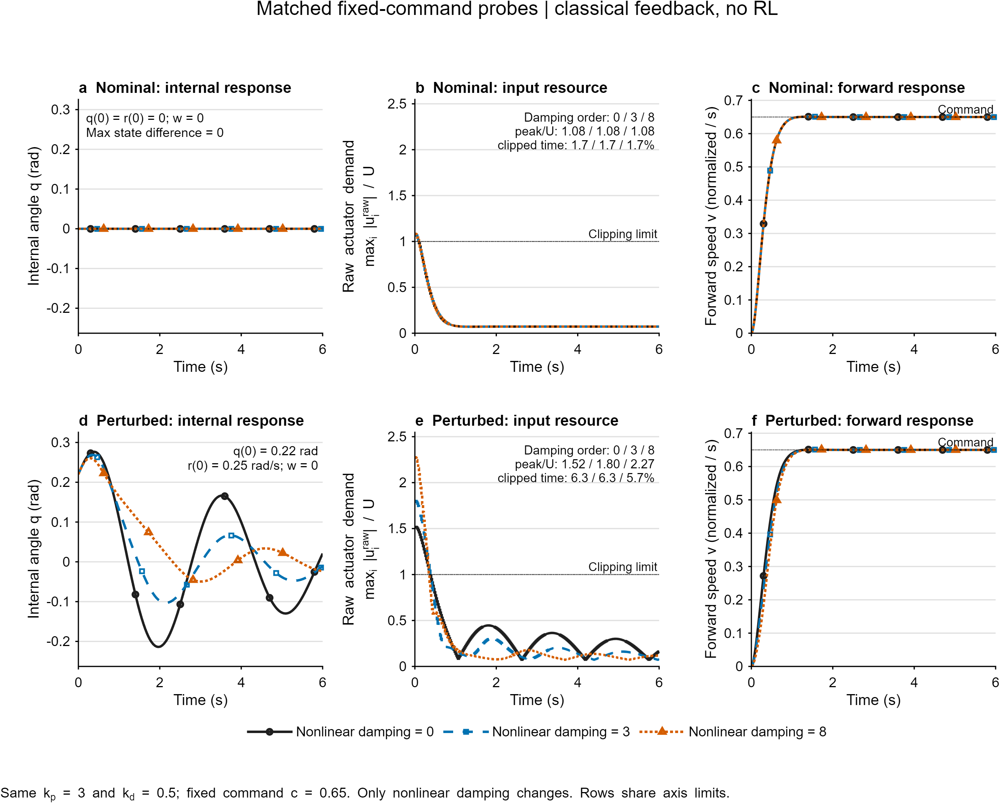
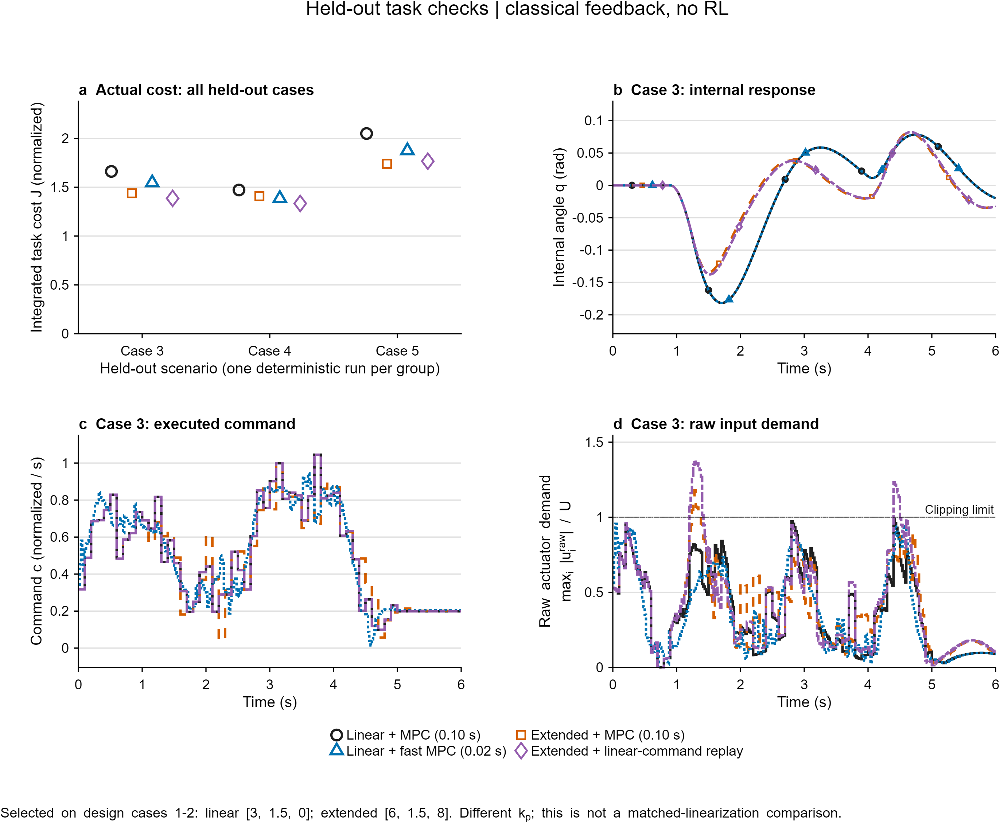
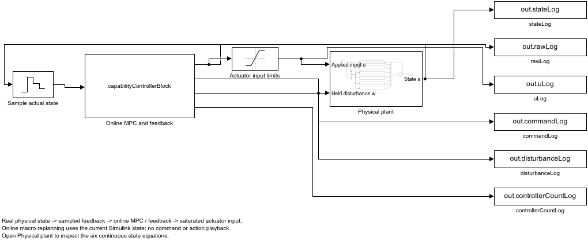
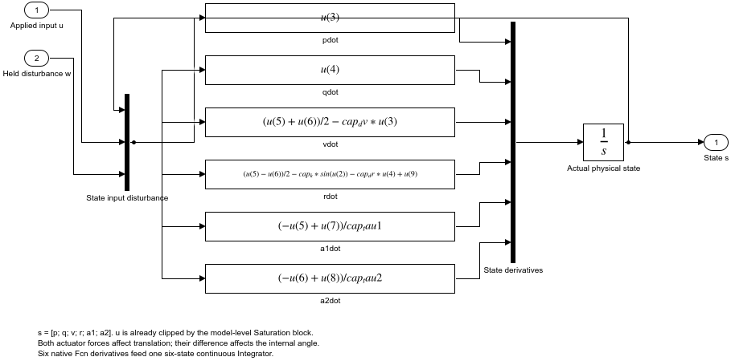

# 反馈能力与输入资源：MATLAB / Simulink第一轮判别

日期：2026-10-16。**本轮实际完成通用控制仿真，不训练RL。**主要结论及后续学习入口见[完整报告](../../docs/capability-probe-report-2026-10-16.md)。

| 证据 | 状态与用途 |
|---|---|
| [冻结协议](protocol.md) | 对象、18候选、2设计/3评价任务、4组比较、固定命令探针；另记录实现错误修复，未改评价设置择优 |
| [理论推导](theory.md) | 精确共模/差模资源关系、命令适配等价边界、瞬时非等价、局部线性化与执行器误差项 |
| [结果JSON](results.json) | 已完成54条MATLAB轨迹，包含所有设计成本和逐评价指标，无RL更新 |
| [设计表](design-grid.csv) | 列顺序kp,kd,theta,case1_cost,case2_cost,mean_cost；18项完整保留 |
| [评价表](evaluation.csv) | 3场景×4组；实际成本、偏转、输入和求解开销逐项保存 |
| [Simulink核验](simulink-check.json) | 两组原生物理模型＋在线MPC各60次；状态差≤8.89e−16，通过 |
| [计算账本](resource-ledger.json) | 正式、Simulink、smoke和报错重跑分别记账，不当作独立学习样本 |
| [MATLAB源码入口](../../matlab/capability/README.md) | 可重建SLX并重跑全部结果；模型/大日志留work忽略目录 |

## 图

固定kp/kd的三组反馈，名义不变子空间响应相同，有限偏转后的恢复和输入需求不同；这是经典反馈结构的行为自由度，不是RL训练结果。

三个评价场景保留全部成本点；扩展反馈选点与线性选点kp不同。case3原始轨迹同时展示偏转、命令和限幅前需求，不能仅按平均成本判断。

实际运行的Simulink顶层；控制器在运行时读取物理状态并求解MPC，不回放命令。

## 接续判断

已支持：存在高层单命令不能直接覆盖的反馈方向；输入代价能使响应改变分成接受、减速后可实现、拒绝三类；更新后的MPC能减少命令回放中的输入饱和。

未支持：RL必要性、共同学习收益、全局任务优越性、硬安全或递归可行、相对SPlaTES/ReCo方法级优势。下一步先将数据支持的段内响应与输入需求明确耦合，保留经典强基线，再决定小规模学习算法。
