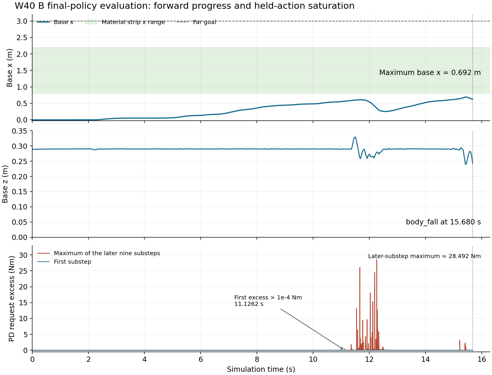
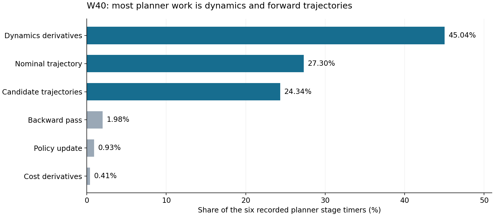

# W40 最终审查：联合学习已运行，稳定材料通行尚未建立

日期：2026-11-07，北京时间。实验事实基准为 [c438f54](https://github.com/kaiwen123-yang/MCP-RL/commit/c438f5463659ab7c8d3a7f5eced251639e14b2ef)。本审查复算已发布结果、修复真实 QP 故障并更新下一轮入口；没有在 D57 构建、恢复训练或取得新的物理评价。

**结论：可以继续推进实验，当前任务是稳定完整联合执行。W40 不是成功的材料通行基线，GPU 支线也还没有形成可替换的加速规划器。先用 qp2 续完 A 的原任务，同时核对同输入下饱和保持动力学及其导数，据证据实施一个r30修复，再进行 W41 两条完整联合续训。全段未裁剪PD可行投影是候选设计，不能预先宣称已找出唯一物理根因。**

[下一轮执行计划](../../../../../../docs/S1_W41_STABILITY_PLAN.md) · [GPU扩展实验](../../../../../../docs/S1_W41_GPU_PLAN.md) · [启动提示词](../../../../../../docs/S1_W41_START_PROMPT.md) · [历史逐阶段审查](history-review.md) · [全部可识别测试索引](history-test-inventory.json) · [技术故障与真实回放](technical-error.md)

## 1. 阅读范围与证据层级

以 Git 对象而非有未提交修改的工作树为准，完整读取实验基准提交c438f54的 **6,013 个 tracked blob、645,462,015 字节**。其中 5,679 个 UTF-8 文件、334 个二进制/非 UTF-8；3,066 个 JSON 和 634 个 JSONL 全部解析，JSONL 共 16,290 条，解析错误 0。历史审计另解析 506 个 CSV、1,037,666 数据行。机器逐字节读取不等于语义理解每个二进制字节。

语义审查覆盖当前/历史计划、历轮结果索引和可识别逐回合结果、R12 训练/恢复/评价/交付链、r24–29 与 qp1/qp2 机制、PANN/奖励/GAE/观察定义、GPU predictor 和原始控制记录。历史索引识别到 723 份 S1 逐回合 JSON、660 个不同轨迹身份；另有 R3 的 3 次已说明但数组丢失的物理启动。R1 外部复现的 CSV 中另有 926 个不同轨迹身份，不能把不同单位合并成一个无定义的“测试总数”。

W40 本次完整复算 **64 个训练回合、B 的一次末次 E30、1,939 条学习转移、7 次已完成更新**。实际重读所有 65 回合的 feedback/planner-call 记录，精选 A314/B E30 的物理/执行/轨迹，以及全部 7 份已训练 rollout NPZ；原始审计读取 273 个文件、2,787,257,551 字节（包括紧凑元数据），没有新物理积分。另重读 GPU 全部 10 份已交付 NPZ。

12 个 ZIP 已发布，包含 6,238 项源文件、原始 19,210,509,738 字节，压缩交付 14,438,490,539 字节。本次已取得并核对的精选 ZIP 成员为 156 项、2,855,727,858 原始字节；**没有宣称重新解压全部 6,238 项、看过所有视频帧，或读完所有历史 Release 权重/数组。** 请求源文件清单、真实读取与语义结论分别记录，避免把“已上传”当作“已分析”。

证据：[Git 全文件覆盖](repository-read-coverage.json)、[精选原件取得记录](raw-read-coverage.json)、[紧凑复算](progress-audit.json)、[原始控制/学习复算](raw-progress-audit.json)、[GPU 数组复算](gpu-array-audit.json)。

补充独立复核重新遍历了全部6,013个Git blob、723份S1回合结果，独立流读W40的128份反馈/规划原件共2,661,289,930字节，并复算奖励、GAE与两例十子步物理记录。关键结论一致，具体范围见[独立复核](independent-progress-verification.md)及[覆盖统计](independent-coverage-20261107.json)。

## 2. 实际目标与已达到的层级

长期问题是：同一世界坐标地块被前足、后足及返程重复加载时，怎样利用可恢复材料的持久状态，让未来支撑需求约束当前加载、落点和重访时间。最终平台为 Go2＋NX；G0/G1 是 Go2 配置代号。

现在的完整链路已经实际运行：冻结因果 PANN 的参数，但继续更新地块历史；PPO Actor/Critic 学习 2 Hz 标量速度 cap；全身 MuJoCo iLQG 产生计划，经时变反馈、目标角、PD 与原 TM02 物理执行，回到真实轨迹和奖励，再更新 PPO。

因此，“联合训练还没开始”已经过时；“联合算法已经稳定”同样不成立。当前 MPC 候选还没有传播完整材料恢复历史，cap 也不能独立指定落脚、支撑分配或重访时序。稳定通行之后仍需补足这些权限，并以同信息、同任务对照证明记忆的收益，才进入核心科学验证。

## 3. W40 最终进度

| 项目 | w40-a / seed1 | w40-b / seed2 |
|---|---:|---:|
| 起点 | 8593 样本 / 33 更新 | 8593 / 33 |
| 本轮新增 | 915 样本 / 3 更新 | 1024 / 4 |
| 最后累计 | 9508 / 36 | 9617 / 37 |
| 有效未更新 tail | 147 | 0 |
| 历史 excluded | 145 | 145，同一祖先历史 |
| 训练回合 | 30 | 34 |
| 自然物理/材料失败 | 28 | 32 |
| 技术中断 | 2，含最初 qp1 修复前一次 | 1，发生在最初 qp1 修复前 |
| 原样本目标截断 | 0 | 1 |
| 材料加载回合 | 28 | 26 |
| 合法去程 / 返程 / 往返 | 0 / 0 / 0 | 0 / 0 / 0 |
| 最后结束 | qp1 数值故障，exit 2 | target_reached，exit 0 |
| 自身末次策略 E30 | 未真正运行，技术中断阻塞 | update37，15.680 s 跌倒，max x=0.692254 m |
| E60 | 未取得前级资格 | blocked_by_predecessor |

合计新增 1,939 条，1,792 条用于 7 次 PPO 更新，147 条仍合法保存在 A 的 tail。PANN 实验树的独特累计样本是 12,580；已训练 12,288，另有 tail147 与历史 excluded145。R12 顶层所有组总量 12,836 还包括独立 RAW 的 256 条。这些都不是把两分支 optimizer 合成一条策略；36/37 次更新不能相加称 73 次更新的模型。

60 次自然失败为 **38 跌倒、12 躯干非法接触、10 材料域退出**。自然回合存活中位 14.005 s、最长 30.198 s，最远 x 最大 1.065995 m；到达 3 m 远端、开始返程均为 0。A314 技术退出时长 24.732 s 是右删失结果，不能推测它后面必定会倒，也不能算成功。

## 4. 与前两轮相比，改善是否成立

| 同口径训练指标 | W38 / r27 | W39 / r28 | W40 / r29、qp1 |
|---|---:|---:|---:|
| 独特新增样本 | 2048 | 2048 | 1939 |
| 训练回合 | 70 | 62 | 64 |
| 自然失败 | 68 | 59 | 60 |
| 跌倒 / 躯干接触 / 材料域 | 27 / 40 / 1 | 41 / 4 / 14 | 38 / 12 / 10 |
| 材料加载回合 | 53 | 58 | 54 |
| 机身进入材料条带 | 15 | 30 | 31 |
| 进入且内部足加载 | 8 | 26 | 26 |
| 自然回合存活中位数 s | 14.5119 | 15.0140 | 14.0050 |
| 合法去程 / 返程 / 往返 | 0 / 0 / 0 | 0 / 0 / 0 | 0 / 0 / 0 |

r28 减少了一类躯干接触失败并使探索深入，但 r29 尚未带来稳定通行。控制版本、继续学习、随机轨迹和 worker 分配都发生变化，这张表是工程演进，不能作为隔离的机制消融。

也不能说整个历史从未出现合法去程：r24 的 W34 曾有 3 条、W35 有 1 条合法去程，W35 ep116 曾运行到 46.1606 s 并进入返程。完整合法往返仍未建立。它们应作为后续控制变化的参照，不因旧版本就被抹去，也不自动成为当前版本资格。

## 5. 程序为何再次报错：已确定的根因

A314 在 plan1257/query12387 返回 `qp_kkt_failure`，失败动作在物理推进前被拒绝。H 有限正定，条件数约 2.964×10^8，交集非空；不是 NaN、缺 H、固定轴错误或后台到时。

qp1 将最终 scaled KKT 容差误用于“当前自由面已最小化”的内部判断。病态耦合 H 下，小自由梯度仍对应可观位移；提前释放上界变量后 Newton 方向向界外，步长为 0，随后又锁回同一边界，循环到 608 次。

**qp2 改为实际完成当前自由面的完整可行 Newton 步之后，才释放错误乘子边界。** 原 H、中心、约束、正则化、primal 1e-10 rad、scaled KKT 1e-7 和通过证书的原生动作均保留。

独立编译实际 C++ 求解代码、链接 MuJoCo 3.2.3，12 个真实记录均通过：A314 从 608 次失败变为 3 步通过，scaled KKT=5.64466e-11、primal=0；9 个原生通过动作和两例旧 refinement 解逐 bit 不变。提高循环次数或放宽阈值没有被采用。详细推导、输入与复算脚本见 [technical-error.md](technical-error.md) 和 [qp2-replay.json](qp2-replay.json)。

这解决了一个已证实的程序阻塞，不等于解决所有物理失败。这里尚无 D57 新构建和新训练结果。

独立复核重新编译并运行了全部12个实际输入，结果一致，并发现/修复两个额外漏洞：同目录恢复会在新episode前覆盖来源checkpoint；E60/E300/E600未读取已有合法材料返程/往返计数。新保存保留来源、索引指向真实restart路径；新长阶段增加`bidirectional_material_roundtrips_v1`，保留旧条件观察，不改写历史结果。真实B E30轨迹重评分仍是原跌倒；文件保存验证没有冒充实际PyTorch恢复。详见[独立技术复核](technical-independent-verification.md)。

## 6. 控制为何不稳：原始执行揭示的缺口

全训练有 477,380 次实际动作查询尝试，其中 477,377 次通过证书，3 次拒绝在物理之前。24,238 次发生投影变化，343 次需要 refinement；并非新机制没有接入。54 个材料加载回合中，51 个在加载前已有大原始反馈，53 个在加载前已有 nominal 或反馈引入的 PD 饱和请求。

本轮 49,044 次训练 planner call 全部安装了新 policy；没有发现本轮是因 planner 停摆而反复用陈旧计划。A314/B E30 的 12,366/7,840 个已执行动作与反馈记录、执行关联及 trajectory 目标角逐项相同。

### 瞬时可行与整段保持可行不同

r29 使用动作起点状态构造 PD 区间，再以 H 度量投影。真实执行在 2 ms 内保持同一目标，经过十个 0.2 ms 物理子步；q/v 在变化，因此 PD 请求也变化：

`tau_j = 60 * (u - q_j) - 5 * v_j`。

| 真实记录 | 首子步最大原始 PD 超限 Nm | 后九子步最大超限 Nm | 后九步超限行数（>1e-4 Nm） |
|---|---:|---:|---:|
| A314 | 0.00000712 | 18.78825 | 2174 / 111294 |
| B 末次 E30 | 0.00000699 | 28.49216 | 672 / 70560 |

这不是实际物理扭矩突破上限；原 actuator clamp 一直生效。实际支撑响应由保持期间裁剪后的请求决定。首子步的微小舍入与后续几十 Nm 的请求超限应分开解释。B 的首次整段 hold 超限在 11.1262 s；不能把终点跌倒才看到的峰值当成首因，也不能仅据饱和记录断言预测器漏掉了裁剪。

图中绿色为材料条带的x范围；前足可以在机身进入前加载。下图为请求超过限值的量，真实执行扭矩仍被截断。

这些证据支持优先核对“相同保持动作的真实饱和动力学与预测/导数是否一致”。若发现接线或导数错误，先修具体错误；若它们一致，再选择受约束优化/反馈方法实验。额外要求全段未裁剪PD不饱和可能抑制恢复动作，不能直接等同于物理正确性。当前没有证据把所有失稳归咎于 TM02 或 PANN。

## 7. 学习链目前排除了什么，又还缺什么

1,939 条 reward 按源公式复算，最大差 1.78e-15；7 次 GAE 均值与生产 float32 记录的差不超过 8.04e-7。所有已训练的 1,792×658 维 obs/next_obs 有限，连续同回合交接一致。按真实整足内域定义重算查询掩码，A/B 均 0 不一致；旧审计用脚中心误判的 37 项已更正。

本轮动作时刻 PANN 非零 107/1939=5.52%；1690 条四足查询全部在条带外，140 条在条带内但没有先前真实加载历史，2 条是观察端点之间的短脉冲。主要是任务暴露不足。B 末次 E30 的 32 个同状态特征清零比较，cap 差全部为 0；这说明该次评价没有显示记忆影响动作，不能推论材料记忆本身无价值，也不是完整重训消融。

2 Hz cap 每 0.5 s 才决定一次速度上限；进入材料后的部分破坏发生在毫秒尺度。它可以改变更早的运动意图，但不能直接指定足端加载/落点/重访时间。稳定完整机器人后，应让材料信息进入候选状态传播和有物理作用的决策权限；当前不应在 A 的合法 tail 中途更改动作维度。

## 8. 效率和 GPU 支线

W40 共有 11.178 h 的采集区间（包含修复暂停，排除 B E30 和发布），1939 独特新样本，相当于 173.465 条/h；W39 为 141.671 条/h。提升约 22.4%，但 worker 8→12、控制变化、修复、GPU 竞争与回合长短混杂，不能称纯 worker 提速因果结果。

普通规划平均 1.23269 s，含启动规划合计占训练回合墙钟 86.66%。同步仿真等待规划，慢影响吞吐与未来 NX 实时性，不直接证明本轮仿真发生墙钟延迟失稳。

GPU 原任务完成 `FP64 batch predictor + one/ten steps + per-substep A/B + composed P/Q`，状态 `completed_batch_layer`，`aligned=false`。8 fixtures 仅 3 个满足原状态/导数条件；最大速度差 0.00148515，组合 A 最大差 1358.333，失败案例最大 A 差所在列全部为 base-z。这里是不同单位混合状态的分量误差，不能把该单一最大值称为统一物理量。

当前缺少完整任务残差/代价、私有 phase 重建、反馈候选排序和整个 planner 集成。现存 GPU 8-fixture 一子步 steady p50=10.443 s，CPU 8-fixture 十子步 0.06389 s；工作量不同，不能据此计算严格加速比，现有结果也没有正向加速证据。显存记录 43,841 MiB、利用率快照 29%，都不是成功标准。

用户本次明确要求扩大GPU工作，因此下一轮继续独立支线：[G1–G5计划](../../../../../../docs/S1_W41_GPU_PLAN.md)覆盖更大的真实状态库、驻留节点/候选批量、完整规划和独立闭环，并在有依据时选择一个替代GPU架构。未对齐结果不进入正在运行的主线；已完成W40和原十份NPZ保留，不重跑旧job。

六项规划内部计时复算表明，动力学导数45.04%、名义轨迹27.30%、候选轨迹24.34%，backward仅1.98%。当前GPU研究应优先覆盖前述主要工作量；这不是可直接外推的加速保证。[复算与图](planner-stage-summary.json)。

## 9. 相关论文如何真正服务下一步

原12篇文献条目及阅读范围见 [literature.json](literature.json)，最新版本校正与新增的Science Robotics/Nature Machine Intelligence/CoRL/Humanoids等论文见 [本次文献更新](literature-update-20261107.md)。这里列实际借鉴关系，不能把别人的稳定性或速度当作本项目成绩。

| 文献 | 发表状态 | 本项目具体使用处 |
|---|---|---|
| [ProxQP](https://scaron.info/publications/tro-2025.html) | T-RO 2025；原始预印本 2023 | 内部迭代条件、缩放、warm start 与最终残差证书分开；先修实际 qp2，不因新论文盲目换库 |
| [Control-Constrained DDP](https://arxiv.org/abs/2608.18552) | RA-L 2026；v2 2026-09-03 | 约束、前馈/反馈及 forward/backward 一致；本文是 SRBD 力输入仿真，非 Go2/TM02 实机通行 |
| [FilterDDP](https://arxiv.org/abs/2504.08278) | ICRA 2026；v7 2026-05-31，早期v2题为IPDDP2 | Filter线搜索、value Hessian与约束求解一致；保留旧v2阅读记录，不把旧名称/未录用状态当最新信息 |
| [ProxDDP](https://simple-robotics.github.io/publications/proxddp-tro-2025/) | T-RO 2025 | 真正需要整体约束轨迹优化时的完整候选；本次未逐式阅读受限全文 |
| [Chance-Constrained MPC](https://cc-mpc.github.io/) | RA-L 2025；有 Go1 实机和代码 | 区分名义可行与扰动下余量；当前先实测残差，不能随意附加概率保证 |
| [DR-MPC](https://arxiv.org/abs/2609.20035) | 2026-09 预印本，submitted RA-L | 按接触结构消元/参数化；被放松的动力学/摩擦约束不等于严格物理可行 |
| [Gait-Net + MPC](https://www.roboticsproceedings.org/rss21/p069.html) | RSS 2025 | 稳定后将历史作用到步时、落脚与载荷；本文人形刚性离散地形不等于恢复材料 |
| [Parallel/Proximal CLQR](https://simple-robotics.github.io/publications/parallel-clqr/) | RSS 2024；SOLO-12 实机、外部桌面求解 | 用问题结构并行，不用线程数替代吞吐证据 |
| [MPC-guided RL](https://caltech-amber.github.io/mpc-guided-rl/) | 2026-06 预印本，官方代码已公开 | GPU batch/horizon parallel 和训练期 MPC guidance 的架构对照；不是当前在线全身 iLQG 的直接替换 |
| [Highly-Efficient Differentiable Simulation](https://arxiv.org/html/2409.07107v3) | 首稿 2024，v3 2026-09；录用未核验 | 拆开接触正向误差、几何与导数误差；不同引擎不能当成 MuJoCo 等价后端 |

经典 [Control-Limited DDP](https://roboti.us/lab/papers/TassaICRA14.pdf) 仍提供必要依据：固定控制盒和随状态移动的 PD 盒不同，不能直接把饱和轴的反馈行清零当作处理完毕。另更新了已有 TM30 的正式 early-online 状态，并保留其仅 PyBullet 仿真验证的边界。

## 10. 本次实际修改、验证与下一入口

已完成源码工作：独立 qp2 patch/spec；按样本/更新目标结束的训练、评价和交付链；允许保存 A 未启动的行政评价记录后继续其真实评价；修复 diagnostics 新参数漏传/漏接与 None deadline 算术；保留已完成 B 自身历史 deadline；修复恢复文件覆盖和新长阶段合法返程判据；统一当前 README/AGENTS/主计划/索引入口。普通网络请求超时和数值迭代上限仍保留。

已做验证：12 个真实 QP C++ 重放并独立重跑；全部 W40 紧凑/精选原始与 GPU 数据复算；真实 B E30 轨迹重评分；保存路径与新评价判据的针对性回归；Python 语法和可达调用链审查。保存路径回归使用序列化替身，判据反例为人工构造，均不是新的机器人实验或真实训练恢复。没有额外 rigid/E30 准入、冒烟、恢复演习或参数网格。

下一现场工作由 [W41 计划](../../../../../../docs/S1_W41_STABILITY_PLAN.md) 执行：A 仅补原 W40 剩余 109 样本与一次更新；B 原 W40 保持完成，第二任务先核对同输入保持动力学/导数，再实施有证据的单一r30；在真实 tail0 边界继续两条完整联合训练；GPU 第三任务按用户最新授权扩大到真实状态库、驻留批量、完整规划与独立闭环，见专项计划。任务按结果与样本目标结束，没有预设墙钟完成时间，也不增加用户电脑归档。
