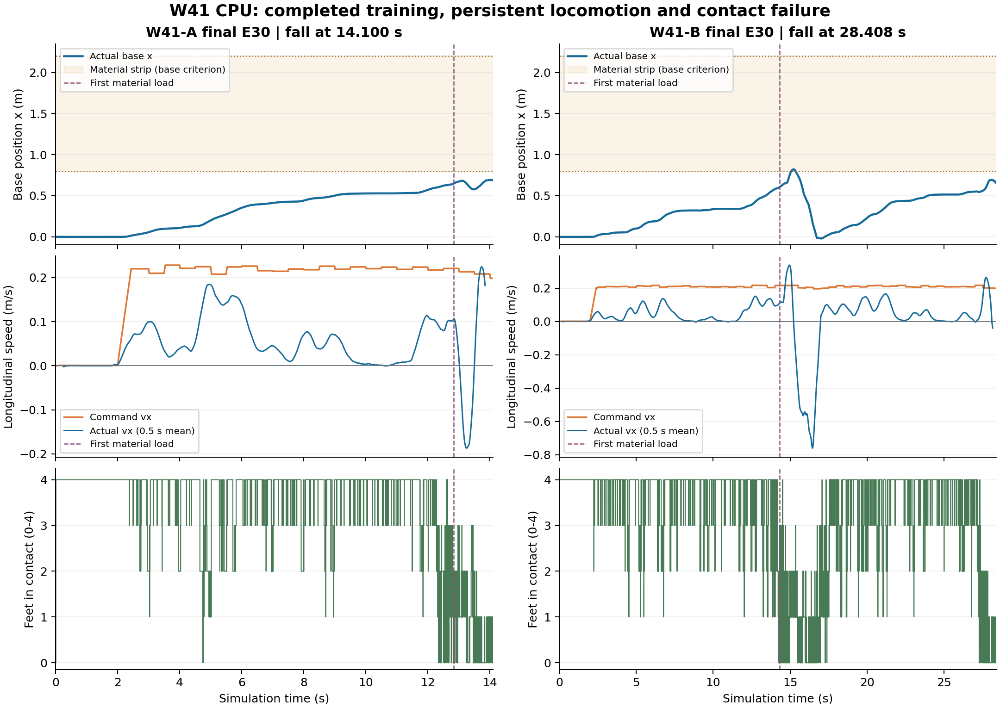

# W41 两条 CPU 联合任务复核

审查基线：[9cc42d5](https://github.com/kaiwen123-yang/MCP-RL/commit/9cc42d5a9189a2bfd7e1e6cd99b9300045a16724)，2026-11-08。GPU 按用户说明仍在运行，本审查不评价其未完成结果，不连接、停止、重启或替换其进程。

## 结论

**W41 已经把两条完整 CPU 联合训练跑到目标，并完成各自末次固定策略 E30；本轮没有结果级技术中断，但稳定移动、材料通行和完整任务均未建立。下一步可以推进有明确机制的新实验，不支持原样追加一轮 r30 训练后期待自行解决。**

两支各新增 2,048 条、8 次更新，分别到 11,665 条/45 次更新，tail=0。130 个训练回合有 127 次物理失败、3 次合法截断；合法去程、返程、往返均为零。A/B 末次 E30 分别在 14.100/28.408 s 跌倒。更长的 B 存活时间包含明显倒退，并不代表接近穿越。以下统计不把训练回合、评价、行政状态、共同祖先或两个策略的更新数混算。[完整复算](cpu-progress.json)

**最值得优先处理的新证据是刚地接触前向失配。** 在材料加载前的同起点、近乎同保持目标记录中，平滑规划器预测足端反力仅约0.007–0.013 N，实际为114–247 N；首个2 ms已有明显关节速度偏差。r30的k/K/value递推、动作投影和既有局部FD自洽并没有消除这个模型缺口。W42拟分离原生接触前向与平滑代理导数，沿原生名义子步锚定局部模型，再做两流完整联合续训。该方案尚未执行，不保证已解决全部失稳。

下一轮的操作入口为 [W42 CPU 计划](../../../../../../docs/S1_W42_CPU_PLAN.md) 与 [完整启动提示词](../../../../../../docs/S1_W42_START_PROMPT.md)。本次只完成证据审查与下一轮交付；尚未在 D57 实现、构建或运行新的控制器。

## 1. 实际进度与分母

| 项目 | W41-A / seed1 | W41-B / seed2 |
|---|---:|---:|
| Job | `job-20261107T100149Z-w41-a` | `job-20261107T093906Z-w41-b` |
| 本 phase 新样本 / 更新 | 2048 / 8 | 2048 / 8 |
| 各自累计样本 / 更新 | 11665 / 45 | 11665 / 45 |
| tail / 历史排除样本 | 0 / 145 | 0 / 145 |
| 最后 episode | 387 | 375 |
| 训练回合 | 69 | 61 |
| 跌倒 | 49 | 50 |
| 材料域退出 | 15 | 4 |
| 不合法躯干接触 | 4 | 5 |
| 结果级技术中断 | 0 | 0 |
| 样本目标截断 | 1 | 1 |
| 原 60 s 采集边界截断 | 0 | 1 |
| 实际材料加载回合 | 63 | 55 |
| base 进入条带回合 | 30 | 29 |
| 合法去程 / 返程 / 往返 | 0 / 0 / 0 | 0 / 0 / 0 |
| 末次 update45 固定 E30 | 14.100 s 跌倒 | 28.408 s 跌倒 |
| E60 | 前级未通过，未执行 | 前级未通过，未执行 |

原始入口：[A evaluation](../../jobs/job-20261107T100149Z-w41-a/evaluation.json)、[B evaluation](../../jobs/job-20261107T093906Z-w41-b/evaluation.json)、[A progress](../../jobs/job-20261107T100149Z-w41-a/training/progress.json)、[B progress](../../jobs/job-20261107T093906Z-w41-b/training/progress.json)。复算脚本 [evidence-audit.py](evidence-audit.py) 按 stream/job/transition_serial 识别本轮样本，逐一核对来源。

两支历史样本不能直接相加为一个策略。共享 PANN 祖先 6545 条只算一次，加 W38/W39/W40 各 2048 条和 W41 的 4096 条，PANN 树独特样本为 **16785=16640 已训练+145 历史排除**；独立 RAW 组另有 256 条，R12 全学习组为 17041。每支策略仍分别是 11665/45。W40 上一审查的 64 回合是 A 尚未收口的快照；收口后 W40 是 68 回合，不混用这两个分母。[历史对照](history-comparison.md)

本轮自然失败中位存活 14.422 s；训练最远 base x=1.05730 m，而材料东界为 2.2 m。59 个进入条带的回合均自然失败，进入到终止的中位间隔仅 0.514 s；真正达到“base 入带且入带期间内部足载”的为 50 个。无远端抵达或返程启动。前足加载、机身入带、合法穿出是三个不同层级。

## 2. 稳定运行有两种含义

### 2.1 工程执行：本轮有明确进展

- 两流正常完成新增 2048/8，保存空 tail，实际使用各自 W41 update45 checkpoint 评价。所有 130 份训练结果的 error 为空，没有 r29 QP failure packet。
- 4 组完整原始 planner 日志（两个 E30、A340、B344）共 5775 次调用，全部 `policy_installed`，每次 backward_attempts=1、metric_valid=true。57750 个候选未记录 failed 或 projection_failed；不能把合法的恢复分支、正则化增大或物理失败重新计为技术异常。
- W41 同输入动力学检查未发现缺失 actuator clamp 或确定的 composed A/B 接线错误。局部有限差分一致；若干 whole-hold 有限扰动误差随诊断 epsilon 缩小。这只建立对应模型内部的导数一致，不能证明预测器已对齐实际接触。r30 是已真实实现的瞬时移动约束 k/K/value 递推实验，不能继续描述为“r30 尚未实施”。[动力学原报告](../../w41-dynamics/result.json)、[控制复核](controller-review.md)
- 16 个完整 rollout 的数组均为有限值；A 有 68 terminated、1 truncated，B 有 59 terminated、2 truncated，与逐回合结果一致。奖励按原公式重算最大误差约 1.78e-15；导出的标量 GAE 均值误差低于 9.41e-7，没有证据支持“PPO 根本没更新”或“终止 bootstrap 串错”。[数组复核](raw-array-summary.json)

范围限制：发布的 24 ZIP 没有完整 `.log/.txt/stderr` 服务日志，不能由结果 error 为空宣称全部 MuJoCo 内部 warning 为零。下一次直接保留现有服务日志及 warning 计数，已有服务器日志可补交；不为补旧日志重跑物理。

### 2.2 物理稳定：仍是当前主要障碍

127 次物理失败占训练尝试 97.69%；在自然终止的 127 次中全部失败。主类为 99 跌倒、19 材料域退出、9 不合法躯干接触。当前修复使失败更完整地被采集和交付，却尚未使任务成功；这两点可以同时成立。

实际力矩裁剪仍工作。末次 E30 已交付的各 1 s 事件窗内，A/B 后九个保持子步的最大原始 PD 请求超限为 19.356/10.889 Nm，实际执行力超限均为 0。此数值只覆盖相应事件窗，既不是整回合最大值，也不是独立因果证据。`feedback_added_saturation` 是投影前 center 的事件；严格浮点边界约 1e-6 量级误差也不能当成新的物理越界。[统计口径与原记录](cpu-progress.json)

## 3. 最有用的新发现：材料前已经欠跟踪

图由完整 500 Hz `trajectory.npz` 生成；中间行实际速度仅为显示使用 0.5 s 平均，原数组未改变。虚线为首次足端材料加载，底色为 base 的材料条带范围。生成与复算见 [analyze-raw-arrays.py](analyze-raw-arrays.py)。

在两条 E30 的 **9–11 s、尚未接触材料**窗口：

| 量 | A | B |
|---|---:|---:|
| 平均前进指令 (m/s) | 0.22182 | 0.20810 |
| 净推进速度 (m/s) | 0.01447 | 0.00980 |
| 四足同时接触的时间比例 | 94.8% | 88.7% |
| 最前足 x 最大值 (m) | 0.72852 | 0.55519 |

原动作复核显示这些欠跟踪窗口投影没有改变部署动作，活跃边界为零；heading 也没有反向。因此不能把最初停滞归因于实时 PD 投影吞掉指令或错误 yaw。A 后续停在 C2 风险带前方值得检查，但 B 在远离该带的位置已有类似现象，不能单凭 A 的位置对齐认定门控是唯一原因。[控制与成本分解](controller-review.md)

B 的长存活也包含反向运动：末次 E30 在 15–20 s 指令仍向前，净 x 却减少约 0.538 m；最大 x 仅 0.82079 m。B344 运行到原 60 s 采集边界，最大 x 仅 0.57903 m，40–60 s 仍有约 +0.203 m/s 指令却净倒退约 0.0258 m。它们支持“推进/接触能力未解决”，不能当作即将完成任务。[原数组汇总](raw-array-summary.json)

当前有证据的问题是全身控制器没有持续实现给定移动意图，随后接触/反馈进入失稳状态。进一步按保存的accepted/reference残差、相位和K/H分解后，出现了下面更具体的修正方向；不能把所有后续症状都叫作饱和问题，也不能直接追加一个约束层当作根因修复。

### 3.1 代价与约束复算没有支持另一个QP修补

九份真实plan的J按实际norm/权重重算，最大误差1.421e-14；r30自由行Riccati关系最大缩放残差2.733e-15，活动边界行误差0，H正定。A590停滞计划的176节点无活动边界，Impact/Domain/Landing成本严格为0，Position占53.35%，却预测0.35 s内base x减少0.0110 m。因此“早期停滞是风险墙或投影持续吞动作”的简单解释不成立；还不能仅凭一份accepted轨迹证明站立局部极小。

### 3.2 刚地支撑前向与实际保持响应不一致

| 同状态记录 | 首目标最大差 (rad) | 当前预测器刚地足力 Fz (N) | 实际足力 Fz (N) | 2 ms后关节速度最大差 (rad/s) |
|---|---:|---:|---:|---:|
| A635 / 12.28 s | 5.71e-8 | 0.007157 | 127.541057 | 0.433510 |
| B712 / 13.82 s | 5.95e-8 | 0.007191 | 113.940128 | 0.385749 |
| B713 / 13.84 s | 5.15e-6 | 0.013398 | 246.876524 | 0.437117 |

三个起点qpos/qvel相同，十子步力求值时钟对齐，末状态与保存accepted首节点一致；全部在足端首次实际材料加载之前，非足接触/非足力为零。接触是水平刚地，已核对接触法向与世界z轴。整段2 ms仍有百牛量级支撑差异，不能用单一行时间错配解释。A635/B712最初执行器力差仅约3.43e-6/3.57e-6 Nm。

准确范围是**已交付记录中的同状态、近乎同目标比较**；尚未新做严格相同输入回放。当前`MakeDifferentiable`将规划接触solimp d0设0，实际geom/pair为0.99，提供直接可检验的机制；coldstart等配置的份额没有逐项分离，不能把全部差异归给单一开关，也不能把刚地证据说成完整TM02模型已对齐。[完整控制报告](controller-review.md) · [独立时序/力来源核验](contact-crosscheck.md) · [可重算输入审计](controller-input-audit.json)

随后实际反馈确实放大了偏差：A/B首次超过1 rad的`K delta_x`为1.43836/1.17824 rad，按保存矩阵重算一致。它支持“预测偏差进入高增益反馈”的机制，但不能证明127次失败都有同一唯一原因。直接缩K也可能固化已经欠推进的状态。

### 3.3 下一轮具体改什么

W42/S5-r31拟让所有nominal、候选、accepted、reference与风险/成本评分用原生geom/pair接触前向；独立平滑模型只在每个原生名义子步提供A/B，有限差分使用soft-minus-soft，零阶值锚定原生后继。C/D与风险峰沿原生轨迹重算，保留r30完整k/K/value和原物理/学习契约。

旧r17也恢复过geom/pair d0但仍失败；本轮保留其负结果，区别在于明确分离前向、代理导数及沿原生轨迹的组合，不宣传“恢复阻抗就一定稳定”。若接触偏差缩小仍不迈步，才基于新轨迹选择参考/结构化初值；PPO权限扩展另立阶段。具体数学、验证范围和无GPU干扰的工作树方案见[W42计划](../../../../../../docs/S1_W42_CPU_PLAN.md)。

## 4. 为什么再训练同一 cap 不够有针对性

PPO 确实在学习，但唯一动作是每 0.5 s 调一次 0.18–0.25 m/s 的速度上限。它无法直接指定脚步、摆动/支撑时序或载荷分配；当前实际速度已远低于指令时，继续小幅调 cap 的作用有限。这是现有接口的能力边界，不证明所有学习控制无效。[实际动作实现](../../../../../../scripts/s1_go2_r11_policy.py)

本轮当前 actor 观测中，PANN 特征非零只有 **229/4096=5.59%**（A90、B139）；118 个材料加载回合中有 61 个从未在当前 actor 输入出现非零 PANN 特征。查询是预测未来落脚位置的地块恢复，材料接触本身不保证查询到已有历史，因此不能据此认定 PANN 损坏。

末次 E30 的原始即时清零特征比较：A29 次决策仅2次 cap 有差异，最大约 1.93e-6 m/s；B57次仅1次，最大约2.24e-6 m/s。这里只改变同一状态下 actor 的12维输入，不是重新跑闭环的因果消融。当前既缺充分的历史曝光，也缺可验证的行动收益，尚不支持宣称材料记忆贡献。[原数组与查询统计](raw-array-summary.json)

B344 的 60 s 停滞回合总奖励约 -0.845，而 B 的自然失败平均约 -10.353。对应 update41 的 batch 奖励变好伴随着物理失败次数减少，后续又回落。原采集边界按约定 bootstrap，不是任务超时失败；奖励变化不能替代合法路线结果，也不能直接定性为 GAE bug。当前优先修可执行移动/接触机制，不同时重写奖励、PANN与动作维度来掩盖原因。[学习与历史复核](history-comparison.md)

## 5. S1 在长期路线中的位置

已经完成的层级：材料建模/辨识与历史研究、S0局部决策、原 Go2 刚地能力、完整 PANN→PPO→MPC 联合采样与学习、实际断点续训与末次评价、可回查的原始记录。本轮新增的是工程完成能力与更清楚的负结果。

尚未完成的层级：当前版本稳定合法材料去程与往返；因果地块历史进入 MPC 候选内完整恢复传播；能够改变落脚/加载/重访的决策权限；同信息经典本构/历史网络/循环策略的记忆消融；泛化、NX及实机。旧 r24 曾有合法去程，R10也曾进入返程；历史成绩保留，但不能替代当前 r30 的资格。[长期历史审查](../W40-final-review/history-review.md)

可以继续实验，但应让下一轮回答“怎样恢复持续可执行的移动与接触过渡”，并以合法穿越和原失败条件判定；不把全部 CPU 再投向无新机制的同款续训，不等待 GPU 支线替主线解决控制问题。具体机制、两 CPU 工作安排与不重启 GPU 的边界见 [W42计划](../../../../../../docs/S1_W42_CPU_PLAN.md)。

## 6. 阅读覆盖、限制与复现

本审查读取全部 130 个训练回合的紧凑结果/解析配置/采样与事件记录、4096 条新 transition/value、16 次更新及两个 E30；compact 复算覆盖 1287 个文件，约117.1 MB。完整路径/字节数与统计计算在 `cpu-progress.json` 中。

原始 Release 使用 Range 按问题读取完整成员，经解压和 ZIP CRC/size核对：54份主要原件（两个E30、A340/B344指定诊断、16rollout）、9份完整事件plan NPZ、6份XML/查询/即时PANN比较，合计69份、666346377未压缩字节。三份覆盖表分别为 [主要原件](raw-read-coverage.json)、[完整事件计划](raw-plan-read-coverage.json)、[模型与查询](raw-metadata-read-coverage.json)。没有把28.45GB ZIP的目录清单说成已读完38.52GB全部原始内容。已发布原件不重复归档到用户电脑，不删除服务器数据。

复算方式：先用 [read-selected-raw.py](read-selected-raw.py) 及三份 `raw-*-selection.json` 读取明确成员，调用已有 W40 Range reader；再运行 `evidence-audit.py` 与 `analyze-raw-arrays.py --raw-root <解压目录>`。这只是分析已交付结果，不重跑训练、物理或 GPU。

论文检索与可迁移机制：[literature-mechanisms.md](literature-mechanisms.md)。新方法是下一轮实验依据，不是本项目已验证的成绩。
