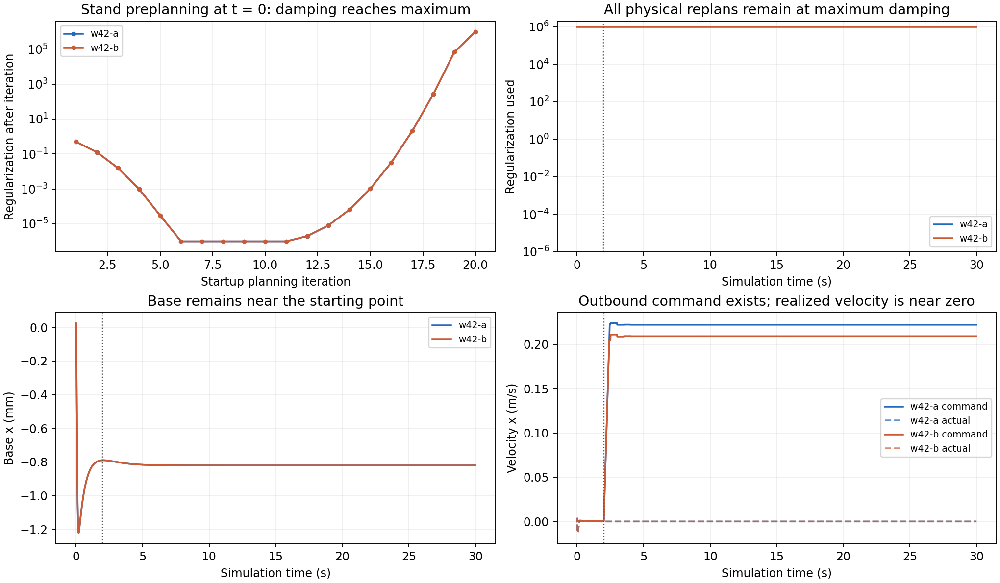

# W42 最终审查：CPU 起点驻留与 GPU 技术失败

审查日期：2026-11-10。原始交付基点：`c4b3f9adc698b15de5c94ef952e2884f3abfec62`。本次读取已发布结果和原件，没有登录 D57，没有新训练、物理仿真或 CUDA 任务。GPU 两处明确代码错误已修改并做针对性非 GPU 核验；CPU S5-r32 是待实施的下一轮机制。

**S1 已具备真实联合采样、更新、断点继承、固定评价和原件交付链，但仍未具备稳定合法材料通行。** W42 当前主要现象不是大量跌倒，而是几乎完全不前进。GPU 虽然进程结束且完成大段计算，G4/G5并没有完成物理闭环。

## 阅读入口

- [CPU完整报告](cpu-report.md)：36训练回合、两次末次E30、启动序列、未缩放梯度与完整矩阵。
- [GPU完整报告](gpu-review.md)：G1/G2数值与吞吐、G4/G5真实报错、修复、续接和验证边界。
- [新增七组论文与算法源码](literature-mechanisms.md)：直接对应阻尼管理、接触候选搜索和GPU批量计算。
- [W43计划](../../../../../../docs/S1_W43_STABILITY_PLAN.md)与[完整启动提示词](../../../../../../docs/S1_W43_START_PROMPT.md)：r32修正、双流512/2、GPU G5续接。

## 1. 当前成果与未获得的能力

| 层级 | 已有证据 | 尚未成立 |
|---|---|---|
| 材料与感知历史 | 材料辨识、恢复历史与冻结因果PANN及空间状态接口已进入项目；早期R/S结果保留 | 当前目标材料上的跨足/返程记忆因果收益 |
| 联合学习 | PANN特征→PPO标量cap→全身MPC→TV反馈→PD真实采样与更新；W42新增4096条、16次更新 | cap已能纠正无效MPC运动；PANN在本轮学到材料恢复 |
| 数值与前向 | qp2、r30完整约束Riccati、r31 native前向/soft导数已实际运行 | 精确native接触梯度、可靠运动下降方向、稳定闭环 |
| 当前任务 | W42两流完成目标，末次E30都满30秒 | 材料加载、合法去程/返程/往返与E30资格 |
| GPU | G1完成32新输入；G2完成176节点导数计算 | 等价后端、成功完整规划接入、GPU物理闭环通过 |
| 长期平台 | Go2与NX目标保留 | 当前控制整链实时能力、硬件与未知材料泛化证据 |

当前PANN参数冻结，PPO更新的是Actor/Critic，低频动作仍是2Hz速度cap。所有W42新transition的当前/next PANN recovery特征为零，与没有材料加载一致。不能把“PANN→PPO”联合链的运行，改写成这一轮PANN权重训练或地形记忆已经学成。完整材料恢复历史在MPC候选内传播、落点/足时/载荷权限仍未完成。[CPU原数值](cpu-summary.json)；长期层级与历史依据见[W41历史对照](../W41-cpu-review/history-comparison.md)和[W40完整历史](../W40-final-review/history-review.md)。

## 2. 失败形式发生了变化

| 阶段 | 本轮新增训练 | 结果级技术中断 | 自然物理失败 | 截断/采集结束 | 任务证据 |
|---|---:|---:|---:|---:|---|
| W40 | 64回合 | 3 | 60 | 1 | 本轮合法材料去程/往返0；旧QP问题仍中断一支 |
| W41 | 130回合 | 0 | 127 | 3 | 有材料加载但未形成合法通行；末次E30分别14.100/28.408秒跌倒 |
| W42 | 36回合 | 0 | 0 | 34个60秒边界、2个4秒样本目标 | 全部无材料加载；末次E30都满30秒却未完成材料通行 |

三轮的controller、学习父点和采样分布不同，不能把上述比例直接作为同分布成功率趋势。旧r24曾有合法去程，历史不是从未前进；当前r31也不能借用这些旧前缀作为自己的资格。W42最大base x仅0.0245873mm，末次评价最终约−0.82061mm。当前零跌倒首先由驻留解释，不能宣称稳定走路已经解决。[W40审查](../W40-final-review/README.md)；[W41审查](../W41-cpu-review/README.md)；[W42复算](cpu-report.md)。

## 3. 本轮最关键的根因证据

两条完整E30都在 t=0 固定20次 startup 中经历相同序列：前11次改善初始站立成本，λ降到1e-6；第12–20次没有native下降，却继续累乘λ与增长率，最终达到1e6。此时尚无物理运动，更没有材料接触。随后每流全部1501次非零时刻规划，包括2.002秒切换outbound后的规划，都沿用1e6。

四个完整计划快照含176状态节点、175控制节点。Qu约1.5e-4而H几乎由1e6I主导，对应局部k约1.5e-10rad、K约2e-7。非零梯度被巨大阻尼压成极小更新；A/B虽有不同正向速度cap，实际运动几乎重合。全部3042次调用都安装policy，不能用这个布尔值作为有效控制证据。[时间序列](cpu-planner-startup.json)；[矩阵量级](cpu-full-plan-matrices.json)。

**该机制已定位，修复收益尚待干预验证。** alpha=0后的expected下界不是原始梯度；t=0不能因此认定数学收敛。r31的native前向误差缩小是真实进步，但四输入代理方向相对L2误差仍0.575–3.044；在恢复正常动作尺度后，仍可能暴露代理梯度、步态/接触搜索、完整保持段执行和材料加载的独立问题。

下一步不叠一串无依据的reward/步态调整。先区分warm trajectory与每个MPC问题的λ/rate/停止状态，保留native `(v,J)`接受与当前问题incumbent身份。用本轮真实初始化/首次outbound记录验证改动，再做两支各512条、2次更新，到14225/55。该阶段是完整实验目标，不是自动开启2048的前置门禁。

## 4. GPU到底完成了什么、为何仍有报错

G2完成176/176并不等于GPU整链已经工作：总耗时152237.10秒，约42.288小时，每节点中位约899.40秒。49个扰动输入在节点内批量，节点之间仍为Python顺序调用；并未形成176节点整体常驻批量。现有固定1007contact/3045constraint布局及dense约束中间量是有根据的性能嫌疑，尚无device profile证明唯一瓶颈，不能断言每节点都重新JIT或显存越满就越快。[GPU数据复算](gpu-audit.json)。

两处直接故障：

1. G4 native/MJX命令缺少必需的 `--evaluation-start-unix`，解析阶段exit2。两者没有进入物理，MJX predictor requests=0。
2. G5将Warp设备数组 `opt.tolerance`覆盖成Python float，首次solver kernel报参数类型错误。应在原数组上填入1e-8，而非删赋值后接受默认1e-6。

本次已补命令参数、修字段类型、改阶段汇总，并提供G4/G5显式恢复、唯一invocation路径和冻结W40-B/r30契约。实际R12解析器确认新参数可接收；真实MuJoCo4.0.0/Warp1.19.0 CPU-device `put_model`确认保留数组身份和1e-8的FP32表示。**没有在CUDA或完整Go2物理上验证。** [修复验证](gpu-fix-validation.json)明确列出范围。

下一轮GPU从G5续接，复用G1/G2与原件，完成原已声明的独立新FP32预测器工作；不自动重复stock MJX多日闭环。原错误记录不改写成成功，GPU不热替换两条CPU主线。

## 5. 文献如何直接改变实验选择

本次增加七组一手文献，而不是重复上一轮HOUND/DiffMJX等条目：JMLR2025 iLQR/DDP收敛、Whole-Body MPPI、DIAL-MPC、Reference-Free Sampling MPC、Global CI-MPC、Model Tensor Planning、RSS2026 Variance-Reduced MPPI。官方MJPC与Crocoddyl代码用于核对数值状态生命周期。

最先采用的是**阻尼与真实下降的数值管理**；光滑理论不直接保证本项目的有偏接触代理。其后若接触模式探索确实不足，再借鉴低维关节目标样条、分层/退火候选、native评分、保留实际赢家及局部精化。不能把作者的Go1/Go2成绩、不同力矩接口或刚地效果当作TM02已通过，也不能以含1e6阻尼的H逆构造近零采样协方差。各篇的代码可得性、接口差异和可迁移边界见[完整机制报告](literature-mechanisms.md)。

## 6. 覆盖范围与可复算性

本次对基点的**7770个tracked文件、874426108字节**建立完整字节可读性/清单，UTF-8部分778433496字节。该清单说明文件覆盖，不等于每份历史二进制或全部文字均已重新逐字语义审读，也不是新的运行hash门禁。[源码读取清单](source-read-coverage.json)。

语义审查集中于：当前AGENTS/交接/长期目标与历轮结论；本轮两个job及训练/评价全量紧凑记录；r31新patch/检查脚本；继承的planner、backward、正则化、reference/runtime调用；GPU当前执行/桥接/Warp/启动与发布路径；相关一手论文。

CPU完整解析428个紧凑文件、40974850字节；另取14个已发布原件，传输体积83516967字节、原始成员157973376字节，含两次完整E30和四个全时域矩阵。GPU读取旧29337276字节与新增95663446字节两个证据包，核查实际日志、节点结果、数组形状和故障。没有为满足“全读”而声称已语义检查所有历史几十GB大原件。[CPU原件清单](cpu-raw-read-coverage.json)；[GPU审计](gpu-audit.json)。

`cpu-read-raw.py`、`cpu-audit.py`、`audit-gpu-evidence.py`与`verify-gpu-fixes.py`保留计算过程。派生统计不修改历史结果。JSON、Python语法、仓库相对链接和实际修复范围检查完成；真实服务器r32构建、CUDA与新物理任务属于下一轮。

## 7. 执行与交付约定

优先两CPU各10workers加GPU约2host核，Torch/BLAS各1；按现场其他任务和实际吞吐调整，记录总资源不冒称实时空闲。所有新后台无固定墙钟截止；原样本目标、物理评价时长、数值guard与网络timeout保留。

先推实现/真实父点再启动，结束先紧凑Git、原件Release，核验远端并发提交。GitHub完成后不在用户电脑另归档，不自动删除服务器研究原件/断点或上传副本。下一阶段具体动作以[W43计划](../../../../../../docs/S1_W43_STABILITY_PLAN.md)为准。
