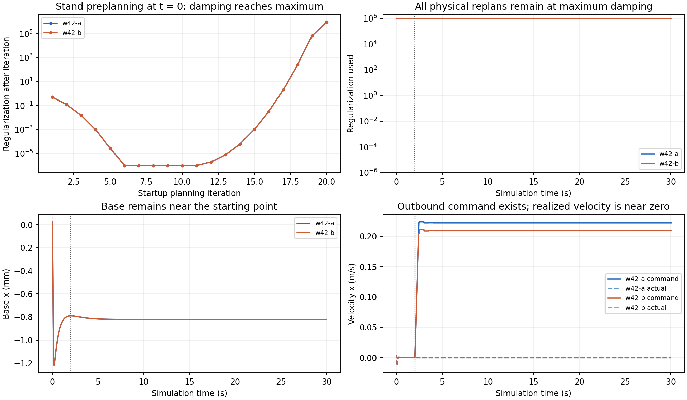

# W42 CPU 完整结果与驻留机制复核

审查基线：`c4b3f9adc698b15de5c94ef952e2884f3abfec62`。本报告只重算已交付数据，不运行新物理、训练或 GPU 任务，也不更改历史结果。

## 结论

**W42 的两条 CPU 联合训练都完成了各自的新增 2048 条样本、8 次更新，运行完整性比此前提高，但任务能力没有通过 E30。当前最突出的失败形态已经变成起点驻留。** 36 个训练回合没有结果级技术中断，也没有记录到自然跌倒；其中 34 个到达 60 秒采集边界，2 个在补齐样本目标时结束。两次末次 E30 均完整运行 30 秒，仍因 `material_traversal_not_completed` 不通过。36 个训练回合及两次末次评价的材料接触、合法去程、返程、往返全部为零。不能把“没有跌倒”单独解释为稳定通行能力已经建立。

完整 E30 原件进一步定位了一个比“PPO 训练不够”更具体的机制：**优化器在 t=0 的 Stand 预热中已把正则化 λ 推到上限 10^6，随后所有非零时刻的规划调用，包括 2.002 秒进入 outbound 之后，都沿用这一上限。** 非零动作梯度在巨大阻尼下变成约 10^-10 rad 的局部前馈更新；实际关节目标几乎不变。两条流的正向速度命令不同，但最终轨迹几乎重合。应先修正优化器问题身份、阻尼及其倍率的生命周期，并做真实保存输入的接受性检验，再继续扩大样本。

这是已观测到的机制链，尚不是“重置阻尼后即可完成任务”的干预结论。接触导数方向偏差、步态目标与动作权限仍是后续可能暴露的独立问题。

## 1. 阅读范围与统计口径

本次审查完整解析两个 W42 job 目录中的 JSON/JSONL，以及对应 36 个训练回合、两次 E30 的结果及 resolved 文件：去重后 **428 个文件、40,974,850 字节**。由 manifest 定位后，又读取了两次 E30 的完整 planner records、planner calls、reference packets、trajectory、action execution，以及每流 plan 221、1516 的全时域矩阵，共 **14 个已发布原件、83,516,967 字节传输体积、157,973,376 字节原始成员大小**。源路径、下载 URL、大小和本地 SHA256 在 [原件读取清单](cpu-raw-read-coverage.json) 中；清单的 hash 是读取后计算的本地摘要，不能一概表述为全部与远端独立摘要比对通过。

统计只计 W42 新回合和新 transition，没有把 `session_records` 中继承的历史回合再算一次；A、B 的累计 13713 也不相加为独立历史样本量。本轮新增量才是可相加的 4096。严格的阻尼时间链来自两次完整 E30；36 个训练回合的驻留有完整结果记录支持，但本报告没有声称逐字节读过这 36 个回合的全部大体积 planner 原件。

可复核入口：

- [A training progress](../../jobs/job-20261108T154719Z-w42-a/training/progress.json)、[B training progress](../../jobs/job-20261108T154727Z-w42-b/training/progress.json)。
- [A E30 结果](../../job-20261108T154719Z-w42-a-eval-PANN_PPO_S5-s1-E30.json)、[B E30 结果](../../job-20261108T154727Z-w42-b-eval-PANN_PPO_S5-s2-E30.json)。
- [完整重算统计与读取清单](cpu-summary.json)、[启动及相位切换逐调用数值](cpu-planner-startup.json)、[四个全时域矩阵的重算](cpu-full-plan-matrices.json)。

## 2. 两条 CPU 流实际上完成了什么

| 指标 | W42-A / seed 1 | W42-B / seed 2 |
|---|---:|---:|
| 父断点 | W41 ep387 | W41 ep375 |
| 本轮末断点 | ep405 | ep393 |
| 累计 transition | 11665 → 13713 | 11665 → 13713 |
| 累计 PPO update | 45 → 53 | 45 → 53 |
| 新 transition / 新 update | 2048 / 8 | 2048 / 8 |
| 未更新尾段 / 已排除旧版本样本 | 0 / 145 | 0 / 145 |
| 训练回合 | 18 | 18 |
| 60 秒采集边界 / 样本目标截断 | 17 / 1 | 17 / 1 |
| 自然终止 / 结果级技术中断 | 0 / 0 | 0 / 0 |
| 训练物理时长 | 1024 秒 | 1024 秒 |
| 新 transition 奖励总和 / 均值 | −21.090510675 / −0.010298101 | −21.597961749 / −0.010545880 |
| 材料接触回合 / 合法往返 | 0 / 0 | 0 / 0 |
| 每个训练回合最大 base x | 0.0245873 mm | 0.0245873 mm |
| 本轮末固定策略 E30 | 完整 30 秒，任务条件不满足 | 完整 30 秒，任务条件不满足 |
| E60 | 被 E30 未通过阻止 | 被 E30 未通过阻止 |

这些结果说明联合训练、断点续接和固定策略评价确实在执行。每流新 transition serial 为 11666–13713，连续且无重复；behavior update 45–52 各对应 256 条样本，随后完成 update 46–53。每次 PPO 更新均记录 16 个 optimizer steps，训练值与 transition 数值有限。A 的训练 cap 平均约 0.221414 m/s，B 约 0.208110 m/s；两流不是拿着同一个冻结 actor 重复导出结果。末次 E30 分别使用本流 `checkpoint-013713.pt` / update 53。所有当前与 next 的 PANN recovery 特征仍为零，原因与材料尚未接触相符；这些样本不能支持“地形记忆已学会材料恢复”的结论。[证据：cpu-summary.json](cpu-summary.json)

两流各 18 个训练回合与 1 个 E30 的 MuJoCo warning 报告均已读取，**38 份报告的 8 类 plant warning 全部为零**。其中服务日志列出的 absl 初始化 STDERR 提示是日志初始化信息。`command_nonprogress_2s` 事件每流 18 次，覆盖 17 个长训练回合及末次 E30；最终 4 秒的补齐回合未到相同事件时点。这些应区分为物理任务不前进和数值技术错误。[证据：cpu-summary.json](cpu-summary.json)

## 3. 驻留不是在材料上才出现：t=0 已把阻尼推至上限

每次 E30 共 1521 个 planner calls：20 次 t=0 startup，加 1501 次非零时刻调用。后者包含 30 秒终点的最后一次规划，不能全部当成之后还有物理积分的动作。两流启动前 20 次的优化数量完全相同。

前 11 次在初始 Stand 问题上明显降成本：第一调用 nominal 为 5.4672839128，第一调用接受 1.3265705643，到第 11 次接受 0.0251458136821；λ 从 1 降至 10^-6。第 12 次开始，同一物理时刻、同一 Stand 参考再无 native candidate 成本下降，alpha=0 的 incumbent 胜出。λ 随重复调用急剧增长：

| plan | origin / s | nominal J | native 实际下降 | alpha | λ before → after |
|---:|---:|---:|---:|---:|---:|
| 11 | 0 | 0.0251458173588 | 3.6767334×10^-9 | 1 | 10^-6 → 10^-6 |
| 12 | 0 | 0.0251458136821 | 0 | 0 | 10^-6 → 2×10^-6 |
| 13 | 0 | 同上 | 0 | 0 | 2×10^-6 → 8×10^-6 |
| 14 | 0 | 同上 | 0 | 0 | 8×10^-6 → 6.4×10^-5 |
| 15 | 0 | 同上 | 0 | 0 | 6.4×10^-5 → 0.001024 |
| 16 | 0 | 同上 | 0 | 0 | 0.001024 → 0.032768 |
| 17 | 0 | 同上 | 0 | 0 | 0.032768 → 2.097152 |
| 18 | 0 | 同上 | 0 | 0 | 2.097152 → 268.435456 |
| 19 | 0 | 同上 | 0 | 0 | 268.435456 → 68719.476736 |
| 20 | 0 | 同上 | 0 | 0 | 68719.476736 → 10^6 |
| 21 | 0.02 | 0.0007246760403 | 0 | 0 | 10^6 → 10^6 |
| 22 | 0.04 | 0.0006838789642 | 0 | 0 | 10^6 → 10^6 |

第 12–20 次全部报告 `no_native_cost_decrease`，各候选没有投影、投影失败或 actuator restoration；第 12 次正 alpha 候选相对 incumbent 的最大成本增加仅约 2.03×10^-9。这是已经收窄到近乎不再改善的 Stand 工作点，而后续重复调用继续增加阻尼。**没有保存该时点未乘 alpha 的原始 dV/Qu，不能直接认定其梯度严格为零，亦不能认定数学意义上已经收敛。** `proxy_expected_decrease=1e-16` 是接受 alpha=0 后的下界值，本身不提供这种证明。[逐项原数值](cpu-planner-startup.json)

更关键的是，**每流全部 1501 次非零时刻规划使用的 λ 都是 10^6**。因此“走起来之后接触事件使阻尼升顶”不能解释首次升顶；时间顺序明确指向初始化阶段。这里必须把优化器的阻尼状态与可复用的轨迹初值分开审查。



图中两流部分曲线重合；竖线为 2.002 秒 outbound 起点。上排为启动阻尼及之后规划阻尼，下排为实际 base x 与命令/实际速度。单位分别为 λ、mm 和 m/s。

## 4. 相位及命令真的切换了，关节目标几乎未响应

2.0 秒前为初始 Stand，2.002 秒的 reference packet 已进入 outbound，active=1，远端目标为 x=3 m、方向为 +1。不能把当前驻留解释为阶段机始终留在 Stand。A 在 5 秒时 command vx≈0.222249 m/s、局部 body target x≈0.054746 m，而 base x≈−0.000816419 m；B 的命令较低，但同样是明确正向运动请求。[reference/trajectory 原件清单](cpu-raw-read-coverage.json)、[时点对照](cpu-planner-startup.json)

A 在切换前后的优化数值如下；B 在这些最早时点相同：

| plan / 时刻 | nominal J | native 下降 | proxy expected | surprise | alpha | λ used |
|---|---:|---:|---:|---:|---:|---:|
| 119 / 1.98 s | 0.000550773318796 | 0 | 10^-16 | 0 | 0 | 10^6 |
| 120 / 2.00 s | 0.000550699512817 | 0 | 10^-16 | 0 | 0 | 10^6 |
| 121 / 2.002 s | 0.004025663294031 | 2.01136×10^-13 | 4.48176×10^-12 | 0.044879 | 1 | 10^6 |
| 122 / 2.02 s | 0.004089648290803 | 2.48986×10^-13 | 4.21967×10^-12 | 0.059006 | 1 | 10^6 |
| 123 / 2.04 s | 0.004216683679684 | 2.92689×10^-13 | 3.91848×10^-12 | 0.074695 | 1 | 10^6 |

两流全部 3042 次调用都返回 `policy_installed`、`policy_updated=true`，每次 backward attempts=1、metric_valid=true，全部 30420 个候选的 failed/projection/projection_failed/actuator_restoration 均为零。每流有 109 次 `no_native_cost_decrease`，其余 1412 次记为 `none`。其中 outbound 的 1401 次均接受 alpha=1，但 native 下降仅约 **1.47×10^-13–3.77×10^-13**，surprise 约 **0.028–0.115**。**“安装了策略”和“接受了全步长”在这里都不能代表安装了有用的运动策略。** 更新方向已被巨大 λ 压得极小。[完整统计](cpu-summary.json)

两次完整轨迹的行为证据更直接：

| E30 实际量 | A | B |
|---|---:|---:|
| outbound 平均命令 vx / m·s^-1 | 0.220529558 | 0.207708273 |
| outbound 平均实际 vx / m·s^-1 | −1.10130×10^-6 | −1.10130×10^-6 |
| outbound 起点至终点净 dx | −0.0308392 mm | −0.0308392 mm |
| 全程最大 x | 0.0245873 mm | 0.0245873 mm |
| 最终 x | −0.820610 mm | −0.820610 mm |
| outbound 四足同时接触比例 | 100% | 100% |
| outbound q_target 相对切换时最大变化 | 1.19209×10^-7 rad | 1.19209×10^-7 rad |
| 非足接触/力 | 0 / 0 | 0 / 0 |

trajectory 各含 15001 个状态样本，action execution 各含 15001 次 `applied_hold` 查询，其中终点一次无后续物理积分，真正积分的 hold 为 15000 次。本报告单独统计了两者，避免用查询次数充当执行次数。[完整统计](cpu-summary.json)

## 5. 全时域矩阵支持“阻尼压小更新”，并不支持“梯度为零”

从两流 plan 221（约 4 秒）及 1516（约 29.9 秒）的完整 NPZ 读取了全部 175 个控制节点，而不只 planner JSON 的两个节点切片。四个样本均满足：

- λ=10^6，所有保存的 active 标记为零；H 的对角线上减去 λ 之后约为 0.000655–0.001492。
- `max |base_Qu|` 约 1.478×10^-4–1.566×10^-4，明显非零；整段 Qu 的二范数约 0.00213–0.00216。
- 在该无 active 约束的局部系统中重算 `k = -solve(H, Qu)`，`max |k|` 仅约 1.478×10^-10–1.566×10^-10。
- 保存的 `max |K|` 约 2.014×10^-7–2.026×10^-7；`H K + Qux` 最大残差不超过 1.11×10^-16。
- plan 221 接受轨迹的整个规划时域 base 净 dx 约 −2.528×10^-6 m；plan 1516 约 5.29×10^-9 m。

这提供了数值自洽的局部阻尼证据，但仍有两个边界：重建 k 是保存的局部 QP 方程的解，不是日志中直接保存的执行 k；accepted/reference actions 在该快照内相同，不能据此反推 k=0。也不能只在旧 H 中减掉 10^6 后求逆，就声称完成了低阻尼的新 Riccati 求解，因为前向/反向的递推状态会随真正重算而改变。[矩阵重算](cpu-full-plan-matrices.json)

## 6. r31 的进步与未解决部分

[W42 contact-forward 原始结果](../../w42-contact-forward/result.json) 使用四个已保存 W41 输入和相同 held target，区分 native、soft 和重建 plant。四个输入的 native held force 最大误差约 0.13–0.70 N，旧 soft 对比约 114–260 N；held 关节速度误差 native 约 0.000756–0.00966，soft 约 0.345–0.437。前向零阶锚定和接触力恢复有实质进步。

但保存方向的 native FD 与 proxy 方向仍有明显差异：relative L2 error 为 0.575、0.986、2.165、3.044，cosine 为 0.478–0.873。报告说明该方向取自旧计划保存的正则化 Newton 前馈，不能当作这次新优化的全局方向保证；实际首子步 post-state 与 qacc warmstart 未保存，重建 plant 使用零初始求解历史，也不能宣传为全时域真实环境完全等价。

四个独立 C++ replay 的能力边界还须保留：A590、A635 有完整 native nominal/candidate 与成本复算，接受成本下降约 0.00451、0.00181；B712、B713 的 fresh home 初值在各 5 次 backward 尝试后返回 `backward_failed`、`no_policy_installed`，因此没有相同完整证据。它们缺少原运行的历史 warm start/K/私有 gait phase，这些旧输入重放失败不能直接计入本轮 36 个训练回合的结果级技术中断，也不能被省略后写成“r31 已彻底解决 backward”。

因此当前判断是：r31 更可信的 native forward 暴露了实际优化接受与阻尼生命周期问题；全程驻留首先要求修正后者。导数模型的方向可靠性仍需独立检验。

## 7. 现有证据如何区分几种解释

| 假设 | 当前证据与判断 |
|---|---|
| actor/联合训练没有运行 | 不支持。每流完整 2048 新 transition、8 更新，cap 有变化，末次评价使用本流新断点。 |
| 阶段机一直停在 Stand，或没有正向命令 | 不支持。2.002 秒进入 outbound，参考、命令、body target 均改变。 |
| backward 一直失败，所以重复旧策略 | 不支持这两次 E30：3042 次均完成一次 backward 并安装 policy。旧 W41 B 输入的独立 replay 另有失败，范围不同。 |
| 候选都被投影/可行性门拒绝 | 不支持这两次 E30：30420 个候选对应计数为零。 |
| 进入材料导致动不了 | 不支持首次驻留原因。材料根本未接触；λ 在 t=0 Stand 预热已升顶。 |
| 正则化状态把运动更新压小 | 有明确时间链及矩阵量级支持，应优先做同输入干预。 |
| 真正的全局/局部最优就是站立 | 尚未证明。巨大 λ 使 tiny step 不具备这项鉴别力，未记录初始失败点完整未缩放梯度。 |
| 多训练几千条自然就能走 | 缺少依据。cap 差异未传递成实际移动，PANN 又无材料输入；应先恢复有效动作响应。 |

## 8. 建议的最小下一步及风险

首先将可复用轨迹和一次优化问题的数值状态分开。新 MPC 问题由真实状态/时间/因果参考或目标版本确定时，保留 warm trajectory/reference，恢复 λ 及 `regularization_rate` 的合理初始状态；同一 t=0 问题的重复优化保持同一问题身份。只把 λ 改回 1 而保留已经增长的 rate，会让下一次失败立即再次增大阻尼，不能作为完整修正。

同一名义点内的 backward 和 native candidate 接受应在明确的数值迭代预算内共同判断。记录未乘 alpha 的 dV、未正则化 Qu、可行投影梯度、native 成本下降、k/K、λ/rate 的前后值，以及 reset 的问题身份理由。把 `installed incumbent`、`accepted native improvement`、`stagnation`、`backward failure` 分开。不能用 alpha=0 后的 expected 下界，也不能用巨大 λ 压小的 k，单独宣告收敛。

每次新状态都从 λ=1/rate=1 开始，相当于每次重规划丢弃上一个问题的局部阻尼经验；遇到必要的大阻尼或接触切换时，可能反复试到不下降方向。因此该改法必须配合 native 接受检查和可行 incumbent 保留。需要的是可证伪的有限改动，不是绕过 native 判断强行安装大动作。

下一轮应先从已保存的 t=0 启动问题及 2.002 秒切换问题做同输入复核，再由两流各新增 512 条、2 次更新的完整联合阶段判断实际响应，即分别从 **13713/53 到 14225/55**。这 512/2 就是本轮完整样本目标；没有无条件追加到 2048 的默认路径。若仍原地驻留，记录负结果及关键导数；若有实际前进、触地/抬腿变化及材料接近，再依据结果设计后续阶段。E30 的任务通过仍需实际材料通行，之后才能依次进入 E60/E300/E600。暂不同时改物理模型、reward、PANN、动作定义和步态目标，否则难以识别上述机制修正的作用。

## 9. 资源与运行时间

本轮 job 的 `deadline_unix_s` 已为 null。60 秒训练回合是物理数据采集边界，E30 是评价任务时长；日志中的 20 ms planning / 2 ms feedback `logical_deadline` 是实时性测量基准，不是后台强制结束墙钟。不要为了取消后台截止，把这些实验语义或数值求解预算一并删除。[job 与结果汇总](cpu-summary.json)

两流各使用 10 个 MPC workers；各自 1024 秒训练物理时间花费约 23.06 / 23.04 小时墙钟，约 81 倍慢于物理时间。两次 E30 的规划耗时中位数约 1.412 / 1.421 秒，对应 20 ms 规划周期约 71 倍；这是当前同步模拟的吞吐问题，不能混称为本轮任务被 deadline 杀掉。两流并行已利用了 CPU 大部分预算，第三路应优先安排独立 GPU 候选/导数验证或低 CPU 分析，并按实时可用 CPU、内存和显存调整；提高第三路占用不能以使两条主流更慢为代价。[timing 原件及重算](cpu-summary.json)

## 10. 复现本次审查

在仓库根目录执行下列两步。第一步只下载 manifest 中本报告选取的 14 个已发布原件；第二步只解析已保存的数据，不执行新物理：

```bash
python results/terrain_memory/simulation/tm-s1-go2-local-readiness-r12/reviews/W42-final-review/cpu-read-raw.py --output /tmp/w42-cpu-raw
python results/terrain_memory/simulation/tm-s1-go2-local-readiness-r12/reviews/W42-final-review/cpu-audit.py --raw-root /tmp/w42-cpu-raw
```

依赖 NumPy、Matplotlib；原始数据不写入本报告目录。第二步重建 `cpu-summary.json`、`cpu-planner-startup.json`、`cpu-full-plan-matrices.json` 和 `cpu-damping-and-motion.png`。这次完成了全量当前阶段紧凑记录重算、两次 E30 完整原件扫描和四个完整矩阵检查；没有运行 r32，也没有把拟议修正写成已通过实验。
