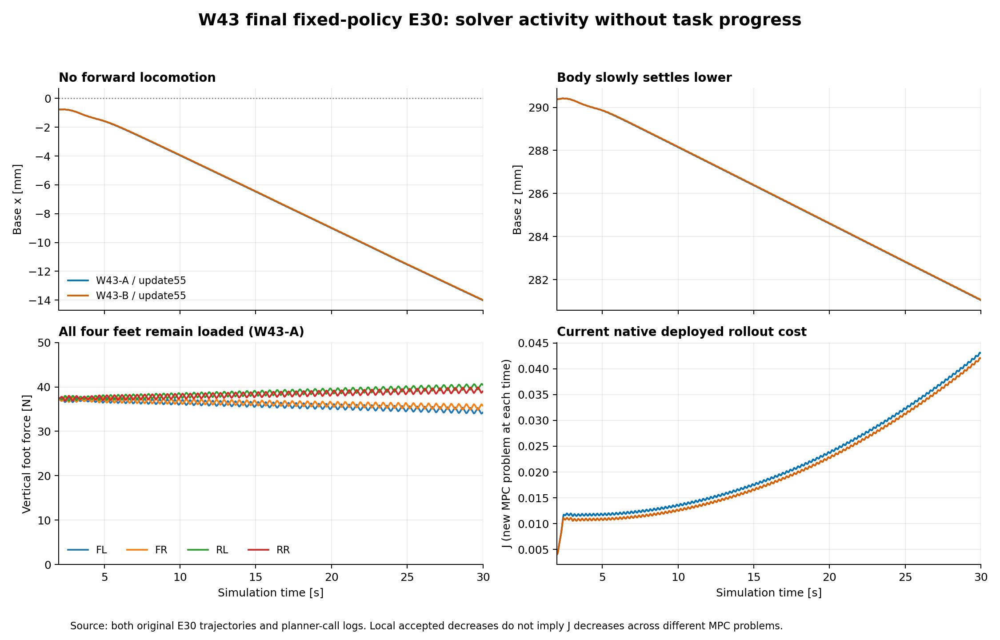

# W43 最终 CPU 审查：阻尼修正有效，起步与材料通行仍未建立

日期：2026-11-10（北京时间）。原始交付审查基点：`6a94c94c8e21e3b50fcca40ab4363165dee2987e`。本次检查已发布仓库与 Release 原件，不登录 D57、不新建物理回合；用户确认 GPU 仍运行，本轮保持其现有作业。

**两条 CPU 流已经真实完成各 +512 条样本、+2 次 PPO 更新到 14225/55，并完成自己的末次 update55 固定 E30。两次评价都满 30 秒且无结果级技术错误，但未产生向前行走、材料加载或合法通行，E60 因 E30 未达任务条件而阻断。** `1334f76` 的 update54 运行中快照属于历史，不再代表当前 CPU 完成状态。

## 阅读入口

- [CPU 训练、评价和原始时序](cpu-report.md)
- [控制器、成本和候选机制](solver-report.md)
- [新论文与具体迁移边界](literature-mechanisms.md)
- [CPU 派生数值](cpu-summary.json) · [控制器派生数值](solver-summary.json) · [发布与实际读取范围](publication-audit.json)
- [公开 Release 元数据快照](release-assets-snapshot.json) · [CPU 复算脚本](analyze_cpu_raw.py) · [求解器复算脚本](analyze_solver_raw.py) · [原件绘图脚本](plot-w43-review.py)
- [W44 实施计划](../../../../../../docs/S1_W44_CPU_PLAN.md) · [完整启动提示词](../../../../../../docs/S1_W44_START_PROMPT.md)

## 1. 已完成与未完成的层级

| 层级 | 本轮已建立的证据 | 尚未建立 |
|---|---|---|
| 运行及学习 | 两流分别从自身 W42 13713/53 继续；各 512 新样本、2 次更新、tail0、excluded145 | 训练完成不代表任务完成 |
| 数值生命周期 | r32 新问题重置 λ/rate，同问题搜索停止后不继续膨胀阻尼；保留当前问题评分与策略身份 | 数值修复不等于接触模式探索或闭环稳定性 |
| 运动 | 有正向 cap 与非零关节目标变化 | 有效前进、抬落足和换支撑 |
| 材料任务 | 材料与观察器接口启用并记录 | 实际材料受载、合法去程/返程/往返 |
| 长期科学目标 | 冻结因果 PANN → PPO 标量 cap → 全身 MPC → TV 反馈 → PD 的联合执行链 | 当前材料恢复记忆的因果收益、候选内完整材料历史传播与实机能力 |

本轮两流 1024 条新增采集可合计为两分支产生的数据量；累计 14225/55 属于各自策略，不能相加成一个策略的历史。两条分支共享祖先，不宣传为从零独立 seed 或严格同父随机对照。

## 2. 失败形式不能混在一起

| 阶段 | 新训练回合 | 结果级技术中断 | 自然物理失败 | 其他结束 | 材料与任务 |
|---|---:|---:|---:|---|---|
| W40 | 64 | 3 | 60 | 1 次样本目标截断 | 本轮未取得合法材料往返 |
| W41 | 130 | 0 | 127 | 3 次样本目标截断 | 有加载，末次评价跌倒，未取得资格 |
| W42 | 36 | 0 | 0 | 34 个 60 秒采集边界、2 个目标截断 | 驻留，材料与合法通行全零 |
| W43 | 10 | 0 | 0 | 8 个 60 秒采集边界、2 个 16 秒目标截断 | 仍未前进，材料与合法通行全零 |

各轮控制器、学习父点和采样分布不同，上表不是同分布成功率趋势。W43 的 `native_search_stagnation` 是规划调用级的搜索状态，不能加到物理失败次数；`external_session_truncation` 是训练采集边界，不能当后台墙钟强停。旧 r24 的合法去程和早期返程进展保留，但不能替当前 r32 取得任务资格。

## 3. 证据边界

本轮最终交付增加了两流的逐条学习记录、完整末次 E30 及选定事件窗原件，上一轮“尚未公开”的清单需要按新的远端资产重新判断。发布数量、文件哈希、下载与解析范围分别记录，不把 remote metadata 核验当作全量原件复算。

| 范围 | 本次实际处理 |
|---|---|
| 全部请求原件的发布核验 | A 391 / B 388 项，共 5,357,128,793 字节；清单名称、远端资产状态与大小无差异 |
| CPU 数据下载和复算 | 52 资产、313,922,243 字节，逐项 SHA256；12 完整轨迹、12 planner calls 文件合计28,850调用、24材料日志、4 rollout |
| Git 中新增学习数值 | 1024 条新 transition 与对应1024条PANN/value；共同祖先不重复计数 |
| 深入求解器数据 | 46 资产逐项 SHA256；包括34份完整accepted/reference/K/H计划、两E30动作与planner记录；和CPU文件有重叠，不能简单把52+46当互不重复原件数 |
| 仍未复算或未具备 | 全量5kHz子步、所有时间点完整策略矩阵、checkpoint权重；全部非赢家轨迹/分项成本没有完整发布；四个拟用保存问题仍需明确私有历史恢复范围 |

本报告引用的详细结论以 `cpu-report.md`、`solver-report.md` 及可复算 JSON 为准。完整物理/预测数据只在已保存且已发布的范围内分析；未记录的全部搜索候选时序不能事后伪造重建为原始闭环证据。GPU 现状以用户最新说明和实际作业读取为准，旧 CPU 进度观察中的 GPU 时间点只保留为历史。

## 4. 已查明什么，仍需反事实验证什么

图由两次最终E30的完整 trajectory 与 planner calls 绘制。A/B轨迹接近重合；足部持续承载、机身后移及下沉。右下图不同点属于不同物理时刻的优化问题，不能把局部accepted下降解释为整体闭环成本降低。

| 结论 | 原始字段或代码 | 证据范围与解释 |
|---|---|---|
| λ重置有效 | `planner-calls.search_attempts[].lambda_used/rate_used`、`problem_epoch` | 12完整调用日志的新epoch首次均1/1；不同于W42继承1e6 |
| 计划本身未行走 | `accepted_states`、原模型足部运动学 | 34保存完整计划全部预测后退、节点无离地；不能代替所有非赢家 |
| 已存窗口执行吻合 | `accepted_times`、`trajectory.qpos/qvel`、`query_kind=applied_hold` | 32段有真实未来20ms，base最大误差约2.30e-8m；2个终端计划未来未执行 |
| 正则尺度值得优先处理 | 保存H/λ、Stand及moving Effort定义 | λ占H对角约99.86%–99.93%，直接曲率例差约1736倍；尚不能证明降低λ必然起步 |
| 没有accepted后降到.5 | 所选α的`dV_unscaled`、`proxy_expected_decrease`、`lambda_after` | A/B实际native/proxy中位.23596/.23536，全低于.5；λ_after只1/2 |
| 末端改善主要是身体高度 | `accepted_residual/reference_residual`、XML norm、resolved cost weights | 34总成本与header误差≤3.47e-17；末端A/B净改善97.59%/97.70%来自MaterialSupportHeight，不外推整回合 |
| 材料尚未受载 | `material.loaded_ever_cells/events/world_cells`、`feet`、材料事件日志 | 12回合/评价均0，最大足心x≈.19216m，材料起点.8m；支撑高度残差非零不能推翻 |

目前最强的判断是：数值生命周期修复已兑现，但求解仍在四足驻留附近做小的局部调整；当前cap权限的PPO没有把这些调整转成起步。主要候选原因为正则与曲率尺度、代理局部方向、接触模式探索与目标权衡。它们还没有通过新反事实求解排出唯一根因，不能把任一种建议写成已验证修复。

## 5. 下一阶段交接原则

下一轮先解决“native 目标、候选轨迹和实际部署之间为何没有形成起步”的具体机制，再评估材料通过与记忆作用。保留 W43 最终负结果，不用奖励、采样量、零跌倒或成本下降替代任务资格。下一控制器是否已实现、正常构建、运行及通过评价分别报告。

CPU 双流使用各自 W43 最终 resume：A ep00410，B ep00398，均 14225/55、tail0、excluded145。GPU 继续当前独立任务，不重启、不覆盖其冻结环境、契约、源码与输出。新后台无固定墙钟完成期限；保留物理任务时长、数值迭代预算和正常网络 timeout。GitHub 交付后不在用户电脑另做归档，也不自动删除服务器研究原件及断点。

W44先在每流call221/4.00s与call1517/29.92s共四个真实保存问题上，比较尺度化正则、同尺度native方向、32槽结构候选；缺失warm context明确列出并使用共同重建基准。只选一种主机制实施r33后，两流各+512/2到14737/57，再做自己的末次固定评价。r33与W44当前尚未实施或运行，根r12仍保留已完成W43。
