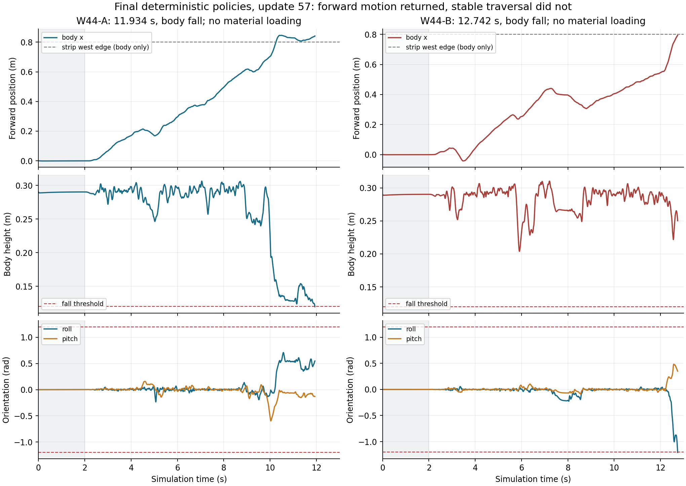

# W44 最终审查：前移恢复，完整策略接纳与接触稳定性仍未解决

日期：2026-11-12（北京时间）。审查结果基点：[`69d5a6f`](https://github.com/kaiwen123-yang/MCP-RL/commit/69d5a6ff2aa9803fddc8ac3a78a906008ea526c6)。本次仅整理已有代码、结果、公开原件与论文；没有启动新的物理仿真、PPO 或服务器任务。

## 主要判断

**S1 已经具备真正的 PANN→PPO→MPC→反馈→PD 联合执行、学习、恢复和发布链，但当前 r33 尚未获得稳定的原 Go2/TM02 合法去程与完整往返。下一轮应以控制稳定性为主实验变量。**

W44 每流真实新增512条/2次更新，达到14737/update57、tail0、excluded145；35个实际训练回合中32个物理失败、3个有效截断，另有2次零物理步初始化失败。最终固定 E30 为 A11.934s、B12.742s 跌倒，均未实际加载材料，合法去返/往返0，后续级别全部blocked。已请求生成原件交付完成，不改变这个科学结论。

W43 的驻留问题不能继续套用到 W44：本轮确实前移到约.846/.794m。但第一批值得追踪的大动作已经发生在2–3秒的刚地启动段。两个关键原件案例显示，alpha0 的近数值平手使名义轨迹几乎不变，却替换了很不同的 K 和反馈倍率，随后实际小偏差被放大。

- A call163/plan156，2.84s：J改善约8.05e−15，nominal倍率0→installed1；2.852s实际目标明显偏离名义并触及多个力矩边界。
- B call173/plan161，3.04s：J改善约2.17e−12，倍率.0133352→1；3.044s实际目标相对accepted偏离约.910716rad，3.052s反馈进一步放大。
- 候选到安装的13类数组完全一致；没有证明安装偷换K。问题在于名义评分对离轨反馈的辨别能力和接纳规则。
- B在2.9282s已有hold内饱和，早于该反馈事件；更早约54.8ms的无足接触也已被2.74s的native nominal预测。修复接纳问题不保证清除既有名义支撑/接触问题。当前证据支持优先干预，不支持唯一根因或稳定性定理。

## 报告与复算入口

| 文件 | 内容 |
|---|---|
| [handoff.json](handoff.json) | 已完成W44与未实施W45的机器可读交接；旧index顶层training状态不代表当前运行 |
| [cpu-report.md](cpu-report.md) | S1实际成熟度、W34–W44历史、W44训练/最终评价、材料曝光与学习权限 |
| [solver-report.md](solver-report.md) | 原始计划、实际动作与5000Hz子步对齐；alpha0/K/scale事件及已排除解释 |
| [gpu-report.md](gpu-report.md) | G1/G2复算、G5完成观察与源码开销、第三任务具体范围 |
| [literature-mechanisms.md](literature-mechanisms.md) | 六篇原论文与官方代码、可迁移机制及不能照搬的条件 |
| [recomputed-summary.json](recomputed-summary.json) | 本轮A/B计数、1024条学习数值、固定评价和四份基础原件摘要 |
| [history-recomputed.json](history-recomputed.json) | 613个训练物理结果与16份固定评价的逐job历史聚合 |
| [control-summary.json](control-summary.json) | 动作/预测/反馈/接纳事件的独立复算 |
| [gpu-recomputed.json](gpu-recomputed.json) | G1/G2原数组复算 |
| [selected-originals.json](selected-originals.json) / [control-originals.json](control-originals.json) | 当前实际使用的Release源路径、URL、大小与SHA256 |
| [recompute.py](recompute.py) / [recompute_control.py](recompute_control.py) | 读取已有原件的复算脚本，不启动实验 |



## 下一轮已形成的具体计划

[W45稳定性计划](../../../../../../docs/S1_W45_STABILITY_PLAN.md) · [完整Codex启动提示词](../../../../../../docs/S1_W45_START_PROMPT.md)

拟实施 r34 的单一主变化是完整策略接纳：同尺度数值平手保留完整基线，alpha0不能仅凭名义浮点下降替换K/H/倍率；规则贯穿candidate archive、Iteration的descent、停止和正则状态。保持原N、成本、物理、力矩、步态和材料域，有限存量问题比较后直接检验原任务。

CPU A/B 固定各自update57 Actor并行评价原E30→E60→E300→E600，W45不增加PPO样本。第三任务使用GPU做四个W44问题×32候选的完整horizon近似筛选，CPU native完整策略最终裁决；没有收益就发布有限负结果。默认10+10 CPU workers、GPU host2、约3核余量，实际以现场可用资源为准。

所有新后台deadline=null，无固定墙钟结束/到点kill；原物理时长、有限数值预算和单次网络timeout仍保留。GitHub核验后不在用户电脑另归档，不自动删除服务器原件/断点。**r34/W45当前仍未实施、未启动，不能把这份计划当作新实验结果。**

## 读取与验证范围

仓库当前快照共8498个tracked文件，约1.011GB；检索、解码/结构解析覆盖7979个文本文件、877,444,947字节，历史图谱含569个可达提交。核心在线链、当前r24–r33补丁、历史关键结论与协议做了针对性语义阅读；批量解析并不等于每个历史数字或每个二进制字节都得到理解。

近期结果核对覆盖613个实际训练物理结果、16份固定评价，以及W38–W44的16384条transition及对应PANN/value。GPU旧原件包读取246个成员、122,965,986解压字节。

本轮基础下载四份W44最终E30原件：两份完整trajectory与两份完整planner calls，共14,015,068字节、12340轨迹节点、1275次planner调用；逐项大小及SHA与远端匹配。控制专项另取21个定向原件，共194,211,521字节，逐项远端SHA匹配，内容包括完整动作、执行、5000Hz物理和关键计划/候选；辅助事件清单另列。两个范围不等于全量156GiB原件重算。

W44发布清单是13127项、167,895,058,454字节；本次没有重新下载/语义分析全部附件、所有视频、checkpoint张量或服务器未发布数据。G5后续完整最终原件尚未在当前Git中取得，其30秒/19.37小时结论来自保留的现场观察。各报告明确区分文件发布核验、实际数组复算、源码结构分析和仍需实验验证的推断。

## 复算

把 `selected-originals.json` 所列四份既有原件按 `local_name` 放入目录后：

```bash
python results/terrain_memory/simulation/tm-s1-go2-local-readiness-r12/reviews/W44-final-review/recompute.py --raw-dir /path/to/selected-originals
```

脚本先核SHA/大小，再统计现有仓库记录并生成图与summary；没有物理实验或训练副作用。控制专项原件复算用 `recompute_control.py --help` 所列输入。下载/保存位置由执行环境选择；GitHub发布完成后无需再在用户电脑建立一套归档。
