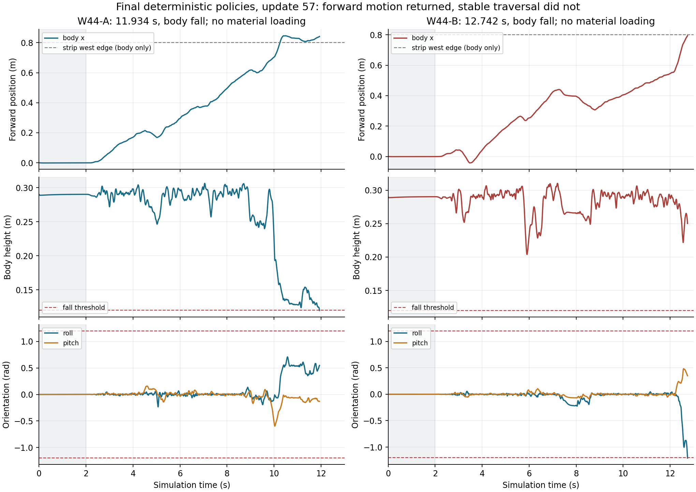

# S1 / W44：实际推进程度与失败口径

审查日期：2026-11-12（北京时间）。结果基点：`69d5a6ff2aa9803fddc8ac3a78a906008ea526c6`。本次只读取、复算和整理已生成证据，没有启动新的机器人仿真、学习或服务器任务。

## 1. 判断

**联合执行、真实 PPO 更新和原件发布已经成立；当前控制器恢复了前移，却尚未获得稳定的刚地起步、合法材料去程或完整往返。** W44 应被定位为一次有信息的控制机制验证失败，而不是即将收敛的材料记忆学习阶段。

可以继续做实验，但下一轮的主要自变量应当是控制器的完整策略接纳规则。先固定各自 update57 的 Actor，直接在原 Go2/TM02 任务中验证控制修正，能区分控制效果与继续学习造成的变化。继续原样追加 cap PPO，并不能检验当前已经定位的早期反馈异常。

## 2. W44 的实际工作量

| 项目 | A | B |
|---|---:|---:|
| job | `job-20261110T143358Z-w44-a` | `job-20261110T143400Z-w44-b` |
| 自身父策略 | W43：14225 / update55 | W43：14225 / update55 |
| 本轮新增 | 512 transitions / 2 updates | 512 transitions / 2 updates |
| 最终累计 | 14737 / update57 | 14737 / update57 |
| tail / 历史排除样本 | 0 / 145 | 0 / 145 |
| 有实际物理执行的训练回合 | 17 | 18 |
| body_fall | 14 | 16 |
| 非足非法接触终止 | 2 | 0 |
| 目标达成截断 | 1 | 1 |
| 用户暂停截断 | 0 | 1 |
| 实际材料加载回合 | 9 | 6 |
| 最大 body x | 1.316758 m | 0.991193 m |
| 合法去程 / 返程 / 往返 | 0 / 0 / 0 | 0 / 0 / 0 |
| 当前恢复特征非零样本 | 6 / 512 | 3 / 512 |

35 个物理回合中有 32 个物理失败，余下 3 个是有效截断。32/35=91.43% 是本轮回合构成，**不是独立同分布的成功率估计**：控制过程中策略更新，回合时长不同，目标截断和用户暂停也不是成功任务。

另外有两次零物理步初始化失败：A ep00411、B ep00399，均源于 17 项父配置身份未完整继承，已在同一二进制上修复。每次有 9 类根本未生成的源记录，因此发布表中的 18 条 unavailable 不是 18 次实验失败。B 后来还受遗留 r25 停止开关影响提前结束，随后沿自己的 job/clock/tail 普通续接；不能把这些操作问题与物理跌倒混成一个计数。

逐条复算结果见 [recomputed-summary.json](recomputed-summary.json)。输入是原 job、逐回合 result、1024 条 transition 与 1024 条 PANN/value；保存数组匹配记录均为 true。首批 256 条来自行为 update55，次批 256 条来自 update56，随后各自完成 update56/57。14737=57×256+145，其中 145 条是历史未用于更新的片段，不得宣称全部 14737 都进入 PPO。

两流共享 W38 之前 6545/update25 的祖先，不能把两份 14737、两份 57 相加，称为一个策略的训练量或从零独立重复。按共同祖先去重，PANN 路径为 22929 条；另有早期 RAW 256 条，R12 distinct 总计 23185 条。

## 3. 最终固定策略评价

| 项目 | A / update57 | B / update57 |
|---|---:|---:|
| E30 实际物理时长 | 11.934 s | 12.742 s |
| 结束原因 | body_fall | body_fall |
| error | null | null |
| 最大 body x | 0.846162 m | 0.793509 m |
| 最终 body z | 0.119647 m | 0.250272 m |
| 最终 roll | +0.547387 rad | −1.207506 rad |
| 实际材料加载 | 无 | 无 |
| 合法去程 / 返程 / 往返 | 0 / 0 / 0 | 0 / 0 / 0 |
| E60 / E300 / E600 | 前级不合格，全部 blocked | 前级不合格，全部 blocked |

A 在 10.252 s 的 body 投影进入材料条带，但没有足端在完整合法 footprint 内实际加载材料；不能把 body x>.8 m 当作材料通行。A 最终由 body z<.12 m 触发跌倒；B 由 |roll|>1.2 rad 触发。原始结果：[A](../../job-20261110T143358Z-w44-a-eval-PANN_PPO_S5-s1-E30.json)、[B](../../job-20261110T143400Z-w44-b-eval-PANN_PPO_S5-s2-E30.json)。

灰色区域为原任务初始站立 2 秒；材料边界线仅标出 body 投影位置。图由两份完整 trajectory 原件重算。全数组有限，未见用 NaN 或虚假成功掩盖失败。A 的评价墙钟包含用户暂停，不能作为纯计算性能；图中时间均为仿真物理时间。

E30 本来就不是完整往返考核：它要求满 30 秒观测、到达远端/进入转向和合法材料去程。E60 才要求至少一次合法去程、返程、完整往返及原终点连续稳定 2 秒；E300/E600 要求 5/10 次合法往返和原截止、完整观测、终点条件。训练中的 60 秒采集边界与正式 E60 的资格完全不同。

## 4. 这几轮为什么看上去一直在失败

| 阶段 | 实际训练回合 | 物理失败 | 结果级技术失败 | 其他结束 | 实际材料加载回合 | 关键结论 |
|---|---:|---:|---:|---:|---:|---|
| W34 / r24 | 30 | 29 | 0 | 1 | 30 | 3 次合法去程，完整往返未成立 |
| W35 / r24 | 73 | 70 | 0 | 3 | 73 | 又有 1 次合法去程；最终 E30 材料域退出 |
| W36 / r25 | 27 | 26 | 0 | 1 | 0 | 控制改动回归，材料之前失稳 |
| W37 / r26 | 72 | 71 | 0 | 1 | 50 | 恢复接触材料能力，仍无合法往返 |
| W38 / r27 | 70 | 68 | 0 | 2 | 53 | 两流各自续训，合法任务未成立 |
| W39 / r28 | 62 | 59 | 0 | 3 | 58 | 躯干风险优先并未建立任务能力 |
| W40 / r29 | 68 | 63 | 3 | 2 | 57 | 瞬时目标角/力矩 QP；最终总数是 68，非早期快照 64 |
| W41 / r30 | 130 | 127 | 0 | 3 | 118 | 约束 Riccati 已接通，跌倒仍多 |
| W42 / r31 | 36 | 0 | 0 | 36 | 0 | 运行不跌倒，但几乎不前进 |
| W43 / r32 | 10 | 0 | 0 | 10 | 0 | 数值生命周期修复，仍后退约 13 mm |
| W44 / r33 | 35 | 32 | 0 | 3 | 15 | 前移恢复，运动中的反馈/接触稳定性暴露 |

共 613 个物理训练回合已按结果复算，历史独立聚合见 [history-recomputed.json](history-recomputed.json)。各轮控制器、父策略和采样分布都不同，不能据此画成同一算法逐渐收敛的成功率曲线。W42/W43 的零跌倒主要与几乎驻留同时发生，不能当作稳定行走。W44 相比它们获得了运动信息，却也重新进入了容易失稳的接触切换区域。

历史能力要保留准确边界：R8/S3 曾真正做到刚地原任务 9/9 和连续 300 秒 3/3；r24 曾有合法材料去程。这说明项目并非从未走通任何基线。但旧刚地、不同控制器或曾经旁路材料的轨迹，都不能替代当前 S5-r33 的材料任务资格。

## 5. 为什么当前追加 PPO 不会自动解决根本问题

真实链路是：冻结的因果 PANN 材料观察器 → 658 维 PPO 观察 → 2 Hz 标量速度 cap（.18–.25 m/s）→ 50 Hz 全身 iLQG → 500 Hz 时变反馈目标角 → PD60/5 → 5000 Hz 原 Go2/TM02 plant。逻辑频率不代表已经达到对应墙钟实时性。

PPO 确实在学习，但只调整一个范围较窄的速度上限；它不能直接改接触模式、反馈矩阵、足端卸载、摆足轨迹或力矩裁切。把这些下层问题的失败全部交给 cap 学习，会产生很多失败样本，却不一定提供可实现原任务的控制权限。这是架构推断，不是宣称 PPO 在数学上必定无解。

W44 当前 12 维恢复特征非零仅 9/1024=0.879%；最终两次 E30 的 24/26 个 Actor 记录全部为零。这不证明 PANN 接线错误，也不证明整个 658 维观察没有信息；它说明本轮数据几乎没有给“恢复历史是否改善跨足/返程行为”提供可辨识对照。前移和跌倒目前主要发生在刚地起步，不能把失败直接归咎于 PANN 材料辨识。

另一项长期结构缺口仍在：真实 plant 和因果 observer 保存世界地块历史，但 MPC 候选没有随各自未来动作完整传播材料内部状态。当前候选主要使用四个当前支撑锚点及瞬时代理接触；native 接触 FD 不等于完整 TM02 材料历史预测。即使 W45 修复早期稳定性，也还要有候选内历史传播、足时/落点或重访权限，以及冻结/打乱/无记忆的因果对照，才能支撑长期论文目标。

## 6. 下一步研究顺序

1. 修复已有证据指向的完整策略接纳问题，用同一保存上下文验证。具体事件、反例和适用边界见 [控制报告](solver-report.md)。
2. 固定各自 update57 策略，双 CPU 在原 Go2/TM02 原任务做真实闭环评价。满时长而不前进不算成功；改变控制器后继续跌倒也应如实发布。
3. 有稳定合法去程/往返后，才把主要资源回到 PPO 扩样、真正材料历史曝光及任务级记忆收益。W45 不以新增学习样本数为交付目标，也不自动继续相同失败流程。
4. GPU 并行做独立、有限的完整候选批量 proposal 工作，CPU native 负责实际资格判断，见 [GPU报告](gpu-report.md)。

正式下一轮方案与可复制启动指令：[W45计划](../../../../../../docs/S1_W45_STABILITY_PLAN.md)、[Codex启动提示词](../../../../../../docs/S1_W45_START_PROMPT.md)。这两个文件是计划，当前 r34 尚未实现或运行。
