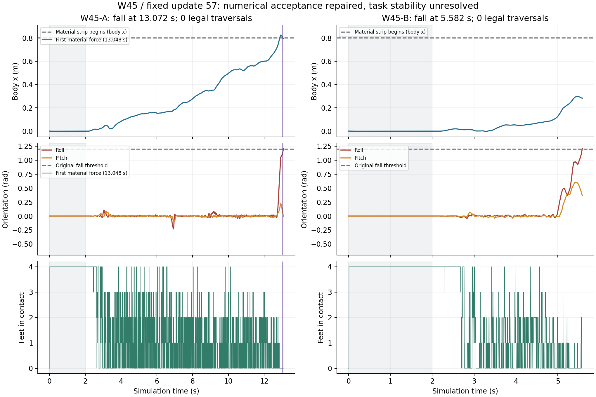

# W45最终审查：接纳修复有效，原任务仍缺稳定的移动控制

日期：2026-11-12。审查基点：[`3e3f69c440d6a33c14131563e5f485d88da3a803`](https://github.com/kaiwen123-yang/MCP-RL/commit/3e3f69c440d6a33c14131563e5f485d88da3a803)。本次读取源码、合同、历史结果及已发布原件，进行哈希校验和离线数组复算；**新增服务器任务、物理仿真、PPO样本与更新均为0**。W46/r35是待实施计划，不是本次已完成实验。

[W46实施计划](../../../../../../docs/S1_W46_STABILITY_PLAN.md) · [Codex启动提示词](../../../../../../docs/S1_W46_START_PROMPT.md) · [主计划](../../../../../../docs/TERRAIN_MEMORY_PLAN.md) · [机器交接](handoff.json)

## 1. 当前S1到了什么程度

**S1已具有真实联合链路、学习与原件交付能力，但没有建立当前控制器下稳定、合法的材料完整往返；材料记忆的因果收益更未成立。** 可以推进有明确反例和有限预算的稳定性实验，不宜直接增加长期PPO或扩大长任务矩阵。

| 层面 | 已有成果 | 当前边界 |
|---|---|---|
| 原硬Go2刚地基线 | R8/S3原任务9/9、连续300s 3/3 | 与当前r34的代价、接触导数、步态与约束实现不同；不等于TM02资格 |
| 联合链路 | 冻结因果PANN→658D PPO→2Hz cap→MPC→500Hz时变反馈→PD→5000Hz原物理真实运行 | cap是间接速度权限，尚不直接决定落点/卸载；逻辑频率不等于墙钟实时 |
| 学习 | 两流各14737条、update57；真实actor/critic/归一化更新与完整resume保留 | 有共享祖先，不能相加当独立样本；W45固定策略，新增0/0 |
| 材料任务 | W34有3次、W35有1次合法去程；曾有返程进展 | 稳定合法材料往返一直未建立 |
| 数值控制 | r34消除了W44的alpha0近数值平手换完整反馈策略 | 原生完整策略仍允许剧烈实际命令，原E30仍失败 |
| 记忆机制 | 世界固定材料历史与因果观察链存在 | 候选未来未完整传播各自材料历史；缺少充分跨足/返程曝光和匹配因果对照 |
| GPU | 原件完整、有限比较已完成 | 当前proxy与完整native控制策略不是同一评估对象，筛选质量不足 |

此前613个近期训练结果、16份固定评价和历史技术沿革见[W44审查](../W44-final-review/README.md)。本次进一步读取W45增量及关键原件，不把旧审查冒充新实验，也不把已完成的Stand平衡/PD/TV机制再列为新修复。

## 2. W45最终原任务结果

权威结果为[W45 phase](../../w45/phase.json)、[A结果](../../job-20261112T103825Z-w45-a-eval-PANN_PPO_S5-s1-E30-attempt01.json)、[B结果](../../job-20261112T103825Z-w45-b-eval-PANN_PPO_S5-s2-E30-attempt01.json)。独立复算见[trajectory-summary.json](trajectory-summary.json)。

| 指标 | A | B |
|---|---:|---:|
| 固定父策略 | W44-A update57 | W44-B update57 |
| E30实际终止 | 13.072s，body_fall | 5.582s，body_fall |
| 最大body x | .8251715m | .2972755m |
| 末态roll | 1.204443rad | 1.204792rad |
| 末态base z | .147113m | .229292m |
| 实际材料受力 | 有，末段极少量 | 无 |
| 合法去程/返程/往返 | 0/0/0 | 0/0/0 |
| E60/E300/E600 | 全部blocked | 全部blocked |
| planner总调用 | 674=20启动+654正式 | 300=20启动+280正式 |
| 新alpha0策略安装 | 0 | 0 |
| runner退出/first_error | 0/null | 0/null |
| 新PPO样本/更新 | 0/0 | 0/0 |

两者都是原roll阈值1.2rad触发的物理跌倒，没有达到base z<.12m，也不是后台到点被杀。原物理判据保留；程序exit0只表示正确记录并退出，不表示任务成功。E60/300/600没有开始，不能再计成六次物理失败。

与W44的11.934/12.742s相比，A多1.138s、B少7.160s。只有这两个各自冻结策略的结果，不足以声称总体稳定性提高或下降了某个统计比例。



### 材料加载不能解释本轮全部早期不稳

A在12.830s已达到|roll|>.5rad，12.872s躯干进入材料带，13.048s才出现首次材料受力，13.072s最终侧翻。.5rad仅用于标出时间顺序，不是新增失败线。最后两份5000Hz材料原件仅18个正受力子步，对应3.6ms；最大应变.00107326，远低于原绝对主应变域.02，未发生material domain exit。B全程没有材料受力。

A/B分别27/12份PANN置零cap对照，合计39份，全部cap差为0。A最后一次actor决策13.0s早于首次材料受力。它说明当前评价尚未产生可识别的材料恢复信息动作收益；不能据此说整个PANN网络从未训练，也不能用扩大材料网络训练解释刚地起步段已经存在的控制异常。

## 3. 本次排除了什么，又发现了什么

详细数值、源文件与方法见[控制审查](solver-report.md)、[control-summary.json](control-summary.json)、[源码与原件依据](control-originals.json)。

### 3.1 r34修复真实生效，简单接纳/安装解释不足

974次planner调用全部启用r34 strict，新alpha0安装均为0。四个保存问题的candidate→installed完整13组数组最大差均为0，native J分项复算误差至多5.55e−17。实际applied QP failure/restoration均为0，最大scaled KKT residual约6.4e−9/5.3e−9。四元数StateDiff与Kδ重建也与原件吻合。

因此没有依据再以“alpha0规则没生效”“偷装未评分K”“QP根本没解出来”作为下一主机制。未裁剪PD请求有时超过力矩界，但原actuator clamp仍工作；不能把raw request超限等同实际施加力矩越界。

### 3.2 剧烈命令已经在native完整策略里存在

| 节点 | native投影后目标相邻2ms变化 | actual相邻目标变化 | actual相邻力矩变化 |
|---|---:|---:|---:|
| A 2.650s | 1.41880rad | 1.16403rad | 74.0108Nm |
| A 2.652s | 1.25106rad | 1.32703rad | 90.86Nm |
| B 2.762s | .864029rad | .870424rad | 52.5030Nm |
| B 2.764s | 1.236289rad | 1.235869rad | 85.6056Nm |

A的90.86Nm对应膝关节在正负45.43Nm限值之间反转；它是相邻变化，不是施加了90.86Nm的越界力矩。B在2.762s时native/actual的关节位置差仅约.0001126rad，速度分量差约.00946，而输出已经很剧烈。这说明native模型本身也认可了这样的执行行为。

积分器Euler/implicitfast、coldstart/warmstart、接触数值差异仍会影响轨迹，A也出现了误差放大；但不能把全部大动作说成“平稳native预测被微小plant误差破坏”。同样，早期一个大动作到最终跌倒之间有多次重规划，当前证据不能证明它单独充分导致最终失败。

短暂全足无承载可属于合法trot；它是接触诊断，不增加“腾空即失败”判据。raw Kδ具有参考表示依赖性，仿射重定中心能改变它而不改变命令；真正应评价的是投影后目标、PD力矩、恢复能力与任务进度。

### 3.3 当前目标真实地偏好了一种尚不可靠的权衡

A call153/plan140@2.64s选alpha1，原native J从.11683448降到.08909507，不是浮点平手。

| 成本 | 原best nominal | 选中alpha1 |
|---|---:|---:|
| MaterialSupportHeight | .08556680 | .02597716 |
| Effort | .00484759 | .03537459 |
| Upright | .01039093 | .01311177 |
| Gait | .00131338 | .00357952 |

高度项减少.05958964，足以抵偿Effort增加.03052700和其他退化。同时预测最低高度从.248456升至.272044m，前移从−19.97mm变为+15.22mm。候选确有短时恢复收益，不能简单删除高度项、关闭反馈或选回不动就称修复。问题是原目标下降、瞬时约束可行，仍没有形成可持续的移动与接触恢复。

当前具有完整Stand平衡参考，缺少经验证的完整moving reference。原相对Height与全局绝对MaterialSupportHeight使用不同参照，Balance仍为四脚几何中心；r14曾修复离开材料带后高度目标关闭的真实缺陷，r25支撑方案又曾被撤回。历史支持有针对性的有限检验，不支持把旧方案换名重试或无证据删约束。

## 4. 为什么失败会反复出现

本项目目前同时面对控制可行性、长任务资格、材料历史建模与计算成本，但这几层的成熟度不相同。此前一些轮次解决了技术故障、数值接纳或驻留问题，并未得到稳定移动；随后在同一未稳定基线上采集PPO，成功材料穿越与返程样本仍稀少。**局部数值修好是实质进展，不能直接推导完整任务已可完成。**

需要分别计算失败类别：

- W44的35个实际训练回合是32个物理失败、3个有效截断；另有2个零物理步初始化失败。18条unavailable是2次attempt各9类未生成记录，不是18次额外物理失败。
- W45是两次实际原E30物理失败；后续blocked是未执行。line search候选拒绝、stagnation、26,900个候选评分都不是26,900次物理失败。
- G5完成30s但没有进度，属于task criteria未满足；旧技术错误是更早attempt，二者都保留。
- GitHub原件交付成功、runner自然退出、QP可行与原任务成功是不同事实，必须分别报告。

控制还未稳定时扩PPO只会增加同类短失败经验，不能保证修复低层名义策略；单纯跑更久也不能把几乎驻留变成合法往返。当前应先建立可恢复的移动控制，再让材料记忆问题得到足够且可比较的数据。

## 5. GPU与25核资源：已知瓶颈与有效第三任务

[GPU审查](gpu-report.md)与[gpu-recomputed.json](gpu-recomputed.json)逐项重算了W45全部128槽，两个原件ZIP整体SHA及301个源文件size/SHA均核验。四问题top4召回为.5/0/.5/0，平均.25；两次漏掉native最优，原J regret约.0174612/.0093759。按完整策略身份去重是另一补充口径，平均.1875。

GPU当时执行reference action、FP32推进与轴向clip，没有完整K/H反馈和原H投影，评分也是reference tracking proxy。两个问题中native几乎同轨迹的baseline被GPU排成第32/1。这首先是策略与目标语义不一致，不能只靠增加候选数或把浮点精度当唯一问题解决。128槽native都未违反trunk约束，因此false-feasible=0没有正例灵敏度含义。

GPU device总8.0036s，整个研究约58.19s；含必要native确认的端到端时间并非20ms实时，并且有质量损失。发现一个未来需要修正的选择边界：已经确认baseline，却只在top4中选赢家；本次4点未触发错误选择，但下次必须保留所有已确认baseline。

W45正式planning约占总wall的77–79%；PANN observer+query约.004–.804%，其中A含首次编译。小PANN查询不是当前主瓶颈，96GB显存占满不能作为有效研究的指标。

### G5最终证据已找到，不再补跑

旧G5最终包已经在[Release](https://github.com/kaiwen123-yang/MCP-RL/releases/tag/tm-s1-go2-w41-gpu-evidence)。354,912,832字节整体SHA匹配；111个源文件全部读取并核CRC/size、独立计算SHA。最终原E30满30s，墙钟19.366h，exit0/error null，但最大前移仅.0000242m、无材料加载、合法路线全0，任务未通过。它冻结W40-B/update37/r30，与W45不同，不能作为公平直接速度对照。

已追加[最终审查指针](../../gpu/w41-gpu/continuation-final-audit.json)，保留旧技术失败结果不覆盖。详见[g5-final-audit.json](g5-final-audit.json)。无需再上服务器寻找这份原件，更不重启G5。

## 6. 论文提供的方向与本项目的缺口

完整核对见[论文与R8比较](literature-and-baseline.md)。

- [HiLQR，TRO2023](https://arxiv.org/pdf/2207.04591)对time-stepping四足按法向承载份额安排相对参考输入的代价，且使用已有稳定Convex MPC walking reference。它启发一个较小的代价机制；本项目缺少稳定moving reference，输入还是目标角，不能直接抄扭矩权重或宣称获得同样稳定性。
- [HOUND contact-implicit MPC](https://arxiv.org/html/2312.08961v2)用FDDP保留状态/输入轨迹、收缩动态缺口，处理接触变化造成的单射击初始化发散。它提示若名义轨迹始终不可恢复，应转向完整可执行参考与热启动；不是只存旧状态数组就完成FDDP。
- [IDTO](https://arxiv.org/html/2309.01813v3)使用位置轨迹、逆动力学和缩放信赖域，是以后生成可行参考的备选。其欠驱动力约束有收敛前提，不适合在本轮顺带重写在线控制器。
- [MJWarp官方说明](https://mujoco.readthedocs.io/en/4.0.0/mjwarp/index.html)指出FP32、原子操作非确定性与吞吐/低延迟差别。完整策略执行一致性比继续proxy筛选更能回答当前问题；本轮负结果并不证明GPU不能做MPC。

## 7. 已写入W46的具体决策

**只检验一个控制机制：共同输入参考代价，比较其恒定与承载调度版本。** 每个真实epoch先用当前状态native重评分输入incumbent，冻结共同投影后目标u_bar、法向力/R/context；所有候选在同一新目标下比较。代价作用于实际held qtarget，不作用于candidate自选reference或raw Kδ。完整评分、残差、held-u导数、Riccati、H、archive和r34接纳必须一致。

固定四个W45上下文：A148/136@2.54、A153/140@2.64、B155/141@2.68、B158/144@2.74。每问题原r34/constant/load三分支，共12次有限求解；各输出从原初态及记录尺度正负偏差进行350ms固定policy native诊断，共36次。A148只在前20ms相对温和，完整350ms最大目标跳变仍1.50591rad，不是假定稳定参考。

constant按节点匹配load平均强度；首次R标度来自现Effort/PD单位，不自动扫参数。必须检查是否锁住坏incumbent、变为驻留，或者仅改变前馈/反馈分解。新旧总J不可直接横比；用共同原J0、实际命令、恢复与进度比较。若两个新分支均无有用变化，交付有限负结果，不开重复E30或临时叠加FDDP。若支持一个分支，冻结同一版本后A/B固定自身update57直接原E30，各自通过才E60/300/600，零新增PPO。

第三任务独立核对同一完整策略在GPU上的执行：最多24个旧策略scenario，先同state动作代数，再20ms短窗，满足语义与约束判断条件才扩一次350ms。最多42,000完整world-step，另计至多2,400短窗和预热；它不阻塞两条CPU原任务，不重跑proxy/G5，不扩大到重写引擎。

默认A/B各10CPU workers、第三任务host总2CPU、约3CPU余量；线程库各1，可写build隔离，构建先完成，PANN/actor共卡，实际资源在服务器开场核对。有限native比较最多两个10CPU求解同时运行，不与两条完整E30叠开。

无固定后台墙钟完成时刻或到点kill；保留原物理观察时长、有限求解预算和网络单次timeout。自然完成的物理失败保留原判定，未完成的技术退出保留interrupted；没有完整plant运行态不能用Actor拼接物理资格。GitHub/Release核验后不在用户电脑另外下载归档，服务器原件不自动删除。

## 8. 阅读覆盖、复算与限制

[repository-inventory.json](repository-inventory.json)记录基点8,548个tracked文件、1,015,989,655字节完整读取；8,208份UTF8、340份二进制，4,993份JSON和1,082份JSONL/37,798行解析无错。相对上一计划有20个新提交、43个变更文件。**这是字节与结构覆盖，不是声称语义理解每个byte或重放全部历史Release。**

本轮语义审查重点是最新源码继承、spec/build/readback、执行合同、W45全部结果与选定原件、旧成功基线及一手论文。37个控制原件共511,521,756字节逐成员size/SHA核验；22个关键源码最终全部匹配实际构建SHA。trajectory来源、最后两份高率材料记录、GPU两份完整ZIP与G5完整ZIP各有独立来源记录；覆盖存在交叠，不把它们简单相加当唯一字节总量。

复算工具不导入MuJoCo，不启动新physics。运行方式及输入位置：

```bash
# 在本审查目录，原件来自已有Release；按各provenance保留member布局。
python recompute_trajectories.py --raw-dir /path/to/trajectory-inputs --plot
python recompute_w45_control.py --originals-dir /path/to/control-inputs \
  --trajectories-dir /path/to/trajectory-inputs \
  --provenance control-originals.json --output control-summary.json
# GPU与G5无需服务器；完整用法、资产链接见REPRODUCE_GPU.md。
```

[trajectory来源](trajectory-originals.json) · [控制来源](control-originals.json) · [源码继承](source-reconstruction.json) · [GPU/G5复算说明](REPRODUCE_GPU.md) · [R8字段比较](r8-w45-resolved-comparison.json)

已经完成数组重算、原件SHA与成本/策略身份核对、复算工具便携性核对及图表检查。尚未检验r35控制效果、未登录服务器实测当前资源，也未证明新的输入代价必然修复任务。下一轮的可否定结果与实际原任务资格仍须由执行产生。
