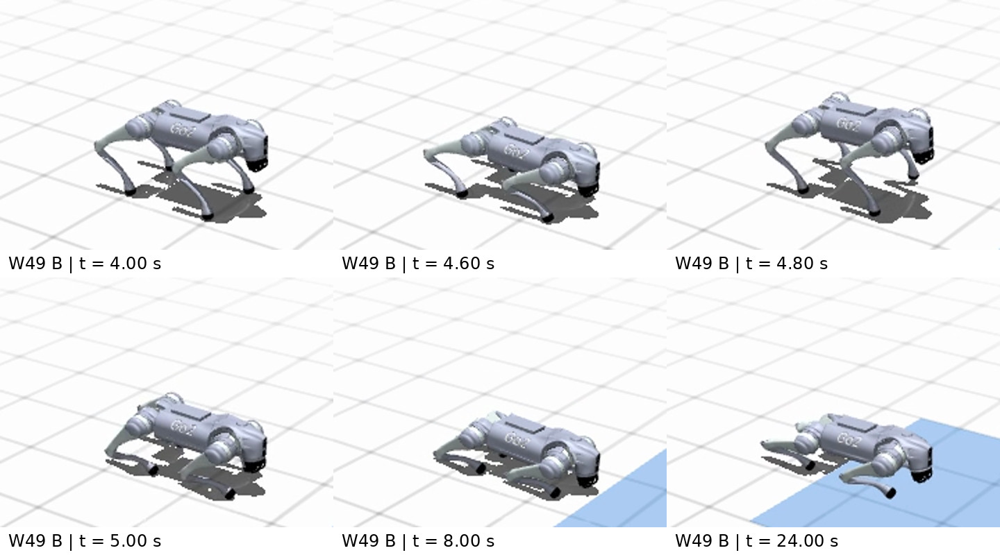

# 用户补充视频：W49 B 的运动质量审查

2026-11-15，用户补充 `W49-B-E30-full.mp4`，并指出行走不像正常步态。审查使用用户已提供的文件，没有从Release额外下载视频，也没有运行物理或新控制试验。

输入为H.264、1280×720、30fps、30.033333s、8,068,416B；文件名、大小、视频内attempt/seed与仓库W49 B视频目录一致。本次未用这些元数据冒充payload逐字节身份验证。

## 直接判断

**这段视频不能称为正常稳定行走。** 早期站立外形逐渐退化为反复深蹲/顶起，随后长期低伏、腿部深屈与外伸，后半段前进呈贴地挪动的外观。30s不中断不能作为步态已经稳定的证据。

图为原视频裁剪放大，时间未重新缩放；从左到右、从上到下为4.0、4.6、4.8、5.0、8.0、24.0s。没有生成或重画机器人姿态。

## 观察与数据对应

| 时段 | 画面观察 | 与原记录对应 |
|---|---|---|
|0–2s|站立外形基本保留|initial stand；2.002s进入outbound|
|2–4s|前进很少，未看到清晰有效的交替支撑推进|4s视频overlay约x=.029m；原配置只有5mm抬脚，不能仅凭远景断言完全无摆动|
|4.4–5.2s|深屈、下沉、顶起、再下沉，躯干上下变化明显|4.50s z=.19551；4.80s z=.30879；5.00s z=.19805；5.10s z=.16375m；同窗口vertical速度有较大正负变化|
|约7–8s后|低伏形态明显、腿深屈或近水平外伸|B最低z=.130666m，首次非足受载早在5.0216s|
|12–30s|低姿态持续，只有小幅腿动作，前移更像拖曳/挪动，未见恢复正常交替承重行走|首足材料加载12.1866s，机体入条带20.064s；末z=.142818m、末vx=.000544m/s|

根审查查看全程分段关键帧及3.8–6.8s每.2s、24–25.1s每.1s放大帧；独立审查另核2–3.5/12–13.5/24–25.5s每.1s，避免按2Hz周期固定相位取帧造成误判。没有声称逐一检查全部视频帧。单一视角、阴影和30fps不足以判定每个.2ms子步的具体接触体和受力，所以“贴地/拖曳式”是外观描述；真实非足支撑取自物理日志，仍须用全量GRF/contact确认分担比例，不能凭画面补造。

在B当前轨迹内，运动从站立外形退化为低位异常姿态有直接证据。相较所有历史版本是否单调越来越差，单个视频不能证明；W48→W49的存活、位移和运动质量应分别比较。当前已知B位移增加、原终止延后，但这些不足以抵消步态失败或成立“整体稳定性提高”的结论。

## 对W50计划的实质修正

主目标前移为**起步后维持有效足部承重、避免最早步态失效，再持续推进**；低姿态恢复作为补充。保留两个早期和两个恢复问题的有限设计，不增加新试验矩阵。

CPU A从2.002s Stand→outbound切换开始，直接读现有数据检查：实际private gait/phase是否切到Trot且持续演进，名义足轨迹/脚顺序是否正确，参考是否仍由初始Stand生成，真实足端法向载荷、接触时长、摆动/落脚/支撑交换、支撑脚切向速度与非足载荷。gait配置写了Trot不等于真实实现了Trot；5mm名义抬脚很小也不能解释后半长期低伏。

正常步态质量与原资格分别报告：躯干高度/垂直振荡、真实足与非足承重、接触交换和有效前进。**不新增随意高度阈值、硬对角接触门或非足一碰即停规则；原短腾空和既有资格不变。** 这些用于判断改善是否符合用户要的正常行走，而不是事后改计分。

原E30推进证据以早期两例为首要依据：若只把晚期低伏挪动变快或只延迟原终止，不能据此再称稳定恢复或触发重复原任务。新的参考/反馈候选须展示对早期异常下沉/承重或实际推进的实质改善；不要求短窗先完成全程。若现有源码问题被否定，则按实际相位/参考/接触证据调整单一修复目标，不能机械执行预设假说。

[W50详细计划](../../../../../../docs/S1_W50_STABILITY_PLAN.md) · [结果与事件分析](results/review.md) · [控制生命周期审查](control/review.md)
