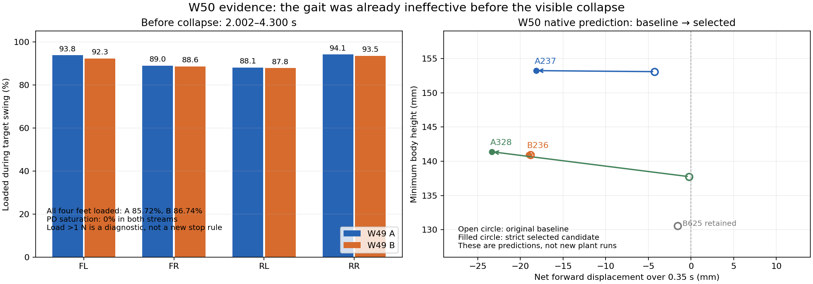

# W50最终审查：冻结已实证，晚态更新无实质恢复；下一步从起步成对验证

日期：2026-11-15（Asia/Shanghai）。结果基点`09bd55e0cb70244938ad82db7dd202a31ac70f77`，相对上一轮计划`9ba97283c13119ec197429b75fce6b139a506a33`新增4提交、40变化文件。本次读取Git及W50 Release原件、复看已有W49 B视频，完成只读数值复算；没有新native solve、仿真/GPU积分或PPO。另实际修复公共runtime两处缩进错误。

[W51详细计划](../../../../../../docs/S1_W51_STABILITY_PLAN.md) · [启动提示词](../../../../../../docs/S1_W51_START_PROMPT.md) · [视频/日志审查](video-review.md) · [控制审查](control/review.md) · [结果/GPU审查](results/review.md) · [一手论文](literature.md) · [机器交接](handoff.json)。

## 1. 当前成熟度与本轮结论

S1已形成PANN—PPO cap—全身MPC—PD—真实材料闭环，历史训练状态确实存在；当前完整材料任务、正常持续步态、材料记忆因果收益和NX实时仍未成立。最新原任务仍是W49/r37：A/B观察满30s但E30 0/2、合法往返0，低伏/非足支撑/前进不足。W50/r38是有限负结果，没有新原E30、没有新完整行走视频，原八阶段均blocked/unrun。

W50有明确知识增量：旧参考冻结被原对象和实际query证实；gait切换与phase时钟正常；r38候选构造和安装的代数正确；早期实际摆动卸载未形成；GPU首差缩到约束求解输出。它没有形成新的稳定行走能力，不能把“代码已实现”和“任务已实现”混为一谈。

| W50四个保存问题 | 正alpha strict改善 | 最佳J变化 | 最低z变化 | .35s位移变化 |
|---|---:|---:|---:|---:|
| A237@4.32s |4/9|2.481991→2.448854，−1.3351%|.153080→.153229m（+.149mm）|−4.297→−18.141mm|
| B236@4.30s |2/9|2.871754→2.871425，−.01144%|.140919→.140935m（+.016mm）|−18.833→−19.024mm|
| A328@6.14s |4/9|7.249399→7.096722，−2.1061%|.137755→.141383m（+3.628mm）|−.248→−23.343mm|
| B625@12.08s |0/9|保留nominal_8，J8.109798|保留最低.130553m|保留−1.585mm|

这些是同问题native有限预测；没有用候选轨迹冒充plant实际恢复。并非所有候选都后退：A237/B236有向前但同时坍低、成本更高的被拒候选，因此也没有证据说原J错拒了正常可行步态。[原始数据复算](results/analysis.json)

## 2. 视频为什么不是正常步态：日志已经支持

观看对象是用户提供的W49 B完整视频，复看早期3.8–6.8s与后期分段。约4.4–5.2s深蹲/顶起，7–8s后低伏、折腿/外伸，后半贴地挪动；不能写成稳定行走30s。[视频证据](video-review.md)

W50从原W49全量记录读到：

- private Trot在2.002s启动，phase持续2Hz推进。不是简单“还在Stand模式”或“相位冻结”。
- 2.002–4.3s，A/B四足同时>1N受载占85.718%/86.736%，目标swing中实际承重约87.811%–94.113%；该窗PD饱和均0。
- B在7–30s非足平均支撑45.084N，约体重30.2%，非足>1N占88.447%。B5.2–7s曾短暂恢复较高身体且无非足载荷，不应把5秒以后写成毫无间断的贴地。
- 原body_fall高度线.12m、允许的腿部接触解释了低伏仍可观察满30s。保持原判据，同时单独报告步态、承重和路线。

**失效起点需要前移。** W50称“早期”的4.3s已在Trot后约4.6个周期；A237起点身体还较高，也不等于当时已有正常步态。晚态一次更新未能恢复，不等于从t=0连续刷新无法预防。

## 3. 原参考冻结从假说变成了实测事实

W50 Task A检查231个保留事件policy，reference states/actions/times、K和H各自只有一组数组，来自t=0的Stand，参考窗[0,.35]。两流各14825/15001个实际held查询超过参考末端，使用动作末节点174，最终过龄29.65s。安装ID、generation_time和metric_source_plan_id确实不能代表反馈生成时刻。

本次下载的四个W50输入完整对象也直接显示旧参考；r38三个正赢家的当前网格确实更新，B625保留旧baseline来源。控制线独立从原bin重算raw center、当前切空间Jacobian、K/H混合及安装对象：节点center误差≤4.44e−16rad，Jacobian≤2.22e−10，K/H数组吻合；末action持值与state插值带来局部非严格等价，但量级不足以解释坍低。没有找到重复alpha、旋转符号或候选/安装对象不一致的主要错误。

这说明r38按设计完成了参考更新，并没有证明这种局部更新足以改变接触模式。新K较大、原反馈较弱也是候选行为大变的背景，但仅凭增益大小不能断言错误。大alpha与投影/接触相互作用仍由真实native轨迹判断。[控制原件与源码审查](control/review.md)

## 4. 失败、技术错误和未运行必须分开

W50四次主solve：76full rollout，36正候选中10strict改善。加两次短部署再规划后共116full rollout、114candidate records、23112transition FD、4746risk FD、12derivative passes、6backward attempts、76650次零物理raw-center求值。另400bridge子步消耗已发生，但native物理等价有效数为0；原plant子步0、新GPU步0、新PPO0/0。

独立解码六组原候选、114条记录并按原residual/norm/weights重算J，最大绝对差2.3283e−10，出现在总J约1.524e6的候选，其余普通值接近机器精度。114条均记录failure=false、状态/动作有限。B625大alpha成本主要来自ImpactMargin：alpha1总J1,523,733.13279，其中该项1,523,721.76338；不能叫NaN、solver崩溃或一概归于高度成本。

### 已知bridge ABI错误

Python wheel与frozen native库同叫`libmujoco.so.3.2.3`，bridge却重用了不兼容布局的前者，原NPZ的actuator字段出现denormal垃圾。RPC单次FP32 cast仍完全正确，证明不了物理正确。四个主finite的独立native server不受此Python句柄问题直接影响；两个midpoint solve输入来自错误bridge，不用于物理等价/恢复结论。

W50已把loader改成`dlmopen`独立namespace，但只做零积分库映射确认，没有修后物理部署。无需为W51准入重跑此桥接：下一轮直接在正常plant/RPC入口中检验闭环。

### 本次实际修复的公共runtime阻断

W50字符串修改把`s1_go2_r11_runtime.py`两处dump行退出其if块，原版AST在line499报`IndentationError`。它会让公共模块在import前失败，W50独立有限脚本未经过该入口所以未暴露。本次只修两处缩进并确认AST可解析；没有启动仿真。具体记录见[runtime-fix.json](runtime-fix.json)。

因此W50不是“又失败了八个原任务”：没有运行原八阶段；已发生的是有限恢复负结果和无效桥接诊断，另发现一个未来入口错误。下一轮应减少平行维护的自制执行路径，直接使用正式闭环链。

## 5. W51下一步：从起步分清预防与新候选的增量

同W44 A/seed1 checkpoint、同evaluation初态t=0，D0=r38 refresh-only、D1=r38加一个相位感知完整运动候选S，双CPU各一次8s真实闭环。它是独立科学诊断，不是E30资格；不能用wall timeout截断E30或training_duration进入另一种任务。

S保持原完整raw PD承重中心，增加由支撑足世界锚点、相位连续摆动与原速度命令生成的IK差。只多一次S rollout，有效时作为唯一backward起点；原B始终保留为全局严格比较对象。S比B差可以用于搜索，但不能因此安装；不追加第二个方向族、alpha×beta网格或新权重。正常epoch D0通常≤20、D1≤21full rollout，FD另计，计算预算不完全相同。

8s约覆盖移动后12个名义周期，双臂约842调用、80,000plant子步，full rollout约17,261量级上界，不能称几次微测试。比较目标swing卸载、实际支撑交换、z/vz、非足承重、前进和同对象执行；若r38本身足够就保留简单机制，若S有增量就选S。两臂都无实质改善则交负结果，不临时叠加多项改动。

选定一个版本后，原A(seed1)/B(seed2)各一次E30，逐case通过才E60→E300→E600。新PPO/donor0，Go2/TM02/PD/力矩/步态/时域/任务判据保持。[完整算法、入口和交付协议](../../../../../../docs/S1_W51_STABILITY_PLAN.md)

## 6. GPU与并行：已有缩小范围，尚未主规划

W50 A/B有限求解实际重叠11.516s；C只做.884s CPU分析且在前完成。没有持续利用率记录，不能把affinity或W49的79.412min重叠说成W50满载。

按活动布局规范化后，首步约束输入与smooth dynamics相同，先见contact efc_force与qacc差；完整contact字段是27/30边界一致，第10步也有分歧。未锁定唯一kernel，canonical sort的stub不构成修复。极小浮点差不自动说明GPU不可用，完整native成本与可比排序未迁移才是直接限制之一。

W51 C改做已有native残差的FP64 GPU成本归约及22项ResidualFn覆盖，记录纯代数/运动学/接触依赖与缺失字段。来自错误bridge状态的midpoint记录仅能作为代数输入，不是正确物理证据。GPU不作正式安装排序，不阻塞两个CPU臂，不为占满显存新增PPO或重复batch。

继续实测25CPU/96GB配额，10+10+2+3，线程库1，先-j6构建。默认零新GPU物理，完成有用工作后自然结束。

## 7. 阅读、发布和工作流

本次全读取40变更文件40,087,699B，完整解析16JSON。W50三ZIP远端live核对均uploaded，size/digest与manifest一致，共464,340,186B；在本次临时审查环境读取并提取254成员569,226,459B，用关键原数组独立复算，没有把Release内容复制进Git或在用户电脑另做归档。字节读流不等于逐数字语义理解，完整W49物理/策略群的全量结论仍明确归属W50执行端Task A；本次直接核的是已发布W50输入与输出对象。[阅读范围](read-coverage.json)、[远端核验](remote-verification.json)

保留历史证据，不重写旧实验。当前文档和执行入口更新为W51；README此前仍停留在W49/W50未实现状态，本次一并修正。所有新后台无固定墙钟截止、无到点kill；GitHub核验后不在用户电脑额外归档；服务器仍被引用的科研原件和checkpoint/resume/视频保留。

本次实际改动只有审查资料、计划/提示词/项目记忆，以及两行runtime缩进修复。r39、D8、GPU成本迁移均为下一轮计划，没有宣称已经实现或跑通。
