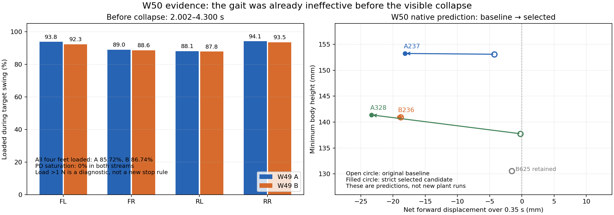

# 视频与日志：失效始于有效摆动/支撑交换未形成

审查基点 `09bd55e0cb70244938ad82db7dd202a31ac70f77`，2026-11-15（Asia/Shanghai）。W50没有运行新原E30、没有新完整行走视频。本页观看对象是用户此前提供的 `W49-B-E30-full.mp4`；不能把W49画面写成r38/W50闭环效果。

本次复看早期3.8–6.8s加密画面与8–29s分段画面，结合[此前视频记录](../W49-final-review/video-review.md)及W50读取W49完整原件形成的[task-a.json](../../w50/task-a.json)。没有声称逐帧判定接触力。足部/非足部受力来自日志，视频用于核对可见姿态与运动。

## 一、画面与原plant日志对应

| 时段 | 画面 | W50从W49原件读出的对应事实 |
|---|---|---|
| 2.002–4.3s | 身体尚较高，缺少明显有效交替迈步 | private Trot在2.002s生效，phase按2Hz推进；A/B四足同时>1N占85.718%/86.736%；目标swing中各脚仍受载87.811%–94.113%；PD饱和均0 |
| 4.3–5.2s | B反复下蹲、顶起、再次下沉 | B身体z范围.163166–.312006m，vz约−.784至1.496m/s，非足受载占11.844%；这是垂直振荡，不能把全足卸载瞬间直接当正常摆动 |
| 5.2–7.0s | B短暂抬高、移动，姿态仍起伏 | B该窗无非足载荷，z .213899–.314783m；A已低伏且非足受载占100%、均值55.135N。不能把B5秒后描述为全程连续非足支撑 |
| 7–30s | B持续低伏、腿折叠/外伸，贴地挪动 | B非足受载占88.447%、均值45.084N，约体重30.2%；末z .142818m。位移不能单独说明正常步态 |

早期B在2.002–4.3s只前进约54.97mm，A约61.34mm；身体尚未明显塌低时有效步态就没有形成。1N沿用已有诊断阈值，不新增非足接触终止规则，不把短腾空一概视为失败。

图左是W49实际载荷的窗口统计；图右是W50保存问题中.35s的native预测，不是新的plant轨迹。数据和只读作图入口：[video-analysis.json](video-analysis.json)、[make_figures.py](make_figures.py)。

## 二、这轮新增了什么解释

W50记录确认，231个保留事件policy的reference states/actions/times、K/H各自均与t=0的Stand对象相同；两流各14825/15001个held查询越过原.35s参考窗，使用末动作节点174，末过龄29.65s。因此此前冻结假说升级为对应保存对象和查询记录中的实证。实际private gait在动，不等于反馈参考也在动。

W50对四个已发生异常的状态做了当前时域更新，三个selected赢家的新reference确实覆盖当前查询，但早期两例预测仍塌低且倒退加重。它支持“单次晚态更新不足以恢复”的结论；不支持“从起步连续刷新也必然失败”。W50最早fixture已在Trot切换约2.3s以后，而异常载荷交换更早存在。

因此W51应从完整初态t=0作同seed成对闭环：刷新本身的预防效果、加一条相位感知运动初始轨迹的额外效果。不能根据W49与W50不同fixture的25/36、10/36直接宣称新方法退化，也不能把向前但同时塌低的候选叫正常步态。

## 三、下一轮视频必须提供的证据

两条8s科学诊断分别保存完整实际轨迹及视频；正常结束覆盖8s，原物理提前失效则保留真实终止时刻，不补齐或为满时长重复。明确D0/D1、控制器、seed、物理时间；重点呈现Stand→Trot、2.002–4.3s和4.3–8s。同一画面与日志对应身体z/vz、实际足Fz、非足Fz、当前phase/target swing、foot世界速度/位移、命令与实际vx。原E30若获推进，另保存完整视频并逐级归属。

视频由已有真实轨迹渲染，不为生成视频另做物理回放；不将候选预测透明模型、短桥接或渲染结果冒充新的plant任务。正常步态、路线资格和成本下降分别报告。
