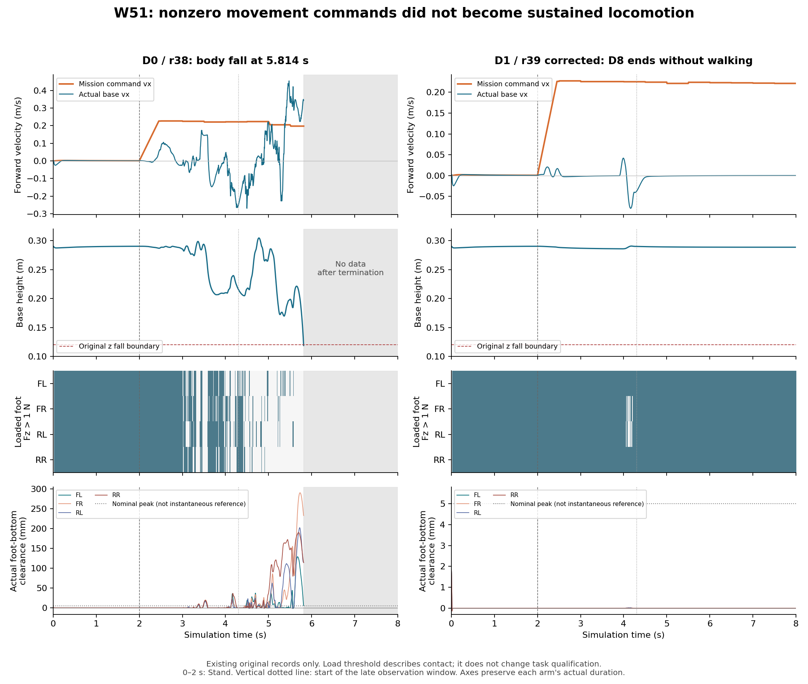

# W51 补充复核与 W52 实施收口

更新：2026-11-16（Asia/Shanghai）。原始结果提交：`a621d7d35e6016634b388a3aef0d39d8d008aab0`；本次审查基点：`28b865477d35a1ef04dc04e0da3521c6c9dc4c2b`。

**审查开始时，实时 main、全部远端分支和最新 Release 仍没有 W52 新结果。最新实验为 W51；W52 仍是 planned_not_implemented。本文补充既有原件分析和实施要求，不将计划当作新实验，也不跳号为 W53。** 本次新增物理、native solve、FD、PPO 和 GPU 实验均为 0。

[原 W51 审查](../W51-review/README.md) · [详细执行计划](../../../../../../docs/S1_W52_STABILITY_PLAN.md) · [Codex 启动提示词](../../../../../../docs/S1_W52_START_PROMPT.md) · [六项补充文献](literature.md) · [机器交接](handoff.json) · [新增图的可复算数据](command-support.json)

## 1. S1 到了什么程度，能否继续推进

可以继续做有针对性的控制修复和一次真实诊断，但当前还不能把 r38/r39 升级为正常行走版本，也不能直接宣称已具备材料往返能力。

| 层级 | 当前证据 | 判断 |
|---|---|---|
| 工程执行与可追溯性 | 独立 native server、真实 plant、固定策略、连续原件、候选和视频已经存在；若干接线/数值错误已经修复 | 已有可审查工作基础，但新版本仍须继承真实运行路径 |
| 原地承重 | 修正 D1 运行满 8 s，末 body z=.288505 m | 该窗口能站住 |
| 正常动态步态 | D0 在 5.814 s 跌倒；D1 后段四足持续承重，没有正常卸载/支撑切换 | 尚未成立 |
| 原任务资格 | W51 原 E30 启动 0；D8 的 qualification_usable=false | 未取得资格；未运行不等于又失败一次 |
| 材料穿越、返回 | W51 三个启动均没有实际加载材料 cell；无合法去程/往返 | 仍未实现 |
| 材料记忆因果收益 | 候选内未来材料内态传播和匹配对照尚未完成 | 不能从站稳、J 下降或 observer 有输出推得 |
| 实时与 GPU | 当前有效臂每仿真秒约需 156–161 墙钟秒；GPU 只完成部分成本工作 | 尚未建立端到端实时/GPU MPC |

长期目标仍是“面向重复踩踏的四足机器人地面记忆辨识与跨步协同控制”：让前足、后足和返程对同一世界地块的加载历史影响后续决策。阶段顺序保持：合法稳定的原 Go2/TM02 完整任务 → 材料历史的因果收益 → 泛化 → NX/实机。历史 R8/S3 刚性任务与长时运行曾成功，但那不是当前材料/控制配置的资格，不能跨版本继承。

历史上也不是每轮都毫无进展。W42/W43 曾从大量跌倒转为站立而不走，W49 A/B 跑满 30 s 却低姿态挪动、未穿越材料；W50 排除了若干保存问题与不等价 bridge，W51 进一步把“动态失稳”和“静态停住”分开，并定位到确定的摆动曲线错误。工程修复有价值，任务能力尚未随之成立。历史状态与学习账本见[项目记忆](../../../../../../docs/TERRAIN_MEMORY_PLAN.md)。

## 2. 三个启动必须按实际原因分账

| W51 启动 | 终止/完成原因 | 实际物理时长 | 最终 x / z | 解释 |
|---|---|---:|---:|---|
| D0/r38 | body_fall | 5.814 s | .095709 / .118934 m | 有效物理负结果 |
| 首次 D1/r39 | execution_error / technical_interruption | 3.120 s | −.000803 / .290463 m | 原命令未写入 userdata，定向停止 server 后拒绝连接；技术无效 |
| 命令修正 D1/r39 | diagnostic_window_completed | 8.000 s | −.012449 / .288505 m | 完成诊断窗口，但没有正常行走；success=null |

来源：[D0](../../w51/D0.json)、[首次 D1](../../w51/D1-technical-attempt01.json)、[修正 D1](../../w51/D1.json)及各 job 的原始 trajectory。三次启动不是三次独立“控制物理失败”，也不是三次成功。首次 D1 不作第三个科学样本，W50 的 blocked 记录不能再次并入 W51。

首次 D1 的 mission 已有非零前进指令，但 `userdata[78:84]` 未填，S 读取了零世界速度。既有修复 `463e91b` 已补写该命令。随后 Connection refused 与执行端定向停止其独立 server 相符，没有证据把它归为随机断网或固定 deadline。D0 没有因此重跑，修正 D1 单独从原 t=0 重启。

### W51 没有发生材料加载

这次独立核对了 D0 的 6 份、首次 D1 的 4 份、修正 D1 的 8 份材料 chunk：18 份 `cells.shape` 均为 `(0,13)`，rates 为空；三个 `material-final.npz` 的 keys、loaded、ever_loaded 全为空，material events/failures JSONL 都为空。它们与 compact summary 的材料计数 0 一致。

因此 D0 的宽泛 stage 类别 `physical_material_failure` 必须按具体 reason `body_fall` 理解。**W51 的最近瓶颈在起步和接触实现；本轮不能用于证明材料记忆模型导致失败。** 这不抹去历史真正进入材料后的应变、侧出和接触失败。

## 3. 命令、视频和足力共同说明了什么

图由[脚本](make_command_support_figure.py)读取两条完整既有 `trajectory.npz` 生成，没有重跑仿真。Fz>1 N 是描述载荷状态的诊断口径，不改变原成功/停止规则。`trajectory.npz` 的逐足字段与 native `r33_foot_rows` 为 **FL、FR、RL、RR**；native gait 枚举及 IK/motion 为 FL、RL、FR、RR，两种逐足字段用 `[0,2,1,3]` 对齐，不能把所有 native 数据都当成同序。图中 5 mm 是名义摆动峰值，不是全时段瞬时目标。D0 终止后的灰区无数据；窗口端点共享一个样本。

### 3.1 修正 D1 有明确前进命令，但没有把命令实现出来

| 时间 | mission 前向命令 | 实际前向速度 |
|---:|---:|---:|
| 3 s | +.227294 m/s | −.001738 m/s |
| 6 s | +.223905 m/s | −.000380 m/s |
| 8 s | +.221266 m/s | −.0000527 m/s |

这些来自同一轨迹的 `command_velocity[:,0]` 与 `qvel[:,0]`。它排除了“修正后的任务本来只要求站立”的解释。它证明命令和实现之间有落差，但单凭这一表还不能指定某个权重或 PD bias 为唯一原因。

- 2.002–4.3 s：四足同时承重占 93.39%；按原 gait phase 判定的计划 swing 时段统计，各足仍带 >1 N 载荷的比例为 94.89%–100%。最大实际足底离地高度仅 .019991 mm，远小于名义 5 mm。
- 4.3–8 s：四足持续同时承重 100%，每足载荷开关转换均为 0；机身又后退 5.699 mm，承重 stance 足平均水平速度约 .090–.221 mm/s。
- 末位置 −12.449 mm，最大前进位置仅 5.452 mm。此窗口的证据是基本原地维持支撑，尚不是持续正常步态。

全时段抽帧中 D1 始终基本停在初始位置。小幅姿态修正、没有跌倒与完成走路任务需要分别判定。

### 3.2 D0 晚段的前移和足部离地发生在失稳中

D0 在 2.002–4.3 s 净后退 20.903 mm；4.3 s 后虽然向前增量约 117.271 mm，但该后段 68.07% 样本四足均不承重，机身垂向速度约 −1.466 至 +.990 m/s，出现最大 598.59 N 非足载荷，最终倒下。足底最高离地达约 290 mm 反映抛落和姿态失稳，不应算成摆动改善。

视频可见下沉、腿部折叠、短暂顶起及后段倒下，与足力和机身时序一致。不能只拿最大 x、离地高度或存活时间判断控制能力。

本次复看 D0 与修正 D1 覆盖全时段、约每 .2 s 的 contact sheets 及关键近景，并沿用[既有三视频审查](../W51-review/video-review.md)。这是抽帧审阅，不声称逐个观看全部编码帧；精确事件时间取 500 Hz 轨迹及 5000 Hz 物理记录。视频容器末帧时间不代替物理终止时刻。原件与视频见[原 Release](https://github.com/kaiwen123-yang/MCP-RL/releases/tag/tm-s1-go2-local-readiness-r12-w51-paired-D8-part01)。

## 4. 为什么仍然不稳定：已证明的问题与未隔离的因果

### 4.1 已证明：旧几何接续式会取消抬脚

301 份 D1 IK 原件共包含 650 个“当前 swing 足 × replan 快照”。360 个快照的已保存剩余节点全部不高于平地，96 个最低低于 −1 mm，最深 −3.570516 mm。旧式将原绝对 C2 高度减去当前名义高度/速度修正；实际足还在地上时，这种连续接续会抵消应有抬脚。独立重建误差 2.36e−16 m。

这不是 IK 没收敛：IK 最大误差约 1e−7 m；目标本身不合理时，精确解出目标也无助于走路。650 是快照数，不是 650 次独立物理失败；保存节点统计也不是连续曲线极值证明。[原公式、复算和候选证据](../W51-review/control/review.md)

### 4.2 已观察：数值有效的 S 仍常留在四足支撑附近

301 次 S 全部数值有效且作为唯一线性化基点 Q，299 次 J(S)>J(B)。这不等于 S 被直接安装；所有最终候选仍需胜过全局 B。94 次正 homotopy 安装有 92 次在 Stand，运动期只有两次。

26 份保留的 native S rollout 也不支持“已经生成了正常步态，只是 J 拒绝它”。早期 call121/128 的 S 全窗口四足承重；也确有抬足反例：call235 的 S 最大离地 4.422 mm，但机身后退 86.438 mm。12/26 条 S 的 x 增量为正，最大仅 4.192 mm/.35 s。不能把所有 S 都说成从未抬足，也不能把任意正 x 说成正常前行。

下一步要检验的是：修正的几何经完整 B 支撑中心和 qIK 差分进入 native 后，是否真的卸载并形成支撑交换。**“去掉支撑偏置就一定解决”与“降低 InputReference 权重就一定解决”均未被现有数据证明。**

### 4.3 D0 与 D1 的参考问题不同

D0 有 311 次调用、272 次 policy update，2,907 个 held 查询真正的尾部过期为 0。134 个 covers=false 主要含 float32 起点舍入，不能都算旧参考。它说明持续更新仍可能失稳。

D1 最后 policy generation 在 4.2 s，但 reference/K/H 仍来自 2.14 s，参考截止 2.49 s。末 reference 已过期 5.51 s；含末查询为 2,755/4,001，计随后积分为 2,754/4,000。更新 policy 的外层缩放或元数据，不代表已获得新的有效行走参考。因此需要同时记录“policy 何时生成”和“反馈参考来自何时”。[完整时钟审查](../W51-review/results/review.md)

### 4.4 D0 执行链有异常，但尚未隔离最初原因

| 时间 | 确定观察 |
|---:|---|
| 2.976 s | QP 开始明显改写最终目标 |
| 3.016 s | 原 ctrlrange 硬裁剪首次出现 |
| 3.170 s | body z 首次低于 .28 m |
| 3.4614 s | 未限幅 PD 请求首次超过原力矩边界 >.01 Nm |
| 3.588 s | body z 首次低于 .25 m |
| 4.050 s | 反馈项 Kδx 绝对值峰值≈37.867 rad |
| 5.2304 s | 首次非足载荷 >1 N |
| 5.814 s | body_fall |

原实际 actuator force 仍受力矩边界限制；“PD 请求超界”不等于实际力矩无限增大。37.867 rad 是晚段极值，不能逆推为最早原因。硬 clip 与 QP 分别发生 648/627 次，合并改写 708 次，不能相加计独立失败。

执行顺序必须保留语义：`action_before_clip → ctrlrange clamp → center_before_projection → QP → u_star → float32 u_held → 物理 PD/actuator`。未来仅在“native 候选已经正常、真实部署才偏离”时，优先沿该链定位，不直接截 K 或改 PD 后宣称解决。[动作与物理时钟审查](../W51-review/control/review.md)

### 4.5 为什么增加尝试和 PPO 没有自动解决

当前外层 PPO 的直接动作只是 2 Hz、.18–.25 m/s 的 scalar cap，它不能逐足指定卸载、分配支撑力或逐关节快速纠偏。W45–W51 没有新 PPO；此前训练的样本增长也不能自动修复后来确认的几何/接线错误。

局部 J 下降、IK 小误差、梯度数值正确、记录完整、没有倒下，分别回答不同问题。此前多个修复改善了其中一个环节，另一个环节仍会阻塞任务。当前应围绕同一次运行保留连续证据，减少把不同问题反复压成一个 success/failure 的做法。这是基于仓库证据的综合判断，不是已证明一个单因子解释了全部历史失败。

## 5. 新找到的实施风险：换 r40/r41 名字不会自动继承 r39

逐项核对[运行入口](../../../../../../scripts/s1_go2_r11_runtime.py)、[准备入口](../../../../../../scripts/prepare_s1_go2_r11.py)、[W51 生成器](../../../../../../scripts/w51_native_source.py)和[记录器](../../../../../../scripts/s1_go2_w51_records.py)后，发现以下具体风险；它们是拟新版本的实施要求，不是 W52 已经失败的证据。

1. `MJPC_W51_MOTION/MJPC_W51_RECORD` 仅在 build 等于 S5-r39 时设置；strict comparator、R33/R35、native 身份、before_call/held 等使用截至 r39 的显式版本集合。新身份须完整接入。
2. 最关键的原命令修复以 `'w51_fixed_policy' in r12_contract` 为条件。若新合同只改成 w52_fixed_policy，可能再次跳过 userdata[78:84] 写入。录制器选择也有同类旧字段条件。正常首次规划的命令 readback 与进程身份即可证明接通，不需要额外物理准入。
3. D3 不能原样调用两次现有单分支 Iteration/Transfer。W50Capture/Transfer 会修改 candidate 缓冲、archive、μ/rate 和 stopped 状态；必须从同一 epoch 冻结输入各自计算，再统一选一次、提交一次。
4. 原 W51 保存全部 B/S/Q/IK，但完整 candidate 只在事件窗保存，普通 direct S 安装不是触发事件，因此 call216 缺同次 rollout。新记录器需在本次 ring 已就绪后保存实际所选轨迹/完整 policy 及来源；无需补跑 rollout 或保存所有 FD 中间数组。
5. 材料区的真实间隙不等于世界 z 极值。原 R10ContactRest 是冻结的双线性 tent patch 之和；五次 xy 下分段表面可到十次，间隙驻点到九次。需处理 patch/材料启用边界，或用等价可靠的一维实根方法。W51 旧快照全在平地，可直接按原事实简化。未来完整 swing 还需保留原 anchor 与新 touchdown 的实际高度差，不能默认两端同高。

上述细节已合入[W52 计划](../../../../../../docs/S1_W52_STABILITY_PLAN.md)。它们不扩展科学变量，不改变成本、PD、步高、相位、PPO 或原任务标准。

## 6. 下一步实验与条件决策

| 任务线 | 资源 | 具体工作 | 能回答什么 |
|---|---:|---|---|
| 主 D2 / 拟 r40 | 10 CPU workers | 只修摆动几何，真实初值直接接固定原 apex/touchdown；一次原 t=0→D8 | 确定几何错误修好后，原控制链是否能形成真实支撑推进 |
| 次 D3 / 拟 r41 | 另 10 CPU workers | 同样几何；B/S 各独立 first-valid 方向及 9 alpha，统一原比较器；一次同初态 D8 | 额外保留 B 搜索方向是否带来实际改善；预算更多，不是等算力对照 |
| C | 约 2 CPU + GPU | 用已有原件定位 MaterialSupportHeight 的 9.00991e−6 state 重建误差及必要比较 | 补当前成本迁移的具体缺口；0 新 GPU 物理，不进入正式安装 |
| 系统/主控及其他任务 | 约 3 CPU | 低频采集真实资源用量、交付、调度 | 尊重现场总配额，不额外开满载 benchmark |

两组 10 核同时可用时并行 D2/D3；不足时优先 D2，不等待 D3。D3 每 job 总 worker 仍为 10，可顺序复用 pool 计算两方向，不额外开两个无配额 server。D2 通常≤21、D3≤30 full rollout/epoch，FD 和 backward attempts 另外计量。

两臂均固定 W44 A/seed1 checkpoint-014737，从原 evaluation 初态 t=0 开始。保留 2 s Stand、2 Hz/.45/5 mm、原绝对 phase、世界锚点/落点、PD60/5、.35 s horizon、原比较器和物理终止。已有 301 份快照做一次纯数学核对，直接服务于此几何修复，不增加微物理准入矩阵。

| 同次 D8 实际观察 | 后续动作 |
|---|---|
| 解析核对失败或 S 不可用 | 区分原相位/真实初值导致的正常不可行，与声称可用的曲线违反约束；记录原因，正常 B 继续，不把正常 unavailable 算作技术失败或重跑理由 |
| 曲线正确，S native 仍四足承重/不动 | 定位几何意图到控制/受力的实现；D3 提供独立搜索覆盖证据，不能先假定比较器拒绝好步态 |
| native 已正常卸载前进，但未选中 | 对齐同 epoch 的 risk、J 分项、roundoff、候选及来源，再判断选择机制 |
| 已安装 native 正常，plant 才偏离 | 比较上一个实际应用策略的对应预测与真实动作/足力，检查执行和时钟链 |
| D2 自然完成一次 D8，完整轨迹支持持续正常支撑推进 | 优先冻结简单 D2，释放的 10 核可开原 A E30；不要求 D3 也成功 |
| 只有 D3 有清楚的实际改善 | 读完后冻结同一个 D3，再开原 A/B E30 |
| 两者都没有正常推进 | 提交真实负结果和剩余机制；不加权、加高、换 seed 或追加 PPO 追成功 |

D3 若尚在运行可以自然结束；任何时候最多两个重 native job。正式机制冻结后不因后来某次 J 更低而切换。原 A seed1/B seed2 各一次独立 E30，逐 case E30→E60→E300→E600；D8 不拼接、不替代资格。E30 合法过材料到 3 m 并完整观察；E60 合法返回并回家稳定 2 s；E300/E600 在原 270/540 s 路线期限内完成 5/10 次合法往返并完整观察。失败只 blocked 本 case 后级。

文献支持检查接触力、运动学和动作权限，但没有任何论文替这两个新实现提供成功保证。后续若确证几何正确、搜索也不能给出动态可行步态，再考虑支撑/摆动受力协调的独立机制变更；不要在这次同时更换求解器、动作空间和地形模型。[文献与条件性启示](literature.md)

## 7. 算力是否真的用了，以及如何继续

| W51 工作 | D0 + 修正 D1 | 含技术 D1 的已记录消耗 |
|---|---:|---:|
| 完整 planner calls | 732 | 909 |
| full native rollout | 14,341 | 17,647 |
| transition FD | 2,673,288 | 3,281,904 |
| risk FD | 598,194 | 726,082 |
| 物理子步 | 69,070 | 84,670 |
| 新 PPO / donor / GPU 物理 | 0 | 0 |

计数仅包含已完成并留存的调用；技术中断时未写出的在途计算未知，不计作零。已有计算量很大；但 affinity=10+10 不代表持续满载。CPU 双任务重叠约 14.49 分钟，C 只与最初两臂重叠 .924 s，不是持续三重满载。现有证据没有完整 CPU 核时和连续整卡利用率，后续随真实 job 低频记录，不另加压力测试。

GPU 实际记录为 RTX PRO 6000 Blackwell Server Edition。C 的 114×176×113 residual→22 项 J FP64 归约，最大差 5.82077e−11、tensor 峰约 43.45 MiB、归约 .104 s；这段工作已完成，无需重复占卡。其中 76 条为保存原问题，38 条为已知不等价 bridge 的代数检查。state→residual 仅 3 项有实际活动覆盖，6 个 Stand 项在 Trot 下为零，MaterialSupportHeight 仍 partial，另 12 项未重建。

96 GB 显存提供容量，但当前 CPU native/FD 没有因此自动迁移。C 完成就自然结束；不为了维持占用而重算已完成归约、启动无关 PPO 或把缺项填零。更大的 GPU 控制后端属于后续有明确覆盖需求的工程，不能阻塞当前稳定运动主线。

## 8. 后台与交付：用户要求直接固化

所有新后台 `deadline=null`、`wall_deadline_enabled=false`，省略 `deadline-unix`；不设固定墙钟完成时刻，不到点 kill，不因对话结束停止后台。D8/E30 等物理任务定义、原失败条件、明确技术/数值/资源错误和有限科学工作量保持；单次网络 timeout 不变成整个实验的截止时间。

GitHub 是交付终点：代码与紧凑结果推 Git；必要原件和全时段视频由 D57 直传增量 Release。短写串行合并最新 main、不强推，回执不明先查远端。核对 commit、资产 URL/大小/digest 后结束，不在用户电脑再下载、复制、打包、镜像或归档。服务器仍被引用的原件、视频、checkpoint/resume 保留，不自动删除；不借用用户电脑的 VPN/Clash/SSH 转发。

本次只改分析、计划、启动提示词和可复算图；尚未实现 r40/r41，未启动服务器实验。下一执行者以最新 main 和本次交接为准，先核现场已有 job，再按计划推进。
