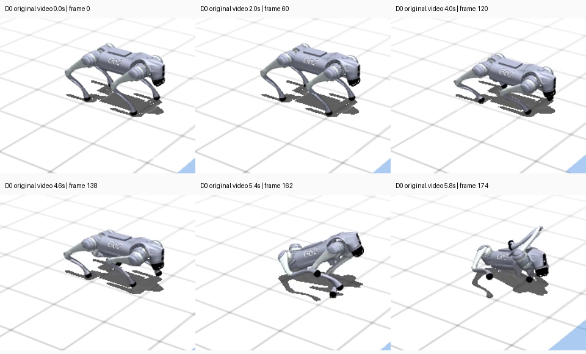
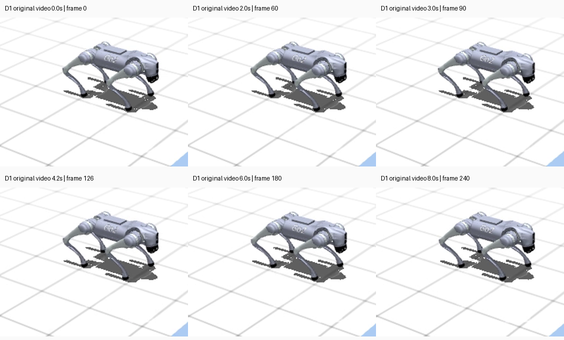
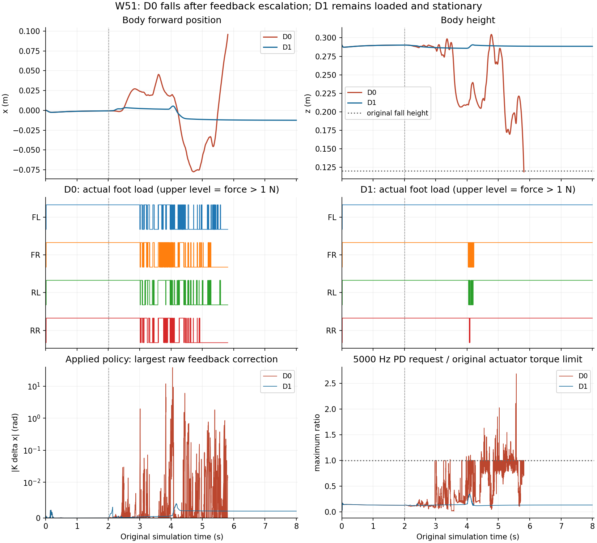

# W51 最终审查：D0 失稳，D1 静站；W52 先修摆动参考的确定性缺陷

审查日期：2026-11-15（Asia/Shanghai）。结果基点：`a621d7d35e6016634b388a3aef0d39d8d008aab0`；上次计划基点：`354b14bf5313332ae167f02c84ce6b68ef6bae90`。本次是已有源码、日志、原始数组和视频的联合审查，没有新物理积分、native solve、FD、GPU 计算或 PPO。W52 尚未实现、尚未启动。

**结论：S1 可以继续推进针对性的控制实验，尚不能宣布稳定行走已经恢复，也不宜直接把 W51 的 r39 当作已选正式控制器。** D0 证明了持续刷新参考仍可能失稳；D1 证明了保住高度可以与完全没有步态同时发生。本轮还独立复现了摆动参考的几何错误：当前相位的连续修正会抵消抬脚，甚至要求足端向地下运动。这是 W52 优先修复的具体对象。

入口：[下一步计划](../../../../../../docs/S1_W52_STABILITY_PLAN.md) · [启动提示词](../../../../../../docs/S1_W52_START_PROMPT.md) · [项目记忆](../../../../../../docs/TERRAIN_MEMORY_PLAN.md) · [机器交接](handoff.json)

## 1. 本轮到底完成了什么

W51 完成了真实 D8 入口、r39 相位感知种子、一次命令布线修正、两个有效诊断臂、全部实际时段视频、GPU 残差归约以及服务器直传。旧首页“D1 仍 running”的内容属于中途快照；实际结果已经结束。

| 尝试 | 实际时长 | 最大身体 x | 最终身体 x / z | 结果解释 |
|---|---:|---:|---:|---|
| D0：r38，只刷新 | 5.814 s | 0.095709 m | 0.095709 / 0.118934 m | 原 `body_fall`；未形成稳定支撑推进 |
| D1：r39，命令修正后 | 8.000 s | 0.005452 m | −0.012449 / 0.288505 m | 正常高度附近静站、轻微后退；D8 观察完成 |
| 第一次 D1：命令槽为零 | 3.120 s | 0.014975 m | −0.000803 / 0.290463 m | 技术无效，定向停止后留档；不能作第三个控制样本 |

两个有效臂都没有进入材料区、没有材料承重、没有合法去程或往返。原 E30 启动数为 **0**，E30/E60/E300/E600 整链仍未运行。D8 的 `qualification.usable=false`；完成 8 s 不产生原任务资格。本次科学选择是 **不从 W51 提升任何版本进入正式阶梯**，原始 `phase/paired-results` 的未选择字段保留为历史记录，当前决策写入本审查及 handoff。

长期研究目标没有变化：重复踩踏的世界材料状态要影响当前加载、落脚和重访。当前仍处于稳定联合控制基线的恢复阶段。R8 刚地 9/9 与 300 s 3/3 是历史能力；不能转移成当前 Go2/TM02/r39 的资格。W34/W35 曾有合法去程，W49 也有完整 30 s 记录，但当前稳定合法材料往返及记忆因果收益仍未建立。

## 2. 视频与全时段日志说明：两种异常都不是正常行走

本次查看了三段新发布视频，按每 6 个原帧取一帧并保留末帧，共 89 个原帧；另外放大了 12 个关键姿态。快速接触、力矩及微小位移依据全时段记录判断，不用抽帧漏掉的瞬间推断“从未离地”。视频时间容器比物理末态略长，详见[视频审查](video-review.md)。



D0 在约 3.6–4.3 s 出现明显下沉与折腿；后段有短暂顶起，并非单调降低；5 s 后失去支撑并倒下。最大 x 的增加主要发生于这段失稳，不能把它看成更好的行走距离。



D1 全段接近原地站立，姿态变化很小，未出现持续交替迈步。4.3–8 s 四足同时承重占比 **100%**，四只脚的载荷切换次数均为 **0**；计划 swing 足仍承重比例也全部为 **100%**，身体反而后退 5.699 mm。前一个运动窗口 2.002–4.3 s 的实际足底最高间隙最大仅约 **0.020 mm**，与 5 mm 的原目标摆幅相差很大。用户对“步态不正常”的判断有原始数据支持。



图中 1 N 是原诊断描述口径；虚线 0.12 m 是原 `body_fall` 高度线。没有新增成功门槛或禁止原许可的短腾空。D0 后期“离地多”伴随身体失稳，不能单凭 swing 受载比例降低判断步态改善。

## 3. 已确认的错误：连续接续公式会取消抬脚并主动下穿

W51 原式在实际足位置/速度的五次接续上叠加：

```text
h_original(t) - H0(u) * h_original(t0) - T * H1(u) * hdot_original(t0)
```

它能匹配当前节点的位置和速度，却没有保证剩余段仍有向上的间隙。当名义相位已经进入上升/下降阶段，而真实足仍在地面上时，减去名义当前高度和速度可以把原来的抬脚曲线抵消为负。数学上的连续与 IK 可达，并不保证步态意图仍然存在。

控制审查完整解析了有效 D1 的 **301 份 IK**，并使用真实足位置/速度、原绝对相位、H0/H1 公式独立重建，最大误差 **2.36e−16 m**。所有目标 x 均在约 `[−0.231,0.307] m`，材料区从 x=0.8 m 才开始；原地面 z=0、足半径 0.022 m。因此这里的负间隙不是材料压陷或地形高程的误读。

| 已有原件的描述统计 | 数量 |
|---|---:|
| 当前 swing 足 × replan 快照 | 650 |
| 已保存的剩余 swing 目标节点全部不高于地面 | 360 |
| 比当前真实初始压入还继续下移超过 1 μm | 362 |
| 已保存目标节点最低间隙低于 −1 mm | 96 |
| 已保存目标节点最深下穿 | −3.570516 mm |

这些是多次重规划快照，**不是 650 次独立摆动或失败**。上述计数依据原件保存的 2 ms 目标节点，不声称已经求出整段连续多项式的所有极值；负目标节点本身足以证实错误。call 128 的 RL/FR 当前段就是具体例子：名义高度约 1.202 mm、名义竖直速度约 0.1044 m/s，而真实足仍落地；接续后最低约 −1.308 mm、最高仅约 0.431 mm。末 call 421 的当前 FL/RR 剩余段也没有形成抬脚，却仍有明显水平移脚意图。

下一轮要删除这种相位误差相减式，改成从真实状态直接接到**固定的原 apex 和 touchdown** 的分段五次曲线。原 2 Hz、duty .45、5 mm、绝对相位、落点与物理保持。不能每 20 ms 把 apex 推迟，不能用 `max(height,0)` 破坏连续性，也不能偷偷把真实负速度改为零。具体不可行边界、极值检查和首个可用窗口写入 W52 计划。

## 4. 候选没有形成可执行步态，不能先怪评分器拒绝好解

301 次 S 均通过原数值有效性检查并实际作了 Q；其中 **299 次 J(S)>J(B)**，只有 2 次较低。直接 S 安装只有 call 216 / 3.900 s 一次。94 次 homotopy 安装里，**92 次发生在 Stand**，运动后只有 call 121 / 2.002 s 和 call 128 / 2.140 s。单看“94 次改进”会掩盖起步后搜索基本停止有效更新的事实。

已读取 D1 的 26 个事件调用、520 个候选；重算 J 与记录最大差约 3.33e−16。S 的早期 native 预测仍四足承重。末 call 421 的 S 在 .35 s 内后退约 **29.476 mm**，最大足底间隙只有约 **22.46 μm**；最佳正候选也仍后退约 29.254 mm。几何目标在未来另一对脚上接近 5 mm，并没有变成相应的实际卸载。

也存在向前的被拒候选，例如 call 220 的某个较大 alpha 预测前移约 84.16 mm，但最低身体 z 约 0.24177 m、J 约 0.79196，而 B 约 0.01533；其他大步候选有过大足高或姿态代价。不能说“所有候选都倒退”，也没有证据证明“正常稳定行走被 J 错拒”。静态去掉 InputReference 只会翻转所读 26 个 S 中的 2 个排序，末 call 421 仍不能战胜 B，故不先降权或强制接受差 S。

另有结构性问题：r39 只在 S 附近做一个方向族，B 仅保留作接受底线。**保留 B 与继续优化 B 是不同操作。** W52 的次级 D3 对照可在相同几何修正上恢复 B/S 两个独立方向族，以实际额外计算换取搜索覆盖；它不是稳定性保证，D0 已证明 B 路径也会失稳。D2 是主要几何修复，D3 不设额外资格门槛。详见[控制审查](control/review.md)。

## 5. D0 与 D1 的参考生命周期不同

D0 全部 2,907 个实际 held 查询都没有真正越过 reference 尾部；它确实不断刷新。D1 最后刷新 reference/K/H 来自 call 128 / 2.140 s，区间 `[2.140,2.490]`；最后 policy generation 却在 call 231 / 4.200 s。到 8 s，policy 年龄为 3.8 s，reference 已过期 **5.51 s**。2.492 s 开始出现真正尾部查询，共 2,755/4,001；其中末次 8 s 查询没有后续积分，实际积分口径为 2,754/4,000。

不能把 `covers=false` 全当过期，float32 RPC 时间在 reference 起点有微小舍入误差。本审查使用原物理时钟去除这一歧义，没有修改控制规则。

D0 的异常时间链为：2.976 s 首 QP 投影；3.016 s 首目标限位硬裁剪及 1.968 rad 反馈修正；3.170 s 首 z<.28；3.4614 s 首明显 PD 超界（超过边界 .01 Nm）；3.564/3.588 s 首 z<.27/.25；4.050 s 最大 raw Kδx 37.867 rad；5.2304 s 首非足承重；5.814 s 跌倒。最初 2.976 s 的物理 PD 超界只有 8.39e−7 Nm，不能当作明显饱和。

全程目标硬裁剪 **648 次**，QP 改写 **627 次**；包含两者的总动作改写为 **708 次**，不能混为一种计数。原 PD 超界口径为 1,557/29,070 子步，其中超过 .01 Nm 的 996、超过 1 Nm 的 619。这些是尚未饱和限幅的 PD 请求；实际 actuator_force 始终在原力矩范围内（最大限幅比 1.0）。D1 这几项为零，但没有行走。时序支持动作异常与失稳相伴，**尚未单独隔离 D0 最初异常的动力学/反馈原因**，不能由后来的 37.867 rad 极值反推最初根因，也不先凭此添加任意 K 裁剪。

## 6. 为什么失败很多，哪些不该再归为一类

本轮账目是：**3 次 D8 启动 = 2 个有效诊断 + 1 个技术无效尝试**。两个有效臂中，1 个物理跌倒，1 个观察完成但未实现运动目标。正式 E30 启动为 0，不能重复把 W50 的八个 blocked/unrun 算成本轮八次失败。

首个 D1 的 mission 命令非零，但 userdata[78:84] 未填，S 使用了零世界速度。执行端定向停止其独立 server，随后日志里的 Connection refused 与这次停止吻合；这不是已证实的随机网络掉线或到点 kill。修正后的 D1 从原 t=0 重启一次，D0 连续保留。本轮所有后台无固定 wall deadline。

反复失败的主要背景是：局部评分改善、参考刷新、几何可达、实际支撑交换、完整路线资格是不同层次。前几层改进不能自动替代后几层。外层固定 PPO 的 2 Hz scalar cap 也没有直接调节哪只脚卸载、支撑力或快速关节恢复的权限。当前两臂还没接触材料就出问题，不能全部归因于 PANN 或材料模型；也不宜先增加 PPO 样本来掩盖低层起步问题。

## 7. 工作量、并行与 GPU 的真实程度

| 记录口径 | 两个有效臂 | 含技术 D1 |
|---|---:|---:|
| planner 完成调用 | 732 | 909 |
| native full rollout | 14,341 | 17,647 |
| transition FD | 2,673,288 | 3,281,904 |
| risk geometry FD | 598,194 | 726,082 |
| plant 子步 | 69,070 | 84,670 |
| 新 PPO / donor / GPU 物理 | 0 | 0 |

只求和已完成且留存的调用；中断时尚未写出的在途工作未知。D0 与技术 D1 重叠 536.508 s，D0 与有效 D1 重叠 332.682 s；CPU 双任务重叠合计约 **14.49 min**。C 仅与前一对重叠 .924 s，不能称为持续三重满载。W51 没有持续 CPU 利用率、核时或整卡 GPU 利用率记录，affinity 10+10+2+3 不等于实测占满。

D0/D1 每 1 s 仿真分别消耗约 **161.29 / 155.94 s 墙钟**，仍是离线 MPC。50 Hz planner、500 Hz hold、5000 Hz 物理是逻辑时钟，不是已经达到实时速度。

C 完成了 FP64 CUDA 的 114×176×113 残差、22 项成本归约，J 最大误差 5.82077e−11，6 组各 361 次内部比较全部一致。GPU 为执行记录中的 RTX PRO 6000 Blackwell Server Edition；torch 峰分配 **45,561,344 B ≈43.45 MiB**，归约 .1040 s、脚本 .9235 s。它没有迁移 native 接触求解、完整残差生成或 FD，未实现整条 GPU MPC。state 重建仅 3 个实际活动纯项；6 个 Stand 项在 Trot 下为零不算覆盖了活动分支，MaterialSupportHeight 仍有 9.01e−6 残差误差，另外 12 项未重建。

W52 的 CPU 配置继续以可用资源为准：两重任务各 10 核、C 2 核、系统/主控/其他任务约 3 核，线程库 1、构建先完成且最多 -j6。第三线只做有明确缺口的材料支撑高度重建与已有候选代数工作，不为填满 96 GB 重复批量或多训 PPO。最终 native 评分与执行仍为依据。

## 8. 文献的有效借鉴与下一步

[五篇一手文献对照](literature.md)分别说明：ROM-guided CI-MPC 将几何参考交给动力学优化并输出一致的 q/v/力矩；Perceptive NMPC 将摆动力、支撑足速度和接触事件纳入执行链；Reference-Free MPC 也仍有接触安排；全局采样加局部接触优化保留多起点探索；RL-augmented MPC 的动作权限远多于 scalar cap。它们支持“几何参考必须落实到受力与动作”，不支持把论文成功迁移成本项目资格。

下一步主实验 D2 只修确定的摆动几何错误，暂不同时改变 PD、权重、步高、horizon、PPO 或完整求解器。可用第二组资源时并行 D3，使用相同曲线加 B/S 两个独立方向族；其预算增加需单列，主要方案仍优先 D2。D2 按原规则自然结束 D8、完整读完实际轨迹后，若已有持续正常支撑推进，不需等 D3 也通过才能冻结 D2 并进入原 A/B E30；任何时刻最多两个重 native job。

只有新闭环确有实际卸载、落脚、持续推进、正常承重，才进入原 A/B E30，随后逐 case 按 E30→E60→E300→E600 推进。几何修好但 native 仍四足承重，应交代“几何修复成立，但该种子尚未实现预期卸载与支撑交换”，而不是继续调权追一次幸运成功。后续需要的支撑力重分配/状态速度力矩一致性，必须由新实际记录确认，不能先写成已实现。

## 9. 阅读和交付边界

相对前次计划新增/变化 **52 个文件、51,178,658 B** 已完整读流；其中 30 个 JSON 全解析。实际下载本轮必要原件 **15 个资产、2,532,967,906 B**，解包 **2,653 个成员、2,769,219,396 B**；包括三条尝试全时序、301 份 D1 IK、所需候选事件和三段视频。未声称下载所有历史 Release 或逐字语义理解所有数字。

本轮 GitHub 两个 Release 共 **38 个资产、8,470,903,356 B**；live API 的状态、size、digest 均与已提交 manifest 相符。没有重复全仓 SHA 扫描。已发布服务器原件保持引用，不复制大型原件入 Git，也不在用户电脑额外归档。

[阅读清单](read-coverage.json) · [远端核验](remote-verification.json) · [结果独立复算](results/review.md) · [控制独立复算](control/review.md) · [复现图表脚本](make_figures.py)

下一轮 **deadline=null、wall_deadline_enabled=false**，省略 deadline-unix；不设置固定墙钟完成时刻，不因对话结束杀后台。物理任务时长、原失败条件、数值/资源错误、用户停止与有限科学工作量仍保留。紧凑 Git、必要原件与视频从服务器直传 GitHub；远端核验后结束交付。
