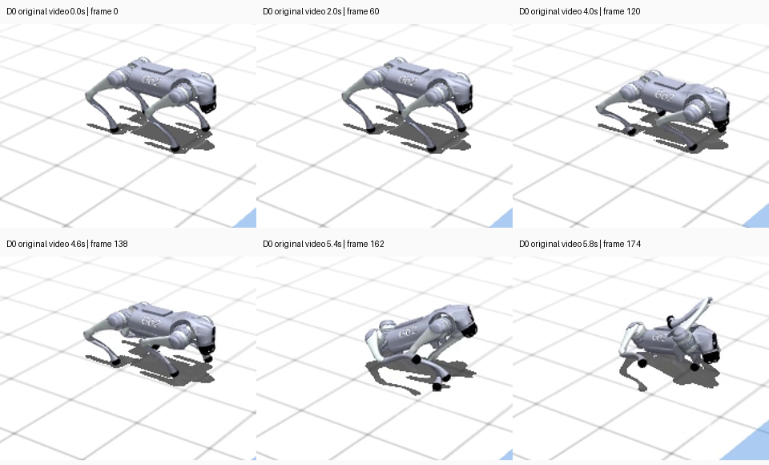
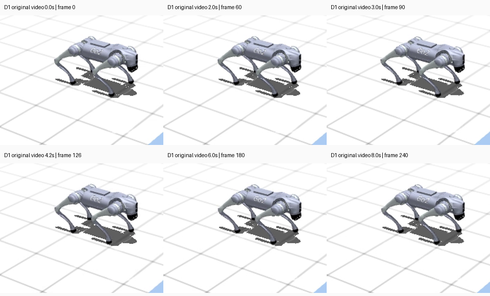

# W51 三段原视频与日志对照

结果基点 `a621d7d35e6016634b388a3aef0d39d8d008aab0`。视频来自[本轮 paired-D8 Release](https://github.com/kaiwen123-yang/MCP-RL/releases/tag/tm-s1-go2-local-readiness-r12-w51-paired-D8-part01)，没有重新模拟或补造缺失时段。

## 视频身份与查看范围

| 原视频前缀（后缀均为 full-mission-material-overlay.mp4） | 分辨率 / 帧率 | 原帧数 | 容器时长 | 对应实际物理结束 |
|---|---|---:|---:|---:|
| w51-job-20261115T112019Z-w51-d0-eval-PANN_PPO_S5-s1-D8-attempt01 | 1280×720 / 30 fps | 176 | 5.866667 s | 5.814 s |
| w51-job-20261115T113036Z-w51-d1-command-repair-eval-PANN_PPO_S5-s1-D8-attempt01 | 1280×720 / 30 fps | 241 | 8.033333 s | 8.000 s |
| w51-job-20261115T112019Z-w51-d1-eval-PANN_PPO_S5-s1-D8-attempt01 | 1280×720 / 30 fps | 95 | 3.166667 s | 3.120 s |

每 6 个原帧提取一帧并额外保留末帧，D0 / 有效 D1 / 技术 D1 分别 31 / 41 / 17 帧；7 张按顺序排列的接触表全部查看，共 89 帧。再看 D0、有效 D1 各 6 个机器人近景。此方法不是逐帧检查全部原视频，故脚的瞬间接触与抬脚量以 500 Hz 轨迹及 5000 Hz 物理记录核对。容器多出的结尾帧不算延长任务物理时间。

## D0：下沉、短时顶起和倒下，不能把最后前移当作走起来

0–2 s 站立姿态正常，身体约 0.29 m。2 s 后仍未出现清楚持续的对角支撑推进；到 3.6–4.3 s 可见明显降低和腿部折叠。4.3–5 s 有短暂顶起，随后重新失去支撑；5.4 s 身体倾斜、腿姿失去正常支撑关系，约 5.8 s 已倒下。视频以原 `body_fall` 结束，没有补齐为 8 s。

日志对齐：3.588 s 首次 z<.25 m；4.3 s z=.215608 m，后又抬高；5.2304 s 开始非足承重>1 N，5.814 s z=.118934 m 触发原高度终止。4.3–5.814 s 的身体 Δx=+117.271 mm 与此失稳过程重合。视频采样下出现“脚离地”不能判作合格 swing：该窗无足>1 N 占比 68.07%、非足承重占比 10.29%，且实际足水平速度已很大。

## 有效 D1：保住姿态却没有持续走路

0–2 s 与 D0 的原物理数组相同。2 s 后机器人仍大体保持原位置；3–4.2 s 可见非常小的身体调整，后半段基本维持同一姿态，蓝色材料块始终未接近到可加载位置。最后 8 s 仍站着，不代表路线任务已完成。

日志对齐：最低 z=.285769 m、最终 z=.288505 m，最大 x=.005452 m、最终 x=−.012449 m。2.002–4.3 s 目标 swing 受载约 94.89–100%，足底最大间隙约 .020 mm；4.3–8 s 四足持续承重、四足载荷转换均为 0，足水平速度约 .1–.2 mm/s。不能把它描述为已经形成正常的交替步态。

## 技术 D1：身份和停止原因决定其用途

这段视频也接近静站，最后停在约 3.12 s。对应 userdata 命令槽未填充的首尝试，执行端定向停止了该 native server。它可证明技术尝试实际发生及已保留记录，不能与命令修正后的 D1 混合计算效果、不能当成第三个独立 seed，更不能用容器结尾判断一次自发网络故障。

## 对“是否越来越不稳定”的准确回答

视频证实当前没有正常行走。不同版本的异常形态在变化：W49 有低伏挪动，W51 D0 是参考持续更新后的失稳，W51 D1 是维持高度但静站。它们的控制机制与任务窗口不同，不能把视频观感拼成一条统计意义的单调退化曲线。当前最值得修复的是已证摆动参考下穿，以及几何意图到 native 卸载的失配；“不倒”与“持续正常行走”应分别报告。

本文件和[物理/反馈图](figures/w51-physical-feedback.png)由原件生成。[make_figures.py](make_figures.py)保存提帧及图表方法；末图 ratio>1 指未限幅 PD 请求超过原执行器力矩范围，实际 actuator_force 仍经原饱和限幅，并非执行力矩突破约束。图片只做裁剪、放大和时间标签，没有改机器人姿态或补造动作。
