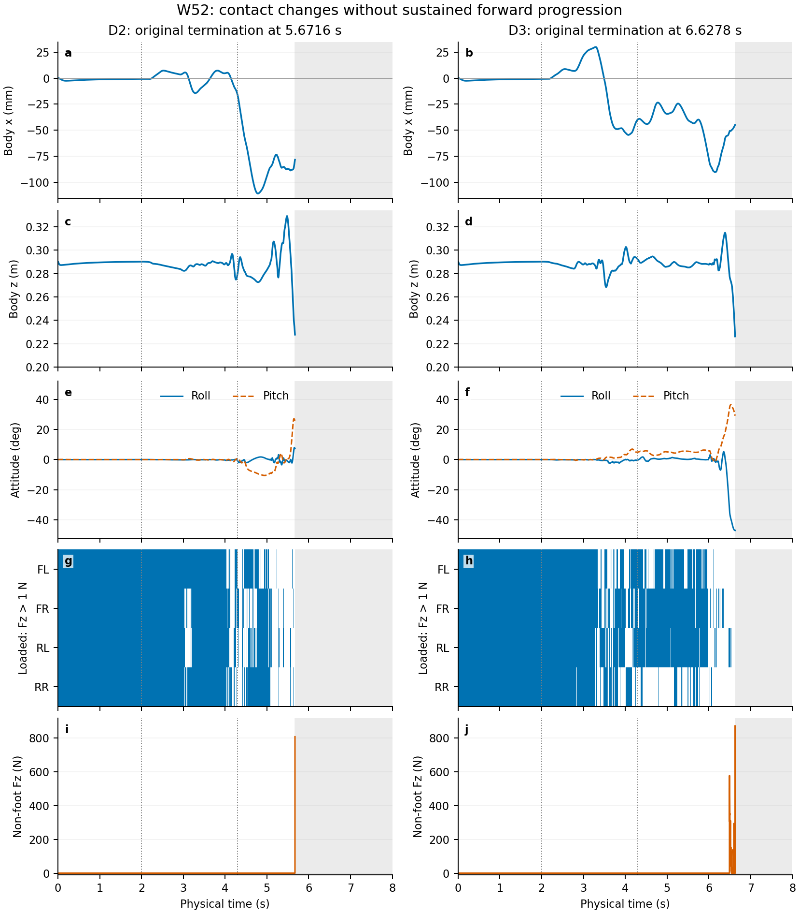
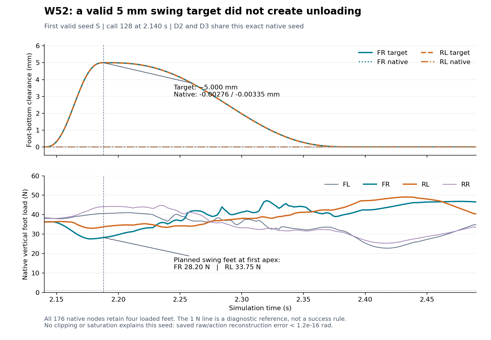

# W52 全面复核：几何修复完成，稳定行走仍未建立；W53 改为两个完整运动内核

审查日期：2026-11-16（Asia/Shanghai）。最新结果基点：[`5e036c6918ae72bb795c4b1b5be08c1e109ade32`](https://github.com/kaiwen123-yang/MCP-RL/commit/5e036c6918ae72bb795c4b1b5be08c1e109ade32)。

**结论：W52 没有选出能够持续正常行走的控制器，S1 尚未完成原材料任务。下一轮可以推进，但应停止围绕旧支撑策略添加局部几何增量，改为并行恢复完整 R8 运动基线和建立独立接触力 MPC/WBC。** 本次只做仓库、原件、视频、控制代数与论文审查；没有启动 W53 物理、native solver、FD 或训练。

[下一轮完整计划](../../../../../../docs/S1_W53_STABILITY_PLAN.md) · [Codex 启动提示词](../../../../../../docs/S1_W53_START_PROMPT.md) · [机器交接](handoff.json) · [精确结果复算](evidence.json) · [控制代数](control-algebra.json)

## 1. 实验走到哪一步

| 能力层 | 当前证据与结论 |
|---|---|
| 可执行的实验系统 | 真实 plant/native、因果观察器、冻结 PPO、完整轨迹与原件发布已运行；W52 两个有效物理任务没有技术重启 |
| 原始刚地运动能力 | 历史 R8/S3 原任务 9/9、连续 300 s 3/3 成功；来源可恢复，但不是当前版本的材料资格 |
| 当前正常步态 | W52 D2/D3 在进入材料前就失稳；持续行走尚未恢复 |
| 当前原 E30 | W52 启动 0；D8 不具资格。最近完整 E30 的 W49 两例也未通过原任务 |
| 合法完整材料往返 | 尚无稳定成功证据；不能把侧绕、低位挪动、训练中原始圈数等同合法完整往返 |
| 材料记忆收益 | 尚未建立；首先缺少稳定跨足/返程重复加载任务，候选也未完整传播未来材料内态 |
| GPU 与实时 | 成本局部重建有进展；没有完整 GPU MPC，也没有 NX 实时或实机资格 |

这不是“所有工作都白做”。现在能够精确核查每次实际选中的政策、目标、力、执行与失败时刻，排除了一批错误解释。但**工程可观测性和局部优化正确性进步，没有转化成原任务成功**。继续按“再修一个局部量，然后重做同一类短任务”的方式推进，收益已明显降低。

项目长期身份仍是“面向重复踩踏的四足机器人地面记忆辨识与跨步协同控制”。稳定完整任务是基础，之后才是 RAW/PANN、冻结或打乱历史、跨足与返程收益、泛化和 Go2/NX。当前 2 Hz PPO 只输出 .18–.25 m/s scalar cap，没有逐足卸载和支撑力分配权限；不能把本轮底层步态缺陷默认交给继续训练解决。

## 2. W52 实际结果：两次物理负结果，不是八次失败

| 指标 | D2 / r40：修正几何 | D3 / r41：相同几何 + 独立 B/S 搜索 |
|---|---:|---:|
| 原物理结束 | 5.6716 s | 6.6278 s |
| 真实原因 | floor–trunk geom13 非法接触 | 相同 |
| 最大 x | +7.332 mm | +29.941 mm |
| 最终 x | −78.349 mm | −44.903 mm |
| 最终身体 z | .227781 m | .226264 m |
| 2.002–4.3 s 净位移 | −15.757 mm | −39.063 mm |
| 同窗四足同时承重比例，时间加权 | 81.897% | 60.052% |
| 几何及 native 有效 S / moving call | 23/184，12.50% | 24/232，10.34% |
| 实际 held 查询 / 真正参考尾部过期 | 2,836 / 0 | 3,314 / 0 |
| 实际材料加载 | 0 | 0 |
| full native rollout | 5,812 | 6,989 |
| 原 E30 启动 | 0 | 0 |

来源：[原 paired-results](../../w52/paired-results.json)、[phase](../../w52/phase.json)、本次全部实际时序的[独立复核](evidence.md)。两臂是同 seed1 的机制比较，不是独立随机种子重复实验；不能由这两个样本估计一般失败概率。

D3 多存活 .9562 s，但身体高度、QP 与 clip 异常反而更早出现；它没有建立正常推进，不能被选为“更稳版本”。W52 共两次真实物理启动、零技术物理重启、两次非法接触终止；后续 E30/E60/E300/E600 未运行，不能累计成八次失败。23/24 个有效 S、数百次接触开关、数百万次 FD 也都不是独立物理失败次数。

**这轮后台没有固定墙钟 deadline。** phase/job 已是 deadline=null、wall_deadline_enabled=false；本次停止发生在原物理非法接触规则，不是到点被杀。后续继续维持无墙钟截止，而原任务的 30/60/300/600 s 物理观察长度仍保留。

## 3. 视频与日志对应起来看

本次主审查看了已发布密帧页中的全部 372 帧：D2 的 0–171、D3 的 0–199；也取得两条原 MP4。视频展示与原 500 Hz 状态、5000 Hz 接触/力矩逐段核对。

| 时段 | 视频可见行为 | 日志含义 |
|---|---|---|
| 0–2 s | 两臂基本保持初始站姿 | 原 Stand，不能当运动成功 |
| 2–4.3 s | 起点附近微小前后移动，未形成持续交替前进 | 正向命令积分约 .466/.464 m，但实际分别后退约 16/39 mm；计划摆动腿大多仍受载 |
| D2 4.3 s 后 | 后退、身体起伏；约 5.2 s 后明显支撑失序，末段俯倒 | 后窗无足>1 N 占约 39.63%，大量接触切换伴随姿态失稳 |
| D3 4.3–6.2 s | 抖动与前后移动，仍未穿越材料 | 后窗两对角支撑明显不对称；不能把四足载荷比例降低等同正常步态 |
| D3 6.2–6.63 s | 明显扭转、侧滚，躯干触地 | 物理非足力与原非法接触终止对应 |

早窗多数卸载段的中位长度仅 2–5 ms，而原计划摆动约 .275 s；接触开关次数很多，主要不能解释为完成了很多正常步。后段确有较长离地与抬足，故也不能说全程从未抬脚；问题是离地没有形成与身体支撑、前进相协调的步态。

[D2 原视频](https://github.com/kaiwen123-yang/MCP-RL/releases/download/tm-s1-go2-local-readiness-r12-w52-paired-D8-part01/w52-job-20261116T110800Z-w52-d2-eval-PANN_PPO_S5-s1-D8-attempt01-full-mission-material-overlay.mp4) · [D3 原视频](https://github.com/kaiwen123-yang/MCP-RL/releases/download/tm-s1-go2-local-readiness-r12-w52-paired-D8-part01/w52-job-20261116T110800Z-w52-d3-eval-PANN_PPO_S5-s1-D8-attempt01-full-mission-material-overlay.mp4) · [全部原件 Release](https://github.com/kaiwen123-yang/MCP-RL/releases/tag/tm-s1-go2-local-readiness-r12-w52-paired-D8-part01)

### 末端采样有一处必须说清

runtime 提前终止时追加的末行只更新 time/qpos/qvel/rpy，其足力和诊断量继承上一控制时刻。D2 末 time 为 5.6716 s，diagnostic_time 仍是 5.670 s；最后物理力评估 5.6714 s 已出现约 808.68 N 非足力。因此 500 Hz nonfoot 列全零与最后躯干触地并不矛盾。原 result 已记录这个例外；本次按全物理 stream 判断碰撞，窗口时间积分也没有给末复制诊断新增权重。

## 4. 这次最关键的新定位：几何目标不是完整运动控制命令

### 4.1 已修掉的几何错误没有解决实际卸载

W51 曲线相消问题真实存在，W52 的直接曲线修复也真实生效。两臂最早有效 S 都在 call128 /t=2.14 s；固定 apex 邻近节点 2.188 s，FR/RL 几何目标均为约 4.99995 mm，native 足底却仍为 −2.76/−3.35 μm，法向力约 28.20/33.75 N。整个 .35 s、176 个 native 节点四足都承重，最小单足力仍有 22.75 N；这不依赖 1 N 诊断阈值。

### 4.2 完整保存政策给出了精确解释

当前 S 实际按以下方式构造：

$$
c_S(x,t)=c_B(x,t)+q_{IK}(t)-q_{B,\mathrm{native}}(t).
$$

B 的完整 reference states/actions、K、H 都被保留。对于 S 的实际轨迹，这等于新 IK 角，加上原闭环的支撑输入偏置，再加旧反馈对新轨迹的响应。保存数组可复原 B/S 的实际最终动作，整段最大误差均为 **1.11e−16 rad**，所以这里没有被 ctrlrange clip 或 QP 改成另一种输入。

在第一 apex，选两条计划摆动腿的 calf 分量：

| 控制量 | FR | RL |
|---|---:|---:|
| 几何输入增量 | −.028178 rad | −.029048 rad |
| 原 B 闭环支撑输入偏置 | +.084310 rad | +.084419 rad |
| 旧反馈对新轨迹的额外响应 | +.004277 rad | +.005562 rad |
| 最终输入相对 IK 角的差 | +.088587 rad | +.089981 rad |
| 实际 native 载荷 | 28.205 N | 33.747 N |

K 的额外响应约抵消 15%/19% 的几何增量，不能说“K 把全部抬腿抵消”。更大的保留量来自旧支撑闭环中心。也不能直接删掉 .084 rad：PD 本来需要输入与实际关节角之间的偏置来产生支撑力矩，qIK 本身不是完整动力学输入。

**证据支持的是：当前实现仍以旧支撑闭环为中心做输入增量，没有同时生成新的卸载、其他腿支撑和身体动态计划。** 这是足以改变下一轮范围的结构问题；它并不证明去掉某项偏置或单独重算 K 必然走稳。[完整控制源码与代数审查](control.md) · [可复算脚本](control_algebra.py)

IK 的身体轨迹也另行假定按命令速度匀速前进。call128 实测 vx 约 −.001218 m/s、当时任务斜坡命令约 +.070527 m/s；足端位置 IK 收敛，并不使这种身体、关节速度和接触力组合自动动态可行。

### 4.3 双方向和增加计算量为什么没有扭转结果

D3 确有独立 workspace 与同 epoch 两组方向。原件证实两臂相同 S 及九个 S-positive 逐值相同，D3 新增的 B-positive 与 S-positive 有真实差异。完整 D3 branch 日志中 309 次只有 B、24 次有 B/S，first-valid 均成功；主要时段 S 本来就不可用。

因此 D3 不是没执行，也不是 backward 技术失败。增加局部方向并没有自动创造协调的接触运动。当前没有证据证明比较器拒绝了一个已经正常稳定向前的候选，故不把“强制接纳”或“先降某个权重”列为下一主方案。

### 4.4 后期反馈、裁剪和饱和是重要现象，但先后关系要准确

| 事件 | D2 | D3 |
|---|---:|---:|
| 最早有效 S 仍未卸载 | 2.14 s | 2.14 s |
| body z 首次低于 .28 m | 4.230 s | 3.494 s |
| QP 首次改写 | 4.262 s | 3.582 s |
| ctrlrange 首次 clip | 4.268 s | 3.594 s |
| PD 请求超界>.01 Nm | 4.2778 s | 3.6204 s |
| Kδx 最大值 | 5.36 rad @5.070 s | 180.96 rad @5.992 s |

实际 actuator force 仍被原力矩限幅。第一有效 S 距力矩上限的最小余量约 19.90 Nm；不能拿更晚出现的大 Kδx 极值解释最初为何不卸载。命令 readback 正确、真正尾部过期为零、材料从未受载也已排除了相应主解释。

## 5. 为什么总感觉每轮只解决一点

一方面，过去各轮确实修正了命令接线、StateDiff、导数写所有权、策略原点、alpha0、参考年龄和几何接续等问题。这些修复有具体证据，不能倒说无用。另一方面，验收经常停留在“数组正确、J 下降、候选合法、短时间不倒”，而任务需要的是从命令一直到身体/接触运动的完整可执行闭环。

W52 用 12,801 次 full rollout、2,472,984 次 transition FD、538,266 次 risk FD，仍没生成稳定前进。问题已不是再增加一点同类搜索预算就有充分依据解决。当前论文式改进与实现层补丁逐渐叠在一起，历史真正走稳的完整运动基线反而没有在当前任务外壳中作为清楚对照。

W53 因此改变研究单位：**一条完整恢复运动内核，一条完整受力与运动协调内核；各用一次原 E30 得到包含起步、材料和任务推进的信息。** 不再加一个 D8 前置轮次，不重复旧 9+3 矩阵，不把本轮终点限定为又一个几何函数正确。

## 6. 文献如何落实到下一步

[文献核查与具体取舍](literature.md)给出一手原文和官方代码链接，重点不是列更多算法名。

- MuJoCo 全身 iLQR 论文在 Go2 等平台展示 joint-target PD 与完整状态反馈可工作；对本项目最直接的启发是先恢复作者完整运动内核，核清接触、积分、代价与执行，而不是默认 MuJoCo/iLQG 这条路线整体不可行。
- MPC + WBIC/WBC 明确把支撑力、摆腿任务、身体动态和完整关节命令接起来，直接针对目前的表达缺口。
- Perceptive NMPC 在执行层处理计划接触与实际接触不一致；全身逆动力学 MPC 则把 swing 零规划力和 stance 运动/摩擦约束写进同一问题。它们都不能直接证明本项目软材料的 stance 约束或 PD 接口已适配。
- 新的双空间采样 MPC 同时搜索关节位置与速度，说明搜索空间的动态表达很关键；但本轮不再额外启动第三个物理控制族。
- CusADi 支持把真实模型函数/矩阵批量放到 GPU；端到端收益仍取决于问题结构和数据传输，不能用已保存残差求和替代完整 GPU MPC。

## 7. 25 核与 96 GB：并行可以更有用，不能只看资源配额

| 实际资源 | D2 | D3 |
|---|---:|---:|
| user+system CPU 秒 | 5,874.11 | 7,230.10 |
| 对应 stage 墙钟 | 1,239.97 s | 1,573.00 s |
| 全阶段平均等价 CPU 核数 | 4.737 | 4.596 |
| 占各自 10 核额度 | 47.37% | 45.96% |
| native 调用墙钟和 | 699.43 s | 872.69 s |
| 现有命名计时外墙钟 | 508.67 s | 664.50 s |
| 该未归因部分占总 eval 墙钟 | 41.38% | 42.56% |

相同 PID 树的 /proc 差分也得到约 4.809/4.647 核，支持平均资源没有吃满。但不能据此认定 native 热阶段也只用了半数 worker。几乎逐 call 保存全 candidate ring，648 个 NPZ 共 **20.918 GB**，两臂原件约 25.084 GB；提取/压缩/序列化位于部分已有计时之外。记录开销值得解决，但所有未计时墙钟不能都算成 IO。

下一轮保持两条实际控制任务并行，第三线做服务 F 的 GPU 模型/约束装配；随正常任务分段记录 CPU 与 wall，不额外跑满载实验。新的记录协议保留全部实际物理、每次实际安装的完整政策/轨迹和关键候选，精简普通非赢家全数组的重复写入，并明确由此产生的事后分析边界。历史原件保留。

W52 整卡采样峰显存 1466 MiB、利用率最高 2%；C 约 2.11 s，在两条 CPU eval 前已结束，不能称持续三路满载。现在已有的 GPU 路径不具备让 96 GB 对当前全部 CPU native/FD 自动提速的能力。W53 C 改做真实 Go2 模型与 MPC/WBC 矩阵批量计算，衡量包含传输的收益；若小问题没有在线收益就如实结论，不继续重复计算来填显存。

## 8. 下一轮具体产出与推进条件

N 恢复完整 R8/S3 运动语义，但接当前 TM02/冻结高层政策，是新的材料未知适配基线；F 独立实现接触力 MPC + WBC，通过原 PD60/5 表达完整 q_d/v_d/tau_ff。F 固定 2 Hz、duty .60、3 cm，给每半周期 50 ms 四足重叠；这与 N 的 .45 软 gait 含义不同，不能说是等步态消融。新 .20 s 摆动曲线与同一接触表一致生成。

首轮预声明 N/F 同 seed1 各一次原 E30，先就绪者先跑，保留真实物理提前终止；若技术未就绪就如实未运行。原任务标准不变。若 N 达到原 E30 和持续正常推进条件，优先选 N；N 原 E30 失败或已明确技术阻塞/本轮实现终止而无可用结果，且 F 达到条件，则选 F；N 正常构建或运行不算失败，技术未运行与物理失败分账。所选同一 case 的此次 E30 直接作为 E60 前序，不额外重复。另一个槽开所选 seed2 E30；两个 case 各走原 E30→E60→E300→E600，互不借资格。两首轮均失败就交各阶段真实负结果，不临时再生一个控制族。

这不能保证下一轮一定完整成功；F 是真实控制工程，材料仍有未验证部分。但它会使下一轮的结论更有决策价值：恢复旧完整内核是否能重新走；显式力控制是否能解决卸载；若行走已经恢复，真正的下一障碍是否位于材料、掉头或返程。不会只得到“又改好了一个局部函数”。

后台继续无固定墙钟结束时间；GitHub 发布核实后不在用户电脑做额外下载/复制/打包/归档。服务器被引用原件和学习状态保留。完整实施细节、资源、记录和条件已写入 [W53 计划](../../../../../../docs/S1_W53_STABILITY_PLAN.md)。

## 9. 阅读范围与未覆盖项

本次核对上轮计划提交至最新结果的 55 个变化路径，30 个 JSON 完整解析，共 70,672,306 B；重点源码、配置、执行/记录/发布入口与历史 R8 恢复来源由三条独立审查交叉读取。原件定向读取 56 个成员共 270,823,967 B，覆盖两臂完整 6,152 行 trajectory、61,497 物理步、656 planner calls、held/seed/分支/资源记录、全部材料块、原视频及关键候选/完整政策对象。另读取已发布的 13 页密帧图，主审查看所有 372 帧。

没有声称下载并逐字理解全部约 25 GB W52 原件，也没有重新下载所有历史 Release。全部 47 个有效 S 的总体统计读取自本轮已发布完整分析；本次独立原数组核查集中在 call128、call230 与实际全时序，call128 另有完整 B/S/IK/context 和精确代数。没有把缺少的普通候选补零或用新 rollout 补证据。见 [阅读清单](read-coverage.json)。

原始数据与历史结论不改写。审查代码只读保存数组，图也来自原始记录；此次新增工作不会被计为新物理实验、训练样本或 W53 任务成功。
