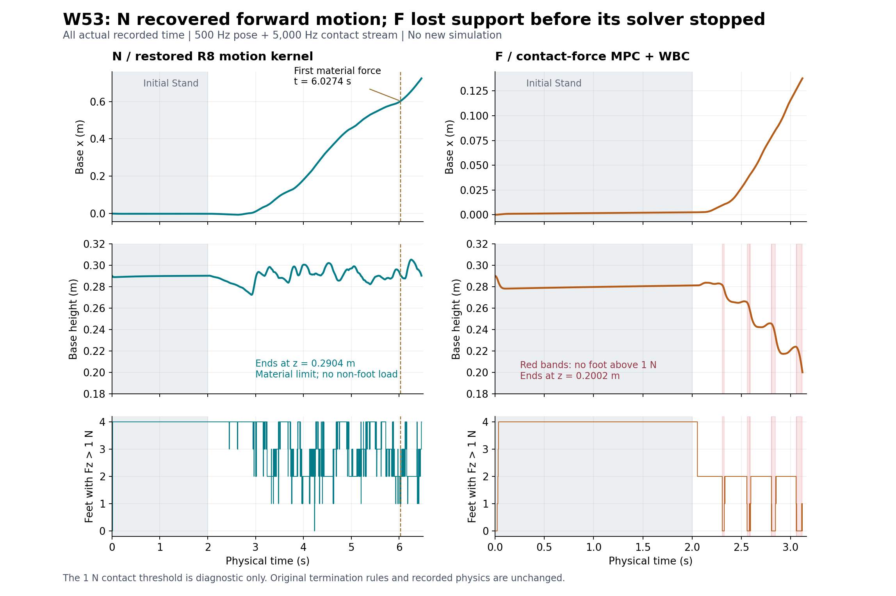
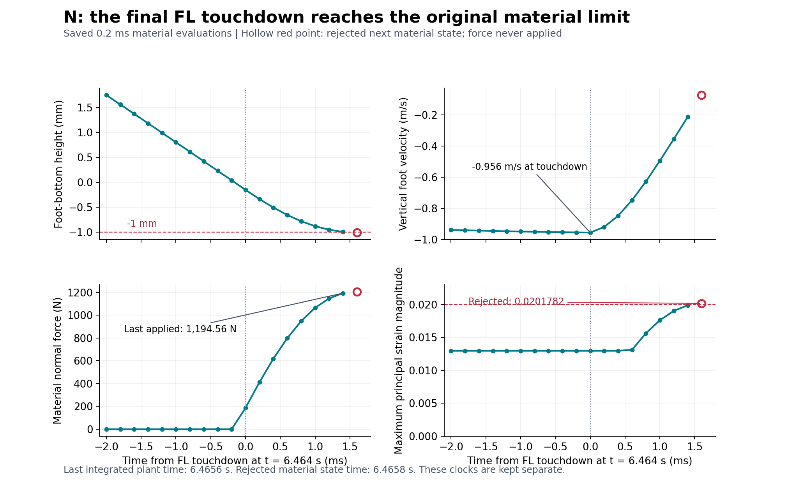

# W53 完整审查：已恢复短段行走，材料落足与承载交接仍未闭合

审查日期：2026-11-17（Asia/Shanghai）。原始结果提交：[`c01ed82d241b559e4d6c798f06bb0483c622b422`](https://github.com/kaiwen123-yang/MCP-RL/commit/c01ed82d241b559e4d6c798f06bb0483c622b422)。本次完成仓库/历史/原件/视频/文献审查及 W54 计划发布，**没有新增物理、native rollout、FD、QP 重解或训练，也没有声称 W54 已实施**。

**可以继续推进实验，而且故障已具体到可实施的控制问题。S1 目前仍处于“恢复原任务所需的稳定运动与材料接触”的阶段：N 的短段行走恢复了，原材料 E30 仍 0/2，完整合法往返、长程可靠性和材料记忆收益尚未成立。** 不能用“再多跑一点 PPO”或“把 GPU 用满”替代当前的接触与执行修复。

[下一轮完整计划](../../../../../../docs/S1_W54_STABILITY_PLAN.md) · [Codex 启动提示词](../../../../../../docs/S1_W54_START_PROMPT.md) · [机器交接](handoff.json) · [W53 原始结果](../../w53/paired-results.json) · [W53 原执行状态](../../w53/phase.json)

## 1. S1 到了什么程度

| 能力层 | 现在有的证据 | 还没有的证据 |
|---|---|---|
| 完整工程执行 | 原 plant、MPC/新 F、冻结 PANN/PPO、执行器、500/5000 Hz 记录、视频与 Release 已实际走通 | 工程跑完不等于任务通过 |
| 真实运动 | N 恢复实际卸载、离地和持续向前，最大 base x=.723845 m | 当前版本长程稳定；F 仍在材料前失去支撑 |
| 材料接触 | N 前足有 .4382 s 实际材料受载，24 个曾加载地块 | 整条材料穿越、后足接续、回程和合法往返 |
| 原任务资格 | N/F 各真实启动一次原 E30 | E30 通过为 0；seed2、E60/E300/E600 都未启动 |
| 材料记忆研究 | 因果 observer、历史训练、世界地块状态和记录链仍保留 | 这轮 cross-leg revisit=0、return=0，无法评价跨足/返程记忆收益 |
| GPU | C 有部分 FP64 模型/矩阵对照 | 完整 MPC/WBC/材料动力学迁移与在线收益 |

不能把 S1 给成一个百分比：实现覆盖、能走、完整任务、泛化与因果收益是不同维度。当前最重要的能力缺口是合法可持续材料行走，后面的记忆研究仍有清楚的入口，但不能跳过这个基础。

历史也不能抹掉。R8/S3 的刚地原任务 9/9 与连续 300 s 3/3 是真实恢复依据；R9/R10 的材料完整任务为 0/8、0/9；R10 GNC-r3 曾到 32.5672 s 回程，W34/W35 也有去程/返程进展。W53 N 的价值是找回此前丢掉的运动组织，**不代表它的材料完成度超过所有历史版本**。历史条件、控制组织和判据不同，不能把不同轮次存活时间连成一条成功率提升曲线。[历史主计划](../../../../../../docs/TERRAIN_MEMORY_PLAN.md) · [R10 索引](../../../tm-s1-go2-soft-landing-r10/index.json)

## 2. 原始日志和视频到底显示什么

两段完整发布视频共 290 帧全部解码，主审逐页看完 11 页 contact sheets；关键完整 overlay 帧另核对。N 的视频是起步过渡后迈步前进，末尾仍直立；F 的视频是开始迈步后高度反复下降，始终未到材料。30 fps 视频不能分辨 1.6 ms 冲击，具体力/足速/时序来自全程高频数组。[视频阅读记录与原片链接](video-review.json)

| 本轮有效任务 | 原因与实际终点 | 最大/最终 x | 最终 z | 材料实际受载 | 原 E30 |
|---|---|---:|---:|---|---|
| N/r42 | 6.4656 s，`material_domain_exit` | .723845 m | .290389 m | 有，前足 | 未通过 |
| F/r43 | 3.1200 s，`execution_error`，MPC 不可行 | .137722 m | .200225 m | 无 | 未通过 |

合计 **47,928 个实际物理子步、4,795 行轨迹**。另外有两个零物理初始化错误，N 为生成任务资源缺失、F 为权重 dtype，已定向修正并保留。不能写成四次走路摔倒；本轮没有一条以 `body_fall` 为最终原因。F 的数值中断发生在已经真实降高之后，两者应同时说明。

图中的 1 N 仅用于描述承载足数，不替换原终止标准。N/F 横轴长度不同；这不是等任务、等预算的速度比较。逐项口径和原件路径见 [证据报告](evidence.md)、[独立计算结果](evidence.json)。

## 3. N：失败集中在一次过快的材料落足

### 3.1 恢复运动是真的，但低冲击还没有做到

建立运动后的 3.0–6.0274 s，N 前进 .590670 m，平均 vx=.195168 m/s，记录 vx 全正；机身 z=.282440–.302198 m，四足最大净离地高度约 23.7–28.3 mm，各足有超过 50 ms 的实际卸载段。这与视频相符，已经不同于前几轮静站、低伏挪动或后退。

但同一刚地窗口出现了 1.31–1.96 kN 的逐足瞬态峰值；机身看起来平稳不等于落足温和。6.0274 s 首次正材料力时，base x 约 .602141 m，前足已伸入 x≥.8 的材料条带。因此 task/route 的 base-entry 字段还未成立，不能据此说“没有材料受载”。

### 3.2 真正终止窗口只有 1.6 ms

最后 FL 在新地块落地，时序为：

- **6.4640 s**：足底 −.152659 mm，向下速度 −.955821 m/s，材料 Fz=187.245 N。
- **6.4654 s**：最后一次已施加评估，足底 −.994451 mm，Fz=1194.564 N，最大主应变 .0198890。
- **6.4656 s 的下一材料候选**：足底 −1.008912 mm，最大主应变 .0201782>.02。它对应材料状态时间 6.4658 s，被检查拒绝，1206.806 N 候选力没有施加，plant 没有再积分。

原 `s1_contact.py` 以材料列高 H=.05 m 将受压足底位移映射为法向应变。就该原模型的这次 virgin-cell 法向加载而言，`.05 × .02 = .001 m`，所以 **1 mm 量级是当前材料有效域的直接几何尺度**。这不是说所有真实软地面只能变形 1 mm，也不是建议放宽本项目有效域。

同一个 2 ms 控制保持内，实际足已经从首次触地走到域边界，下一次 500 Hz 更新原本在 6.466 s，尚未来临；2 Hz cap 更不可能在这段冲击发生后补救。可以据此推断必须在落足前降低入射速度，并让 predictor 看到执行层与材料接触的相应变化。**具体哪种修法足够，仍须真实实验回答。**

这次失败地块是新加载单元，不能首先归为“反复踩踏后材料记忆积累耗尽”。64 次 revisit 是同足对网格单元的再次激活，cross-leg/return 均为 0。N 还不能回答长期材料记忆到底有没有帮到任务。

源：本轮 [完整逐步数据与两种时钟](evidence.md)、[材料接触实现](https://github.com/kaiwen123-yang/MCP-RL/blob/c01ed82d241b559e4d6c798f06bb0483c622b422/src/tm02/s1_contact.py)、[材料施力顺序](https://github.com/kaiwen123-yang/MCP-RL/blob/c01ed82d241b559e4d6c798f06bb0483c622b422/scripts/s1_go2_joint_material.py)。

## 4. F：至少五项确定问题要一起修

全部 1,560 条 WBC 记录、157 份 MPC 计划和最后失败矩阵已读取，结论不只来自 exception 文本。

| 确定问题 | 原件与代码证据 | 为什么只修最后一行不够 |
|---|---|---|
| 当前静态关节力矩近似被套满未来 | 摆动反力等式消元后，6 行为 `0>=1.70025764 Nm` | 动态惯性项被遗漏；换求解器或加迭代无法解空可行域 |
| 按绝对时钟抬旧支撑 | 实际落足延迟 74–114 ms，大于约 50 ms 重叠；移动段无任何足 Fz>1N 合计 145 ms | 身体在最终 solver error 之前已经反复失去支撑 |
| 悬空脚位被捕获为支撑锚 | 首 FR/RL 脚底仍高 2.733/5.301 mm 即保存 anchor；实际落地后仍不更新 | 后续 stance 任务持续要求脚往空中目标回去 |
| 丢力污染身体参考 | 2.280 s 删除未落脚计划力后 az 参考由代数 +1.082 变为 −4.557 m/s² | 控制器把欠缺的支撑转换成了期望下落，未保留原身体运动需求 |
| 未来 landing 不持久 | 58 次未来触地转换回旧锚，最大相邻预测 XY 跳变 112.366 mm | 错误脚位直接进入预测力臂；这不是实测脚滑 |

最后两列的比较来自保存数据代数，不是修后物理反事实。成组修改有直接依据，但尚无证据保证一次就完成材料往返。[完整控制审查](control.md) · [矩阵/事件复算](f-control-evidence.json) · [原 F 源码](https://github.com/kaiwen123-yang/MCP-RL/blob/c01ed82d241b559e4d6c798f06bb0483c622b422/scripts/s1_w53_f_backend.py)

还需追查最初为什么晚落足。首摆动中最大请求力矩只达到原限额 35.86%，无实际 clip；现有 p/v/a 曲线末端本来就是零速、零加速度，PD 瞬时映射也正确。已确认实际关节有非零 dry friction，而 F 的 `h=bias-passive` 未包含它；WBC 足加速度只是软任务，hold 内力矩还会随 q/v 变化。这些是具体模型/跟踪缺口，**不能把全部最初误差归给某一项，或简单加大增益**。MuJoCo 对 frictionloss 的约束分类见 [官方计算文档](https://mujoco.readthedocs.io/en/3.2.3/computation/#friction-loss)。

## 5. 为什么改了这么多，完整任务仍没成功

目前证据支持四个层面的解释。

**修好的数值性质不自动等于行走能力。** 四元数/正则化/参考刷新/候选几何等修复有其必要性，但局部 J 降低、命令读回一致或动力学残差小，都不能替代真实卸载、承载交接与前进。W53 N 恢复完整运动语义后能走，是这条判断的新证据。

**刚地能承受的落足瞬态，目标材料的有效域未必容得下。** 当前 N 的 rigid predictor 与真实材料接触不一致；短时机身稳定掩盖了高足力。旧 R10 已尝试近地软惩罚/局部接触近似，不能再当未试的新想法。下一步必须把真实执行的入射速度、减速提前量和预测中的执行算子接起来。

**一个故障链被拆成多轮单点修补，容易把下一个确定错误留到下次才暴露。** F 当前就有五个互相关联的问题；只消除最后 infeasible，前面已发生的支撑缺口仍在。W54 将这些问题在首个 E30 前作为一个完整修复包处理。

**失败记账和资源叙述也影响判断。** 零步初始化、物理材料失败、控制器错误、没有达到路线目标、blocked/unrun 要分开；不能从混合记录得到一个可信“失败率”。同样，资源配额不是实际并行，离线一致不是在线收益。

现在能够给的是更有把握的故障定位和完整下一轮工作范围，不能诚实地承诺某个固定日期一定稳定。决定“真的解决”的证据是原 E30/E60 及后续独立长期任务，而不是又多改了多少行代码。

## 6. 文献到底给了什么帮助

用户点名的 [RL-Augmented MPC for Non-Gaited Legged and Hybrid Locomotion](https://arxiv.org/html/2603.10878v1) 与 [官方代码](https://github.com/AndrePatri/AugMPC)值得保留为长期架构参考。它让学习层参与接触安排，底层同时表达运动与受力；这与本项目“高层只调全局 cap”之间存在动作权限差距。当前更应借其接口完整性，先把低层接触执行做对，再讨论扩大 RL 权限；不能把换学习算法当已定位逻辑错误的解决办法。

本次还核对了 2026 年冲击感知稳健 MPC、MPC+阻抗/导纳+SINDy、RK-MPC、OT-MPC，以及 2025 自适应稳定 MPC 和官方 PyMPC 源码。冲击前规划、接触后反馈和可预测模型误差应分别处理；文献里的机器人、力矩假设、材料和数据条件不能自动套入当前任务。具体出版状态、源码 pin、可借模块及不能照搬的部分见 [文献报告](literature.md)。

这里不以论文数量作为成果，也没有安装运行这些框架来冒称复现。特别是最新冲击论文仅取得官方摘要/引言；其全文与代码未确认的部分明确留空。

## 7. 算力为什么没有转化成更多有效实验

W53 F 的有效作业为北京时间 10:38:47.858–10:39:15.968，N 为 10:41:07.710–10:44:05.737；**有效 N/F 重叠 0 s**，C 更早结束。两次零步初始化的约 8.827 s 重叠不算有效实验并行。

N 热求导段用核接近满额，整任务平均 5.98 核；F 只有约 1.02 核，其命令实际为 `--workers 1`。F 的完整 horizon 装配 5.248 s、MPC 求解 2.613 s，局部模型 .768 s；不能把所有工作都当成一个能直接铺满 GPU 的大并行核。

C 的 CPU 参考为 2.224 s，含 CPU 前处理/传输的 GPU 路径 1.908 s，含初始化 2.303 s。其覆盖不包括完整 M/h/Jdot/WBC/horizon 求解；目前没有控制器在线加速结论。单独把局部矩阵算准，也会把 F 的错误数学假设准确地搬到 GPU。

W54 因此安排 N/F 两条独立实际任务，C 升级完整力序列求解；冻结内核后两个 case 继续独立推进资格链。CPU 预算按真实任务借用，solver workers 在同一资格链固定；96 GB 用于有完整输出的批量问题，不以分配满显存作为目标。[全部资源口径](evidence.md)

## 8. W54 如何一次做更多有用工作

W54 的主要变化不是多开几个 seed，而是扩大**一次完成的控制闭环和授权推进范围**：

1. F 首任务前一起修完真实接触/锚/未来落点/身体目标/执行约束与模型覆盖。
2. N 以已恢复运动为起点，把确定性预触地整形接入真实/native/FD 的同一执行合同；明确材料近似与状态/导数边界。
3. C 完成一个有限清单的全 horizon 优化与独立 CPU 裁决，使用修后的因果接触输入。
4. 一次失败后有新增可定位证据就在同一轮继续明确修订；不按两个首轮失败自动停止，也不无证据重复同版本或追参数网格。
5. 第一套通过原 E30 且完整记录支持正常运动的内核立即冻结推进 E60；槽位释放后第二 case 开始，逐 case 走到可达的 E300/E600。

完整实施细节、并行配额、停止边界和记录合同都已写进 [W54 计划](../../../../../../docs/S1_W54_STABILITY_PLAN.md)。这份计划尚未执行，不能将其内容写成新实验成果。

## 9. 本次阅读、核验与交付边界

本次以最新 clone、历史主计划与“仓库整体梳理”的相关最终约定为背景。相对上一计划提交检查 **64 个变化路径、42,806,377 B**，其中 **41 个 JSON 共 42,382,472 B 完整解析**；读取关键 runtime、N prepare/model、F 全实现、材料施力/积分、原协议及 R10 旧方案。不能将字节读流等同每个数字都被语义理解。[变化文件清单](read-coverage.json)

必要原件完成下载约 383.85 MB，提取 236 个成员共 104,761,612 B，236/236 与发布 source SHA-256 一致；N 两个 ZIP 与 direct MP4 的整包摘要也一致。全部实际轨迹/接触/材料流、F 全控制/计划/失败矩阵用于独立复算。N 全部 native `.bin` 没有逐个解码重建，也没有下载所有历史 Release。[原件覆盖](original-coverage.json)

可复算入口：`recompute_evidence.py --repo <repo> --originals <W53原件父目录>`；`audit_w53_f_saved.py --originals <F原件目录> --output <JSON>`；`plot_evidence.py --originals <W53原件父目录> --output <图目录>`。这些脚本只读原件，不调用物理、优化器或训练。

本轮还增加轻量 current.json 并同步文档与配置顶层 next_authorized_plan，避免原大 index 的旧 training/next_task 和旧 W41 入口误导下一次执行。原大 index.json 保留为历史账本，不改写历史结果；W54 之后写独立窗口索引并更新当前入口。这项入口修正不意味着过去 W53 被旧 deadline 杀停。

**所有新后台无固定墙钟截止，无到点 kill、对话结束 kill。GitHub 是交付处，核验后不在用户电脑额外下载、复制、镜像、打包或归档。** 原物理时长/失败条件保持，被引用服务器原件和完整学习状态保留。
