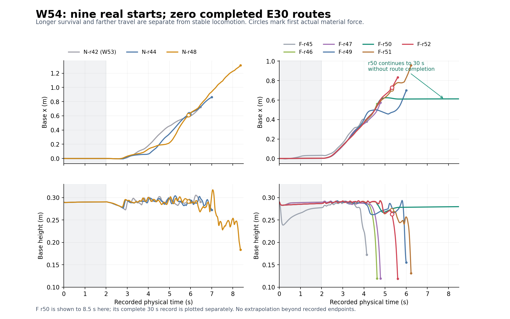
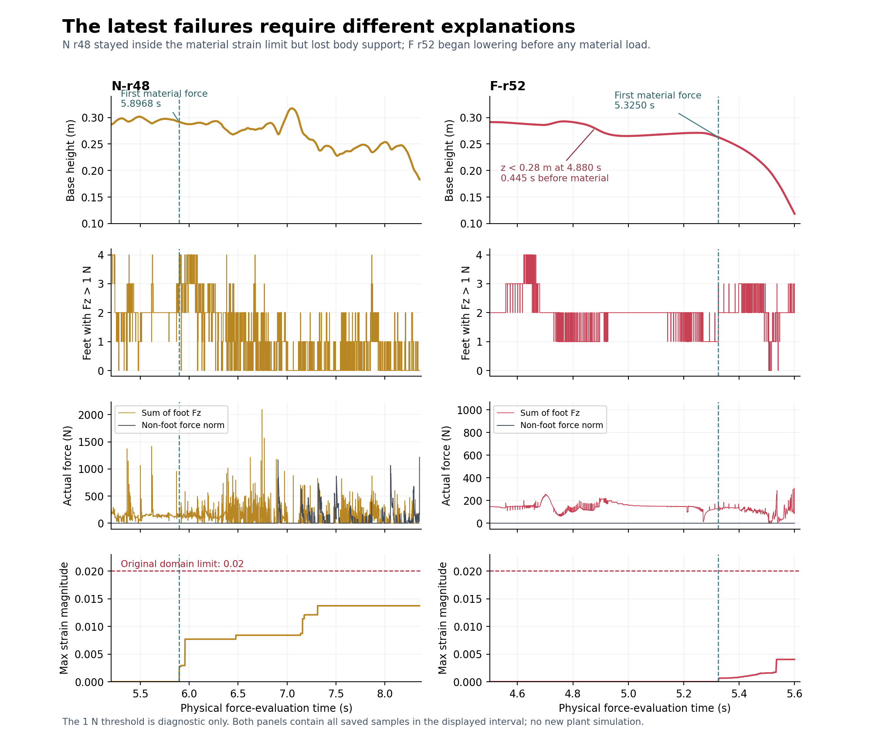
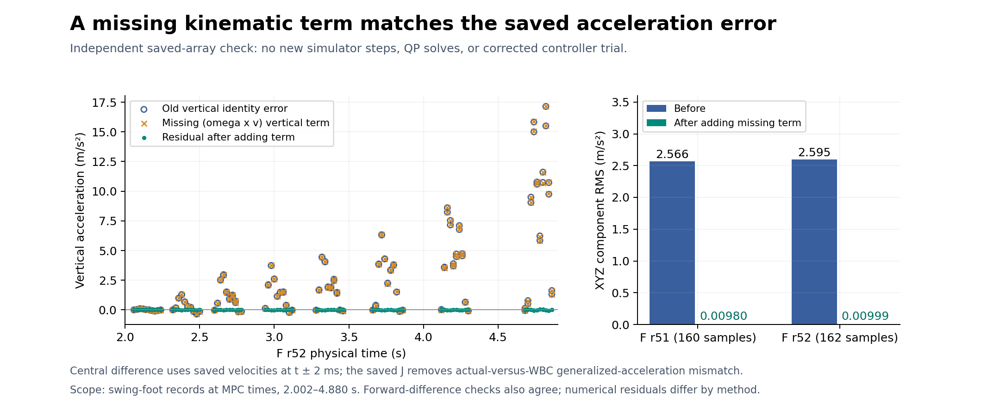

# W54 深入审查：S1 的真实进度、稳定性根因与 W55

日期：2026-11-17（Asia/Shanghai）。审查对象：`kaiwen123-yang/MCP-RL`，实际结果提交 `1ae25272c86f551f8c6b3a65073bc05b24e3d8f6`；W54 实施起点 `df07c4bb690f831745879af3a86800c2c3ec427d`。

**S1 仍没有取得原 E30 资格，尚未稳定贯穿材料，更没有完整往返和材料记忆收益证据。但现在有比继续盲目调参更具体的推进依据：F 使用的 MuJoCo 3.2.3 平移 `mj_jacDot` 存在官方已修复缺项，已被当前代码和两份独立保存数组复算确认。应首先局部修正它，同时推进 N 的支撑耦合修复和 PANN 的实载适用域审计。**

本提交是审查和下一计划；没有实施新的机器人控制补丁、构建新控制器或运行新机器人任务。本次对保存数组和原视频做独立分析，并进行离线材料本构自由积分；没有新增机器人物理、native rollout、控制器 FD、QP 重解或 PPO。

[下一实施计划](../../../../../../docs/S1_W55_STABILITY_PLAN.md) · [启动提示词](../../../../../../docs/S1_W55_START_PROMPT.md) · [机器交接](handoff.json) · [控制分析](control.md) · [日志/视频/资源](evidence.md) · [PANN专项](pann.md) · [文献](literature.md)

## 1. S1 到底到了哪一步

| 版本 | 物理终点 / s | 最大 x / m | 原任务结果 | 应怎样解释 |
|---|---:|---:|---|---|
| F r45 | 4.1340 | .403342 | execution_error | 已走但控制中断，材料力 0 |
| F r46 | 4.6260 | .561246 | body_fall | 硬地失稳，材料力 0 |
| F r47 | 4.7840 | .574192 | body_fall | 硬地失稳，材料力 0 |
| F r49 | 6.0040 | .699149 | execution_error | 材料前降高后中断 |
| F r50 | 30.0000 | .623944 | material_traversal_not_completed | 跑满观察但约 5 s 后停步 |
| F r51 | 6.2320 | .957352 | material_domain_exit | 先降高，后加载，最终材料候选越域 |
| F r52 | 5.6000 | .833806 | body_fall | 先降高，后加载，最终跌倒 |
| N r44 | 7.0058 | .864826 | material_domain_exit | 材料暴露延长，仍撞入域外候选 |
| N r48 | 8.3568 | 1.312010 | invalid_contact | 应变未越域，但支撑丢失、躯干触地 |

9 次是不同版本的原 E30 尝试，不是同一策略的 9 次独立可靠性试验。正确计数为 6 次物理/材料失败、2 次控制器中断、1 次任务目标失败；后级未运行不再加进失败分母。总计 383,713 个物理子步、76.7426 s 仿真，原 E30 通过 0。seed2 与 E60/E300/E600 都没有启动；新 PPO samples/updates/donor 为 0。[独立汇总](evidence-summary.json)

确实取得的进展包括：F 的真实接触/承载、运动目标与执行保持等多项错误已修；N 的 E/nominal/FD 接线已更一致，r48 四足真正接触到材料；C 已完成完整 SRB 力序列 GPU 优化。未取得的仍是持续正常支撑、材料贯穿、完整往返以及历史状态的因果决策收益。

## 2. 视频与高频日志说明了什么

九个全视频全部解码，共 2314 帧；主审实际查看九张覆盖完整时间轴的抽样 overview，以及 N r48/F r52/F r50 的完整末帧。常规约 2 Hz 抽样，失败末秒加密；r50 前段加密、后段每 5 s 检查。没有把“解码全部帧”说成“逐帧视觉检查全部帧”。1 ms 级事件以全部 5 kHz 数组为准，视频辅助判断姿态和先后关系。[视频清单](video/manifest.json)

- **F r50**：前面实际前进，随后保持在 x≈.60 m。最后 1 s 实际 vx≈.000774 m/s，指令仍约 .222323 m/s。它证明能在某种支撑状态下站住，也证明任务停滞；不是稳定步行 30 s。
- **F r51/r52**：4.880 s 首次 z<.28 m，真实材料力分别在 5.3196/5.3250 s 才出现。身体下降先于材料约 .44 s。F r45/46/47/49/50 更是全过程材料力为零，因此不能把 F 的主要早期失稳统称为 PANN 受载预测错误。
- **N r48**：材料接触后逐渐丢失正常支撑。6.9074 s 首次非足承载，7.302 s 低于 .25 m，8.3568 s 躯干触地；材料暴露后约 42.74% 时间没有任何足 Fz>1 N。首次跨足地块重访在 7.555 s，已经晚于失稳迹象。12 次跨足事件真实存在，但不代表 12 次正常步态，更不代表记忆带来收益。





## 3. 最关键的新根因：F 的足端加速度模型漏了一项

运动学关系是 `a_foot = J*qacc + Jdot*qvel`。当前 F 的 QP 使用 MuJoCo 3.2.3 返回的平移 Jdot，而该 API 缺少计算点运动项。MuJoCo [3.3.1 官方更新记录](https://mujoco.readthedocs.io/en/stable/changelog.html#version-3-3-1-apr-9-2025)及[原始修复](https://github.com/google-deepmind/mujoco/commit/de48f4178f971d945fc135afb42699b8ca6bec8e)确认这一问题。

在本代码的球心/连杆质心用途下，缺少的收缩项为 `omega_body_world × v_point_world`。两份独立复算都使用当前保存的真实速度，先消去实际 qacc 与 QP qacc 的差，避免把接触动力学误差混成运动学错误。

| 材料前摆足样本 | 中心差分原残差 RMS | 加入缺项后 RMS | 解释 |
|---|---:|---:|---|
| r51：160 个足×时刻 | 2.565798 m/s² | .009796 m/s² | 主要运动学残差被同一缺项解释 |
| r52：162 个足×时刻 | 2.594999 m/s² | .009986 m/s² | 下降约 99.6%，相关系数 .999993 |

前向差分也得到一致方向：r52 2.609765→.127848 m/s²。两种差分精度不同，不混用。这里的残差是日志中的运动学恒等式检验，**不是修后机器人已取得的跟踪误差或成功率**。[摘要](jacdot-summary.json) · [必要时序](jacdot-r52-central.csv)



这说明“QP 自己算出来的残差很小”仍可能执行错误，因为 QP 与记录共同使用了缺项公式。它与摆足落点间隙逐步增长、迟落足和支撑恶化相符，是当前最高优先级的直接修复。当前 runtime 已有 `mj_forward`，不属于漏了前置计算阶段；角 Jacobian 不受这一平移缺项影响，N 的方向差分也没有同一错误。

修复应覆盖四足球心与各连杆质心后质量平均的 COM drift，再让 rolling 组合使用修后足心项。保留冻结 plant，局部修控制计算，防止整包升级混入其他物理变化。公式修正能否最终稳定完整任务，仍由下一轮原任务决定。

## 4. N 为什么还不稳定

r48 的材料最大应变 .013724，没有越过 .02，这是事实；但原足域代理只约束脚底，不能保证身体还有可用支撑。保存的 6.58 s 候选中，所有 10 条都满足足域代理，被选轨迹预测最低 body z 约 .206 m；6.96 s 被选轨迹预测最低约 .162 m。只能说当前可行性/排序允许这种计划，不能声称某条被拒候选必然会成功。[W54 原候选分析](../../w54/n-r48-analysis.json)

源码中的制动响应使用自由浮基 `J_z M^-1 S^T`，没有把其他承载脚的反力耦合进去。新增复算发现，首次非足接触之前 243 个 E 激活 tick 中，169 个修改了当前 >10 N 的支撑腿；相对相同 raw 输入的直接裁剪基线，支撑关节力矩改变量 RMS 10.424 Nm、最大 71.984 Nm。最大值是**两次合法力矩之差**，不是违反执行器上限 71.984 Nm。

因此下一步必须让制动、支撑反力与身体可实现性一起求解，并生成可恢复的候选。仅改一个落足速度阈值或把低机身候选全部拒绝，会留下“无解后继续旧危险动作”的漏洞。执行、forward 和 FD 相同只能证明接线一致，不能证明内部响应模型完整。[控制分析](control.md)

## 5. PANN 是否锁得过早

结论分两层：**目前不支持将 W54 普遍失稳归因于“PANN 权重冻结太早”；但支持立即补做真实加载路径上的部署验证。**

真实地面力由解析 `ReferenceColumns` 产生，PANN 不生成 plant 反力。其网络权重固定，每个世界地块 e/q 每 2 ms 因果更新；给 PPO 的是 12 个零载恢复特征，PPO 每 .5 s 只输出一个速度 cap。当前 F/N 候选都没有沿各自未来力/动作完整传播材料内态，因而不存在“只要把 PANN 练准，候选就自然知道怎么踩”的完整接口。

九份原件的即时置零对照显示：五条未加载材料的 F 任务，去掉 12 个恢复通道后的 cap 完全相同；其余四条最大差仅约 3.49e−6–1.39e−5 m/s。实际 cap 约 .203–.231 m/s，并未锁在 .18/.25 边界。这是即时特征敏感度，不能替代闭环消融，也不能排除旧 PPO 训练历史或新 F 后端导致的分布变化。[PANN证据](pann-audit.json)

当前实际权重为 **B_random1000--ideal seed0**。局部体积恢复时间约 1.0816 s，对照 1.2 s；偏量约 .9143 s，对照 .95238 s。历史 noisy 模型约快一倍的问题不能套在当前权重上。另一方面，旧材料验证不覆盖真实高速接触全部边界。

本次重新取回并核对真正训练 observations：采样 dt 约 30–70 ms，法向采样应变差分率最大 .09087 s⁻¹；W54 N/r48 连续加载约 13.6401 s⁻¹，F/r52 约 1.8578 s⁻¹，分别约 150 倍和 20 倍。它们是不同采样路径的比较，不是误差放大倍数，也不能把外部应变率直接当作网络内部 qdot 的硬边界。训练应变幅值本身并非从未见过 .02 以上，不能以错误的幅值解释替代真实速率问题。

本次已经对 **F/r52 的 3 个、N/r48 的 6 个预先按真实接触极值/首次加载/跨足重访选定的地块**，从 virgin 状态完成独立自由积分；没有向 PANN 注入真实 q，也没有根据误差挑样本。参考模型按 0.2 ms 原路径重放，与原件 e/q、应力和地块力吻合至数值精度，之后才比较模型误差。

| 原路径 | 地块数 | 同 0.2 ms 加载样本应力 RMSE 范围 / MPa | 最大地块力误差 / N | 最大自由恢复差 / μm | Reference 自身 2 ms 端点路径与 0.2 ms 原路径的最大力差 / N |
|---|---:|---:|---:|---:|---:|
| F/r52 | 3 | .03043–.03249 | .91096 | .49518 | 7.47165 |
| N/r48 | 6 | .04312–.28843 | 3.48127 | 5.86391 | 45.26916 |

表中 RMSE 仅统计两种模型任一处于加载的样本，避免未加载时段稀释误差。两个时钟下所有最终 PANN 积分残差均小于 `1e−8 MPa`。N/r48 同 2 ms 模型之间的最大力差约 4.622 N、自由恢复差约 8.604 μm。这里的力误差是**单个所选地块**的比较，不能冒充全足合力误差；最后一列同时包含采样、激活/释放边界与路径差异，不是纯步长收敛试验。模型恢复误差仍需单独评价：N/r48 的两个高速地块，相应最大恢复偏差约为各自参考恢复峰的 22.3% 和 18.9%，值得定向检验短时加载后的恢复能力。不能因冲击力的采样差较大就全部忽略，也不能直接把这种相对误差判为本轮摔倒原因。

这些有限实载路径不支持“先大规模重训 PANN 就能修好当前行走”的优先级；也不能证明所有地块、越域路径、返程或修后新分布均已覆盖。下一轮 C 复用此次结果，只扩展真实覆盖缺口，并在独立历史上确认已测恢复误差后，定向 GPU 训练一套候选；是否上线另看完整离线验证与动作影响。[逐地块结果](pann-replay-cells.csv) · [完整自由积分口径](pann-replay-summary.json)

专项报告继续区分本构、2 ms 采样和空间接触桥接，不一开始同时解冻 PANN、PPO 和真实材料参数。真实材料 `.05 m` 厚度与 `.02` 应变尺度对应约 1 mm 法向行程；这是原测试床的严格要求，但局部静载估计可承受体重，并没有证据已经证明原任务无解。

## 6. 为什么此前每轮修了东西，任务却仍没完成

主要原因是正确性缺口分布在同一条执行链上。接触事件、承载建立、运动学、全身响应和材料预测任何一层错误，都可以让上层优化在错误模型上得到很好的数值结果。W54 的旧问题确实修过；与此同时，r50 的承载死锁、r52 尚未发现的 Jdotv 缺项、N 的支撑耦合缺口又使后续任务失败。增加随机次数或重新训练 cap 不会自动补齐这些合同。

本轮因此不再把“再读日志、再调一组参数”当主要计划，而是把 F 的明确公式修复、N 的完整支撑投影/候选生成、PANN 的真实路径验证作为三项独立完整工作。首个新身份前修全已经定位的同类调用点；修后任务仍失败时，用**新轨迹最早偏差**继续本轮工作，避免重复解释历史极值。

## 7. 并行与 GPU：可以做得更充分，但要看实际产出

W54 仅有 N/r44 与 F/r46 的有效双物理重叠，共 **41.1324 s**，没有三重物理并行。九任务 CPU 合计 4263.539333 CPU-s，约 1.1843 核时，不含额外构建/离线工作。N 的求导热段约 9.74/9.77 核，整任务平均 6.16/5.40 核；F 约 1 核。给 F 更大 affinity 不会自动把小 QP 变成多核算法。[资源复算](evidence-summary.json)

GPU 已有实际进展：最新 r52 的 16 个完整 horizon、224 个力区间使用相同内接摩擦方锥，16/16 独立检查通过。最大相对目标差约 .0134%；本批 warm 含传输 .3508 s，CPU 装配+求解 .6659 s，约 1.90 倍批次比；含初始化编译 GPU 2.172 s 则更慢。不同算法预算，不能称普遍硬件加速，也不能用 batch 平均冒充在线单步延迟。尚未包含 GPU WBC、材料动力学或在线安装。

W55 初期安排 N≤10 workers、F≤4 核、C/数据≤8 核、系统/其他≥3 核。两个物理任务都就绪就同时跑，第三路 GPU 做材料批量自由积分和必要的定向训练；一条先通过即可推进原资格链。实际重叠、核时和新知识是指标，96 GB 显存不是必须填满的任务目标。

## 8. 下一轮可以推进，而且应立即从明确缺陷开始

完整执行内容见 [W55 计划](../../../../../../docs/S1_W55_STABILITY_PLAN.md)：F 局部修正确 Jdotv；N 联合考虑支撑和制动、统一全身可行性并提供同源恢复候选；C 定量区分材料模型与采样误差、必要时训练新材料候选。已有数据能回答的问题不再加新机器人试验；新实现直接原 E30，成功后同身份顺序推进 E60/E300/E600 与第二 case，不跨身份借资格。

**持续遵守：所有新后台 deadline=null、wall_deadline_enabled=false，无到点或对话结束 kill；GitHub 直接交付，核实后不在用户电脑额外归档。** 原物理任务时长、失败条件和路线保持；服务器仍被引用的学习状态与原件保留。

## 9. 阅读与验证边界

本轮相对 W54 计划提交有 211 个变化路径，15,679,199 B；158 个 JSON、14,864,520 B 被完整解析。结合既有项目记忆/历史审查，定向阅读实际控制、材料、观察器、任务、运行和 GPU 实现。原件审查从 16 个 ZIP 中取回 4093 个必要成员、解压后 572,690,041 B，逐成员长度与 sources SHA256 相符；没有下载完整 ZIP、native `.bin` 或 `model.mjb`，不宣称逐字语义读完全部仓库和每个二进制字节。

本次报告明确区分：直接原件事实、代码/官方修复证据、保存数据的独立复算、离线材料预测、尚待真实闭环检验的改进方向。[阅读范围](read-coverage.json) · [原实验索引](../../w54/index.json)

## 10. 保存数据复算入口

以下仅供复现审查，不是下一轮必须重复执行的前置矩阵。下载使用 Python 标准库；数组复算需 NumPy，画图另需 Matplotlib。原件及新输出目录显式传入，不把大原件写进审查目录。下例从仓库根执行：

```bash
review=results/terrain_memory/simulation/tm-s1-go2-local-readiness-r12/reviews/W54-review
python "$review/fetch_w54_originals.py" --repo . --output /path/to/w54-originals --workers 4
python "$review/recompute_w54.py" --repo . --originals /path/to/w54-originals --output /path/to/w54-recomputed
python "$review/audit_w54_f_saved.py" --originals /path/to/w54-originals --output /path/to/w54-recomputed
python "$review/audit_w54_n_saved.py" --originals /path/to/w54-originals --output /path/to/w54-recomputed
python "$review/crosscheck_jacdot.py" --originals /path/to/w54-originals --output /path/to/w54-recomputed
python "$review/plot_jacdot.py" --audit-root /path/to/w54-recomputed
```

PANN 的独立积分另见 [专项报告](pann.md) 与 [命令行脚本](pann-replay.py)；需原冻结材料权重及其相容的 JAX/Equinox 环境。大训练集与权重继续引用原 Release，不重复复制到本审查提交。下载脚本会核每个所取成员的长度与 sources SHA256；这不是未下载完整 ZIP 的整包哈希验证。
