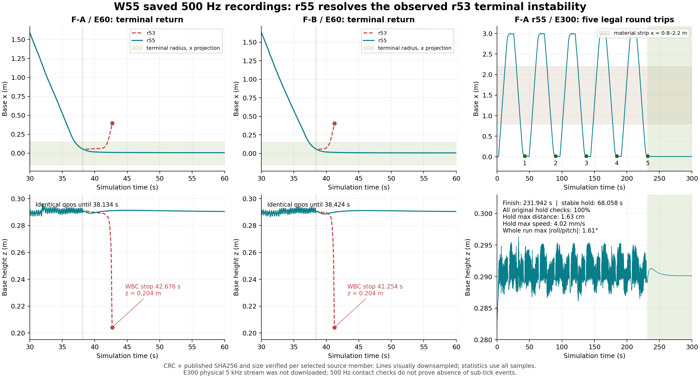

# W55 完整审查与 W56 下一步

审查日期：2026-11-20（Asia/Shanghai）。最新结果基点 **0eb39b13932c18d8e52ff305a3c35477a4510ab7**；进度快照 **2026-11-20 16:33:31 北京时间**。GitHub后续提交可能继续推进后台结果；执行时先核live任务。

**S1 已经有了这两个 nominal case 上的稳定材料往返基线：F/r55 A、B 各通过原 E30、E60、E300；A 的完整原数组独立复算确认五圈和最后 68.058 s 稳定保持。** 当前不能再概括为“仍走不起来”。完整 E600 尚无完成证据，材料记忆的因果收益、扰动鲁棒与实时性也尚未证明。

下一轮优先冻结 r55，接续 A/B 已有 E600；并行完成真实材料特征消融、因果材料接线、N 的有证据成组修复及计算效率改进。计划已写入 [W56 计划](../../../../../../docs/S1_W56_STABILITY_PLAN.md) 和 [启动提示词](../../../../../../docs/S1_W56_START_PROMPT.md)。

## 1. 最新进度，按版本和 case 看

| 身份 | E30 | E60 | E300 | E600 |
| --- | --- | --- | --- | --- |
| F-A-r53 | 通过 | 42.676 s WBC中断；已完成1圈后失稳 | 未运行 | 未运行 |
| F-B-r53 | 通过 | 41.254 s WBC中断；往返穿材料但回家稳定未完成 | 未运行 | 未运行 |
| **F-A-r55** | **通过** | **通过，1圈** | **通过，5圈；原数组与视频已核** | 运行快照153.502 s |
| **F-B-r55** | **通过** | **通过，1圈** | **独立结果通过5圈；视频已核、数组未独立复算** | 运行快照113.502 s |
| N-A-r54 | 30 s结束，未贯穿材料 | 未运行 | 未运行 | 未运行 |
| N-A-r56 | 30 s结束，未贯穿材料 | 未运行 | 未运行 | 未运行 |

重建台账为 **12次已结束：8通过、2次控制中断、2次任务未完成；另2个E600在途**。其中 r55 已结束六个阶段全通过。不能把所有版本混成“当前成功率8/12”，也不能把六个阶梯阶段称为六次独立长时可靠性试验。A/B 是两份冻结策略 case，并非从头独立随机训练的大样本。

已结束累计983.930物理秒、4,919,650物理步、41,304.292273 CPU秒。原W55 index少计N56，当前入口旧文字又落后于正式phase。审查派生台账见 [phase-recomputed.json](phase-recomputed.json)；原attempt没有被改写。

## 2. 日志和视频共同支持的稳定性变化

A/r55 E300的150001条500Hz记录复算五圈完成时刻：**42.640、90.168、137.320、184.486、231.942 s**。十次方向穿越的入口、出口、真实加载和侧出字段与正式结果一致；五圈之后持续观察68.058 s，原hold五项检查全部通过。

| A/r55 E300指标 | 值 | 证据层次 |
| --- | ---: | --- |
| 全程最低机身高度 | 0.283007 m | 500Hz原轨迹独立复算 |
| 全程最大单轴横滚／俯仰 | 0.028074 rad，约1.61° | 500Hz原轨迹独立复算 |
| 最后保持最大距原点 | 0.016267 m | 原hold区间独立复算 |
| 最后保持最大线速度 | 0.004017 m/s | 原hold区间独立复算 |
| 最后保持非足接触 | 500Hz记录为0 | 不外推为全部5kHz子步已复核 |
| 最大材料应变 | 0.00322918，低于原0.02域界 | 正式材料汇总；未独立下载此E300全部材料流 |
| 完整运行 result.wall_s | 9474.04 s | 正式执行计时；首末物理步区间9468.80 s |

11个已发布完整视频均核SHA/size、全解码无错误，主审看过所列关键帧。r53 A/B尾段可见明显下沉，r55 A/B E60尾段稳定，A300反复跨材料后保持；N54停在入口。详见 [video.md](video.md)、[A300抽样图](video/f-a-r55-e300-overview.jpg) 与 [原全视频](https://github.com/kaiwen123-yang/MCP-RL/releases/download/tm-s1-go2-local-readiness-r12-w55/w55-f-a-r55-e300-full-mission-material-overlay.mp4)。B300新增视频也已核文件并目视检查关键帧；N56任务视频仍未发布，未声称观看。

B/r55新增独立结果报告五圈在42.710、90.250、137.774、185.052、232.696 s完成，随后67.304 s保持、原五项检查100%通过；保持最大距原点0.016918 m、最大速度0.004323 m/s。B的这些细项来自执行端独立分析，本次另核完整视频关键帧，未独立复算B原数组。

## 3. 以前失败多，是不同层的问题先后暴露

**第一层：运动学公式。** W54实际运行的MuJoCo3.2.3平移Jdotv遗漏运动点项。r53按官方缺项修复足球心和逐体COM，并在真实执行接通。W55完整E30和材料往返支持这项修复确实解决了原来的早期主要问题。

**第二层：回家后的力矩几何。** r53走到终点后，用目标COM作力矩臂中心，实际COM仍有偏差。对当前支撑力，错误中心会改变合力矩和平动／转动耦合。保存同状态例在40.178s把应制动的水平合力算为约+1.860N，r55修正为约−3.439N。r55保留原成本、步行分支和WBC硬界，修正站立展开中心与一阶耦合。

A的新旧qpos在38.134s前逐位相同，B在38.424s前逐位相同，差异恰在进入terminal hold后出现。r53随后漂移约0.4m、下沉到0.204m，最后WBC迭代耗尽；r55对应时段稳定。这是比“增加迭代上限可能有用”更直接的因果证据。r53正式标签是技术中断，但之前已有真实物理失稳，不能只归为求解器偶发。

**第三层：N候选的推进和数值问题。** N56最远0.894534m，已进入0.8m材料入口，但未到2.2m出口。当前最优可行候选常在全支撑下预测倒退；20ms推进前缀不足，单独延至350ms仍未解决。同时存在原约束有可行见证却被候选半空间投影误拒的数值例，也存在稍后真正不可行的例。要成组修候选和数值正确性，不能只调阈值、换seed或将全站立计成功。

详细源码、身份及同输入证据见 [control.md](control.md)。

## 4. PANN不是被“冻结状态”卡住，但当前接口确实很弱

网络权重固定，世界地块状态持续推进；真实plant是解析ReferenceColumns。新材料候选确实在GPU上做了两参数耗散势校准，但两个独立保留组恢复变差，所以没有采用。当前没有证据说明解冻权重是r55稳定的必要条件——r55在原材料权重下已经通过E300。

更实质的限制是材料历史主要只经末12维恢复特征影响2Hz限速。F53的60次同状态探针最大cap差约1.20e−5m/s；F力MPC没有沿候选传播PANN材料状态。这并未检验完整闭环记忆收益，也解释了为什么只继续提高材料拟合精度未必改变行走。

同时，2ms端点采样会漏掉短接触事件；W55已将它与纯积分步长误差分开。下一步应把因果窗口、逐地块历史、候选独立演化和实际控制参考接起来，并检查原任务是否有尚未松弛的有效重访机会。不能更改原plant造收益。详见 [pann.md](pann.md) 与 [material-interface.md](material-interface.md)。

## 5. 并行已经发生，资源效率仍需改

已结束任务真实双物理重叠 **13,603.379 s**；两物理与一次GPU材料拟合有约403.852s重叠。但F单进程平均约1.1核，N54/N56平均约4.0/4.2核，没有充分利用25核；没有整机监控，不能据此报全机器空闲百分比。

GPU当前9条完整FP64材料历史用31.078s，CPU单数学线程0.920s，约慢33.77倍。这只针对已测小批量负载。源码是四线程block，每条历史一个线程内部串行差分Newton和时间推进；应改真实批量和计算路径，而不是复制数据占满96GB。只有force-horizon上GPU也不能称全MPC/WBC上GPU。

A300的反馈p50约4.21ms、p95约51.41ms，完整result.wall_s为模拟时间约31.58倍；当前没有500Hz在线实时资格。记录里的2ms逻辑deadline miss是性能统计，后台deadline=null仍成立，两者不能混淆。

## 6. W56要一次完成什么

1. 接续现有r55 A/B E600，核对B300新交付回执并补齐N56任务原件和统一台账；有新失效再按首因修，不重写已有成功内核。
2. 同actor、同plant、同初态实际执行末12维屏蔽，默认A/B各自身E30→E60，取得一次完整往返的闭环增量作用结果；有多圈问题才扩大。
3. 同轮实现因果观测窗口、离线候选地块传播及最小在线材料法向执行参考；保存状态验证正式参考/输出实际受影响后直接新身份原E30并推进资格，不能停在又一份接口方案。
4. N按已保存反例合并数值与全域支撑推进修复，用释放的物理槽验证；C同时做有收益的CPU/GPU批量。最高两条重物理加一条计算线。

不设置后台墙钟完成时间；不对话结束kill；GitHub直接交付后不在用户电脑新增归档。完整执行边界和条件见 [计划](../../../../../../docs/S1_W56_STABILITY_PLAN.md) 与 [机器交接](handoff.json)。

## 7. 审查覆盖及证据边界

本审查接续历史项目记忆、前轮审查和长期目标，重点复核W55增量、实际调用链、逐job身份、正式判据及本轮原件。所读内容和字节清单见 [read-coverage.json](read-coverage.json)，不把文件枚举／JSON解析当成“逐字理解了全仓每个字节”。

通过HTTP范围读取6批原件共305个成员、约1.005GB解压数据，逐成员CRC、已发布SHA256和size均匹配；6组完整500Hz轨迹、5组完整5kHz流及选取控制矩阵经复算。没有把选取成员校验说成完整ZIP哈希验证，没有对全部约15.19GB Release资产逐字节下载。A300的全5kHz流未独立取回；B300原数组未独立复算，N56任务视频/数组仍未发布，范围明确列出。

此次新增机器人物理、native rollout、QP重解、材料训练和PPO均为0。审查输出的矩阵复算、计数、图和视频解码是只读分析。执行端已有诊断与本次独立复算分别注明。

完整证据入口：[evidence.md](evidence.md)、[evidence-summary.json](evidence-summary.json)、[control-raw-check.json](control-raw-check.json)、[Release清单](release-inventory.json)、[近年论文与限制](literature.md)。

