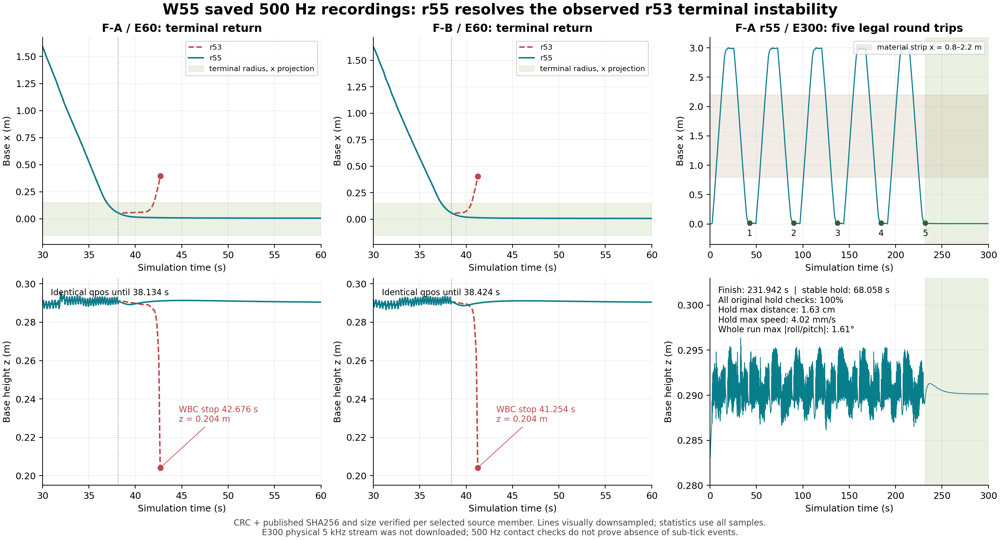

# W55 结果与原始记录独立审查

审查版本：`0eb39b13932c18d8e52ff305a3c35477a4510ab7`。阶段快照：**2026-11-20 08:33:31 UTC**。本审查只读取已保存的结果、原数组和已发布资产，不启动物理仿真、训练或后台实验。视频视觉审查由主审查者另外完成；本子审查不把“下载了视频清单”写成“看过视频”。

## 结论

**最新 F-r55 已经跨过了此前“走完一圈后站不住”的具体故障：A/B 两条固定策略均完成独立 E30、E60，E300 均记录通过。A 的完整 E300 原始 500 Hz 轨迹经独立重算，确认 5 次去程、5 次回程都穿过原材料带，并完成 5 次有效往返；第 5 次在 231.942 s 完成，之后保持到 300 s。** B 的 E300 已补齐独立 runner、result、analysis、resolved，直接 Release 查询亦确认其视频及 20 个原件 ZIP 已发布；本次只核对其独立 JSON，没有下载复算 B 的原数组，因此详细保持指标仍注明为执行端分析。E600 两条仅处于快照中的运行状态，尚无最终结果，不能写十次往返通过。

这意味着“始终没有稳定走起来”已不适用于最新 F-r55 的这两个 nominal 案例。更准确的剩余问题是：E600 与交付闭环仍未完成，扰动与其他正式条件没有覆盖；N 分支仍只能接近或略进入材料带而无法穿越；材料记忆的因果收益与后续训练目标尚未因此获得证明。不能用旧版本的失败总数替代当前版本的可靠性判断，也不能把本轮 8/12 当作同分布独立成功率。

## 1. 全阶段台账：完成、失败、未运行、在途分开

| 精确案例 | E30 | E60 | E300 | E600 |
|---|---|---|---|---|
| F-A r53 / seed 1 | 通过，30 s | 数值中断，42.676 s | 未运行 | 未运行 |
| F-B r53 / seed 2 | 通过，30 s | 数值中断，41.254 s | 未运行 | 未运行 |
| F-A r55 / seed 1 | 通过，30 s | 通过，60 s | 通过，300 s；原数组独立核验 | 快照在途，153.502 s |
| F-B r55 / seed 2 | 通过，30 s | 通过，60 s | 独立结果通过，300 s；原件已发布但本次未复算 | 快照在途，113.502 s |
| N-A r54 / seed 1 | 运行满 30 s，未完成穿越 | 未运行 | 未运行 | 未运行 |
| N-A r56 / seed 1 | 运行满 30 s，未完成穿越 | 未运行 | 未运行 | 未运行 |

按六个精确案例的四级门槛统计：**12 次结束、8 次通过、4 次非通过、2 次快照在途、10 格未运行**。E30 是 4 通过 / 2 未达任务；E60 是 2 通过 / 2 数值中断；E300 为 2 次独立结果通过，其中 A 具有本次独立原数组核验、B 为新交付独立 JSON 核验；E600 没有已结束结果。

`index.json` 的 11 次结束遗漏了已经结束的 N56。它的 runner 在 `w55/n/N-A-r56/E30.json`，独立 result 实际在 `w55/n/r56/` 下，而不是与 N54 同层。合并阶段汇总、runner 和实际 result 后：

| 统计量 | index 原值 | 独立校正 |
|---|---:|---:|
| 已完成原阶段运行 | 11 | **12** |
| 模拟时间 | 953.930 s | **983.930 s** |
| 5 kHz 物理步 | 4,769,650 | **4,919,650** |
| 进程 CPU 秒 | 35,562.097836 | **41,304.292273** |
| 已完成物理运行的成对重叠墙钟秒 | 12,515.706290 | **13,603.379134** |

这些是原运行账本的修正，不是追加实验。重叠只按各运行第一次至最后一次真实物理步计数；进程开始/结束、压缩、发布耗时没有冒充有效物理并行。未观察区间不能据此认定机器空闲。

## 2. r53 到 r55：故障位置与修复效果的原数组证据

A 旧新版本的 `qpos` 在 38.134 s 之前逐位完全相同，首次差异发生在 **38.136 s**；B 对应 **38.424 / 38.426 s**。这正是末端站立阶段开始后的时刻。去程、转向、返程前段相同这一事实，使“材料从一开始就把整条路线弄坏了”不符合这组对照。

| 终止前最后 2 s 的同一时窗 | A r53 | A r55 | B r53 | B r55 |
|---|---:|---:|---:|---:|
| 最低基座高度 m | 0.204122 | 0.290171 | 0.204203 | 0.288605 |
| 最大距原点 m | 0.396288 | 0.015086 | 0.406222 | 0.030852 |
| 最大线速度 m/s | 0.769267 | 0.003027 | 0.701479 | 0.022230 |
| 最大角速度 rad/s | 1.298209 | 0.001045 | 1.825201 | 0.006406 |
| 500 Hz 非足接触最大数量 | 4 | 0 | 4 | 0 |

因此 r53 的最后一条异常 `wbc: maximum iterations reached` 不是全过程唯一的问题；在该异常之前已经发生了明显的下沉、滑移与非足承重。A 的 5 kHz 原记录从 **42.5978 s** 起出现非足接触，共 391 个物理步，合力峰值 **503.915 N**；B 从 **41.1578 s** 起出现，共 481 步，峰值 **430.135 N**。其正式分类仍为 `technical_interruption`：当时基座尚高于原始跌倒终止门槛 0.12 m，倾角也未达到 1.2 rad，最后触发的是求解器错误。

“非足接触”与 `invalid_contact` 不是同一概念。原模型允许四条腿 hip 子树中的所有 body 接地，而非只有足球；`invalid_contact` 针对许可集合以外的 body。保存的聚合数组没有逐个接触 body ID，本审查不能凭非足合力反推出确切小腿或其他几何体。不能把官方技术中断标签解释为没有物理失稳，也不能擅自将其改记为原判据的 body fall。

完整 5 kHz 的 A/B r53 E60、A/B r55 E60，以及 N54 E30，共 **1,169,650 步**中，按原每关节 23.7 / 23.7 / 45.43 Nm 上限复算的实际关节力矩和 actuator force 超限数均为零（数值比较容差 1e-7 Nm）。这只说明执行硬界被遵守，不说明 r53 闭环稳定。控制审查的选段原矩阵重算另显示小量圆锥求解容差残差，不能把所有计划约束都写成绝对数学零误差，详见同目录 `control.md` 与 `control-raw-check.json`。

## 3. A-r55 E300：确实完成原 5 次往返任务

完整原轨迹有 **150,001 条 500 Hz 状态**，从 0 到 300.000000008 s。独立程序用原材料带 `x ∈ [0.8, 2.2] m, |y| ≤ 0.6 m`、足投影内缩边界和实际 `Fz > 0` 重新计算每一程；10 次 entry、exit、侧出、材料加载与完成字段均与发布结果逐项一致。

| 往返序号 | 去程进入→离开材料带 s | 回程进入→离开材料带 s | 回到端点并完成原稳定停留 s |
|---|---|---|---:|
| 1 | 6.144 → 12.466 | 29.730 → 36.150 | 42.640 |
| 2 | 53.438 → 59.674 | 77.026 → 83.460 | 90.168 |
| 3 | 100.752 → 107.162 | 124.480 → 130.838 | 137.320 |
| 4 | 147.926 → 154.308 | 171.734 → 178.152 | 184.486 |
| 5 | 195.232 → 201.452 | 218.838 → 225.204 | 231.942 |

五圈在原 270 s 路线门槛前完成。全程最大横向偏移 0.083337 m，最低基座高度 0.283007 m，最大单轴绝对 roll/pitch 0.028074 rad（约 1.61°），10 次合法穿越均没有侧出。

第 5 圈完成后的 **68.058 s**，原 `hold_metrics` 的五项条件均为 100%：四足接触、距原点小于 0.15 m、线速度小于 0.05 m/s、角速度小于 0.1 rad/s、roll/pitch 小于 0.15 rad。独立复算得到：

| 终点保持指标 | 复算值 |
|---|---:|
| 保持状态样本 | 34,030 |
| 任一原条件违例样本 | 0 |
| 端点位置违例样本 | 0 |
| 最大距原点 | 0.0162673 m |
| 最大线速度 | 0.00401676 m/s |
| 最大角速度 | 0.00267440 rad/s |
| 最大单轴绝对 roll/pitch | 0.0101065 rad |
| 保持阶段最低 / 最高基座高度 | 0.289745 / 0.291295 m |
| 500 Hz 非足接触 | 0 |

此 E300 本审查没有下载全部 1,500,000 步的 5 kHz 物理流，因此“500 Hz 未观察到非足接触”不能扩大成“每一个物理子步都已独立证明无接触”。原结果没有以 `invalid_contact` 或 `body_fall` 结束，且独立任务资格核验成立；这里保留证据分辨率的边界。

A/B r55 E60 分别在 40.176 / 40.428 s 完成任务，并继续保持 19.824 / 19.572 s；两者保持五项条件全为 100%。这两条 E60 的完整 5 kHz 记录也没有非足接触。

### B-r55 E300 的补交结果（执行端独立 JSON，未作本次原数组复算）

e5ff1478 已补齐 B E300 的独立 runner/result/analysis/resolved。其 case key 与本 B 的 E30/E60 相同，workers=1，predecessor 明确为自身 E60，评价器 SHA 与 A 一致。独立 result 记录 300.000000008 s、150,001 个 500 Hz 状态、1,500,000 个物理步、5 次合法去程和回程、0 次侧出；五圈稳定完成时刻为 **42.710、90.250、137.774、185.052、232.696 s**。

执行端保持分析记录后 **67.304 s** 原五项条件全部满足，33,653 个样本、0 次违例、0 次端点位置违例；最大距原点 **0.0169177 m**，最大线速度 **0.00432321 m/s**，最大角速度 **0.00281550 rad/s**。全程最低 z **0.283007 m**，最大 x **2.999930 m**，峰值材料应变 **0.00340561**，关节限位超出 0，全部 MuJoCo warning 计数 0。这些数值是已读取的执行端分析，不与 A 的本次独立原数组复算混称。

最新 Release 已含 B E300 完整视频（76,774,302 bytes）与 20 个 ZIP；本次子审查没有下载 B 的大数组或观看该视频。主审可据最新 inventory 单独核验视频。本 B 的 `wall_s` 为 9,377.516962 s，首次至末次物理步墙钟区间为 9,372.245711 s，两种时间口径分别保留。

## 4. N 分支：活着运行满窗口，并不等于在完成任务

| 指标 | N-A r54 | N-A r56 |
|---|---:|---:|
| 运行 / 原物理步 | 30 s / 150,000 | 30 s / 150,000 |
| 最大 x m | 0.788521 | 0.894534 |
| 首次基座进入材料带 x≥0.8 | 从未进入 | 10.692 s |
| 基座离开材料带东边界 x≥2.2 | 未发生 | 未发生 |
| 最低基座高度 m | 0.276509 | 0.283114 |
| 最大材料应变 | 0.0114725 | 0.00695883 |
| 结束原因 | material_traversal_not_completed | material_traversal_not_completed |

N54 的原轨迹显示，10 s 时 x≈0.774 m，此后至 30 s 长时间停在材料入口附近；指令速度仍约 0.22 m/s，而位置没有形成持续进展。N56 将进入点向前推进，并降低了峰值应变和下沉，但 30 s 的最大 x 仍只有 0.895 m，距离穿越材料带东边界还很远。它们属于“存活和支持有所改善，任务进展停滞”，不能与旧 F 的末端数值故障混成一种失败。N56 原数组和全视频尚未在本 Release 清单公开，相关详细数值来自其独立 result 和 `E30-actual-analysis.json`，不标注为本次原数组复算。

## 5. 并行、CPU/GPU 与 deadline 的真实含义

12 个结束运行合计 **11.4734 核时**。F r55 A/B E60 和 E300 的进程累计 CPU / runner 墙钟时间约为 **1.08–1.15 核**；N54、N56 对应约 **4.00 / 4.20 核**。固定 `--workers 10` 并不意味着每一秒都饱和使用 10 核。

原 `resources.jsonl` 中，对连续相同 PID 集合的相邻样本求 CPU 增量，N54 CPU 核数中位 3.91、p95 6.13，RSS 峰 6.06 GiB；F A-r55 E300 中位 1.14、p95 1.24，RSS 峰 3.36 GiB。N 的子进程退出后，末条只有父进程计数，不能用末条资源记录冒充整个 attempt CPU 总量，因此汇总仍采用 runner wait/rusage 累计值。

已完成原物理运行的最大同时数为 **2**；已有任务确实发生双物理并行，不是只有两个 tmux 名称。仓库还记录过双物理加材料 GPU 拟合的重叠，主审查会对 C 分支给出具体资源与收益结论。本审查没有全机器逐核或全 GPU 时间序列，因此不报“整机使用率 xx%”或“空闲 xx 小时”。

F A E300 的反馈延迟中位 4.211 ms、p95 51.414 ms，150,001 次都超过其诊断预算 `logical_deadline_s = 0.002`；物理每个 2 ms 控制段的计算也显著慢于 2 ms。这说明当前是离线慢时仿真，尚未证明实时控制吞吐；它并不是一个后台作业完成时间限制。阶段快照明确 `deadline: null`、`wall_deadline_enabled: false`、`kill_on_conversation_end: false`。不能把这些 deadline_misses 当成 r53 被墙钟杀掉的证据，更不应删除原 E30/E60/E300/E600 任务时间窗以“消除截止”。

## 6. 资格边界、发布状态与下一步判断

F-r55 A 的 E30/E60/E300 精确 case key 相同，B 的这三级也相同；每一级 predecessor 指向该版本自身前一级，solver workers 均为 1。r53→r55 的 case key 改变后重新做了 E30，旧资格没有直接挪给新代码。原 evaluator 保持要求 E60 的合法一圈、E300 的 5 次合法往返及终点稳定。E30 通过只说明短阶段完成原去程要求，不等于完整返程任务已通过。

最新一次直接查询（2026-11-20 08:34:25 UTC）Release 得到 **82 个资产、11 个 full-mission 视频**。首次旧 `index/delivery` 只有 40 资产，第一次直接查询为 60；随后 a1501926 补齐 A E300 sources/manifest，e5ff1478 又补齐 B E300 独立 runner/result/analysis/resolved。最新 Release 比第一次多 B E300 视频及 20 个原件 ZIP，以及 A E300 的新增 originals-0020.zip。本次没有扩大下载 B 原数组，也没有把新增 ZIP 声称为已逐成员核验。N56 result 在特殊子目录中可以找到，但 Release 仍无其原数组/全视频。两条 E600 只能描述为最后快照的在途进度：A 为 outbound / 153.502 s，B 为 turn / 113.502 s；本审查没有连接服务器证明当前仍在跑。

对下一轮的含义：保留已被原记录支持的 F-r55 作为稳定参考，先收完同版本 E600，核对 B E300 新发布资产回执并补齐 N56 交付链，再按原资格评估有限数量新条件；N 线单独处理“支持可行但不产生足够前进”的机制；材料/PANN 线继续作为因果诊断与独立拟合分支。不能把 F 已修好的末端故障、N 的任务停滞、材料因果有效性和运行吞吐混成一个不断重启的单队列。增加并行应分配独立工作区、输出目录和资源实测，不应靠未测收益的更多 solver workers 填满核数。

## 7. 检查覆盖与可复算文件

共获取并验证 **6 批、305 个选取原成员**，解压大小 1,005,412,806 bytes；HTTP 范围读取 963,395,471 bytes。所有选取成员均通过 ZIP CRC、发布 sources SHA256 和 size 验证（A E300 已用 a1501926 新 sources 补验）。34 个远端 ZIP 通过 central directory 定位；未整包下载，因此**没有**宣称验证完整 ZIP SHA。远端 asset digest 保留为发布者元数据，成员核验与整包核验分别记账。

主要输出：

- `evidence-summary.json`：紧凑证据结论、全阶段矩阵、资源与证据不足说明。
- `phase-recomputed.json`：阶段、runner、独立 result 合并账本及真实物理重叠。
- `arrays-recomputed.json`：6 组 500 Hz 轨迹与 5 组完整 5 kHz 流复算；样本级派生统计。
- `release-inventory.json`：最新直接查询的 82 个 Release 资产 name、size、digest、URL、id、创建/更新时间和查询时间。
- 原件目录中的 `original-ledger.json`：逐成员来源映射、SHA/CRC、下载范围统计与核验等级。
- `recompute_w55_arrays.py`、`recompute_w55_evidence.py`、`plot_w55_evidence.py`：保存数据的复算与制图；`fetch_w55_evidence.py`：按需读取发布 ZIP 成员。
- `w55-stability-evidence.png` / `.svg`：已检查版面，基于原数组；线条可视化降采样，所有统计用全样本。

原始可追溯入口：

- [W55 phase，审查 commit](https://github.com/kaiwen123-yang/MCP-RL/blob/0eb39b13932c18d8e52ff305a3c35477a4510ab7/results/terrain_memory/simulation/tm-s1-go2-local-readiness-r12/w55/phase.json)
- [W55 index，审查 commit](https://github.com/kaiwen123-yang/MCP-RL/blob/0eb39b13932c18d8e52ff305a3c35477a4510ab7/results/terrain_memory/simulation/tm-s1-go2-local-readiness-r12/w55/index.json)
- [A-r55 E300 独立 result](https://github.com/kaiwen123-yang/MCP-RL/blob/0eb39b13932c18d8e52ff305a3c35477a4510ab7/results/terrain_memory/simulation/tm-s1-go2-local-readiness-r12/w55/f/job-20261120T035811Z-w55-f-a-r55-eval-PANN_PPO_S5-s1-E300-attempt01.json)
- [N-r56 独立 result](https://github.com/kaiwen123-yang/MCP-RL/blob/0eb39b13932c18d8e52ff305a3c35477a4510ab7/results/terrain_memory/simulation/tm-s1-go2-local-readiness-r12/w55/n/r56/job-20261120T040054Z-w55-n-a-r56-eval-PANN_PPO_S5-s1-E30-attempt01.json)
- [A-r55 E300 原件 sources](https://github.com/kaiwen123-yang/MCP-RL/blob/0eb39b13932c18d8e52ff305a3c35477a4510ab7/results/terrain_memory/simulation/tm-s1-go2-local-readiness-r12/w55/delivery/f-a-r55-e300/sources.json)
- [W55 原始资产 Release](https://github.com/kaiwen123-yang/MCP-RL/releases/tag/tm-s1-go2-local-readiness-r12-w55)
- [原 stage evaluator](https://github.com/kaiwen123-yang/MCP-RL/blob/0eb39b13932c18d8e52ff305a3c35477a4510ab7/scripts/s1_go2_r11_protocol.py)、[原合法穿越账本](https://github.com/kaiwen123-yang/MCP-RL/blob/0eb39b13932c18d8e52ff305a3c35477a4510ab7/scripts/s1_go2_legal_route.py)、[原终点保持判据](https://github.com/kaiwen123-yang/MCP-RL/blob/0eb39b13932c18d8e52ff305a3c35477a4510ab7/scripts/s1_go2_wb_equilibrium.py)。
