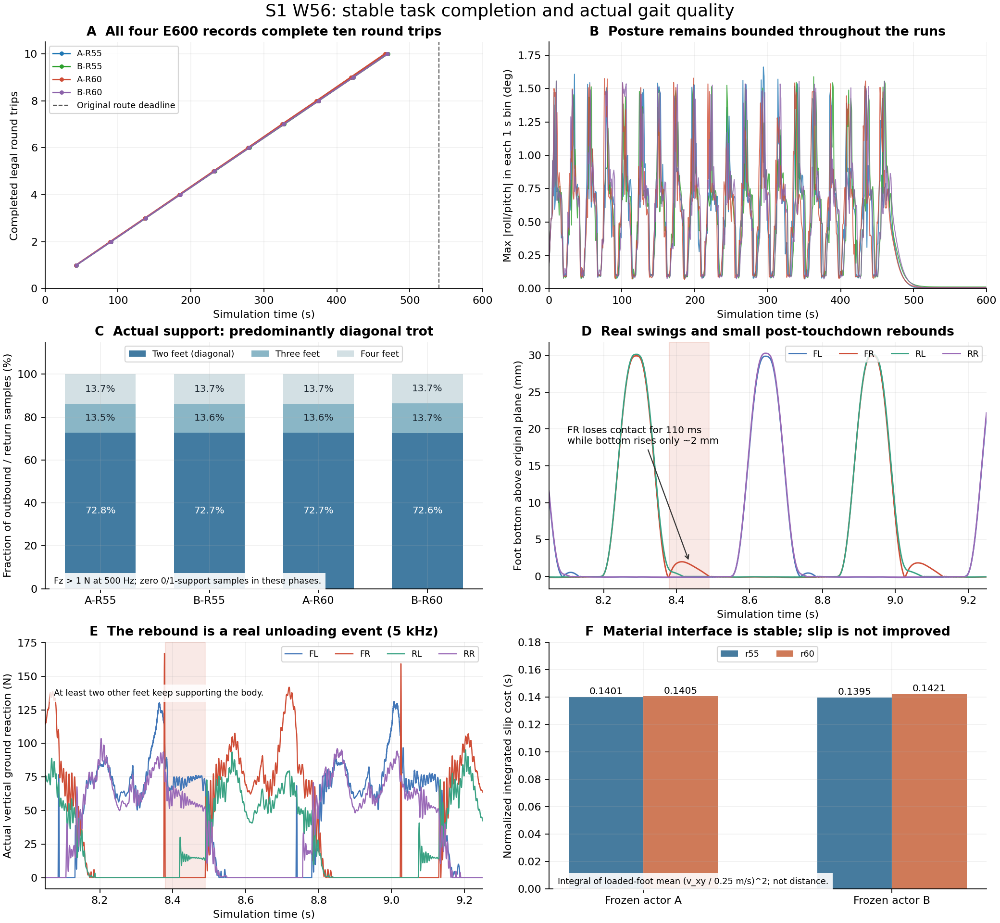

# W56完整审查：稳定基线已成立，转向模块与联合研究

> 2026-11-22补充：四份原E600和精选接触再次复核，baseline判断保持；新增query→next-load时距表已说明0.35s能覆盖已查询同圈跨足接触。真实架构、积分/查询合同与同轮训练延伸见[补充报告](../../../../../../docs/S1_W57_REVIEW_20261122.md)。下文为11/21原审查，原数据和结论身份保留。

审查基点：[`3590646bc15a59903c9561381368d985963dfe9e`](https://github.com/kaiwen123-yang/MCP-RL/commit/3590646bc15a59903c9561381368d985963dfe9e)。对照上一轮计划基点 `6da12efc2cb85dcc99e53243dca489c9966e4969`。执行端证据截止 **2026-11-21 23:35:02 +08:00**；本审查没有操作服务器或运行新机器人物理、QP/native、材料求解、PPO。所有新数值来自已发布数据的只读复算。

## 核心判断

**当前不再是“没有能稳定走完的控制器”。r55与r60各自A/B都通过原E600。真正尚未完成的是：材料状态如何改变未来决策、各模块的独立收益、联合方法的必要性，以及泛化/实时/实机。** 已经做过的运动学、接触与执行一致性修复有必要的工程价值，但还不能替代上述科学证据。

[W57执行计划](../../../../../../docs/S1_W57_RESEARCH_PLAN.md) · [启动提示词](../../../../../../docs/S1_W57_START_PROMPT.md) · [独立每日工作日志](../../../../../../docs/S1_DAILY_WORKLOG.md) · [机器交接](handoff.json)

## 1. 任务已经推进到什么程度

|身份|最新原资格|结论|
|---|---|---|
|r55 A/B|各自E30→E60→E300→E600|较简单的稳定参考；完整十次合法往返|
|r57 A/B|各自E30→E60|显式恢复末12维确实置零并施加；不是去掉全部近期历史|
|r58 A/B|各自E30→E60；E300技术中断|在线GPU材料路径不再推进，原位恢复未能续接；不能当摔倒或E300通过|
|r60 A/B|各自E30→E60→E300→E600|同本构/因果窗口/法向接口的CPU FP64新身份，重新取得完整资格|
|N/r59 A|原E30未通过|自然跑完30s但最远x=1.039835m，未穿过材料带|

W56为19个已结束attempt：**16通过、2中断、1任务未达标**；另2个r58 E600未运行。W55/r55的8个阶梯记录是继承参考，不重复算作W56新实验。旧不同控制版本的大量失败，不能用来估计当前冻结r60的失败概率。

|E600|十圈完成/s|完成后保持/s|保持五条件违例|最大单轴roll/pitch/°|
|---|---:|---:|---:|---:|
|r55 A|467.094|132.906|0|1.663|
|r55 B|470.302|129.698|0|1.589|
|r60 A|466.054|133.946|0|1.579|
|r60 B|469.820|130.180|0|1.558|

以上由四份全程500Hz轨迹共1,200,004行独立复算；20次单向贯穿、10次往返、材料真实加载、侧向退出、最终保持均与原判定一致。原540s路线期限与600s观察长度未改变。两个冻结nominal case与相关阶段前缀不能代替独立鲁棒性试验。

## 2. 步态可用，但接触质量还有具体问题

实际行走段两足承重72.61–72.77%，均为FL/RR或FR/RL对角组合；三足约13.5–13.7%，四足约13.7%。单腿高摆幅摆动约520–530次，足底峰值中位约3cm，实际周期约.536–.542s，即约1.85Hz。真实连续迈步已经成立，不是四足静站或拖着身体凑任务进度。

精选5kHz原物理共1,200,000条：r60 A/B各0–60和450–480s，r55 A/B各0–30s。前足尤其FR存在约1.6–2.4mm、约110–145ms的再离地；r55已存在，r55 B与r60 B在7.8112–7.9258s几乎相同。其余足仍至少两足支撑，抽样区间无非足接触或原力矩越界。尚未对齐控制计划，不能直接说是PANN、增益或某次交接错误。

这是下一步接触机制研究的明确入口：计划要求承载时是否实际失载、载荷建立/释放是否可预测、哪一处最先偏离。它不会推翻已经完成原任务的事实，但不能因任务通过就宣布步态已经优质。

图中的540s为原任务物理路线期限，不是后台墙钟deadline。落脚再离地的长区间来自5kHz同一力求值时钟；500Hz不能替代所有子步。

## 3. 为什么稳定了，研究效果仍然弱

### 3.1 尚未证明新材料接口整体更优

r60相对r55的E600归一化滑移代价A/B分别增加0.317%/1.816%，峰值应变增加3.266%/4.467%；完成只提前1.040/.482s。不能把这组结果写成一致性能提升。滑移代价是承重足球底水平速度除以.25m/s后平方的时间积分，单位秒，**不是滑移距离**。两条确定性轨迹的微小差异没有统计显著性资格。

### 3.2 材料可能有状态，但现有接口消掉大部分作用

当前法向参考为 `z_now + inverse(F_measured,h) − inverse(F_target,h)`。若逆响应局部近似 `b(h)+F/k(h)`，历史偏置b会相消。这种锚定避免重复加沉陷，是正确的执行处理，但不会自动提供强历史控制权。

已存5.420s单点中，history/virgin法向参考差约8.86e−11m、最终mapped input差约5.89e−11rad；同一候选绝对变形差约6.68e−7m。只能说明这个点的接口敏感度，不能外推全程。`rollout_candidate`尚未被在线F的`replan`用于实际候选选择，当前材料历史没有完整进入未来负载/接触规划。

### 3.3 路线记忆机会与材料时间尺度不匹配

W56 exposure源于**r55 A/B E60/E300**。原E300确有652/655个“先受载、被查询、再重载且面积重叠”的world cells，不能说没有重访。可是在跨圈约48s的查询点，恢复残余已极弱；同圈跨足残余更明显。匹配下次触地有面积重叠的同圈跨足query-cell行，|q11|中位约2.64e−4/2.50e−4，2ms自由恢复深度中位约9.11/8.65μm；跨圈对应量接近消失。此结论不是r60全程查询审计，也不是所有材料变量永久无记忆。

原MPC horizon .35s短于实际单脚约.54s周期，尚不能完整表示当前加载如何影响下一次同足重载。`prior_event_age_s≈1.36s`是查询时前一事件年龄，不是未来触地延迟。下一层时域要用真正load→reload事件对确定。

### 3.4 旧RL权限不足以检验最终想法

旧actor只输出2Hz scalar cap，范围.18–.25m/s；同状态显式末12维置零引起的cap变化约1–2e−5m/s。540维近期运动/受力历史仍保留。r57双E60通过说明该显式通道在当前冻结策略下依赖弱，不证明PANN全部无用，也不证明RL材料协同已经学会。

## 4. 如何从模块到联合创新

详细接口、证伪条件和比较设计见[模块路线](module-innovation-roadmap.md)。统一命名：**M=材料估计，P=MPC规划，R=学习**。

|模块|本轮具体可实施的增量|独立证据|不能冒称的结论|
|---|---|---|---|
|M|测力校正的持久world-cell状态、可辨识方向、因果事件标记|完整保留历史的未来力/恢复误差与置信校准|拟合当前力较好即控制更好；一个总力唯一识别每格q|
|P|候选内材料传播真正进入预测/选择，逐步扩展低频材料事件层|同状态history干预→候选/首动作→闭环接触与任务指标|候选只打印材料差异即跨步协同；350ms已覆盖全部跨步|
|R|独立新head提出±50ms交接时刻请求，原支撑门保持|真实请求/接受/执行、2048转移pilot、冻结策略评价|动作被mask也算有效探索；标准PPO调时序本身就是原创|
|联合|固定M与同一R1的B/P/R/PR首批机制比较|独立收益、直接组合、短残余/充分恢复对照|尚无完整消融就说三个模块都必要或三阶协同|

受控新学习在计划中明确允许；历史PPO=0不是永久禁令。W57首次pilot一个学习seed、一个共享head，不能把旧A/B两个case误称两次独立训练。更大预算、多seed、history-blind同权限学习对照、等预算联合适配和泛化属于后续明确证据层。

## 5. 并行与效率：确实可以扩大有用工作量

r60两份E600实际物理区间重叠14,697.577s（4.083h），单进程平均约1核；每条600s仿真需要约4.14/4.19h墙钟，当前不能宣称500Hz实时。两物理槽加第三条材料/数据/训练线可以同时推进不同问题，单条串行链不会因为绑4核就用满4核。

已有174个真实历史×600step材料批次，热CPU1.8718s、GPU1.0748s，约1.742倍吞吐；单历史GPU约慢37.6倍。线上保留CPU FP64，GPU做独立真实批次和训练更合理。计时样本有限且不含历史装配/import，不扩写成全系统加速。配额先4+4+14+3，数学线程1、构建总-j6；记录真实CPU/core-s和端到端GPU工作，不凑96GB显存。

后台继续无墙钟截止，任务物理时长和有限科学样本预算照常生效。GitHub直交后不做用户电脑二次归档。每日详细活动记录在独立[S1_DAILY_WORKLOG.md](../../../../../../docs/S1_DAILY_WORKLOG.md)，11/17–21有据回填，缺证据日期明确标注。

## 6. 本次读到了哪里

- 仓库源快照9837个tracked paths；相对前轮计划289个变更路径。机器解析与语义阅读分开记在[read-coverage.json](read-coverage.json)，不宣称每个字节都获得了人工理解。
- 逐身份原结果/配对/前序源值核对，四份全程500Hz轨迹，八个精选5kHz物理chunk，以及全部已发表exposure表。
- 20个精选原件共1,636,624,630B核size/SHA256/ZIP CRC；不是整个约41GB W56 Release全部重读。
- 21段视频共938,322,069B全部SHA核验与完整解码；对关键总览和密集摆足片段实际视觉审查。详见[视频审查](video.md)，不把全解码冒称逐帧人工观看。
- W55远端179个有效资产、W56远端197个有效资产均与回执一致；W56另有3个starter/digest为空的上传中断对象，不计作成功资产，未删除。
- 最新一手论文的实际已读范围、借鉴与不能照搬处在[literature-and-goals.md](literature-and-goals.md)。只读摘要的文献有明确标记。

## 文件导航

- [控制链与材料接口分析](control.md)、[模块创新路线](module-innovation-roadmap.md)
- [原结果、步态、资源详细报告](evidence.md)、[完整轨迹复算](evidence-arrays.json)、[再离地事件](evidence-force-dropouts.json)
- [逐身份与配对复算](evidence-summary.json)、[材料历史复算](history-signal-recomputed.json)
- [原件来源与SHA](evidence-original-ledger.json)、[视频来源/核验](video-download-manifest.json)
- [W55远端清单](w55-release-inventory.json)、[W56远端清单](w56-release-inventory.json)
- [一手文献与贡献缺口](literature-and-goals.md)、[视频范围](video.md)、[机器交接](handoff.json)

上述新报告是从发布证据派生，不回写原attempt或评估器。复算脚本只读保存数据；必要原件沿原Release可定位，正常复现不需要机器人重跑。
