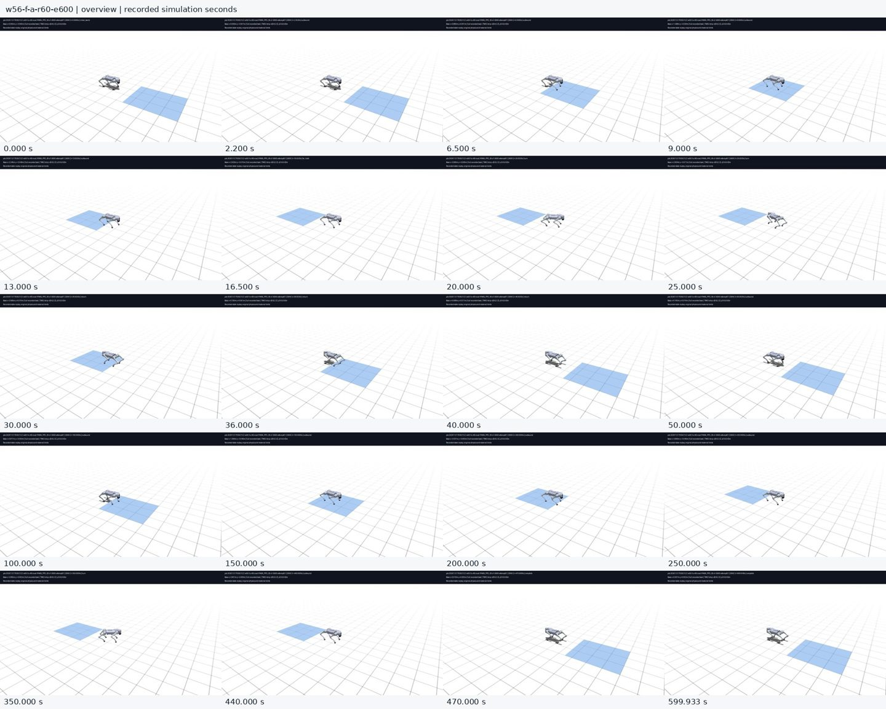
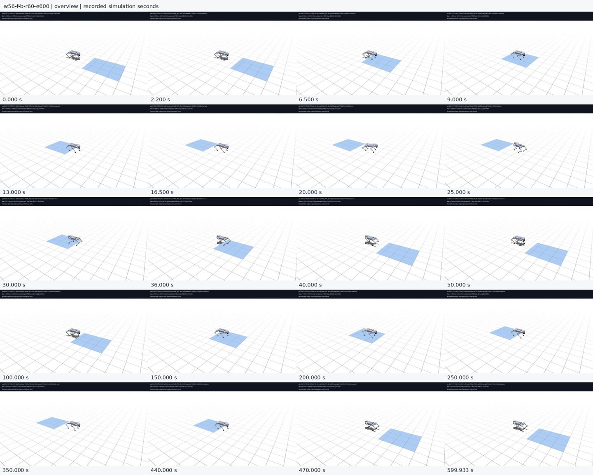
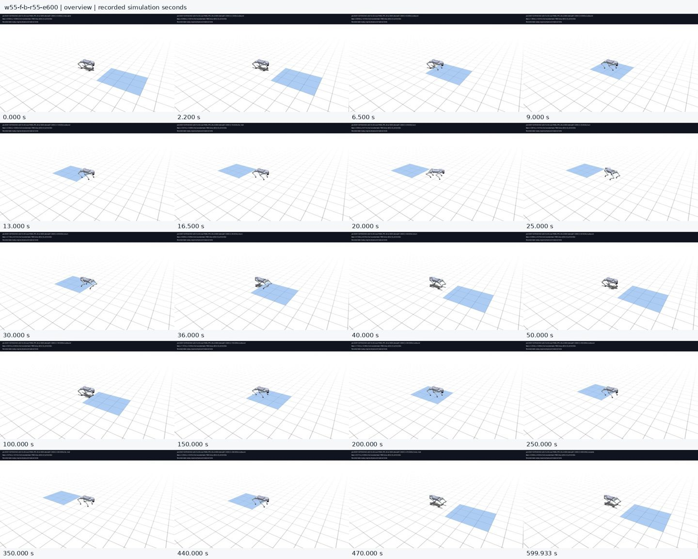
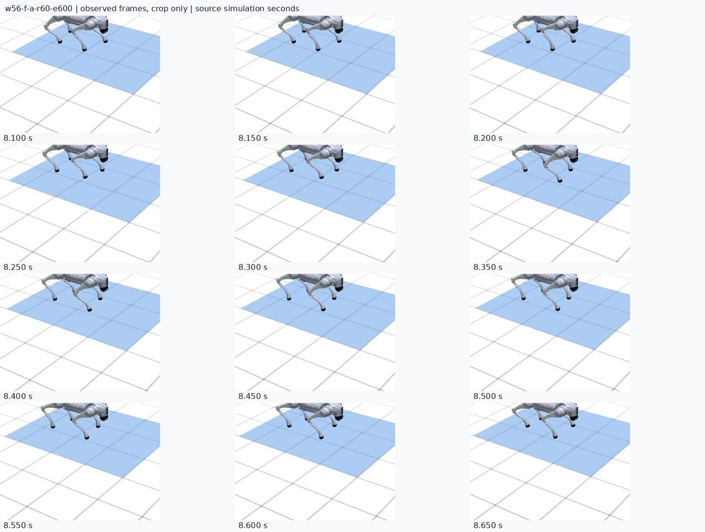
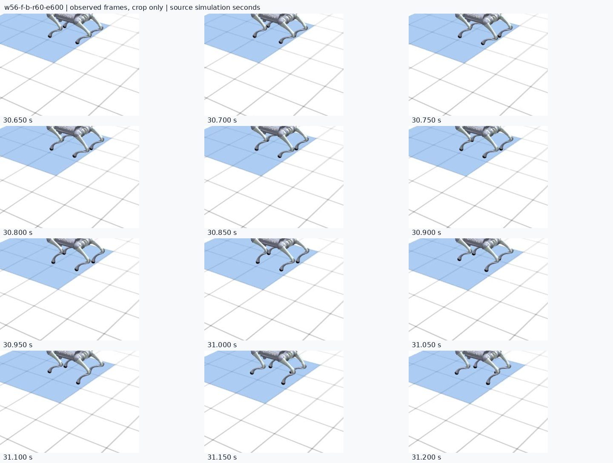
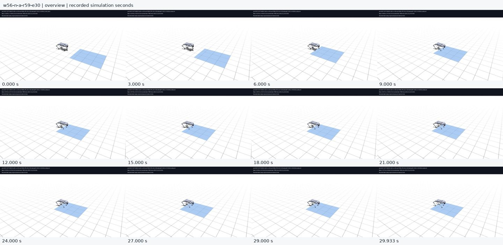

# W56视频与日志联合审查

审查源为3590646对应的W55/W56 Release回执。全部21段发布视频已读取、逐文件size/SHA256核对，并用ffmpeg完整解码，解码错误0；总938,322,069B。包括W56全部19段（其中两段是r58中断后的MPC输入姿态前缀）及W55 r55 A/B完整E600两段。

## 已观看的范围

生成37张总览/密集步态contact sheet。本次实际查看16张中的228个展示画面（同源帧可能重叠，不当独立样本），包括四份E600总览、四份E600密集足部裁切、r55 A早期密集摆动、N59 E30总览，以及r57/r58 A/B E60与r58双E300姿态前缀。逐图的来源SHA、抽样时刻、审查者和是否真正查看记录在[video/manifest.json](video/manifest.json)。生成但未查看的图如实标记，不冒充已审。

`video-download-manifest.json`说明全解码和校验；全解码不等于全程逐帧人工观看。稀疏总览不能排除帧间100ms左右失载，更不能判断0.2ms足力/力矩界。精细结论以[evidence.md](evidence.md)的500Hz全程及精选5kHz物理为准。

## 画面可见的结论

|视频组|采样画面中的观察|与数值记录结合后的含义|
|---|---|---|
|r55 A/B E600|连续通过蓝色材料区，远端转向后返程；晚段回原点后维持姿态，采样未见倒地|四份全轨迹的十圈与hold复算支持完整任务资格|
|r60 A/B E600|相同路线与反复通过，约470s后已回家保持至末帧；身体姿态平稳|确有长期可用基线；不能从观感判定比r55更好|
|四份E600密集足部裁切|可见左右对角交替、真实抬脚和再落脚，部分足在落地附近有轻微再次抬离|3cm摆动与约2mm再离地需用真实接触/足高分开，不从图像估计毫米数|
|r57 A/B E60|去程、转向、返程及约38–59.933s末段保持可见，末帧直立|显式12维消融仍完成任务，与原E60通过一致|
|r58 A/B E60|同样有完整往返和末段保持，未见持续塌陷|短期材料接口能走，后来的E300计算停滞不是视频显示的摔倒|
|r58 A/B E300 pose-prefix|A最后可见119.660s，B78.100s；末帧均机身离地、有腿支撑|只代表保存姿态前缀；不等于完整E300、完整5kHz plant或确切死锁根因|
|N59 E30|早期到材料入口附近，后段前进很少；末段仍维持机身，没有完整贯穿|对应30s自然结束、maxx1.039835m、任务未完成；不是完整任务成功|

前后向要按身体朝向与世界坐标共同判断；返回时world-x为负不能直接说成倒退。地面蓝色区域是渲染叠加，不是对真实微米级材料形变的视觉测量。

## 可直接查看的代表图

### r60 A完整任务总览

### r60 B完整任务总览

### 旧r55 B同任务参考

### r60 A早期足部密集画面

### r60 B返程足部密集画面

### N59未贯穿原E30

图像仅从原记录提取、裁切、重排和等比缩小便于阅读，没有补帧、修改姿态或生成机器人画面。密集裁切将机身部分裁出，适用于查看足部；全身姿态以总览和原视频为准。

## 复现与来源

原视频URL、Release资产名、大小、SHA及probe/decode信息见[video-source-manifest.json](video-source-manifest.json)、[video-download-manifest.json](video-download-manifest.json)。`download_review_videos.py`接受manifest/output/report；`extract_review_frames.py`从该下载清单按固定时刻抽图。此次仅保存六张代表图进Git，其他图可依manifest复现；不额外复制一套全视频进仓库，也不要求用户电脑下载归档。

两段r58姿态前缀由保存的约50Hz MPC输入姿态渲染为25fps视频。视频文件时长、最后渲染画面、最后成功MPC、heartbeat、完整plant chunk前缀是不同记录边界；分别保留，不用较长者覆盖较短者的证据缺口。
